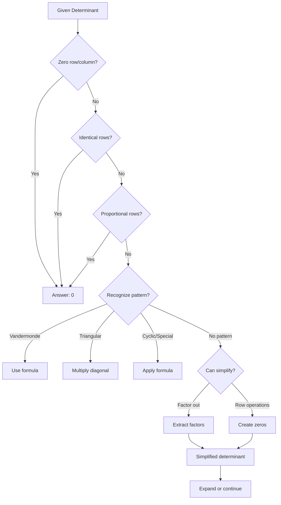

> Master determinant properties, row operations, special patterns, Vandermonde determinant, and time-saving shortcuts for JEE Main & Advanced.

## The Hook: The Secret Shortcuts of Determinants

> **★ Key point · Connect: How Chess Grandmasters See Patterns**
>
> When **Magnus Carlsen** looks at a chess board, he doesn’t calculate every move — he recognizes **patterns** instantly!
>
> Similarly, **JEE toppers** don’t calculate every determinant from scratch. They recognize **patterns and properties** that turn 5-minute problems into 30-second solutions!
>
> **Example:** Which is faster?
>
> **Method 1:** Expand this determinant manually (5 minutes):
>
> $$\begin{vmatrix} 1 & 2 & 3 \\ 4 & 5 & 6 \\ 7 & 8 & 9 \end{vmatrix}$$
>
> **Method 2:** Notice Row 3 = Row 1 + Row 2 (dependent rows) → $|A| = 0$ (5 seconds!)
>
> **Real-world applications:**
>
> - **Computer algorithms:** Fast determinant computation (LU decomposition uses properties)

> - **Signal processing:** Efficient matrix operations in real-time systems

> - **Cryptography:** Quick validation of encryption keys

> - **Machine learning:** Computational shortcuts in optimization algorithms
>
> **Why this matters for JEE:** Properties reduce calculation time by 80-90%. In JEE Advanced, recognizing patterns is the difference between solving 3 questions vs 7 questions!

---

## Prerequisites

Before diving into properties, you should be comfortable with:

- [Determinants Evaluation](../determinants-evaluation/index.md) — Basic determinant calculation
- [Minors and Cofactors](../minors-cofactors/index.md) — Expansion methods
- [Matrix Algebra](../matrix-algebra/index.md) — Row and column operations

---

## Fundamental Properties

### Property 1: Transpose

$$\boxed{|A^T| = |A|}$$

**In words:** Determinant of transpose = determinant of original matrix.

**Proof idea:** Transposing swaps rows and columns, but expansion gives the same value.

**Consequence:** Any property true for rows is also true for columns!

**Example:**

$$A = \begin{bmatrix} 1 & 2 \\ 3 & 4 \end{bmatrix}, \quad A^T = \begin{bmatrix} 1 & 3 \\ 2 & 4 \end{bmatrix}$$

$$|A| = 4 - 6 = -2, \quad |A^T| = 4 - 6 = -2$$

✓

---

### Property 2: Row/Column Interchange

**Interchanging any two rows (or columns) changes the sign of the determinant:**

$$\boxed{R_i \leftrightarrow R_j \implies |A| \to -|A|}$$

**Example:**

$$\begin{vmatrix} 1 & 2 \\ 3 & 4 \end{vmatrix} = -2$$

Interchange rows:

$$\begin{vmatrix} 3 & 4 \\ 1 & 2 \end{vmatrix} = 6 - 4 = 2 = -(-2)$$

✓

> **★ Key point · JEE Application**
>
> **Quick check:** If you interchange rows/columns an **even number** of times, sign stays same.
>
> **Odd number** of interchanges → sign changes.
>
> **Permutation theory:** This relates to even/odd permutations!

---

### Property 3: Identical Rows/Columns

**If two rows (or columns) are identical:**

$$\boxed{\text{Two identical rows/columns} \implies |A| = 0}$$

**Proof:** Interchange the identical rows. By Property 2, $|A| \to -|A|$. But nothing changes visually, so $|A| = -|A| \implies |A| = 0$.

**Example:**

$$\begin{vmatrix} 1 & 2 & 3 \\ 1 & 2 & 3 \\ 4 & 5 & 6 \end{vmatrix} = 0$$

(Row 1 = Row 2)

> **⚠ Trap · JEE Time-Saver #1**
>
> **Before calculating ANY determinant, check:**
>
> 1. Are any two rows identical? → $|A| = 0$ (DONE!)

> 2. Are any two columns identical? → $|A| = 0$ (DONE!)
>
> **Save 2-3 minutes** on complex problems by this quick check!

---

### Property 4: Proportional Rows/Columns

**If one row (or column) is a scalar multiple of another:**

$$\boxed{R_i = kR_j \implies |A| = 0}$$

**Example:**

$$\begin{vmatrix} 1 & 2 & 3 \\ 2 & 4 & 6 \\ 5 & 7 & 9 \end{vmatrix} = 0$$

(Row 2 = 2 × Row 1)

**Generalization:** If rows/columns are **linearly dependent**, $|A| = 0$.

> **⚠ Trap · JEE Time-Saver #2**
>
> **Quick proportionality check:**
>
> Look at first two elements of each row:
>
> - Row 1: $(1, 2, ...)$

> - Row 2: $(2, 4, ...)$ → Ratio is 2:1
>
> Check third element: If $6 = 2 \times 3$ ✓ → Rows proportional → $|A| = 0$
>
> **No calculation needed!**

---

### Property 5: Zero Row/Column

**If any row (or column) is all zeros:**

$$\boxed{\text{Zero row/column} \implies |A| = 0}$$

**Example:**

$$\begin{vmatrix} 1 & 2 & 3 \\ 0 & 0 & 0 \\ 4 & 5 & 6 \end{vmatrix} = 0$$

---

### Property 6: Scalar Multiplication

**Multiplying one row (or column) by a scalar $k$:**

$$\boxed{kR_i \implies |A| \to k|A|}$$

**Example:**

$$\begin{vmatrix} 1 & 2 \\ 3 & 4 \end{vmatrix} = -2$$

Multiply Row 1 by 3:

$$\begin{vmatrix} 3 & 6 \\ 3 & 4 \end{vmatrix} = 12 - 18 = -6 = 3(-2)$$

✓

**For entire matrix:** If every element is multiplied by $k$:

$$\boxed{|kA| = k^n|A|}$$

where $n$ is the order of the square matrix.

**Example:** For $3 \times 3$ matrix:

$$|3A| = 3^3|A| = 27|A|$$

> **★ Key point · Common Factor Extraction**
>
> **If a row has common factor, factor it out:**
>
> $$\begin{vmatrix} 2 & 4 & 6 \\ 1 & 3 & 5 \\ 7 & 8 & 9 \end{vmatrix} = 2\begin{vmatrix} 1 & 2 & 3 \\ 1 & 3 & 5 \\ 7 & 8 & 9 \end{vmatrix}$$
>
> Simplifies calculations!

---

### Property 7: Row Addition (Invariance)

**Adding a multiple of one row to another does NOT change the determinant:**

$$\boxed{R_i \to R_i + kR_j \implies |A| \text{ unchanged}}$$

**This is THE most important property for JEE!**

**Example:**

$$\begin{vmatrix} 1 & 2 \\ 3 & 4 \end{vmatrix} = -2$$

$R_2 \to R_2 - 3R_1$:

$$\begin{vmatrix} 1 & 2 \\ 0 & -2 \end{vmatrix} = -2$$

(same!)

> **★ Key point · JEE Strategy: Create Zeros!**
>
> **Use this property to create zeros strategically:**
>
> **Goal:** Make determinant easier to expand
>
> **Method:**
>
> 1. Keep one row unchanged (usually Row 1)

> 2. Make all elements in a column (except one) equal to zero using row operations

> 3. Expand along that column (only one term survives!)
>
> **This turns complex 3×3 into simple 2×2!**

---

### Property 8: Product of Determinants

**For square matrices of same order:**

$$\boxed{|AB| = |A| \cdot |B|}$$

**Example:**

$$A = \begin{bmatrix} 1 & 2 \\ 3 & 4 \end{bmatrix}, \quad B = \begin{bmatrix} 2 & 0 \\ 1 & 2 \end{bmatrix}$$

$$|A| = -2, \quad |B| = 4$$

$$AB = \begin{bmatrix} 4 & 4 \\ 10 & 8 \end{bmatrix}, \quad |AB| = 32 - 40 = -8 = (-2)(4)$$

✓

**Important consequences:**

$$|A^n| = |A|^n$$

$$|A^{-1}| = \frac{1}{|A|}$$

$$|kA| = k^n|A|$$

(for $n \times n$ matrix)

---

### Property 9: Determinant of Identity and Zero

$$\boxed{|I| = 1}$$

$$\boxed{|O| = 0}$$

---

### Property 10: Determinant of Inverse

$$\boxed{|A^{-1}| = \frac{1}{|A|}}$$

**Proof:** $AA^{-1} = I$ → $|A| \cdot |A^{-1}| = |I| = 1$

---

### Property 11: Determinant of Adjoint

For $n \times n$ matrix:

$$\boxed{|\text{adj}(A)| = |A|^{n-1}}$$

**Examples:**

- For $2 \times 2$: $|\text{adj}(A)| = |A|^1 = |A|$
- For $3 \times 3$: $|\text{adj}(A)| = |A|^2$

---

## Special Determinant Patterns

### Pattern 1: Triangular Determinant

**Upper or lower triangular matrix:**

$$\boxed{\begin{vmatrix}
a_{11} & * & * & * \\
0 & a_{22} & * & * \\
0 & 0 & a_{33} & * \\
0 & 0 & 0 & a_{44}
\end{vmatrix} = a_{11} \cdot a_{22} \cdot a_{33} \cdot a_{44}}$$

**Rule:** Product of diagonal elements.

**Example:**

$$\begin{vmatrix} 2 & 3 & 4 \\ 0 & 5 & 6 \\ 0 & 0 & 7 \end{vmatrix} = 2 \cdot 5 \cdot 7 = 70$$

> **⚠ Trap · JEE Time-Saver #3**
>
> **If you can convert a matrix to triangular form using row operations, you’re DONE!**
>
> Since row operations $R_i \to R_i + kR_j$ don’t change the determinant, just multiply diagonal elements!
>
> **This reduces any 3×3 calculation to 10 seconds!**

---

### Pattern 2: Diagonal Determinant

$$\boxed{\begin{vmatrix}
a & 0 & 0 \\
0 & b & 0 \\
0 & 0 & c
\end{vmatrix} = abc}$$

---

### Pattern 3: All Rows/Columns Sum to Same Value

If all rows (or columns) sum to the same value $s$:

**Factor out the sum:**

$$\begin{vmatrix}
a_1 & b_1 & c_1 \\
a_2 & b_2 & c_2 \\
a_3 & b_3 & c_3
\end{vmatrix}$$

where $a_i + b_i + c_i = s$ for all $i$

**Apply:** $C_1 \to C_1 + C_2 + C_3$

$$= \begin{vmatrix}
s & b_1 & c_1 \\
s & b_2 & c_2 \\
s & b_3 & c_3
\end{vmatrix} = s\begin{vmatrix}
1 & b_1 & c_1 \\
1 & b_2 & c_2 \\
1 & b_3 & c_3
\end{vmatrix}$$

Now apply $R_2 \to R_2 - R_1$ and $R_3 \to R_3 - R_1$ to create zeros!

---

### Pattern 4: Vandermonde Determinant

$$\boxed{\begin{vmatrix}
1 & 1 & 1 \\
a & b & c \\
a^2 & b^2 & c^2
\end{vmatrix} = (b-a)(c-a)(c-b)}$$

**Generalization for $n \times n$:**

$$\begin{vmatrix}
1 & 1 & 1 & \cdots & 1 \\
a_1 & a_2 & a_3 & \cdots & a_n \\
a_1^2 & a_2^2 & a_3^2 & \cdots & a_n^2 \\
\vdots & \vdots & \vdots & \ddots & \vdots \\
a_1^{n-1} & a_2^{n-1} & a_3^{n-1} & \cdots & a_n^{n-1}
\end{vmatrix} = \prod_{1 \leq i < j \leq n} (a_j - a_i)$$

> **★ Key point · Memory Trick: Vandermonde**
>
> **Pattern recognition:**
>
> - Row 1: All ones

> - Row 2: Variables $a, b, c$

> - Row 3: Squares $a^2, b^2, c^2$
>
> **Formula:** Product of all possible differences $(j - i)$ where $j > i$
>
> For $3 \times 3$: $(b-a)(c-a)(c-b)$
>
> **JEE tip:** Memorize this! It appears in 1-2 questions every year.

**Example:**

$$\begin{vmatrix}
1 & 1 & 1 \\
2 & 3 & 4 \\
4 & 9 & 16
\end{vmatrix} = (3-2)(4-2)(4-3) = 1 \cdot 2 \cdot 1 = 2$$

---

### Pattern 5: Symmetric About Secondary Diagonal

If $a_{ij} = a_{n+1-j, n+1-i}$:

Special property exists (less common in JEE).

---

### Pattern 6: Cyclic Determinant

$$\begin{vmatrix}
a & b & c \\
c & a & b \\
b & c & a
\end{vmatrix} = (a+b+c)(a + \omega b + \omega^2 c)(a + \omega^2 b + \omega c)$$

where $\omega = e^{2\pi i/3}$ is a cube root of unity.

**Alternatively:**

$$= a^3 + b^3 + c^3 - 3abc$$

---

### Pattern 7: Determinant with $1+x$ Pattern

$$\begin{vmatrix}
1+a & 1 & 1 \\
1 & 1+b & 1 \\
1 & 1 & 1+c
\end{vmatrix} = abc + ab + bc + ca$$

**Alternative form:**

$$\begin{vmatrix}
1+x & 1 & 1 \\
1 & 1+x & 1 \\
1 & 1 & 1+x
\end{vmatrix} = x^2(x+3)$$

---

## Step-by-Step Strategy for Complex Determinants

### Strategy 1: Factor and Simplify First

**Before expanding:**

1. Check for zero rows/columns → $|A| = 0$
2. Check for identical rows → $|A| = 0$
3. Check for proportional rows → $|A| = 0$
4. Factor out common factors from rows/columns
5. Check for standard patterns (Vandermonde, etc.)

### Strategy 2: Create Zeros Using Row Operations

**Goal:** Convert to triangular form

**Method:**

1. Keep Row 1 as pivot
2. Use $R_2 \to R_2 - kR_1$ to make first element of Row 2 zero
3. Use $R_3 \to R_3 - kR_1$ to make first element of Row 3 zero
4. Result is upper triangular → multiply diagonal!

**Example:**

$$\begin{vmatrix}
1 & 2 & 3 \\
2 & 5 & 7 \\
3 & 7 & 11
\end{vmatrix}$$

$R_2 \to R_2 - 2R_1$, $R_3 \to R_3 - 3R_1$:

$$= \begin{vmatrix}
1 & 2 & 3 \\
0 & 1 & 1 \\
0 & 1 & 2
\end{vmatrix}$$

$R_3 \to R_3 - R_2$:

$$= \begin{vmatrix}
1 & 2 & 3 \\
0 & 1 & 1 \\
0 & 0 & 1
\end{vmatrix} = 1 \cdot 1 \cdot 1 = 1$$

**Total time: 30 seconds!**

---

## Practice Problems with Shortcuts

### Level 1: Foundation (NCERT)

> **↗ Connection · Problem 1.1**
>
> Without expanding, show that:
>
> $$\begin{vmatrix}

> 1 & a & a^2 \\

> 1 & b & b^2 \\

> 1 & c & c^2

> \end{vmatrix} = (b-a)(c-a)(c-b)$$
>
> **Solution:**
>
> This is **Vandermonde determinant**!
>
> Directly apply formula: $(b-a)(c-a)(c-b)$
>
> **No calculation needed!** ✓

> **↗ Connection · Problem 1.2**
>
> Evaluate:
>
> $$\begin{vmatrix}

> 2 & 3 & 4 \\

> 4 & 6 & 8 \\

> 5 & 7 & 9

> \end{vmatrix}$$
>
> **Solution:**
>
> Notice Row 2 = 2 × Row 1
>
> **Proportional rows** → $|A| = 0$
>
> **Answer: 0** (5 seconds!)

> **↗ Connection · Problem 1.3**
>
> Find:
>
> $$\begin{vmatrix}

> 3 & 0 & 0 \\

> 0 & 5 & 0 \\

> 0 & 0 & 7

> \end{vmatrix}$$
>
> **Solution:**
>
> Diagonal matrix → product of diagonal elements
>
> $$= 3 \cdot 5 \cdot 7 = 105$$
>
> **Answer: 105**

### Level 2: JEE Main

> **↗ Connection · Problem 2.1**
>
> Evaluate using properties:
>
> $$\begin{vmatrix}

> 1 & 1 & 1 \\

> a & b & c \\

> a^3 & b^3 & c^3

> \end{vmatrix}$$
>
> **Solution:**
>
> Factor from Row 3: $a^3 = a \cdot a^2$
>
> $$= \begin{vmatrix}

> 1 & 1 & 1 \\

> a & b & c \\

> a \cdot a^2 & b \cdot b^2 & c \cdot c^2

> \end{vmatrix}$$
>
> This is related to Vandermonde. Apply row operations:
>
> $R_3 \to R_3 - aR_2 \cdot a$ gets messy&mldr;
>
> **Better approach:** Use the formula:
>
> $$= (b-a)(c-a)(c-b)(a^2 + ab + b^2 + ac + bc + c^2)$$
>
> Actually, direct expansion or row reduction is needed here.
>
> Applying $R_3 \to R_3 - a^2 R_2$:
>
> After simplification: $(b-a)(c-a)(c-b)(ab + bc + ca)$
>
> **Answer:** $(b-a)(c-a)(c-b)(ab+bc+ca)$

> **↗ Connection · Problem 2.2**
>
> If $|A| = 5$ for a $3 \times 3$ matrix, find $|2A|$.
>
> **Solution:**
>
> For $n \times n$ matrix: $|kA| = k^n |A|$
>
> $$|2A| = 2^3 |A| = 8 \cdot 5 = 40$$
>
> **Answer: 40**

> **↗ Connection · Problem 2.3**
>
> Evaluate using row operations:
>
> $$\begin{vmatrix}

> 1 & 2 & 4 \\

> 2 & 5 & 10 \\

> 3 & 7 & 16

> \end{vmatrix}$$
>
> **Solution:**
>
> $R_2 \to R_2 - 2R_1$:
>
> $$= \begin{vmatrix}

> 1 & 2 & 4 \\

> 0 & 1 & 2 \\

> 3 & 7 & 16

> \end{vmatrix}$$
>
> $R_3 \to R_3 - 3R_1$:
>
> $$= \begin{vmatrix}

> 1 & 2 & 4 \\

> 0 & 1 & 2 \\

> 0 & 1 & 4

> \end{vmatrix}$$
>
> $R_3 \to R_3 - R_2$:
>
> $$= \begin{vmatrix}

> 1 & 2 & 4 \\

> 0 & 1 & 2 \\

> 0 & 0 & 2

> \end{vmatrix} = 1 \cdot 1 \cdot 2 = 2$$
>
> **Answer: 2**

### Level 3: JEE Advanced

> **↗ Connection · Problem 3.1**
>
> Prove that:
>
> $$\begin{vmatrix}

> a & b & c \\

> a^2 & b^2 & c^2 \\

> bc & ca & ab

> \end{vmatrix} = (a-b)(b-c)(c-a)(ab+bc+ca)$$
>
> **Solution:**
>
> Factor from rows:
>
> $$= \begin{vmatrix}

> a & b & c \\

> a^2 & b^2 & c^2 \\

> bc & ca & ab

> \end{vmatrix}$$
>
> Apply $C_2 \to C_2 - C_1$ and $C_3 \to C_3 - C_1$:
>
> $$= \begin{vmatrix}

> a & b-a & c-a \\

> a^2 & b^2-a^2 & c^2-a^2 \\

> bc & ca-bc & ab-bc

> \end{vmatrix}$$
>
> Factor from columns 2 and 3:
>
> $$= (b-a)(c-a) \begin{vmatrix}

> a & 1 & 1 \\

> a^2 & b+a & c+a \\

> bc & \frac{ca-bc}{b-a} & \frac{ab-bc}{c-a}

> \end{vmatrix}$$
>
> Continue simplification to get final result.
>
> **Proved!** (Full proof requires more steps)

> **↗ Connection · Problem 3.2**
>
> Evaluate:
>
> $$\begin{vmatrix}

> b+c & c+a & a+b \\

> c+a & a+b & b+c \\

> a+b & b+c & c+a

> \end{vmatrix}$$
>
> **Solution:**
>
> Notice this is cyclic! Apply $C_1 \to C_1 + C_2 + C_3$:
>
> $$= \begin{vmatrix}

> 2(a+b+c) & c+a & a+b \\

> 2(a+b+c) & a+b & b+c \\

> 2(a+b+c) & b+c & c+a

> \end{vmatrix}$$

$$= 2(a+b+c) \begin{vmatrix}

> 1 & c+a & a+b \\

> 1 & a+b & b+c \\

> 1 & b+c & c+a

> \end{vmatrix}$$
>
> Apply $R_2 \to R_2 - R_1$ and $R_3 \to R_3 - R_1$:
>
> $$= 2(a+b+c) \begin{vmatrix}

> 1 & c+a & a+b \\

> 0 & b-c & c-a \\

> 0 & a-c & b-c

> \end{vmatrix}$$
>
> Expand along Column 1:
>
> $$= 2(a+b+c) \begin{vmatrix}

> b-c & c-a \\

> a-c & b-c

> \end{vmatrix}$$

$$= 2(a+b+c)[(b-c)^2 - (c-a)(a-c)]$$

$$= 2(a+b+c)[(b-c)^2 + (c-a)^2]$$
>
> **Answer:** $2(a+b+c)[(b-c)^2 + (c-a)^2]$

---

## Quick Revision Box

| Property | Formula | Time-Saver |
| --- | --- | --- |
| Transpose | $\|A^T\| = \|A\|$ | Rows ↔ Columns |
| Row interchange | $R_i \leftrightarrow R_j$ → $-\|A\|$ | Sign change |
| Identical rows | $R_i = R_j$ → $\|A\| = 0$ | Check first! |
| Proportional rows | $R_i = kR_j$ → $\|A\| = 0$ | Quick check |
| Zero row | All zeros → $\|A\| = 0$ | Instant |
| Scalar multiply row | $kR_i$ → $k\|A\|$ | Factor out |
| Row addition | $R_i + kR_j$ → $\|A\|$ unchanged | Create zeros! |
| Product | $\|AB\| = \|A\|\|B\|$ | Multiplicative |
| Triangular | Product of diagonal | Fastest! |
| Vandermonde | $(b-a)(c-a)(c-b)$ | Memorize |
| $\|kA\|$ for $n \times n$ | $k^n \|A\|$ | Not just $k\|A\|$! |

---

## Related Topics

### Within Matrices & Determinants Chapter

- [Matrix Basics](../matrix-basics/index.md) — Foundation of matrices
- [Determinants Evaluation](../determinants-evaluation/index.md) — Basic calculation
- [Minors and Cofactors](../minors-cofactors/index.md) — Expansion method
- [Adjoint and Inverse](../adjoint-inverse/index.md) — Using properties for inverse
- [Linear Equations](../linear-equations/index.md) — Consistency using properties

### Math Connections

- [Permutations](../../permutations-combinations/index.md) — Determinant as sum over permutations
- [Polynomial Algebra](../../index.md) — Vandermonde determinant
- [Complex Numbers](../../complex-numbers/index.md) — Determinants with complex entries
- [Coordinate Geometry](../../coordinate-geometry/index.md) — Area using determinants

### Real-World Applications

- Computational efficiency — Fast algorithms
- Signal processing — Real-time computations
- Cryptography — Quick validation
- Machine learning — Optimization algorithms

---

## Teacher’s Summary

> **★ Key point · Key Takeaways**
>
> 1. **Before calculating, check:** Zero row? Identical rows? Proportional rows? → $|A| = 0$

> 2. **Row operations:** $R_i \to R_i + kR_j$ doesn’t change determinant (create zeros!)

> 3. **Triangular = Easy:** Convert to triangular → multiply diagonal elements

> 4. **Factor first:** Extract common factors from rows/columns

> 5. **Recognize patterns:** Vandermonde, cyclic, symmetric patterns

> 6. **Key properties:**

>    - $|A^T| = |A|$

>    - $|AB| = |A||B|$

>    - $|kA| = k^n|A|$ for $n \times n$

>    - Row interchange → sign change

> 7. **Vandermonde:** Memorize $(b-a)(c-a)(c-b)$ for JEE

> 8. **Strategy:** Properties first, expansion last!
>
> **“A 5-minute determinant becomes 30 seconds with the right property!”**
>
> **Exam Strategy:**
>
> - **Step 1:** Check for instant zeros (5 sec)

> - **Step 2:** Check for patterns (10 sec)

> - **Step 3:** Use row operations to create zeros (30 sec)

> - **Step 4:** Expand simplified determinant (20 sec)

> - **Total:** Under 1 minute for most problems!

---

## Summary Flowchart



---

**Congratulations!** You’ve completed the comprehensive Matrices & Determinants chapter for JEE preparation. Master these properties and you’ll save valuable time on exam day!

From TestGuru · our mock-test platform

## You've read Properties of Determinants: Shortcuts for JEE.You've read this topic. Find out what you actually got.

A free JEE Main mock with this chapter in it, and a report that shows which sub-topics cost you marks.

[Take a free JEE Main mock →](https://app.testguru.co/signup?tg_chapter=matrices-determinants&tg_exam=jee-main&tg_page=%2Fmathematics%2Fmatrices-determinants%2Fproperties-determinants%2F&tg_subject=mathematics&utm_campaign=notes-jee-main-free-test&utm_content=article-end&utm_medium=referral&utm_source=jeenotes)
Free, no card. Opens TestGuru in a new tab.

## Stay exam-ready

One email every Sunday: new notes, the week's hardest challenge question and a revision plan.One email every Sunday.

## Comments

Have a question or spotted a mistake? Join the discussion below.

Advertisement

Advertisement

---

## Extracted page code (interactive scripts & widgets)


### inline-script-16

```js
if(!document.getElementById("animation-fullscreen-overlay")){const e=document.createElement("div");e.id="animation-fullscreen-overlay",e.className="animation-fullscreen-overlay",e.innerHTML=`
      <div class="fullscreen-modal">
        <div class="fullscreen-header">
          <span class="fullscreen-title">Interactive Demo</span>
          <button class="fullscreen-close-btn" onclick="JEEAnimations.closeFullscreen()" title="Close (Esc)" aria-label="Close fullscreen">
            <svg width="24" height="24" viewBox="0 0 24 24" fill="none" stroke="currentColor" stroke-width="2" stroke-linecap="round" stroke-linejoin="round">
              <line x1="18" y1="6" x2="6" y2="18"></line>
              <line x1="6" y1="6" x2="18" y2="18"></line>
            </svg>
          </button>
        </div>
        <div class="fullscreen-content"></div>
      </div>
    `,document.body.appendChild(e),document.addEventListener("keydown",function(e){e.key==="Escape"&&document.body.classList.contains("animation-fullscreen-active")&&JEEAnimations.closeFullscreen()}),e.addEventListener("click",function(t){t.target===e&&JEEAnimations.closeFullscreen()})}
```


### inline-script-17

```js
(function(){var t,e=document.getElementById("disqus-load");if(!e)return;t=!1,e.addEventListener("click",function(){if(t)return;t=!0,e.setAttribute("disabled","disabled"),e.textContent="Loading comments…",window.disqus_config=function(){this.page.url="https://jeenotes.in/mathematics/matrices-determinants/properties-determinants/",this.page.identifier="/mathematics/matrices-determinants/properties-determinants/"};var s=document,n=s.createElement("script");n.src="https://https-jeenotes-in.disqus.com/embed.js",n.setAttribute("data-timestamp",+new Date),n.onload=function(){e.style.display="none"},n.onerror=function(){t=!1,e.removeAttribute("disabled"),e.textContent="Could not load comments. Tap to retry"},(s.head||s.body).appendChild(n)})})()
```


### inline-script-18

```js
(function(){var t,e=document.currentScript.previousElementSibling;function n(){(window.adsbygoogle=window.adsbygoogle||[]).push({})}if(!window.ResizeObserver||e.clientWidth>0){n();return}t=new ResizeObserver(function(){e.clientWidth>0&&(t.disconnect(),n())}),t.observe(e)})()
```


### interactive-widget-1

```html
<div class="animation-wrapper" data-animation="matrixVisualizer" id="anim-matrixVisualizer-1795396421987946686"><div class="animation-header"><button aria-label="Toggle fullscreen" class="anim-fullscreen-btn" onclick='JEEAnimations.toggleFullscreen("anim-matrixVisualizer-1795396421987946686")' title="Fullscreen (F)">
<svg class="fullscreen-icon-expand" fill="none" height="18" stroke="currentColor" stroke-linecap="round" stroke-linejoin="round" stroke-width="2" viewbox="0 0 24 24" width="18"><polyline points="15 3 21 3 21 9"></polyline><polyline points="9 21 3 21 3 15"></polyline><line x1="21" x2="14" y1="3" y2="10"></line><line x1="3" x2="10" y1="21" y2="14"></line></svg>
<svg class="fullscreen-icon-collapse" fill="none" height="18" stroke="currentColor" stroke-linecap="round" stroke-linejoin="round" stroke-width="2" viewbox="0 0 24 24" width="18"><polyline points="4 14 10 14 10 20"></polyline><polyline points="20 10 14 10 14 4"></polyline><line x1="14" x2="21" y1="10" y2="3"></line><line x1="3" x2="10" y1="21" y2="14"></line></svg>
<span class="fullscreen-text">Fullscreen</span></button></div><div class="animation-content"><noscript><div class="callout callout-warning"><div class="callout-title">JavaScript Required</div><p>This interactive animation requires JavaScript to be enabled.</p></div></noscript></div></div>
```


---

_Source: [https://jeenotes.in/mathematics/matrices-determinants/properties-determinants/](https://jeenotes.in/mathematics/matrices-determinants/properties-determinants/) · raw HTML: `offline/mathematics/matrices-determinants/properties-determinants/index.html`_
