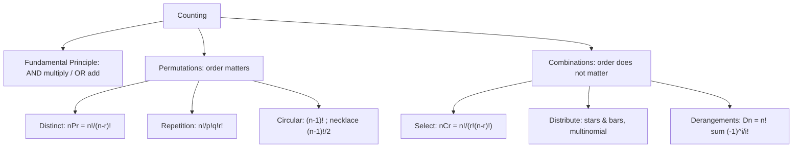

> All key Permutations and Combinations formulas for JEE Main & Advanced quick revision: counting principles, nPr, nCr, circular permutations, distribution, and derangements.

Every formula, key relation, and must-know result for Permutations and Combinations on one scannable page. Use it for last-minute JEE revision.

## Fundamental Principle of Counting

| Principle | Operation | When to use | Result |
| --- | --- | --- | --- |
| Multiplication (AND) | $\times$ | Sequential / simultaneous independent events | $m \times n \times p \times \ldots$ |
| Addition (OR) | $+$ | Mutually exclusive choices | $m + n + p + \ldots$ |

$$\boxed{\text{Total ways} = m \times n \times p \times \ldots \quad (\text{AND})}$$

$$\boxed{\text{Total ways} = m + n + p + \ldots \quad (\text{OR})}$$

> **★ Key point · AND vs OR**
>
> “AND then” / “followed by” means **multiply**. “OR” / “alternatively” (mutually exclusive) means **add**. Most JEE problems combine both, e.g. (3 + 4) × 2.

## Factorial

$$\boxed{n! = n \times (n-1) \times (n-2) \times \ldots \times 2 \times 1}$$

| Quantity | Value / Property | Notes |
| --- | --- | --- |
| $0!$ | $1$ | By definition; crucial for formulas |
| $1!$ | $1$ | — |
| Recursive | $n! = n \times (n-1)!$ | Also $(n+1)! = (n+1) \times n!$ |

Quick values: $2! = 2$, $3! = 6$, $4! = 24$, $5! = 120$, $6! = 720$, $7! = 5{,}040$, $10! = 3{,}628{,}800$.

> **★ Key point · Never expand fully**
>
> Simplify ratios by cancelling: $\dfrac{10!}{7!} = 10 \times 9 \times 8 = 720$. Do not compute the full factorials.

## Permutations (order matters)

### Core formulas

$$\boxed{^nP_r = \frac{n!}{(n-r)!} = n \times (n-1) \times \ldots \times (n-r+1)}$$

| Quantity | Formula | Notes |
| --- | --- | --- |
| Arrange all $n$ distinct objects | $n!$ | $^nP_n = n!$ |
| Arrange $r$ from $n$ distinct | $^nP_r = \dfrac{n!}{(n-r)!}$ | Order matters |
| $^nP_0$ | $1$ | Arrange nothing |
| $^nP_1$ | $n$ | — |
| $^nP_r$ when $r > n$ | $0$ | Cannot select more than available |
| With repetition allowed | $n^r$ | $r$ positions, $n$ choices each |

### Properties

$$\boxed{^nP_r = n \times {}^{n-1}P_{r-1}} \qquad \boxed{\frac{^nP_r}{^nP_{r-1}} = n - r + 1}$$

$$\boxed{^nP_r = {}^nC_r \times r!}$$

## Permutations with Repeated (Identical) Objects

For $n$ objects where $p$ are alike of one kind, $q$ alike of another, $r$ alike of another, &mldr;:

$$\boxed{\frac{n!}{p! \cdot q! \cdot r! \cdot \ldots}}$$

| Special case | Result |
| --- | --- |
| All objects distinct ($p=q=\ldots=1$) | $n!$ |
| All $n$ objects identical | $1$ |

> **★ Key point · Count every letter**
>
> Include letters that appear once (divide by $1!$). MISSISSIPPI: M(1), I(4), S(4), P(2) gives $\dfrac{11!}{1!\,4!\,4!\,2!} = 34{,}650$. More repetition means fewer distinct arrangements.

## Circular Permutations

| Type | Can flip? | Formula |
| --- | --- | --- |
| Circular (round table, fixed orientation) | No | $(n-1)!$ |
| Necklace / garland (reflection allowed) | Yes | $\dfrac{(n-1)!}{2}$ |

$$\boxed{\text{Circular} = (n-1)!} \qquad \boxed{\text{Necklace} = \frac{(n-1)!}{2}}$$

Derivation: $n$ linear arrangements ($n!$) collapse to one under rotation, so $\dfrac{n!}{n} = (n-1)!$.

> **★ Key point · Divide by 2 only for flippable objects**
>
> Necklaces, garlands and bracelets can be flipped, so divide by 2. Round tables, circular races and clocks have a fixed orientation, so do **not** divide by 2. For restrictions in a circle, bundle objects then apply $(n-1)!$ to the units (e.g. A, B together: $(n-2)! \times 2!$ for $n$ people total counted as units).

## Combinations (order does not matter)

### Core formula

$$\boxed{^nC_r = \binom{n}{r} = \frac{n!}{r!\,(n-r)!}} \qquad \boxed{^nC_r = \frac{^nP_r}{r!}}$$

### Properties

| Property | Statement |
| --- | --- |
| Symmetry | $^nC_r = {}^nC_{n-r}$ |
| Pascal’s rule | $^nC_r + {}^nC_{r-1} = {}^{n+1}C_r$ |
| Sum of all | $^nC_0 + {}^nC_1 + \ldots + {}^nC_n = 2^n$ |
| End values | $^nC_0 = {}^nC_n = 1$ |
| Linear values | $^nC_1 = {}^nC_{n-1} = n$ |
| Quick $^nC_2$ | $\dfrac{n(n-1)}{2}$ |
| Quick $^nC_3$ | $\dfrac{n(n-1)(n-2)}{6}$ |

$$\boxed{^nC_r = {}^nC_{n-r}} \qquad \boxed{{}^nC_r + {}^nC_{r-1} = {}^{n+1}C_r} \qquad \boxed{\sum_{r=0}^{n} {}^nC_r = 2^n}$$

**Maximum value of $^nC_r$:** at $r = n/2$ if $n$ even; at $r = \frac{n-1}{2}$ and $\frac{n+1}{2}$ (equal) if $n$ odd.

> **★ Key point · Select vs arrange**
>
> “Committee / team / group / choose” means combination. “Arrange / order / rank / podium” means permutation. If $r > n/2$, compute $^nC_{n-r}$ instead — e.g. $^{50}C_{48} = {}^{50}C_2 = 1{,}225$.

## Distribution and Division

### Distribution of identical objects to distinct recipients (stars and bars)

| Constraint | Formula |
| --- | --- |
| Each gets $\ge 0$ (no restriction) | $^{n+r-1}C_{r-1} = {}^{n+r-1}C_n$ |
| Each gets $\ge 1$ | $^{n-1}C_{r-1}$ |

$$\boxed{^{n+r-1}C_{r-1}} \qquad \boxed{^{n-1}C_{r-1}}$$

Equivalent to non-negative (or positive) integer solutions of $x_1 + x_2 + \ldots + x_r = n$.

### Distribution of distinct objects to distinct recipients

| Constraint | Formula |
| --- | --- |
| No restriction | $r^n$ |
| Each gets $\ge 1$ (inclusion–exclusion) | $r^n - {}^rC_1 (r-1)^n + {}^rC_2 (r-2)^n - \ldots$ |

$$\boxed{r^n} \qquad \boxed{r^n - {}^rC_1(r-1)^n + {}^rC_2(r-2)^n - \ldots}$$

The “each $\ge 1$” count also equals $r! \cdot S(n,r)$, where $S(n,r)$ is the Stirling number of the second kind.

### Division into groups

| Situation | Formula |
| --- | --- |
| Into distinct groups of sizes $n_1, n_2, \ldots, n_k$ (multinomial) | $\dfrac{n!}{n_1!\,n_2!\,\ldots\,n_k!}$ |
| Into $k$ identical groups of equal size $m$ ($n = km$) | $\dfrac{n!}{(m!)^k \cdot k!}$ |

$$\boxed{\frac{n!}{n_1!\,n_2!\,\ldots\,n_k!}} \qquad \boxed{\frac{n!}{(m!)^k \cdot k!}}$$

> **★ Key point · Identical objects vs identical groups**
>
> Identical objects to distinct recipients uses stars and bars. Dividing distinct objects into **identical** groups of the **same size** divides the multinomial by $k!$ — but only for groups that share a size; groups of different sizes are already distinguishable.

### Selection of non-consecutive items

| Arrangement | Select $r$ non-consecutive from $n$ |
| --- | --- |
| In a line | $^{n-r+1}C_r$ |
| In a circle ($n \ge 2r$) | $\dfrac{n}{n-r}\,{}^{n-r}C_r$ |

$$\boxed{\text{Line: } {}^{n-r+1}C_r} \qquad \boxed{\text{Circle: } \frac{n}{n-r}\,{}^{n-r}C_r}$$

## Geometry of Points and Polygons

| Quantity | Formula |
| --- | --- |
| Handshakes among $n$ people | $^nC_2 = \dfrac{n(n-1)}{2}$ |
| Lines from $n$ points (no 3 collinear) | $^nC_2$ |
| Triangles from $n$ points (no 3 collinear) | $^nC_3$ |
| Diagonals of an $n$-gon | $^nC_2 - n = \dfrac{n(n-3)}{2}$ |

$$\boxed{\text{Diagonals} = \frac{n(n-3)}{2}}$$

> **⚠ Trap · Collinear points**
>
> When some points are collinear, subtract the lines or triangles those collinear points would otherwise form.

## Sum of Numbers Formed

Sum of all $n$-digit numbers formed using digits $d_1, d_2, \ldots, d_n$ (without repetition):

$$\boxed{(n-1)! \times (d_1 + d_2 + \ldots + d_n) \times \underbrace{111\ldots1}_{n \text{ ones}}}$$

## Derangements (no element in its original position)

$$\boxed{D_n = n!\left(1 - \frac{1}{1!} + \frac{1}{2!} - \frac{1}{3!} + \ldots + \frac{(-1)^n}{n!}\right) = n!\sum_{i=0}^{n}\frac{(-1)^i}{i!}}$$

| Relation | Formula |
| --- | --- |
| Recursive | $D_n = (n-1)(D_{n-1} + D_{n-2})$ |
| Single-step recurrence | $D_n = nD_{n-1} + (-1)^n$ |
| Approximation ($n \ge 7$) | $D_n \approx \dfrac{n!}{e}$ |
| Derangement probability | $\dfrac{D_n}{n!} \approx \dfrac{1}{e} \approx 0.368$ |
| Exactly $k$ in correct position | $^nC_k \cdot D_{n-k}$ |
| Identity | $\sum_{k=0}^{n} {}^nC_k \cdot D_k = n!$ |

$$\boxed{D_n = (n-1)(D_{n-1} + D_{n-2})} \qquad \boxed{D_n = nD_{n-1} + (-1)^n}$$

**First values:** $D_0 = 1$, $D_1 = 0$, $D_2 = 1$, $D_3 = 2$, $D_4 = 9$, $D_5 = 44$, $D_6 = 265$, $D_7 = 1{,}854$.

> **★ Key point · The 1/e result**
>
> About 37% of random permutations have no fixed point, and this stays near $1/e$ for all $n \ge 7$. For small $n$ use the recursion $D_n = (n-1)(D_{n-1}+D_{n-2})$.

## Master Comparison: nPr vs nCr

| Aspect | Permutation $^nP_r$ | Combination $^nC_r$ |
| --- | --- | --- |
| Order | Matters | Does not matter |
| Formula | $\dfrac{n!}{(n-r)!}$ | $\dfrac{n!}{r!\,(n-r)!}$ |
| ABC vs BAC | Different | Same |
| Keywords | Arrange, rank, podium | Select, choose, committee |
| Relation | $^nP_r = {}^nC_r \times r!$ | $^nC_r = \dfrac{^nP_r}{r!}$ |

## Quick Revision Map



## Key Takeaways

- AND means multiply, OR means add; check for restrictions before counting.
- Order matters means $^nP_r$; order does not matter means $^nC_r$, related by $^nP_r = {}^nC_r \times r!$.
- Identical objects reduce arrangements: divide $n!$ by the factorials of repetitions.
- Circular: fix one object so $(n-1)!$; divide by 2 only for flippable necklaces and garlands.
- Stars and bars for identical objects to distinct boxes; multinomial for division into groups; divide by $k!$ for identical equal-sized groups.
- Derangement probability $\approx 1/e \approx 0.368$; memorize $D_2=1, D_3=2, D_4=9, D_5=44$.

From TestGuru · our mock-test platform

## You've read Permutations and Combinations Formula Sheet.You've read this topic. Find out what you actually got.

A free JEE Main mock with this chapter in it, and a report that shows which sub-topics cost you marks.

[Take a free JEE Main mock →](https://app.testguru.co/signup?tg_chapter=permutations-combinations&tg_exam=jee-main&tg_page=%2Fmathematics%2Fpermutations-combinations%2Fformula-sheet%2F&tg_subject=mathematics&utm_campaign=notes-jee-main-free-test&utm_content=article-end&utm_medium=referral&utm_source=jeenotes)
Free, no card. Opens TestGuru in a new tab.

## Stay exam-ready

One email every Sunday: new notes, the week's hardest challenge question and a revision plan.One email every Sunday.

## Comments

Have a question or spotted a mistake? Join the discussion below.

Advertisement

Advertisement

---

## Extracted page code (interactive scripts & widgets)


### inline-script-14

```js
(function(){var t,e=document.getElementById("disqus-load");if(!e)return;t=!1,e.addEventListener("click",function(){if(t)return;t=!0,e.setAttribute("disabled","disabled"),e.textContent="Loading comments…",window.disqus_config=function(){this.page.url="https://jeenotes.in/mathematics/permutations-combinations/formula-sheet/",this.page.identifier="/mathematics/permutations-combinations/formula-sheet/"};var s=document,n=s.createElement("script");n.src="https://https-jeenotes-in.disqus.com/embed.js",n.setAttribute("data-timestamp",+new Date),n.onload=function(){e.style.display="none"},n.onerror=function(){t=!1,e.removeAttribute("disabled"),e.textContent="Could not load comments. Tap to retry"},(s.head||s.body).appendChild(n)})})()
```


### inline-script-15

```js
(function(){var t,e=document.currentScript.previousElementSibling;function n(){(window.adsbygoogle=window.adsbygoogle||[]).push({})}if(!window.ResizeObserver||e.clientWidth>0){n();return}t=new ResizeObserver(function(){e.clientWidth>0&&(t.disconnect(),n())}),t.observe(e)})()
```


---

_Source: [https://jeenotes.in/mathematics/permutations-combinations/formula-sheet/](https://jeenotes.in/mathematics/permutations-combinations/formula-sheet/) · raw HTML: `offline/mathematics/permutations-combinations/formula-sheet/index.html`_
