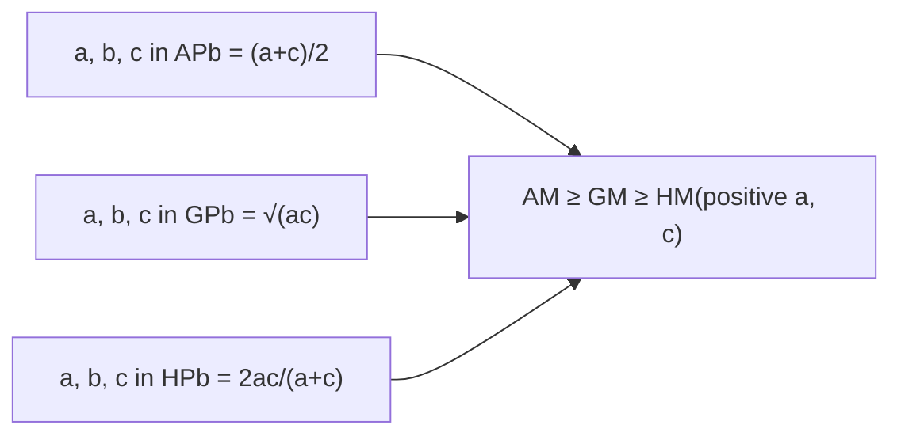

> All key Sequences and Series formulas for JEE Main & Advanced: AP, GP, HP, AGP, AM-GM-HM, special summations, and telescoping series quick revision.

Every must-know formula for Sequences and Series in one scannable sheet, grouped by progression type. Use it for last-minute revision before JEE Main and Advanced.

## Arithmetic Progression (AP)

General form: $a,\ a+d,\ a+2d,\ a+3d,\ \ldots$ where $a$ is the first term and $d$ is the common difference.

$$\boxed{T_n = a + (n-1)d}$$

$$\boxed{S_n = \frac{n}{2}\big[2a + (n-1)d\big] = \frac{n}{2}(a + l)}$$

where $l = T_n$ is the last term.

| Quantity | Formula | Notes |
| --- | --- | --- |
| $n$th term | $T_n = a + (n-1)d$ | Not $a + nd$ — first term is $a$ |
| Sum of $n$ terms | $S_n = \frac{n}{2}[2a + (n-1)d]$ | Note the $2a$, not $a$ |
| Sum (last term known) | $S_n = \frac{n}{2}(a + l)$ | Count $\times$ average of ends |
| AP test | $T_{n+1} - T_n = $ constant | Or $2b = a + c$ for $a,b,c$ |
| $n$th term from sum | $T_n = S_n - S_{n-1}$ | Valid for $n \geq 2$ |

### Key Properties

- Three terms in AP:
  $$\boxed{2b = a + c}$$
- Sum of equidistant terms: $T_k + T_{n-k+1} = a + l$ (constant)
- Arithmetic Mean of $a$ and $b$: $A = \dfrac{a+b}{2}$
- Inserting $n$ AMs between $a$ and $b$: common difference $d = \dfrac{b-a}{n+1}$
- $S_n,\ S_{2n} - S_n,\ S_{3n} - S_{2n},\ \ldots$ are themselves in AP

### Smart Selection of Terms

| Terms | Choose as | Sum |
| --- | --- | --- |
| 3 terms | $a-d,\ a,\ a+d$ | $3a$ |
| 4 terms | $a-3d,\ a-d,\ a+d,\ a+3d$ | $4a$ |
| 5 terms | $a-2d,\ a-d,\ a,\ a+d,\ a+2d$ | $5a$ |

> **★ Key point · High-Yield Shortcut**
>
> If $S_n$ is **quadratic in $n$**, the sequence is an AP. Recover the AP using $T_n = S_n - S_{n-1}$.

## Geometric Progression (GP)

General form: $a,\ ar,\ ar^2,\ ar^3,\ \ldots$ with first term $a \neq 0$ and common ratio $r \neq 0$.

$$\boxed{T_n = ar^{n-1}}$$

$$\boxed{S_n = a\frac{r^n - 1}{r - 1} = a\frac{1 - r^n}{1 - r}\quad (r \neq 1)}$$

| Quantity | Formula | Notes |
| --- | --- | --- |
| $n$th term | $T_n = ar^{n-1}$ | Not $ar^n$ |
| Sum ($r > 1$) | $S_n = a\frac{r^n - 1}{r - 1}$ | Positive denominator |
| Sum ($r < 1$) | $S_n = a\frac{1 - r^n}{1 - r}$ | Positive denominator |
| Sum ($r = 1$) | $S_n = na$ | Formula above is undefined |
| Common ratio | $r = \frac{T_{n+1}}{T_n}$ | Constant for a GP |

### Key Properties

- Three terms in GP:
  $$\boxed{b^2 = ac}$$
- Product of equidistant terms: $T_k \cdot T_{n-k+1} = a \cdot l$ (constant)
- Geometric Mean of $a$ and $b$: $G = \sqrt{ab}$
- Inserting $n$ GMs between $a$ and $b$: ratio $r = \left(\dfrac{b}{a}\right)^{\frac{1}{n+1}}$
- Reciprocals of GP terms form a GP with ratio $\frac{1}{r}$
- $\frac{T_8}{T_5} = r^3$ — divide terms to get $r$ raised to the index gap

### Smart Selection of Terms

| Terms | Choose as | Product |
| --- | --- | --- |
| 3 terms | $\frac{a}{r},\ a,\ ar$ | $a^3$ |
| 4 terms | $\frac{a}{r^3},\ \frac{a}{r},\ ar,\ ar^3$ | $a^4$ |
| 5 terms | $\frac{a}{r^2},\ \frac{a}{r},\ a,\ ar,\ ar^2$ | $a^5$ |

> **★ Key point · Watch the Sign**
>
> For negative ratios, track even/odd powers: $(-2)^4 = +16$ but $(-2)^5 = -32$. Both sum forms are valid — pick the one with cleaner arithmetic.

## Infinite GP

Converges **if and only if**

$|r| < 1$.

$$\boxed{S_\infty = \frac{a}{1-r}\quad (|r| < 1)}$$

| Quantity | Formula | Notes |
| --- | --- | --- |
| Infinite sum | $S_\infty = \frac{a}{1-r}$ | Only when $\lvert r\rvert < 1$ |
| Convergence | $\lvert r\rvert < 1$ | Use absolute value; $1-r$ in denominator, not $1-\lvert r\rvert$ |
| Pure recurring | $0.\overline{a_1\ldots a_k} = \frac{a_1\ldots a_k}{\underbrace{99\ldots9}_{k}}$ | $k$ digits $\to k$ nines |
| Mixed recurring | $0.a_1\ldots a_m\overline{b_1\ldots b_k} = \frac{a_1\ldots a_m b_1\ldots b_k - a_1\ldots a_m}{\underbrace{9\ldots9}_{k}\underbrace{0\ldots0}_{m}}$ | $k$ nines then $m$ zeros |

Standard infinite-series results (for $|x| < 1$):

$$1 - x + x^2 - x^3 + \cdots = \frac{1}{1+x}\qquad (\text{ratio } -x)$$

$$0.\overline{9} = 1 \quad\text{(exactly)}$$

> **★ Key point · Convergence First**
>
> Always verify $|r| < 1$ before applying $S_\infty = \frac{a}{1-r}$. For $r=2$, “$\frac{1}{1-2}=-1$” is meaningless — the series diverges.

## Harmonic Progression (HP)

A sequence whose **reciprocals form an AP**. If the reciprocal AP has first term $a$ and common difference $d$:

$$\boxed{H_n = \frac{1}{a + (n-1)d}}$$

| Quantity | Formula | Notes |
| --- | --- | --- |
| $n$th term | $H_n = \frac{1}{a+(n-1)d}$ | Work with reciprocal AP |
| Reciprocal relation | $\frac{1}{H_n} = \frac{1}{H_1} + (n-1)d$ | $d = \frac{1}{H_2} - \frac{1}{H_1}$ |
| Three terms in HP | $\frac{2}{b} = \frac{1}{a} + \frac{1}{c}$ | Equivalent to $b = \frac{2ac}{a+c}$ |
| Harmonic Mean (2 nos.) | $H = \frac{2ab}{a+b}$ | Not $\frac{a+b}{2ab}$ |
| Harmonic Mean ($n$ nos.) | $H = \frac{n}{\frac{1}{a_1} + \cdots + \frac{1}{a_n}}$ | Reciprocal of mean of reciprocals |

- Three terms in HP:
  $$\boxed{b = \frac{2ac}{a+c}}$$
- Selection of 3 terms: $\frac{1}{a-d},\ \frac{1}{a},\ \frac{1}{a+d}$ (reciprocals of an AP)

> **★ Key point · No Sum Formula**
>
> HP has **no simple sum formula**. Convert to the reciprocal AP, find terms, then add as fractions. All terms should keep the same sign.

## AM, GM, HM and the Mean Inequality

For positive numbers $a$ and $b$:

| Mean | Two numbers | $n$ numbers |
| --- | --- | --- |
| Arithmetic (AM) | $\frac{a+b}{2}$ | $\frac{a_1 + \cdots + a_n}{n}$ |
| Geometric (GM) | $\sqrt{ab}$ | $\sqrt[n]{a_1 a_2 \cdots a_n}$ |
| Harmonic (HM) | $\frac{2ab}{a+b}$ | $\frac{n}{\frac{1}{a_1} + \cdots + \frac{1}{a_n}}$ |

$$\boxed{\text{AM} \geq \text{GM} \geq \text{HM}}$$

$$\boxed{\frac{a+b}{2} \geq \sqrt{ab} \geq \frac{2ab}{a+b}}$$

Equality holds **if and only if** all numbers are equal ($a = b$).

### Key Relations

$$\boxed{\text{GM}^2 = \text{AM} \times \text{HM}}$$

- Standard optimization result:
  $$\boxed{x + \frac{k}{x} \geq 2\sqrt{k}\quad (x > 0)}$$(so $x + \frac{1}{x} \geq 2$)
- Weighted AM-GM: $\dfrac{ma + nb}{m+n} \geq \sqrt[m+n]{a^m b^n}$, equality when $a = b$

### Advanced Results (JEE Advanced)

- **Power Mean Inequality** (for $r > s$):
  $$\left(\frac{a_1^r + \cdots + a_n^r}{n}\right)^{1/r} \geq \left(\frac{a_1^s + \cdots + a_n^s}{n}\right)^{1/s}$$
  ($r=1, s=0$ gives AM $\geq$ GM; $r=0, s=-1$ gives GM $\geq$ HM)
- **Cauchy-Schwarz Inequality**:
  $$(a_1^2 + \cdots + a_n^2)(b_1^2 + \cdots + b_n^2) \geq (a_1 b_1 + \cdots + a_n b_n)^2$$

> **⚠ Trap · Positivity Required**
>
> AM-GM-HM applies **only to positive numbers**. For negatives the inequality can reverse: with $a=-2,\ b=-3$, GM $\approx 2.45 >$ AM $=-2.5$.

## Relationship Between AP, GP, HP

For a number $b$ between $a$ and $c$:



## Arithmetico-Geometric Progression (AGP)

Each term is the product of an AP term and a GP term: $a,\ (a+d)r,\ (a+2d)r^2,\ \ldots$

$$\boxed{T_n = \big[a + (n-1)d\big]\, r^{n-1}}$$

$$\boxed{S_n = \frac{a}{1-r} + \frac{dr\,(1 - r^{n-1})}{(1-r)^2} - \frac{[a+(n-1)d]\,r^n}{1-r}\quad (r \neq 1)}$$

When $r = 1$, the AGP reduces to an AP: $S_n = na + \frac{n(n-1)d}{2}$.

### Infinite AGP ($|r| < 1$)

$$\boxed{S_\infty = \frac{a}{1-r} + \frac{dr}{(1-r)^2} = \frac{a + r(d-a)}{(1-r)^2}}$$

### Must-Know Standard Sums ($|x| < 1$)

| Series | Sum |
| --- | --- |
| $1 + 2x + 3x^2 + 4x^3 + \cdots$ | $\frac{1}{(1-x)^2}$ |
| $x + 2x^2 + 3x^3 + 4x^4 + \cdots$ | $\frac{x}{(1-x)^2}$ |
| $1 + 4x + 9x^2 + 16x^3 + \cdots$ | $\frac{1+x}{(1-x)^3}$ |
| $a + (a+d)r + (a+2d)r^2 + \cdots$ | $\frac{a + r(d-a)}{(1-r)^2}$ |

> **★ Key point · Method: Multiply and Subtract**
>
> To sum an AGP, compute $S - rS$. The middle becomes a plain GP. This is often faster than plugging into the full formula.

## Special Series and Standard Summations

$$\boxed{\sum_{k=1}^{n} k = \frac{n(n+1)}{2}}$$

$$\boxed{\sum_{k=1}^{n} k^2 = \frac{n(n+1)(2n+1)}{6}}$$

$$\boxed{\sum_{k=1}^{n} k^3 = \left[\frac{n(n+1)}{2}\right]^2}$$

| Series | Sum | Notes |
| --- | --- | --- |
| $\sum k$ | $\frac{n(n+1)}{2}$ | Natural numbers |
| $\sum k^2$ | $\frac{n(n+1)(2n+1)}{6}$ | Three factors, $\div 6$ |
| $\sum k^3$ | $\left[\frac{n(n+1)}{2}\right]^2$ | Square of $\sum k$; $\div 4$ |
| $\sum 2k$ | $n(n+1)$ | First $n$ even numbers |
| $\sum (2k-1)$ | $n^2$ | First $n$ odd numbers |
| $\sum k(k+1)$ | $\frac{n(n+1)(n+2)}{3}$ | Product of 2 consecutive |
| $\sum k(k+1)(k+2)$ | $\frac{n(n+1)(n+2)(n+3)}{4}$ | Product of 3 consecutive |
| $\sum k^4$ | $\frac{n(n+1)(2n+1)(3n^2+3n-1)}{30}$ | Rare in JEE |

### Useful Combinations and Patterns

- Linear combination: $\sum (ak + b) = a\dfrac{n(n+1)}{2} + bn$
- General product rule:
  $$\boxed{\sum_{k=1}^{n} k(k+1)\cdots(k+r-1) = \frac{n(n+1)\cdots(n+r)}{r+1}}$$
- Range adjustment: $\displaystyle\sum_{k=a}^{b} f(k) = \sum_{k=1}^{b} f(k) - \sum_{k=1}^{a-1} f(k)$
- Alternating sum: $1 - 2 + 3 - 4 + \cdots + (-1)^{n-1}n = \begin{cases} \frac{n+1}{2} & n \text{ odd} \\ -\frac{n}{2} & n \text{ even} \end{cases}$

> **★ Key point · Memory Hooks**
>
> Sum of first $n$ **odd** numbers $= n^2$. Sum of **cubes** $=$ (sum of naturals)$^2$. Verify any formula by checking $n = 1, 2, 3$.

## Method of Differences (Telescoping)

If $T_n = f(n+1) - f(n)$, then almost everything cancels:

$$\boxed{S_n = \sum_{k=1}^{n} \big[f(k+1) - f(k)\big] = f(n+1) - f(1)}$$

### Standard Telescoping Forms

| Series | Sum | Key step |
| --- | --- | --- |
| $\sum \frac{1}{k(k+1)}$ | $\frac{n}{n+1}$ | $\frac{1}{k} - \frac{1}{k+1}$ |
| $\sum \frac{1}{k(k+2)}$ | $\frac{3}{4} - \frac{2n+3}{2(n+1)(n+2)}$ | $\frac{1}{2}\left(\frac{1}{k} - \frac{1}{k+2}\right)$ |
| $\sum \frac{1}{k(k+1)(k+2)}$ | $\frac{1}{4} - \frac{1}{2(n+1)(n+2)}$ | Difference of products |
| $\sum \frac{1}{(2k-1)(2k+1)}$ | $\frac{n}{2n+1}$ | $\frac{1}{2}\left(\frac{1}{2k-1} - \frac{1}{2k+1}\right)$ |
| $\sum \frac{1}{\sqrt{k} + \sqrt{k+1}}$ | $\sqrt{n+1} - 1$ | Rationalize: $\sqrt{k+1} - \sqrt{k}$ |
| $\sum k\cdot k!$ | $(n+1)! - 1$ | $k\cdot k! = (k+1)! - k!$ |
| $\sum \frac{k}{(k+1)!}$ | $1 - \frac{1}{(n+1)!}$ | $\frac{1}{k!} - \frac{1}{(k+1)!}$ |

> **⚠ Trap · Don't Forget the First Term**
>
> After cancellation, write $f(n+1) - f(1)$ — a common slip is to keep $f(n+1)$ but drop the $-f(1)$. For gap-2 forms, the first **two** and last **two** terms survive.

## Cross-Links

- [Arithmetic Progression](../arithmetic-progression/index.md)
- [Geometric Progression](../geometric-progression/index.md)
- [Infinite GP](../infinite-gp/index.md)
- [Harmonic Progression](../harmonic-progression/index.md)
- [AM-GM-HM Inequalities](../am-gm-hm/index.md)
- [AGP](../agp/index.md)
- [Special Series](../special-series/index.md)
- [Method of Differences](../method-differences/index.md)

From TestGuru · our mock-test platform

## You've read Sequences and Series Formula Sheet.You've read this topic. Find out what you actually got.

A free JEE Main mock with this chapter in it, and a report that shows which sub-topics cost you marks.

[Take a free JEE Main mock →](https://app.testguru.co/signup?tg_chapter=sequences-series&tg_exam=jee-main&tg_page=%2Fmathematics%2Fsequences-series%2Fformula-sheet%2F&tg_subject=mathematics&utm_campaign=notes-jee-main-free-test&utm_content=article-end&utm_medium=referral&utm_source=jeenotes)
Free, no card. Opens TestGuru in a new tab.

## Stay exam-ready

One email every Sunday: new notes, the week's hardest challenge question and a revision plan.One email every Sunday.

## Comments

Have a question or spotted a mistake? Join the discussion below.

Advertisement

Advertisement

---

## Extracted page code (interactive scripts & widgets)


### inline-script-14

```js
(function(){var t,e=document.getElementById("disqus-load");if(!e)return;t=!1,e.addEventListener("click",function(){if(t)return;t=!0,e.setAttribute("disabled","disabled"),e.textContent="Loading comments…",window.disqus_config=function(){this.page.url="https://jeenotes.in/mathematics/sequences-series/formula-sheet/",this.page.identifier="/mathematics/sequences-series/formula-sheet/"};var s=document,n=s.createElement("script");n.src="https://https-jeenotes-in.disqus.com/embed.js",n.setAttribute("data-timestamp",+new Date),n.onload=function(){e.style.display="none"},n.onerror=function(){t=!1,e.removeAttribute("disabled"),e.textContent="Could not load comments. Tap to retry"},(s.head||s.body).appendChild(n)})})()
```


### inline-script-15

```js
(function(){var t,e=document.currentScript.previousElementSibling;function n(){(window.adsbygoogle=window.adsbygoogle||[]).push({})}if(!window.ResizeObserver||e.clientWidth>0){n();return}t=new ResizeObserver(function(){e.clientWidth>0&&(t.disconnect(),n())}),t.observe(e)})()
```


---

_Source: [https://jeenotes.in/mathematics/sequences-series/formula-sheet/](https://jeenotes.in/mathematics/sequences-series/formula-sheet/) · raw HTML: `offline/mathematics/sequences-series/formula-sheet/index.html`_
