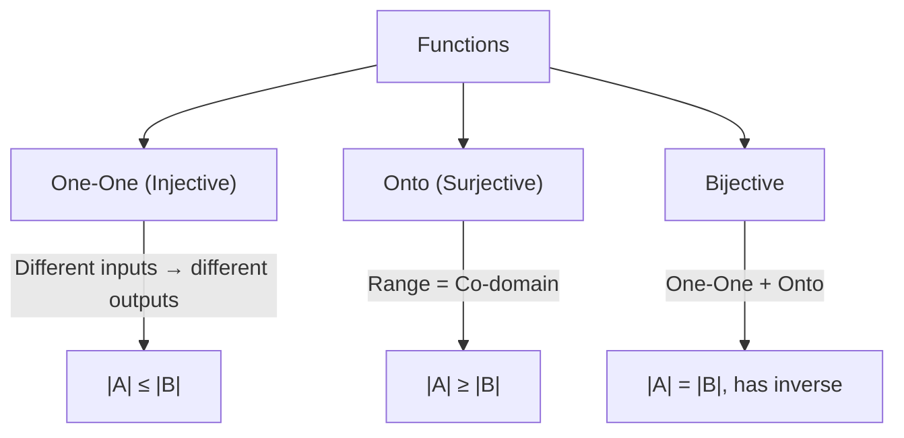

> All key Sets, Relations & Functions formulas in one place — set identities, counting relations, function types, composition & inverses for JEE Main & Advanced quick revision.

Every must-know formula, identity, and counting result for Sets, Relations and Functions on a single scannable page. Use it for last-minute revision before JEE Main and Advanced.

## Sets — Notation & Basics

### Standard Number Sets

| Symbol | Name | Elements |
| --- | --- | --- |
| $\mathbb{N}$ | Natural Numbers | $\{1, 2, 3, \dots\}$ |
| $\mathbb{W}$ | Whole Numbers | $\{0, 1, 2, 3, \dots\}$ |
| $\mathbb{Z}$ | Integers | $\{\dots, -2, -1, 0, 1, 2, \dots\}$ |
| $\mathbb{Z}^+$ | Positive Integers | Same as $\mathbb{N}$ |
| $\mathbb{Q}$ | Rationals | $\left\{\frac{p}{q} : p, q \in \mathbb{Z},\ q \neq 0\right\}$ |
| $\mathbb{R}$ | Reals | All rational and irrational numbers |

Nesting of number sets:

$$\mathbb{N} \subset \mathbb{W} \subset \mathbb{Z} \subset \mathbb{Q} \subset \mathbb{R}$$

### Set Membership & Equality

- $x \in A$ means $x$ belongs to $A$; $x \notin A$ means it does not.
- Set equality: $A = B \iff (x \in A \Leftrightarrow x \in B)$
- Subset: $A \subseteq B \iff (x \in A \Rightarrow x \in B)$
- Proper subset: $A \subset B \iff A \subseteq B$ and $A \neq B$
- Antisymmetry of $\subseteq$: if $A \subseteq B$ and $B \subseteq A$, then $A = B$

> **⚠ Trap · Empty set trap**
>
> $\emptyset \neq \{\emptyset\}$. The empty set $\emptyset$ has $0$ elements; the set $\{\emptyset\}$ has $1$ element (it contains the empty set). Also remember $\emptyset \subseteq A$ for every set $A$.

### Subset Counting

For a set $A$ with $|A| = n$:

| Quantity | Formula |
| --- | --- |
| Number of subsets | $2^n$ |
| Number of proper subsets | $2^n - 1$ |
| Number of non-empty subsets | $2^n - 1$ |
| Number of non-empty proper subsets | $2^n - 2$ |

### Interval Notation (Real Numbers)

| Interval | Set-Builder |
| --- | --- |
| $[a, b]$ | $\{x : a \leq x \leq b\}$ |
| $(a, b)$ | $\{x : a < x < b\}$ |
| $[a, b)$ | $\{x : a \leq x < b\}$ |
| $(a, b]$ | $\{x : a < x \leq b\}$ |
| $[a, \infty)$ | $\{x : x \geq a\}$ |
| $(-\infty, b)$ | $\{x : x < b\}$ |

---

## Set Operations

### Core Operations

$$\boxed{A \cup B = \{x : x \in A \text{ or } x \in B\}}$$

$$\boxed{A \cap B = \{x : x \in A \text{ and } x \in B\}}$$

$$\boxed{A - B = \{x : x \in A \text{ and } x \notin B\}}$$

$$\boxed{A' = \{x : x \in U \text{ and } x \notin A\} = U - A}$$

Disjoint sets: $A \cap B = \emptyset$.

Symmetric difference:

$$A \triangle B = (A - B) \cup (B - A) = (A \cup B) - (A \cap B)$$

> **⚠ Trap · Difference is not commutative**
>
> $A - B \neq B - A$ in general. Likewise the Cartesian product $A \times B \neq B \times A$ in general.

### Complement Properties

| Property | Result |
| --- | --- |
| Double complement | $(A')' = A$ |
| Exhaustive | $A \cup A' = U$ |
| Mutually exclusive | $A \cap A' = \emptyset$ |
| Universal complement | $U' = \emptyset$ |
| Empty complement | $\emptyset' = U$ |

### Algebraic Laws

| Law | Statement |
| --- | --- |
| Commutative | $A \cup B = B \cup A$,  $A \cap B = B \cap A$ |
| Associative | $(A \cup B) \cup C = A \cup (B \cup C)$,  $(A \cap B) \cap C = A \cap (B \cap C)$ |
| Distributive | $A \cup (B \cap C) = (A \cup B) \cap (A \cup C)$ |
| Distributive | $A \cap (B \cup C) = (A \cap B) \cup (A \cap C)$ |
| Identity | $A \cup \emptyset = A$,  $A \cap U = A$ |
| Domination | $A \cup U = U$,  $A \cap \emptyset = \emptyset$ |
| Idempotent | $A \cup A = A$,  $A \cap A = A$ |
| Absorption | $A \cup (A \cap B) = A$,  $A \cap (A \cup B) = A$ |

### De Morgan’s Laws

$$\boxed{(A \cup B)' = A' \cap B'} \qquad \boxed{(A \cap B)' = A' \cup B'}$$

Generalized form:

$$(A_1 \cup A_2 \cup \dots \cup A_n)' = A_1' \cap A_2' \cap \dots \cap A_n'$$

$$(A_1 \cap A_2 \cap \dots \cap A_n)' = A_1' \cup A_2' \cup \dots \cup A_n'$$

> **★ Key point · Memory hook for De Morgan**
>
> **Break the bracket, change the operation, complement each set.** Union flips to intersection and vice versa.

### Power Set

The power set $P(A)$ is the set of all subsets of $A$: $P(A) = \{S : S \subseteq A\}$.

$$\boxed{|P(A)| = 2^{|A|} = 2^n}$$

Properties: $\emptyset \in P(A)$ and $A \in P(A)$ for any set $A$; if $A \subseteq B$ then $P(A) \subseteq P(B)$.

### Cardinality (Inclusion–Exclusion)

Two sets:

$$\boxed{|A \cup B| = |A| + |B| - |A \cap B|}$$

Three sets:

$$|A \cup B \cup C| = |A| + |B| + |C| - |A \cap B| - |B \cap C| - |A \cap C| + |A \cap B \cap C|$$

General principle for $n$ sets:

$$\left|\bigcup_{i=1}^{n} A_i\right| = \sum|A_i| - \sum|A_i \cap A_j| + \sum|A_i \cap A_j \cap A_k| - \dots + (-1)^{n+1}|A_1 \cap \dots \cap A_n|$$

> **★ Key point · High-yield shortcut**
>
> “Neither” count $= |U| - |A \cup B|$. Combined with De Morgan, $n(A' \cap B') = n(U) - n(A \cup B)$ — a recurring JEE one-liner.

---

## Relations

### Cartesian Product & Relations

$$\boxed{A \times B = \{(a, b) : a \in A \text{ and } b \in B\}}$$

- Ordered-pair equality: $(a, b) = (c, d) \iff a = c$ and $b = d$
- Cardinality: $|A \times B| = |A| \times |B|$
- Empty product: $A \times \emptyset = \emptyset = \emptyset \times A$

A **relation** $R$ from $A$ to $B$ is any subset $R \subseteq A \times B$. If $(a,b) \in R$ we write $aRb$.

### Domain, Co-domain, Range

| Term | Meaning |
| --- | --- |
| Domain $\text{Dom}(R)$ | Set of first elements of the ordered pairs in $R$ |
| Co-domain | The whole target set $B$ |
| Range $\text{Range}(R)$ | Set of second elements of the ordered pairs in $R$ |

$$\boxed{\text{Range}(R) \subseteq \text{Co-domain}}$$

### Inverse of a Relation

$$R^{-1} = \{(b, a) : (a, b) \in R\}$$

- $(R^{-1})^{-1} = R$
- $\text{Dom}(R^{-1}) = \text{Range}(R)$ and $\text{Range}(R^{-1}) = \text{Dom}(R)$

### Counting Relations

For $|A| = m$ and $|B| = n$ (so $|A \times B| = mn$):

| Quantity | Formula |
| --- | --- |
| Number of relations from $A$ to $B$ | $2^{mn}$ |
| Empty relation | $1$ |
| Universal relation | $1$ |
| Non-empty relations | $2^{mn} - 1$ |

For a relation **on** a set $A$ with $|A| = n$:

| Type | Count |
| --- | --- |
| Reflexive relations | $2^{n(n-1)}$ |
| Symmetric relations | $2^{\frac{n(n+1)}{2}}$ |
| Reflexive and symmetric relations | $2^{\frac{n(n-1)}{2}}$ |

---

## Types of Relations

### Defining Properties (relation $R$ on set $A$)

$$\boxed{\text{Reflexive: } (a, a) \in R \ \text{ for all } a \in A}$$

$$\boxed{\text{Symmetric: } (a, b) \in R \Rightarrow (b, a) \in R}$$

$$\boxed{\text{Anti-symmetric: } (a, b) \in R \text{ and } (b, a) \in R \Rightarrow a = b}$$

$$\boxed{\text{Transitive: } (a, b) \in R \text{ and } (b, c) \in R \Rightarrow (a, c) \in R}$$

| Property | Matrix check |
| --- | --- |
| Reflexive | All diagonal entries are $1$ |
| Symmetric | $M = M^{T}$ (matrix equals its transpose) |
| Transitive | Every chain $a \to b \to c$ closes with $a \to c$ |

> **⚠ Trap · Vacuous truth**
>
> The empty relation is transitive (and symmetric) vacuously — there are no pairs to violate the condition. A single pair $(a,b)$ with $a \neq b$ is also transitive.

### Equivalence Relation

$$\boxed{\text{Equivalence} = \text{Reflexive} + \text{Symmetric} + \text{Transitive}}$$

Equivalence class of $a$:

$$[a] = \{x \in A : xRa\}$$

Properties of equivalence classes:

- Every element lies in exactly one class.
- Any two classes are either identical or disjoint.
- The classes **partition** the set $A$ (non-overlapping, union is all of $A$).

Standard examples: equality $=$, congruence $a \equiv b \pmod{n}$, parallel lines $\parallel$.

### Quick Comparison

| Relation | Reflexive | Symmetric | Transitive | Equivalence |
| --- | --- | --- | --- | --- |
| $=$ | Yes | Yes | Yes | Yes |
| $\leq$ | Yes | No | Yes | No |
| $<$ | No | No | Yes | No |
| $\perp$ (perpendicular) | No | Yes | No | No |
| $\parallel$ (parallel) | Yes | Yes | Yes | Yes |

---

## Functions — Basics

A **function** $f: A \to B$ is a relation in which every element of $A$ is related to **exactly one** element of $B$.

$$\boxed{\text{Range}(f) \subseteq \text{Co-domain}}$$

### Terminology

| Term | Meaning |
| --- | --- |
| Domain $\text{Dom}(f)$ | Set of all valid inputs (set $A$) |
| Co-domain | Set of possible outputs (set $B$) |
| Range | Set of actual outputs |
| Image | $f(x)$, the output of a specific input |
| Pre-image | Input(s) giving a specific output, $f^{-1}(\{y\})$ |

> **★ Key point · Vertical Line Test**
>
> A graph defines a function $f:\mathbb{R}\to\mathbb{R}$ iff every **vertical** line meets it at most once. (The **horizontal** line test instead checks one-one — at most one intersection.)

### Domain Restrictions (most common)

| Expression | Restriction |
| --- | --- |
| $\dfrac{1}{g(x)}$ | $g(x) \neq 0$ |
| $\sqrt{g(x)}$ | $g(x) \geq 0$ |
| $\log\,(g(x))$ | $g(x) > 0$ |
| $\tan x$ | $x \neq \dfrac{\pi}{2} + n\pi$ |

### Standard Functions

| Function | Definition | Range |
| --- | --- | --- |
| Identity | $I(x) = x$ | $A$ |
| Constant | $f(x) = c$ | $\{c\}$ |
| Modulus | $f(x) = \lvert x \rvert$ | $[0, \infty)$ |
| Greatest integer (floor) | $f(x) = \lfloor x \rfloor$ = greatest integer $\leq x$ | integers |
| Fractional part | $\{x\} = x - \lfloor x \rfloor$ | $[0, 1)$ |
| Signum | $\text{sgn}(x) = 1,\,0,\,-1$ for $x>0,\,x=0,\,x<0$ | $\{-1, 0, 1\}$ |

### Algebra of Functions

For $f, g: A \to \mathbb{R}$:

| Operation | Definition | Domain |
| --- | --- | --- |
| $(f + g)(x)$ | $f(x) + g(x)$ | $\text{Dom}(f) \cap \text{Dom}(g)$ |
| $(f - g)(x)$ | $f(x) - g(x)$ | $\text{Dom}(f) \cap \text{Dom}(g)$ |
| $(fg)(x)$ | $f(x) \cdot g(x)$ | $\text{Dom}(f) \cap \text{Dom}(g)$ |
| $(f/g)(x)$ | $\dfrac{f(x)}{g(x)}$ | $\text{Dom}(f) \cap \text{Dom}(g) \cap \{x : g(x) \neq 0\}$ |

### Even & Odd Functions

- **Even:** $f(-x) = f(x)$ — graph symmetric about the $y$-axis (e.g. $x^2,\ \cos x,\ |x|$).
- **Odd:** $f(-x) = -f(x)$ — graph symmetric about the origin (e.g. $x^3,\ \sin x,\ x$).

Any function splits into even + odd parts:

$$f(x) = \underbrace{\frac{f(x) + f(-x)}{2}}_{\text{even}} + \underbrace{\frac{f(x) - f(-x)}{2}}_{\text{odd}}$$

---

## Types of Functions

### Definitions

$$\boxed{\text{One-one (injective): } f(x_1) = f(x_2) \Rightarrow x_1 = x_2}$$

$$\boxed{\text{Onto (surjective): } \text{Range}(f) = \text{Co-domain } B}$$

$$\boxed{\text{Bijective} = \text{Injective} + \text{Surjective}}$$

Checking one-one for differentiable $f$: strictly monotonic works — $f'(x) > 0$ everywhere (increasing) or $f'(x) < 0$ everywhere (decreasing) implies one-one.

> **★ Key point · Cardinality constraints**
>
> One-one needs $|A| \leq |B|$. Onto needs $|A| \geq |B|$. Bijective needs $|A| = |B|$. Only bijective functions have an inverse. Restricting the domain can force one-one; restricting the co-domain can force onto.

### Counting Functions

For $|A| = m$ and $|B| = n$:

| Type | Formula | Condition |
| --- | --- | --- |
| All functions | $n^m$ | Always |
| One-one (injective) | $\dfrac{n!}{(n-m)!} = P(n, m)$ | $m \leq n$ |
| Onto (surjective) | $\displaystyle\sum_{r=0}^{n-1} (-1)^r \binom{n}{r}(n-r)^m$ | $m \geq n$ |
| Bijective | $n!$ | $m = n$ |

Small onto cases worth memorizing:

$$\text{Onto } m \to 2:\ \ 2^m - 2 \qquad\qquad \text{Onto } m \to 3:\ \ 3^m - 3\cdot 2^m + 3$$



---

## Composition & Inverse Functions

### Composition

For $f: A \to B$ and $g: B \to C$:

$$\boxed{(g \circ f)(x) = g(f(x))}$$

Domain: $\text{Dom}(g \circ f) = \{x \in A : f(x) \in \text{Dom}(g)\}$.

| Property | Statement |
| --- | --- |
| Not commutative | $g \circ f \neq f \circ g$ in general |
| Associative | $(h \circ g) \circ f = h \circ (g \circ f)$ |
| Identity | $f \circ I = I \circ f = f$ |

Preservation under composition:

| If | Then |
| --- | --- |
| $f, g$ one-one | $g \circ f$ one-one |
| $f, g$ onto | $g \circ f$ onto |
| $f, g$ bijective | $g \circ f$ bijective |
| $g \circ f$ one-one | $f$ is one-one |
| $g \circ f$ onto | $g$ is onto |

### Inverse Functions

For a **bijective** $f: A \to B$, the inverse $f^{-1}: B \to A$ satisfies:

$$\boxed{f^{-1}(y) = x \iff f(x) = y}$$

| Property | Statement |
| --- | --- |
| Left inverse | $f^{-1} \circ f = I_A$ |
| Right inverse | $f \circ f^{-1} = I_B$ |
| Involutive | $(f^{-1})^{-1} = f$ |
| Reverses order | $(g \circ f)^{-1} = f^{-1} \circ g^{-1}$ |
| Derivative of inverse | $(f^{-1})'(y) = \dfrac{1}{f'(x)}$ where $y = f(x)$ |

- Graph of $f^{-1}$ is the reflection of $f$ about the line $y = x$: if $(a,b)$ lies on $f$, then $(b,a)$ lies on $f^{-1}$.
- **Self-inverse (involution):** $f(f(x)) = x$, i.e. $f^{-1} = f$. Examples: $f(x) = \frac{1}{x}$, $f(x) = -x$, $f(x) = \frac{a - x}{1 + ax}$.
- If $f \circ g = I$ and $g \circ f = I$, then $f$ and $g$ are inverses of each other.

> **⚠ Trap · Order reversal**
>
> The inverse of a composition flips the order: $(g \circ f)^{-1} = f^{-1} \circ g^{-1}$, not $g^{-1} \circ f^{-1}$.

---

## One-Glance Recap

| Concept | Headline formula |
| --- | --- |
| Subsets of $A$ | $2^n$ |
| Power set size | $\lvert P(A)\rvert = 2^n$ |
| Two-set count | $\lvert A \cup B\rvert = \lvert A\rvert + \lvert B\rvert - \lvert A \cap B\rvert$ |
| De Morgan | $(A \cup B)' = A' \cap B'$,  $(A \cap B)' = A' \cup B'$ |
| Relations $A \to B$ | $2^{mn}$ |
| Reflexive relations | $2^{n(n-1)}$ |
| Symmetric relations | $2^{n(n+1)/2}$ |
| Total functions | $n^m$ |
| One-one functions | $\dfrac{n!}{(n-m)!}$ |
| Bijections ($m=n$) | $n!$ |
| Composition | $(g \circ f)(x) = g(f(x))$ |
| Inverse of composition | $(g \circ f)^{-1} = f^{-1} \circ g^{-1}$ |

**Related:** [Sets and Their Representation](../sets-basics/index.md) · [Set Operations](../set-operations/index.md) · [Introduction to Relations](../relations-basics/index.md) · [Types of Relations](../types-of-relations/index.md) · [Introduction to Functions](../functions-basics/index.md) · [Types of Functions](../types-of-functions/index.md) · [Composition of Functions](../composition/index.md)

From TestGuru · our mock-test platform

## You've read Sets, Relations and Functions Formula Sheet.You've read this topic. Find out what you actually got.

A free JEE Main mock with this chapter in it, and a report that shows which sub-topics cost you marks.

[Take a free JEE Main mock →](https://app.testguru.co/signup?tg_chapter=sets-relations-functions&tg_exam=jee-main&tg_page=%2Fmathematics%2Fsets-relations-functions%2Fformula-sheet%2F&tg_subject=mathematics&utm_campaign=notes-jee-main-free-test&utm_content=article-end&utm_medium=referral&utm_source=jeenotes)
Free, no card. Opens TestGuru in a new tab.

## Stay exam-ready

One email every Sunday: new notes, the week's hardest challenge question and a revision plan.One email every Sunday.

## Comments

Have a question or spotted a mistake? Join the discussion below.

Advertisement

Advertisement

---

## Extracted page code (interactive scripts & widgets)


### inline-script-14

```js
(function(){var t,e=document.getElementById("disqus-load");if(!e)return;t=!1,e.addEventListener("click",function(){if(t)return;t=!0,e.setAttribute("disabled","disabled"),e.textContent="Loading comments…",window.disqus_config=function(){this.page.url="https://jeenotes.in/mathematics/sets-relations-functions/formula-sheet/",this.page.identifier="/mathematics/sets-relations-functions/formula-sheet/"};var s=document,n=s.createElement("script");n.src="https://https-jeenotes-in.disqus.com/embed.js",n.setAttribute("data-timestamp",+new Date),n.onload=function(){e.style.display="none"},n.onerror=function(){t=!1,e.removeAttribute("disabled"),e.textContent="Could not load comments. Tap to retry"},(s.head||s.body).appendChild(n)})})()
```


### inline-script-15

```js
(function(){var t,e=document.currentScript.previousElementSibling;function n(){(window.adsbygoogle=window.adsbygoogle||[]).push({})}if(!window.ResizeObserver||e.clientWidth>0){n();return}t=new ResizeObserver(function(){e.clientWidth>0&&(t.disconnect(),n())}),t.observe(e)})()
```


---

_Source: [https://jeenotes.in/mathematics/sets-relations-functions/formula-sheet/](https://jeenotes.in/mathematics/sets-relations-functions/formula-sheet/) · raw HTML: `offline/mathematics/sets-relations-functions/formula-sheet/index.html`_
