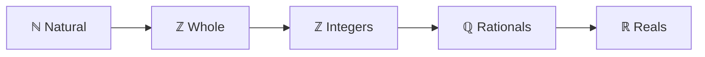

> Learn set notation, roster and set-builder forms, and standard number sets for JEE Mathematics.

## Introduction

A **set** is a well-defined collection of distinct objects called **elements** or **members**. The concept of sets was developed by Georg Cantor in the late 19th century and forms the basis of modern mathematics.

---

## What Makes a Set “Well-Defined”?

A collection is well-defined if we can determine definitively whether any given object belongs to it or not.

**Well-defined examples:**

- The set of vowels in the English alphabet
- The set of prime numbers less than 20

**Not well-defined examples:**

- The set of beautiful flowers (subjective)
- The set of tall people (no clear criterion)

> **◐ In simple terms · Notation**
>
> Sets are usually denoted by capital letters: $A, B, C, X, Y, Z$
>
> Elements are denoted by lowercase letters: $a, b, c, x, y, z$
>
> If $x$ is an element of set $A$, we write $x \in A$ ("$x$ belongs to $A$")
>
> If $x$ is not in $A$, we write $x \notin A$

---

## Representation of Sets

### 1. Roster (Tabular) Form

List all elements within curly braces, separated by commas.

**Examples:**

- Vowels: $V = \{a, e, i, o, u\}$
- First five primes: $P = \{2, 3, 5, 7, 11\}$
- Even numbers from 2 to 10: $E = \{2, 4, 6, 8, 10\}$

**Rules:**

- Order doesn’t matter: $\{1, 2, 3\} = \{3, 1, 2\}$
- Repetition is ignored: $\{1, 2, 2, 3\} = \{1, 2, 3\}$

### 2. Set-Builder Form

Describe the property that elements satisfy.

$$A = \{x : \text{condition on } x\}$$

Read as: “A is the set of all $x$ such that [condition]”

**Examples:**

- $A = \{x : x \in \mathbb{N}, x < 6\} = \{1, 2, 3, 4, 5\}$
- $B = \{x : x^2 = 4\} = \{-2, 2\}$
- $C = \{x : x \text{ is a vowel}\} = \{a, e, i, o, u\}$

> **★ Key point · When to Use Each Form**
>
> - **Roster form**: When the set has few elements or follows a clear pattern

> - **Set-builder form**: When the set is infinite or describing a property is cleaner

---

## Standard Number Sets

| Symbol | Name | Description | Example Elements |
| --- | --- | --- | --- |
| $\mathbb{N}$ | Natural Numbers | Positive counting numbers | $1, 2, 3, 4, ...$ |
| $\mathbb{W}$ | Whole Numbers | Natural numbers with zero | $0, 1, 2, 3, ...$ |
| $\mathbb{Z}$ | Integers | Whole numbers and negatives | $..., -2, -1, 0, 1, 2, ...$ |
| $\mathbb{Z}^+$ | Positive Integers | Same as $\mathbb{N}$ | $1, 2, 3, ...$ |
| $\mathbb{Q}$ | Rational Numbers | Fractions of integers | $\frac{1}{2}, -\frac{3}{4}, 0.5$ |
| $\mathbb{R}$ | Real Numbers | All points on number line | $\pi, \sqrt{2}, -3.14$ |

### Relationships Between Number Sets

$$\mathbb{N} \subset \mathbb{W} \subset \mathbb{Z} \subset \mathbb{Q} \subset \mathbb{R}$$



### Interactive Demo: Visualize Set Operations

Explore unions, intersections, and complements with Venn diagrams.

---

## Types of Sets

### 1. Empty Set (Null Set)

A set with no elements, denoted by $\emptyset$ or $\{\}$.

**Examples:**

- $\{x : x \in \mathbb{R}, x^2 = -1\} = \emptyset$ (no real solution)
- $\{x : x \text{ is both even and odd}\} = \emptyset$

> **⚠ Trap · Common Mistake**
>
> $\emptyset \neq \{\emptyset\}$
>
> - $\emptyset$ is the empty set (has 0 elements)

> - $\{\emptyset\}$ is a set containing the empty set (has 1 element)

### 2. Singleton Set

A set with exactly one element.

**Example:** $A = \{5\}$ or $B = \{\sqrt{2}\}$

### 3. Finite and Infinite Sets

- **Finite Set**: Has a countable number of elements

  - $A = \{1, 2, 3, 4, 5\}$ (finite, 5 elements)
- **Infinite Set**: Has unlimited elements

  - $\mathbb{N} = \{1, 2, 3, ...\}$ (infinite)

### 4. Equal Sets

Two sets are equal if they have exactly the same elements.

$$A = B \iff (x \in A \Leftrightarrow x \in B)$$

**Example:** $\{1, 2, 3\} = \{3, 2, 1\}$ (order doesn’t matter)

### 5. Equivalent Sets

Two sets are equivalent if they have the same number of elements (same cardinality).

$\{a, b, c\}$ and $\{1, 2, 3\}$ are equivalent (both have 3 elements)

---

## Subsets

### Definition

Set $A$ is a **subset** of set $B$ (written $A \subseteq B$) if every element of $A$ is also in $B$.

$$A \subseteq B \iff (x \in A \Rightarrow x \in B)$$

### Proper Subset

$A$ is a **proper subset** of $B$ (written $A \subset B$) if $A \subseteq B$ and $A \neq B$.

### Important Facts

1. Every set is a subset of itself: $A \subseteq A$
2. Empty set is a subset of every set: $\emptyset \subseteq A$
3. If $A \subseteq B$ and $B \subseteq A$, then $A = B$

### Number of Subsets

If set $A$ has $n$ elements:

- **Number of subsets** = $2^n$
- **Number of proper subsets** = $2^n - 1$
- **Number of non-empty subsets** = $2^n - 1$
- **Number of non-empty proper subsets** = $2^n - 2$

**Example:** For $A = \{1, 2\}$ (n = 2):
Subsets: $\emptyset, \{1\}, \{2\}, \{1, 2\}$ — that’s $2^2 = 4$ subsets

---

## Universal Set

The **universal set** $U$ is the set containing all objects under consideration for a particular problem.

**Example:** When discussing vowels and consonants:
$U = \{a, b, c, ..., z\}$ (all letters)

---

## Interval Notation (for Real Numbers)

| Interval | Set-Builder | Number Line |
| --- | --- | --- |
| $[a, b]$ | $\{x : a \leq x \leq b\}$ | Closed (includes endpoints) |
| $(a, b)$ | $\{x : a < x < b\}$ | Open (excludes endpoints) |
| $[a, b)$ | $\{x : a \leq x < b\}$ | Half-open |
| $(a, b]$ | $\{x : a < x \leq b\}$ | Half-open |
| $[a, \infty)$ | $\{x : x \geq a\}$ | Includes $a$, no upper bound |
| $(-\infty, b)$ | $\{x : x < b\}$ | No lower bound, excludes $b$ |

---

## Practice Problems

1. Write in roster form: $A = \{x : x^2 - 5x + 6 = 0\}$
2. Write in set-builder form: $B = \{1, 4, 9, 16, 25\}$
3. Find all subsets of $\{a, b\}$
4. Is $\{1, 2\}$ equal to $\{1, 2, 2, 1\}$? Explain.

> **↗ Connection · Quick Check**
>
> How many proper subsets does a set with 4 elements have?

---

**Next: [Set Operations →](../set-operations/index.md)**

From TestGuru · our mock-test platform

## You've read Sets and Their Representation.You've read this topic. Find out what you actually got.

A free JEE Main mock with this chapter in it, and a report that shows which sub-topics cost you marks.

[Take a free JEE Main mock →](https://app.testguru.co/signup?tg_chapter=sets-relations-functions&tg_exam=jee-main&tg_page=%2Fmathematics%2Fsets-relations-functions%2Fsets-basics%2F&tg_subject=mathematics&utm_campaign=notes-jee-main-free-test&utm_content=article-end&utm_medium=referral&utm_source=jeenotes)
Free, no card. Opens TestGuru in a new tab.

## Stay exam-ready

One email every Sunday: new notes, the week's hardest challenge question and a revision plan.One email every Sunday.

## Comments

Have a question or spotted a mistake? Join the discussion below.

Advertisement

Advertisement

---

## Extracted page code (interactive scripts & widgets)


### inline-script-16

```js
if(!document.getElementById("animation-fullscreen-overlay")){const e=document.createElement("div");e.id="animation-fullscreen-overlay",e.className="animation-fullscreen-overlay",e.innerHTML=`
      <div class="fullscreen-modal">
        <div class="fullscreen-header">
          <span class="fullscreen-title">Interactive Demo</span>
          <button class="fullscreen-close-btn" onclick="JEEAnimations.closeFullscreen()" title="Close (Esc)" aria-label="Close fullscreen">
            <svg width="24" height="24" viewBox="0 0 24 24" fill="none" stroke="currentColor" stroke-width="2" stroke-linecap="round" stroke-linejoin="round">
              <line x1="18" y1="6" x2="6" y2="18"></line>
              <line x1="6" y1="6" x2="18" y2="18"></line>
            </svg>
          </button>
        </div>
        <div class="fullscreen-content"></div>
      </div>
    `,document.body.appendChild(e),document.addEventListener("keydown",function(e){e.key==="Escape"&&document.body.classList.contains("animation-fullscreen-active")&&JEEAnimations.closeFullscreen()}),e.addEventListener("click",function(t){t.target===e&&JEEAnimations.closeFullscreen()})}
```


### inline-script-17

```js
(function(){var t,e=document.getElementById("disqus-load");if(!e)return;t=!1,e.addEventListener("click",function(){if(t)return;t=!0,e.setAttribute("disabled","disabled"),e.textContent="Loading comments…",window.disqus_config=function(){this.page.url="https://jeenotes.in/mathematics/sets-relations-functions/sets-basics/",this.page.identifier="/mathematics/sets-relations-functions/sets-basics/"};var s=document,n=s.createElement("script");n.src="https://https-jeenotes-in.disqus.com/embed.js",n.setAttribute("data-timestamp",+new Date),n.onload=function(){e.style.display="none"},n.onerror=function(){t=!1,e.removeAttribute("disabled"),e.textContent="Could not load comments. Tap to retry"},(s.head||s.body).appendChild(n)})})()
```


### inline-script-18

```js
(function(){var t,e=document.currentScript.previousElementSibling;function n(){(window.adsbygoogle=window.adsbygoogle||[]).push({})}if(!window.ResizeObserver||e.clientWidth>0){n();return}t=new ResizeObserver(function(){e.clientWidth>0&&(t.disconnect(),n())}),t.observe(e)})()
```


### interactive-widget-1

```html
<div class="animation-wrapper" data-animation="vennDiagram" id="anim-vennDiagram-1795396422155826256"><div class="animation-header"><button aria-label="Toggle fullscreen" class="anim-fullscreen-btn" onclick='JEEAnimations.toggleFullscreen("anim-vennDiagram-1795396422155826256")' title="Fullscreen (F)">
<svg class="fullscreen-icon-expand" fill="none" height="18" stroke="currentColor" stroke-linecap="round" stroke-linejoin="round" stroke-width="2" viewbox="0 0 24 24" width="18"><polyline points="15 3 21 3 21 9"></polyline><polyline points="9 21 3 21 3 15"></polyline><line x1="21" x2="14" y1="3" y2="10"></line><line x1="3" x2="10" y1="21" y2="14"></line></svg>
<svg class="fullscreen-icon-collapse" fill="none" height="18" stroke="currentColor" stroke-linecap="round" stroke-linejoin="round" stroke-width="2" viewbox="0 0 24 24" width="18"><polyline points="4 14 10 14 10 20"></polyline><polyline points="20 10 14 10 14 4"></polyline><line x1="14" x2="21" y1="10" y2="3"></line><line x1="3" x2="10" y1="21" y2="14"></line></svg>
<span class="fullscreen-text">Fullscreen</span></button></div><div class="animation-content"><noscript><div class="callout callout-warning"><div class="callout-title">JavaScript Required</div><p>This interactive animation requires JavaScript to be enabled.</p></div></noscript></div></div>
```


---

_Source: [https://jeenotes.in/mathematics/sets-relations-functions/sets-basics/](https://jeenotes.in/mathematics/sets-relations-functions/sets-basics/) · raw HTML: `offline/mathematics/sets-relations-functions/sets-basics/index.html`_
