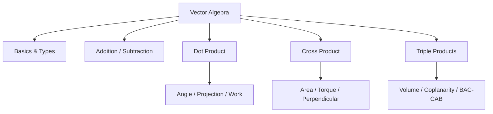

> All key Vector Algebra formulas for JEE Main & Advanced quick revision: magnitude, dot product, cross product, projections, triple products, BAC-CAB & volume.

Every must-know Vector Algebra formula, condition, and identity from this chapter in one scannable sheet. Use it for last-minute revision before JEE Main and Advanced.

## Chapter Map



---

## Vector Basics

| Quantity | Formula | Notes |
| --- | --- | --- |
| Component form (3D) | $\vec{a} = a_x\hat{i} + a_y\hat{j} + a_z\hat{k}$ | $\vec{a} = a_x\hat{i} + a_y\hat{j}$ in 2D |
| Magnitude | $\lvert\vec{a}\rvert = \sqrt{a_x^2 + a_y^2 + a_z^2}$ | Length of the vector |
| Unit vector | $\hat{a} = \dfrac{\vec{a}}{\lvert\vec{a}\rvert}$ | Magnitude 1, same direction |
| Position vector of P(x,y,z) | $\vec{r} = \overrightarrow{OP} = x\hat{i} + y\hat{j} + z\hat{k}$ | From origin to point |
| Direction (2D) | $\tan\theta = \dfrac{a_y}{a_x}$ | Angle with x-axis |

$$\boxed{\hat{a} = \frac{\vec{a}}{|\vec{a}|}, \qquad |\vec{a}| = \sqrt{a_x^2 + a_y^2 + a_z^2}}$$

### Vector Joining Two Points

For A$(x_1, y_1, z_1)$ to B$(x_2, y_2, z_2)$:

$$\boxed{\overrightarrow{AB} = (x_2 - x_1)\hat{i} + (y_2 - y_1)\hat{j} + (z_2 - z_1)\hat{k}}$$

$$|\overrightarrow{AB}| = \sqrt{(x_2-x_1)^2 + (y_2-y_1)^2 + (z_2-z_1)^2}$$

> **★ Key point · High-yield: AB = Head − Tail**
>
> Always **final point − initial point**. Note $\overrightarrow{AB} = -\overrightarrow{BA}$. This single formula drives the majority of coordinate-based vector problems.

### Direction Cosines

$$\boxed{l = \frac{a_x}{|\vec{a}|}, \quad m = \frac{a_y}{|\vec{a}|}, \quad n = \frac{a_z}{|\vec{a}|}}$$

$$l^2 + m^2 + n^2 = 1$$

### Types of Vectors (quick recall)

| Type | Key Property |
| --- | --- |
| Zero (null) vector $\vec{0}$ | Magnitude 0, direction **undefined**; $\vec{a} + \vec{0} = \vec{a}$ |
| Unit vector $\hat{a}$ | Magnitude 1; $\lvert\hat{i}\rvert = \lvert\hat{j}\rvert = \lvert\hat{k}\rvert = 1$ |
| Equal vectors | Same magnitude **and** direction |
| Negative vector $-\vec{a}$ | Same magnitude, opposite direction |
| Parallel / collinear | $\vec{a} = \lambda\vec{b}$ for some scalar $\lambda$ |

Mnemonic: **ZUENPP** — Zero, Unit, Equal, Negative, Parallel, Position.

---

## Vector Addition & Subtraction

### Component Method (use 90% of the time)

$$\boxed{\vec{R} = (a_x + b_x)\hat{i} + (a_y + b_y)\hat{j} + (a_z + b_z)\hat{k}}$$

$$\vec{a} - \vec{b} = (a_x - b_x)\hat{i} + (a_y - b_y)\hat{j} + (a_z - b_z)\hat{k}, \qquad |\vec{R}| = \sqrt{R_x^2 + R_y^2 + R_z^2}$$

### Parallelogram Law (magnitude & direction)

$$\boxed{|\vec{R}| = \sqrt{a^2 + b^2 + 2ab\cos\theta}}$$

$$\tan\alpha = \frac{b\sin\theta}{a + b\cos\theta} \quad (\alpha \text{ = angle of } \vec{R} \text{ with } \vec{a})$$

### Equal-Magnitude Special Case

When $|\vec{a}| = |\vec{b}| = a$:

$$\boxed{|\vec{R}| = 2a\cos\frac{\theta}{2}}$$

### Resultant by Angle (high-yield table)

| Angle $\theta$ | Resultant $\lvert\vec{R}\rvert$ | Notes |
| --- | --- | --- |
| $0^\circ$ (same direction) | $a + b$ | Maximum |
| $60^\circ$ | $\sqrt{a^2 + b^2 + ab}$ | Common in JEE |
| $90^\circ$ (perpendicular) | $\sqrt{a^2 + b^2}$ | $\tan\alpha = \tfrac{b}{a}$ |
| $120^\circ$ | $\sqrt{a^2 + b^2 - ab}$ | Common in JEE |
| $180^\circ$ (opposite) | $\lvert a - b\rvert$ | Along larger vector |

Equal magnitudes: $\theta = 60^\circ \Rightarrow R = a\sqrt{3}$; $\theta = 90^\circ \Rightarrow R = a\sqrt{2}$; $\theta = 120^\circ \Rightarrow R = a$.

### Properties of Addition

| Property | Statement |
| --- | --- |
| Commutative | $\vec{a} + \vec{b} = \vec{b} + \vec{a}$ |
| Associative | $(\vec{a} + \vec{b}) + \vec{c} = \vec{a} + (\vec{b} + \vec{c})$ |
| Additive identity | $\vec{a} + \vec{0} = \vec{a}$ |
| Additive inverse | $\vec{a} + (-\vec{a}) = \vec{0}$ |

> **★ Key point · High-yield: never add magnitudes**
>
> $3$ N and $4$ N give $7$ N only if **parallel**. Perpendicular $\to 5$ N, opposite $\to 1$ N. The pattern “$\lvert\vec{a}\rvert=3,\ \lvert\vec{b}\rvert=4,\ \lvert\vec{a}+\vec{b}\rvert=5$” means the vectors are **perpendicular**.

---

## Scalar (Dot) Product

$$\boxed{\vec{a} \cdot \vec{b} = |\vec{a}||\vec{b}|\cos\theta = a_1b_1 + a_2b_2 + a_3b_3}$$

Result is a **scalar**. (2D: $\vec{a}\cdot\vec{b} = a_1b_1 + a_2b_2$.)

| Concept | Formula |
| --- | --- |
| Definition | $\vec{a} \cdot \vec{b} = ab\cos\theta$ |
| Component form | $a_1b_1 + a_2b_2 + a_3b_3$ |
| Angle between vectors | $\cos\theta = \dfrac{\vec{a} \cdot \vec{b}}{\lvert\vec{a}\rvert\lvert\vec{b}\rvert}$ |
| Perpendicular condition | $\vec{a} \cdot \vec{b} = 0$ |
| Parallel condition | $\vec{a} \cdot \vec{b} = \pm ab$ |
| Magnitude from self-dot | $\lvert\vec{a}\rvert^2 = \vec{a} \cdot \vec{a}$ |
| Projection of $\vec{a}$ on $\vec{b}$ (scalar) | $\dfrac{\vec{a} \cdot \vec{b}}{\lvert\vec{b}\rvert} = \lvert\vec{a}\rvert\cos\theta$ |
| Vector projection of $\vec{a}$ on $\vec{b}$ | $\dfrac{\vec{a} \cdot \vec{b}}{\lvert\vec{b}\rvert^2}\,\vec{b}$ |
| Work done | $W = \vec{F} \cdot \vec{s} = Fs\cos\theta$ |
| Power | $P = \vec{F} \cdot \vec{v}$ |

### Angle Between Vectors

$$\boxed{\cos\theta = \frac{\vec{a} \cdot \vec{b}}{|\vec{a}||\vec{b}|}}$$

### Properties of Dot Product

| Property | Statement |
| --- | --- |
| Commutative | $\vec{a} \cdot \vec{b} = \vec{b} \cdot \vec{a}$ |
| Distributive | $\vec{a} \cdot (\vec{b} + \vec{c}) = \vec{a} \cdot \vec{b} + \vec{a} \cdot \vec{c}$ |
| Scalar multiple | $(m\vec{a}) \cdot \vec{b} = m(\vec{a} \cdot \vec{b}) = \vec{a} \cdot (m\vec{b})$ |
| Self dot | $\vec{a} \cdot \vec{a} = \lvert\vec{a}\rvert^2$ |
| Not associative | $(\vec{a} \cdot \vec{b}) \cdot \vec{c}$ is meaningless |

### Unit Vector Dot Products

$$\hat{i} \cdot \hat{i} = \hat{j} \cdot \hat{j} = \hat{k} \cdot \hat{k} = 1, \qquad \hat{i} \cdot \hat{j} = \hat{j} \cdot \hat{k} = \hat{k} \cdot \hat{i} = 0$$

Rule: **same = 1, different = 0** (standard unit vectors are mutually perpendicular).

> **★ Key point · High-yield: perpendicularity in one step**
>
> To test $\vec{a} \perp \vec{b}$, just check $\vec{a}\cdot\vec{b} = 0$ — never compute the angle. Work signs: $W>0$ for $0^\circ\le\theta<90^\circ$, $W=0$ at $90^\circ$, $W<0$ for $90^\circ<\theta\le180^\circ$.

---

## Vector (Cross) Product

$$\boxed{\vec{a} \times \vec{b} = |\vec{a}||\vec{b}|\sin\theta\,\hat{n}}$$

$\hat{n}$ is perpendicular to both $\vec{a}$ and $\vec{b}$ (right-hand rule). Result is a **vector**.

### Determinant Form

$$\boxed{\vec{a} \times \vec{b} = \begin{vmatrix} \hat{i} & \hat{j} & \hat{k} \\ a_1 & a_2 & a_3 \\ b_1 & b_2 & b_3 \end{vmatrix} = (a_2b_3 - a_3b_2)\hat{i} - (a_1b_3 - a_3b_1)\hat{j} + (a_1b_2 - a_2b_1)\hat{k}}$$

| Concept | Formula |
| --- | --- |
| Magnitude | $\lvert\vec{a} \times \vec{b}\rvert = ab\sin\theta$ |
| Order matters | $\vec{a} \times \vec{b} = -(\vec{b} \times \vec{a})$ |
| Parallel condition | $\vec{a} \times \vec{b} = \vec{0}$ |
| Vector $\perp$ to both | $\vec{n} = \vec{a} \times \vec{b}$ |
| $\sin\theta$ between vectors | $\sin\theta = \dfrac{\lvert\vec{a} \times \vec{b}\rvert}{\lvert\vec{a}\rvert\lvert\vec{b}\rvert}$ |
| Area of parallelogram | $\lvert\vec{a} \times \vec{b}\rvert$ |
| Area of triangle | $\tfrac{1}{2}\lvert\vec{a} \times \vec{b}\rvert$ |

### Unit Vector Cross Products (cyclic: i → j → k → i)

$$\hat{i} \times \hat{j} = \hat{k}, \qquad \hat{j} \times \hat{k} = \hat{i}, \qquad \hat{k} \times \hat{i} = \hat{j}$$

$$\hat{j} \times \hat{i} = -\hat{k}, \qquad \hat{k} \times \hat{j} = -\hat{i}, \qquad \hat{i} \times \hat{k} = -\hat{j}$$

$$\hat{i} \times \hat{i} = \hat{j} \times \hat{j} = \hat{k} \times \hat{k} = \vec{0}$$

Forward in the cycle = positive; against the cycle = negative.

### Properties of Cross Product

| Property | Statement |
| --- | --- |
| Anti-commutative | $\vec{a} \times \vec{b} = -(\vec{b} \times \vec{a})$ |
| Distributive | $\vec{a} \times (\vec{b} + \vec{c}) = \vec{a} \times \vec{b} + \vec{a} \times \vec{c}$ |
| Scalar multiple | $(m\vec{a}) \times \vec{b} = m(\vec{a} \times \vec{b}) = \vec{a} \times (m\vec{b})$ |
| Not associative | $(\vec{a} \times \vec{b}) \times \vec{c} \neq \vec{a} \times (\vec{b} \times \vec{c})$ |
| Self cross | $\vec{a} \times \vec{a} = \vec{0}$ |

### Physics Applications

| Quantity | Formula |
| --- | --- |
| Torque | $\vec{\tau} = \vec{r} \times \vec{F}$, magnitude $\tau = rF\sin\theta$ |
| Angular momentum | $\vec{L} = \vec{r} \times \vec{p}$ |
| Magnetic force on charge | $\vec{F} = q(\vec{v} \times \vec{B})$ |
| Magnetic force on current | $\vec{F} = I\vec{L} \times \vec{B}$ |
| Linear velocity (rotation) | $\vec{v} = \vec{\omega} \times \vec{r}$ |

> **⚠ Trap: middle term sign**
>
> The $\hat{j}$ component of $\vec{a}\times\vec{b}$ carries a **minus** sign: $-(a_1b_3 - a_3b_1)\hat{j}$. This is the single most common cross-product error.

---

## Triple Products

### Scalar Triple Product

$$\boxed{[\vec{a}\,\vec{b}\,\vec{c}] = \vec{a} \cdot (\vec{b} \times \vec{c}) = \begin{vmatrix} a_1 & a_2 & a_3 \\ b_1 & b_2 & b_3 \\ c_1 & c_2 & c_3 \end{vmatrix}}$$

| Concept | Formula |
| --- | --- |
| Volume of parallelepiped | $\lvert[\vec{a}\,\vec{b}\,\vec{c}]\rvert$ |
| Volume of tetrahedron | $\tfrac{1}{6}\lvert[\vec{a}\,\vec{b}\,\vec{c}]\rvert$ |
| Coplanar condition | $[\vec{a}\,\vec{b}\,\vec{c}] = 0$ |
| Four points A,B,C,D coplanar | $[\overrightarrow{AB}\,\overrightarrow{AC}\,\overrightarrow{AD}] = 0$ |
| Cyclic property | $[\vec{a}\,\vec{b}\,\vec{c}] = [\vec{b}\,\vec{c}\,\vec{a}] = [\vec{c}\,\vec{a}\,\vec{b}]$ |
| Anti-cyclic (swap two) | $[\vec{a}\,\vec{b}\,\vec{c}] = -[\vec{b}\,\vec{a}\,\vec{c}]$ |
| Dot–cross interchange | $\vec{a}\cdot(\vec{b}\times\vec{c}) = (\vec{a}\times\vec{b})\cdot\vec{c}$ |
| Scalar multiple | $[\lambda\vec{a}\,\vec{b}\,\vec{c}] = \lambda[\vec{a}\,\vec{b}\,\vec{c}]$ |

### Vector Triple Product — BAC-CAB

$$\boxed{\vec{a} \times (\vec{b} \times \vec{c}) = (\vec{a} \cdot \vec{c})\vec{b} - (\vec{a} \cdot \vec{b})\vec{c}}$$

Other form (note the different result):

$$(\vec{a} \times \vec{b}) \times \vec{c} = (\vec{a} \cdot \vec{c})\vec{b} - (\vec{b} \cdot \vec{c})\vec{a}$$

Key properties: $\vec{a} \times (\vec{b} \times \vec{c})$ is **coplanar with $\vec{b}$ and $\vec{c}$** and **perpendicular to $\vec{a}$**; the operation is **not associative**.

### Advanced Identities

**Lagrange’s identity:**

$$\boxed{(\vec{a} \times \vec{b}) \cdot (\vec{c} \times \vec{d}) = (\vec{a} \cdot \vec{c})(\vec{b} \cdot \vec{d}) - (\vec{a} \cdot \vec{d})(\vec{b} \cdot \vec{c})}$$

**Jacobi identity:**

$$\vec{a} \times (\vec{b} \times \vec{c}) + \vec{b} \times (\vec{c} \times \vec{a}) + \vec{c} \times (\vec{a} \times \vec{b}) = \vec{0}$$

> **★ Key point · High-yield triple-product reflexes**
>
> See “volume” $\to$ scalar triple product determinant (take **absolute value**; tetrahedron carries the $\tfrac{1}{6}$ factor). See “coplanar” $\to$ set $[\vec{a}\,\vec{b}\,\vec{c}] = 0$. See $\vec{a} \times (\vec{b} \times \vec{c})$ $\to$ write $(\vec{a}\cdot\vec{c})\vec{b} - (\vec{a}\cdot\vec{b})\vec{c}$ — it is **BAC minus CAB** (a minus, never a plus).

---

## One-Glance Master Table

| Operation | Formula | Result | Geometric meaning |
| --- | --- | --- | --- |
| Dot product | $\vec{a}\cdot\vec{b} = ab\cos\theta$ | Scalar | Projection / work |
| Cross product | $\vec{a}\times\vec{b} = ab\sin\theta\,\hat{n}$ | Vector | Area / torque |
| Scalar triple | $[\vec{a}\,\vec{b}\,\vec{c}]$ | Scalar | Volume of parallelepiped |
| Vector triple | $\vec{a}\times(\vec{b}\times\vec{c})$ | Vector | Coplanar with $\vec{b},\vec{c}$ |
| Perpendicular test | $\vec{a}\cdot\vec{b}=0$ | — | $\theta = 90^\circ$ |
| Parallel test | $\vec{a}\times\vec{b}=\vec{0}$ | — | $\theta = 0^\circ$ or $180^\circ$ |
| Coplanar test | $[\vec{a}\,\vec{b}\,\vec{c}]=0$ | — | Same plane |

---

## Related Topics

- [Vectors Basics](../vectors-basics/index.md)
- [Vector Addition](../vector-addition/index.md)
- [Scalar Product](../scalar-product/index.md)
- [Vector Product](../vector-product/index.md)
- [Triple Products](../triple-products/index.md)
- [3D Coordinate Geometry](../../three-dimensional-geometry/index.md)

From TestGuru · our mock-test platform

## You've read Vector Algebra Formula Sheet.You've read this topic. Find out what you actually got.

A free JEE Main mock with this chapter in it, and a report that shows which sub-topics cost you marks.

[Take a free JEE Main mock →](https://app.testguru.co/signup?tg_chapter=vector-algebra&tg_exam=jee-main&tg_page=%2Fmathematics%2Fvector-algebra%2Fformula-sheet%2F&tg_subject=mathematics&utm_campaign=notes-jee-main-free-test&utm_content=article-end&utm_medium=referral&utm_source=jeenotes)
Free, no card. Opens TestGuru in a new tab.

## Stay exam-ready

One email every Sunday: new notes, the week's hardest challenge question and a revision plan.One email every Sunday.

## Comments

Have a question or spotted a mistake? Join the discussion below.

Advertisement

Advertisement

---

## Extracted page code (interactive scripts & widgets)


### inline-script-14

```js
(function(){var t,e=document.getElementById("disqus-load");if(!e)return;t=!1,e.addEventListener("click",function(){if(t)return;t=!0,e.setAttribute("disabled","disabled"),e.textContent="Loading comments…",window.disqus_config=function(){this.page.url="https://jeenotes.in/mathematics/vector-algebra/formula-sheet/",this.page.identifier="/mathematics/vector-algebra/formula-sheet/"};var s=document,n=s.createElement("script");n.src="https://https-jeenotes-in.disqus.com/embed.js",n.setAttribute("data-timestamp",+new Date),n.onload=function(){e.style.display="none"},n.onerror=function(){t=!1,e.removeAttribute("disabled"),e.textContent="Could not load comments. Tap to retry"},(s.head||s.body).appendChild(n)})})()
```


### inline-script-15

```js
(function(){var t,e=document.currentScript.previousElementSibling;function n(){(window.adsbygoogle=window.adsbygoogle||[]).push({})}if(!window.ResizeObserver||e.clientWidth>0){n();return}t=new ResizeObserver(function(){e.clientWidth>0&&(t.disconnect(),n())}),t.observe(e)})()
```


---

_Source: [https://jeenotes.in/mathematics/vector-algebra/formula-sheet/](https://jeenotes.in/mathematics/vector-algebra/formula-sheet/) · raw HTML: `offline/mathematics/vector-algebra/formula-sheet/index.html`_
