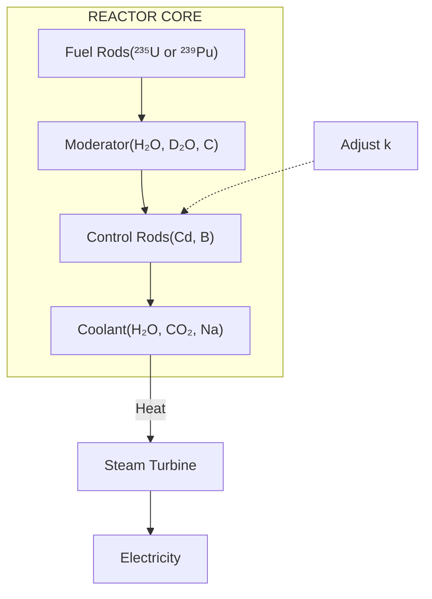

> Master nuclear fission, fusion, chain reactions, and energy generation for JEE Main and Advanced

# Nuclear Reactions: Unleashing the Atom’s Power

## The Trinity Test and Beyond 🎬

*“Now I am become Death, the destroyer of worlds.”* - J. Robert Oppenheimer, July 16, 1945

When the first atomic bomb detonated in the New Mexico desert, it proved Einstein’s E=mc² wasn’t just theory - it was the most powerful force humans had ever harnessed. From weapons to power plants to stars, nuclear reactions shape our universe.

---

## What is a Nuclear Reaction?

**Transformation of nuclei** through collisions or decay.

### Key Differences from Chemical Reactions

| Property | Chemical | Nuclear |
| --- | --- | --- |
| **Involves** | Electrons | Nucleus |
| **Energy** | eV scale | MeV scale (million times more!) |
| **Elements** | Same before/after | Can transmute |
| **Mass change** | Negligible | Measurable (ΔE=mc²) |
| **Rate factors** | Temperature, catalyst | Independent of chemistry |

---

## Conservation Laws

In all nuclear reactions:

:::box
**Conservation Rules**

1. **Mass-Energy:** Total mass-energy conserved (E=mc²)
2. **Charge:** Total charge conserved (Z conserved)
3. **Nucleon number:** Total nucleons conserved (A conserved)
4. **Momentum:** Total momentum conserved
5. **Angular momentum:** Total spin conserved
   :::

**Example:** $^7_3Li + ^1_1H → 2(^4_2He)$

Check:

- A: 7 + 1 = 4 + 4 ✓
- Z: 3 + 1 = 2 + 2 ✓
- Charge: 3 + 1 = 2 + 2 ✓

---

## Q-Value (Energy Release)

Energy released (or absorbed) in nuclear reaction:

:::box
**Q-Value Formula**

$$Q = (M_{reactants} - M_{products}) × c^2$$

or in atomic mass units:

$$Q = Δm × 931.5 \text{ MeV}$$

where Δm = (mass of reactants) - (mass of products)

**Sign Convention:**

- Q > 0 → **Exothermic** (energy released)
- Q < 0 → **Endothermic** (energy absorbed)
  :::

### Alternative Formulation

$$Q = BE_{products} - BE_{reactants}$$

(Energy released = increase in binding energy)

---

## Types of Nuclear Reactions

### 1. Transmutation (Artificial)

**First artificial transmutation** (Rutherford, 1919):

$$^{14}_7N + ^4_2He → ^{17}_8O + ^1_1H$$

Or in shorthand: $^{14}N(α,p)^{17}O$

**General notation:** $X(a,b)Y$

- X = target nucleus
- a = projectile
- b = ejected particle
- Y = product nucleus

### 2. Nuclear Fission

**Heavy nucleus splits into lighter fragments**

$$^{235}_{92}U + n → \text{Fragments} + \text{neutrons} + \text{energy}$$

Typical fission:

$$^{235}U + n → ^{144}Ba + ^{89}Kr + 3n + 200 \text{ MeV}$$

### 3. Nuclear Fusion

**Light nuclei combine to form heavier**

$$^2_1H + ^3_1H → ^4_2He + n + 17.6 \text{ MeV}$$

Powers the Sun and stars!

---

## Nuclear Fission: Splitting the Atom

### Discovery (1938)

- **Otto Hahn & Fritz Strassmann:** Chemical evidence
- **Lise Meitner & Otto Frisch:** Physical explanation
- Realized U-235 splits when hit by neutron

### The Process

```fallback
Neutron
             ↓
    ²³⁵U ←──●──→ Excited ²³⁶U*
                    ↓
              Unstable!
                    ↓
              ╱          ╲
         Fragment1    Fragment2
             +           +
         2-3 neutrons  Energy
```

### Typical Fission Equation

$$^{235}_{92}U + ^1_0n → ^{236}_{92}U^* → ^A_{Z_1}X + ^{A'}_{Z_2}Y + 2-3n + Q$$

where A + A’ ≈ 236

**Common fragments:**

- Mass ~95 (e.g., ⁹⁵Sr, ⁹⁵Y)
- Mass ~140 (e.g., ¹⁴⁰Ba, ¹⁴⁰Xe)

### Energy Release

**~200 MeV per fission** distributed as:

| Component | Energy (MeV) | % |
| --- | --- | --- |
| Kinetic energy of fragments | 165 | 82.5 |
| Neutron kinetic energy | 5 | 2.5 |
| Instant γ-rays | 7 | 3.5 |
| β-particles (delayed) | 8 | 4.0 |
| γ-rays (delayed) | 7 | 3.5 |
| Neutrinos (lost) | 8 | 4.0 |
| **Total** | **200** | **100** |

---

## Chain Reaction

### The Concept

```fallback
1 neutron
       ↓
    ══●══ U-235
    ↙  ↓  ↘
   n   n   n  (3 neutrons released)
   ↓   ↓   ↓
  ●   ●   ●   (3 more fissions)
  ↓   ↓   ↓
  ... ... ... (9 neutrons, then 27, 81, ...)
```

**Self-sustaining** if each fission causes ≥1 more fission!

### Neutron Multiplication Factor (k)

:::box

$$k = \frac{\text{Number of neutrons in generation n+1}}{\text{Number of neutrons in generation n}}$$

**Three regimes:**

- **k < 1:** Subcritical (reaction dies out)
- **k = 1:** Critical (steady state)
- **k > 1:** Supercritical (exponential growth)
  :::

### Critical Mass

**Minimum mass** needed for sustained chain reaction.

**For ²³⁵U sphere:** ~52 kg (bare), ~15 kg (with reflector)
**For ²³⁹Pu sphere:** ~10 kg (bare), ~5 kg (with reflector)

**Depends on:**

- Shape (sphere is optimal)
- Purity
- Neutron reflector
- Moderator

---

## Fissile vs Fertile Materials

### Fissile (Can fission with slow neutrons)

| Isotope | Natural? | Critical Mass |
| --- | --- | --- |
| ²³³U | No (made from Th) | ~15 kg |
| ²³⁵U | Yes (0.7% in U) | ~52 kg |
| ²³⁹Pu | No (made from U) | ~10 kg |

### Fertile (Can become fissile)

| Isotope | Converts to |
| --- | --- |
| ²³²Th | ²³³U (fissile) |
| ²³⁸U | ²³⁹Pu (fissile) |

**Breeding reaction:**

$$^{238}U + n → ^{239}U → ^{239}Np + β^- → ^{239}Pu + β^-$$

---

## Nuclear Reactor

### Basic Components



### Functions

1. **Fuel:** Provides fissile material (²³⁵U ~3-5% enrichment)
2. **Moderator:** Slows down neutrons

   - Fast neutrons (2 MeV) → Slow neutrons (0.025 eV)
   - Increases fission probability
   - Materials: H₂O, D₂O, graphite (C)
3. **Control Rods:** Absorb neutrons to control k

   - Cadmium, boron, hafnium
   - Insert deeper → more neutrons absorbed → k↓
4. **Coolant:** Removes heat

   - Water, heavy water, liquid sodium
   - Heat → steam → turbine → electricity
5. **Shielding:** Protects from radiation

   - Concrete, lead

---

## Nuclear Fusion: Power of the Stars

### Why Fusion?

```fallback
BE/A curve:
    ╱■╲
   ╱   ╲
  ╱     ╲
Light → Heavy = CLIMB UP = Energy OUT!
```

Combining light nuclei increases BE/A → releases energy!

### Stellar Fusion (The Sun)

**Proton-Proton Chain:**

$$4(^1_1H) → ^4_2He + 2e^+ + 2ν_e + 26.7 \text{ MeV}$$

Detailed steps:

1. $p + p → ^2H + e^+ + ν_e$ (slow!)
2. $^2H + p → ^3He + γ$
3. $^3He + ^3He → ^4He + 2p$

**CNO Cycle** (in massive stars):
Uses C, N, O as catalysts.

### Fusion Reactions (Laboratory/Weapons)

:::box
**D-T Reaction** (easiest to achieve):

$$^2_1H + ^3_1H → ^4_2He (3.5 \text{ MeV}) + n (14.1 \text{ MeV})$$

Total: **17.6 MeV**

**D-D Reactions:**

$$^2H + ^2H → ^3He (0.82 \text{ MeV}) + n (2.45 \text{ MeV})$$

$$^2H + ^2H → ^3H (1.01 \text{ MeV}) + p (3.02 \text{ MeV})$$

:::

---

## Fusion Challenges

### The Coulomb Barrier

Both nuclei are **positive** → repel!

$$E_{barrier} = \frac{kZ_1Z_2e^2}{r}$$

For D+T at contact (~4 fm):

$$E_{barrier} ≈ 0.4 \text{ MeV}$$

**Classical:** Need particles with KE > 0.4 MeV
**Temperature:** $kT ≈ 0.4 \text{ MeV} → T ≈ 5 × 10^9 \text{ K}$! 🌡️

**Quantum tunneling** allows fusion at lower T:
**Sun’s core:** 15 million K
**Lab fusion:** 100-150 million K needed

### Lawson Criterion

For net energy gain, need:

:::box

$$nτ > 10^{20} \text{ s/m}^3$$

where:

- n = particle density
- τ = confinement time
  :::

**Two approaches:**

1. **Magnetic confinement** (Tokamak):

   - Low density, long confinement
   - ITER project
2. **Inertial confinement** (Laser):

   - Very high density, short confinement
   - NIF (National Ignition Facility)

### Interactive Demo: Visualize Nuclear Reactions

Explore fission and fusion reactions, watching how nuclei split or combine to release energy.

---

## Comparison: Fission vs Fusion

| Property | Fission | Fusion |
| --- | --- | --- |
| **Nuclei** | Heavy → Light | Light → Heavy |
| **Example** | ²³⁵U → Ba + Kr | D + T → He |
| **Energy/reaction** | ~200 MeV | ~17.6 MeV |
| **Energy/kg** | ~10¹³ J | ~10¹⁴ J (10× more!) |
| **Fuel** | Uranium (limited) | Deuterium (abundant) |
| **Waste** | Radioactive (long-lived) | Minimal, short-lived |
| **Control** | Relatively easy | Very difficult |
| **Status** | Commercial power | Still experimental |
| **Weapons** | Atomic bomb | Hydrogen bomb |
| **Temperature** | Room temp OK | Millions of degrees! |
| **Runaway** | Meltdown risk | Reaction stops if containment fails |

---

## Interactive Demo: Fusion vs Fission Calculator

```javascript
const NuclearEnergyCalculator = () => {
  const [reactionType, setReactionType] = useState('fission');
  const [mass, setMass] = useState(1); // kg

  // Energy values
  const fissionEnergy = 200; // MeV per fission
  const fusionEnergy = 17.6; // MeV per D-T fusion

  const avogadro = 6.022e23;

  let energyPerKg, totalEnergy, comparison;

  if (reactionType === 'fission') {
    // U-235 fission
    const atomsPerKg = (mass * 1000 / 235) * avogadro;
    const totalMeV = atomsPerKg * fissionEnergy;
    energyPerKg = 8.2e13; // J/kg
    totalEnergy = mass * energyPerKg;
    comparison = totalEnergy / (mass * 4.6e6); // Compare to TNT
  } else {
    // D-T fusion (approximate as D-D for calculation)
    const atomsPerKg = (mass * 1000 / 2.5) * avogadro; // Average mass
    const totalMeV = atomsPerKg * fusionEnergy / 2; // Two atoms per fusion
    energyPerKg = 3.4e14; // J/kg
    totalEnergy = mass * energyPerKg;
    comparison = totalEnergy / (mass * 4.6e6);
  }

  return (
    <div>
      <h3>Nuclear Energy Calculator</h3>

      <label>Reaction Type:</label>
      <select value={reactionType} onChange={(e) => setReactionType(e.target.value)}>
        <option value="fission">Fission (U-235)</option>
        <option value="fusion">Fusion (D-T)</option>
      </select>

      <label>Mass of fuel: {mass} kg</label>
      <input
        type="range"
        min="0.1"
        max="10"
        step="0.1"
        value={mass}
        onChange={(e) => setMass(Number(e.target.value))}
      />

      <div className="results">
        <h4>Energy Output:</h4>
        {reactionType === 'fission' ? (
          <>
            <p>Reaction: ²³⁵U → fragments + neutrons</p>
            <p>Energy per fission: {fissionEnergy} MeV</p>
            <p>Energy per kg: {(energyPerKg/1e13).toFixed(1)} × 10¹³ J</p>
          </>
        ) : (
          <>
            <p>Reaction: ²H + ³H → ⁴He + n</p>
            <p>Energy per fusion: {fusionEnergy} MeV</p>
            <p>Energy per kg: {(energyPerKg/1e14).toFixed(1)} × 10¹⁴ J</p>
          </>
        )}

        <p style={{fontSize: '1.2em', color: 'green'}}>
          Total Energy: {totalEnergy.toExponential(2)} J
        </p>

        <h4>Comparisons:</h4>
        <p>Equivalent to {comparison.toFixed(0)} kg of TNT</p>
        <p>Could power a 100W bulb for {(totalEnergy/100/3600/24/365).toExponential(1)} years!</p>

        {reactionType === 'fusion' && (
          <p style={{color: 'blue'}}>
            Fusion releases {(energyPerKg/8.2e13).toFixed(0)}× more energy per kg than fission!
          </p>
        )}

        <h4>Environmental Note:</h4>
        {reactionType === 'fission' ? (
          <p>⚠ Produces long-lived radioactive waste</p>
        ) : (
          <p>✓ Clean energy, minimal radioactive waste</p>
        )}
      </div>
    </div>
  );
};
```

---

## Memory Tricks 🧠

### “FISSION vs FUSION”

**FISSION:**
**F**ragments formed
**I**s currently used (power plants)
**S**plits heavy nuclei
**S**low neutrons needed
**I**s established technology
**O**lder discovery (1938)
**N**uclear waste problem

**FUSION:**
**F**uses light nuclei
**U**ltra-high temperature
**S**un’s energy source
**I**n development (ITER)
**O**cean has fuel (deuterium)
**N**o long-lived waste

### Chain Reaction Memory

```fallback
1
   ╱│╲
  2 2 2  → k=2 (supercritical)

    1
    │   → k=1 (critical)
    1

    1
    ╱  → k<1 (dies out)
   0.5
```

### Energy Order of Magnitude

- **Chemical:** 1 eV per reaction
- **Fission:** 200 MeV per reaction (200 million times!)
- **Fusion:** 20 MeV per reaction

**“Millions more from nuclear than chemical!”**

---

## Common Mistakes ⚠️

### ❌ Mistake 1: Energy comparison

**Wrong:** “Fission releases more energy than fusion”
**Right:** Per kg, fusion releases ~10× more; per reaction, fission ~10× more

### ❌ Mistake 2: Q-value sign

**Wrong:** Q negative for energy release
**Right:** Q positive for energy release (products lighter)

### ❌ Mistake 3: Critical mass

**Wrong:** “Any amount of U-235 will explode”
**Right:** Need critical mass for chain reaction

### ❌ Mistake 4: Fusion fuel

**Wrong:** “Fusion uses uranium”
**Right:** Fusion uses hydrogen isotopes (D, T)

### ❌ Mistake 5: Conservation laws

**Wrong:** Forgetting to conserve both A and Z
**Right:** Check both before and after!

---

## Important Numerical Values

### Fission

| Quantity | Value |
| --- | --- |
| Energy per U-235 fission | ~200 MeV |
| Energy per kg U-235 | 8.2 × 10¹³ J |
| Critical mass U-235 (bare sphere) | ~52 kg |
| Neutrons per fission | 2-3 (average 2.5) |

### Fusion

| Reaction | Q-value (MeV) |
| --- | --- |
| D + T → He + n | 17.6 |
| D + D → He-3 + n | 3.27 |
| D + D → T + p | 4.03 |
| p + p → D + e⁺ + ν | 0.42 |

### Conversion Factors

| Energy | Equivalent |
| --- | --- |
| 1 kg matter (E=mc²) | 9 × 10¹⁶ J |
| 1 kg TNT | 4.6 × 10⁶ J |
| 1 kg U-235 fission | ~17 kilotons TNT |
| 1 kg D-T fusion | ~100 kilotons TNT |

---

## Practice Problems

### Level 1: JEE Main Basics

**Q1.** Complete the nuclear reaction: $^7_3Li + ^1_1H → 2X$. Find X.

**Solution:**

```fallback
Conserve A: 7 + 1 = 2A → A = 4
Conserve Z: 3 + 1 = 2Z → Z = 2

X = ⁴₂He (alpha particle)

Reaction: ⁷₃Li + ¹₁H → 2(⁴₂He)
```

**Q2.** Calculate Q-value for above reaction.
Given: m(Li-7) = 7.016 u, m(H-1) = 1.008 u, m(He-4) = 4.003 u

**Solution:**

```fallback
Δm = [m(Li) + m(H)] - 2m(He)
Δm = [7.016 + 1.008] - 2(4.003)
Δm = 8.024 - 8.006 = 0.018 u

Q = Δm × 931.5 = 0.018 × 931.5
Q = 16.77 MeV (exothermic!)
```

**Q3.** If neutron multiplication factor k = 1.002, is the reactor subcritical, critical, or supercritical?

**Solution:**

```fallback
k > 1 → Supercritical
Reaction growing exponentially!
(Need to insert control rods)
```

---

### Level 2: JEE Main/Advanced

**Q4.** A nuclear reactor produces 1000 MW power. How many U-235 atoms fission per second? (Energy per fission = 200 MeV)

**Solution:**

```fallback
Power = 1000 MW = 10⁹ W = 10⁹ J/s

Energy per fission = 200 MeV
                   = 200 × 1.6 × 10⁻¹³ J
                   = 3.2 × 10⁻¹¹ J

Fissions per second = Power / Energy per fission
                    = 10⁹ / (3.2 × 10⁻¹¹)
                    = 3.125 × 10¹⁹ fissions/s
```

**Q5.** Calculate the energy released in the fusion reaction:
$^2_1H + ^2_1H → ^3_2He + ^1_0n$

Given: m(D) = 2.014 u, m(He-3) = 3.016 u, m(n) = 1.009 u

**Solution:**

```fallback
Δm = 2m(D) - [m(He-3) + m(n)]
Δm = 2(2.014) - [3.016 + 1.009]
Δm = 4.028 - 4.025 = 0.003 u

Q = 0.003 × 931.5 = 2.79 MeV
```

**Q6.** In a chain reaction, each fission produces 2.5 neutrons on average. If 80% are lost, what is the multiplication factor?

**Solution:**

```fallback
Neutrons produced per fission = 2.5
Neutrons lost = 80% of 2.5 = 2.0
Neutrons causing next fission = 0.5

k = 0.5/1 = 0.5

Subcritical! (k < 1)
Reaction will die out.
```

---

### Level 3: JEE Advanced

**Q7.** Show that 1 kg of matter, if completely converted to energy, equals about 21.5 megatons of TNT.

**Solution:**

```fallback
E = mc² = 1 kg × (3×10⁸ m/s)²
E = 9 × 10¹⁶ J

1 kg TNT = 4.184 × 10⁶ J
1 kiloton TNT = 4.184 × 10¹² J (standard)
Equivalent TNT = (9×10¹⁶) / (4.184×10¹²) = 21,500 kilotons ≈ 21.5 megatons ✓
(Hiroshima bomb was ~15 kt — about 1400× less!)
```

**Q8.** A fusion reactor runs on D-T reaction. If it produces 1000 MW power with 30% efficiency, how much tritium is consumed per day?

**Solution:**

```fallback
Thermal power needed = 1000/0.3 = 3333 MW

Energy per D-T fusion = 17.6 MeV = 2.82 × 10⁻¹² J

Fusions per second = (3.333×10⁹) / (2.82×10⁻¹²)
                   = 1.18 × 10²¹ /s

Each fusion consumes 1 tritium atom.

Tritium atoms per day = 1.18×10²¹ × 86400
                      = 1.02 × 10²⁶

Mass of tritium = (1.02×10²⁶ / 6.022×10²³) × 3 g
                = 508 g ≈ 0.5 kg per day

(Very little fuel needed!)
```

**Q9.** A bare sphere of Pu-239 has critical mass 10 kg. If surrounded by neutron reflector that reduces neutron loss by 50%, what is new critical mass?

**Solution:**

```fallback
Critical mass depends on neutron loss.

With reflector, neutrons reflected back
→ Less mass needed for criticality

Reduction in loss by 50% roughly means:
Critical mass reduces by ~50%

New critical mass ≈ 5 kg

(This is why bombs use reflectors/tampers!)
```

**Q10.** In Sun’s core, proton-proton chain converts 4p → He + 2e⁺ + 2ν + 26.7 MeV. If Sun radiates 3.8 × 10²⁶ W, how much mass is lost per second?

**Solution:**

```fallback
Power = 3.8 × 10²⁶ W = 3.8 × 10²⁶ J/s

From E = mc²:
dm/dt = P/c² = (3.8×10²⁶) / (9×10¹⁶)
      = 4.2 × 10⁹ kg/s

Sun loses 4.2 billion kg per second!

Yet Sun's mass = 2 × 10³⁰ kg
Lifetime ≈ 10¹⁰ years

Plenty of fuel left! ☀️
```

---

## Applications

### 1. Nuclear Power Plants

**Worldwide:**

- ~450 reactors in 30 countries
- ~10% of world electricity
- France: 70% nuclear
- India: Growing nuclear program

**Types:**

- PWR (Pressurized Water Reactor)
- BWR (Boiling Water Reactor)
- PHWR (Pressurized Heavy Water Reactor - India)
- Fast Breeder Reactor

### 2. Nuclear Weapons

**Fission bombs:**

- Hiroshima (Little Boy): Gun-type U-235
- Nagasaki (Fat Man): Implosion Pu-239
- Yield: 15-20 kilotons

**Fusion bombs (H-bombs):**

- Fission primary triggers fusion
- Yield: Megatons (1000× more!)
- Largest: Tsar Bomba (50 megatons)

### 3. Medical Applications

- **Cancer therapy:** Proton beams, gamma knife
- **Radioisotopes:** Tc-99m for imaging
- **Sterilization:** Gamma rays

### 4. Space Exploration

- **RTGs** (Radioisotope Thermoelectric Generators)
- Voyager, Curiosity rover
- Pu-238 decay heat → electricity

### 5. Research

- **Particle accelerators:** Transmutation studies
- **Neutron scattering:** Material structure
- **Radioactive tracers:** Biological pathways

---

## Future of Nuclear Energy

### Generation IV Reactors

- **Molten Salt Reactors:** Liquid fuel
- **High Temperature Gas Reactors:** Efficiency
- **Fast Reactors:** Breed and burn waste

### Fusion Power

**ITER** (International Thermonuclear Experimental Reactor):

- Under construction in France
- Goal: Q = 10 (10× more energy out than in)
- First plasma: ~2025
- Commercial fusion: 2050s?

**Advantages:**

- Abundant fuel (deuterium from seawater)
- No CO₂ emissions
- No long-lived waste
- Inherently safe (can’t run away)

**Challenges:**

- Extreme temperatures (10× hotter than Sun)
- Plasma confinement
- Materials that can withstand neutrons
- Still net energy negative

---

## Cross-Links to Related Topics

- [Binding Energy](../binding-energy/index.md) - Why fission & fusion release energy
- [Radioactivity](../radioactivity/index.md) - Natural nuclear transformations
- [Nuclear Structure](../nuclear-structure/index.md) - Composition and mass defect
- [Mass-Energy Equivalence](../index.md) - E=mc² foundation

---

## Quick Revision Checklist ✓

- Nuclear reaction: Nucleus transformation
- Conservation: A, Z, charge, energy, momentum
- Q-value: Q = Δm × 931.5 MeV
- Q > 0 → exothermic (energy released)
- Fission: Heavy → light fragments (~200 MeV)
- Fusion: Light → heavier (~17.6 MeV for D-T)
- Chain reaction: Self-sustaining if k ≥ 1
- Critical mass: Minimum for chain reaction
- Fissile: ²³³U, ²³⁵U, ²³⁹Pu
- Fertile: ²³²Th, ²³⁸U (become fissile)
- Moderator: Slows neutrons
- Control rods: Absorb neutrons
- Fusion needs high T (Coulomb barrier)
- Lawson criterion: nτ > 10²⁰ s/m³

---

## Final Tips for JEE

1. **Conservation always:** Check A and Z in every reaction
2. **Q-value mastery:** Know Δm × 931.5 formula
3. **Sign convention:** Q > 0 means energy OUT
4. **Fission vs fusion:** Know which releases more per kg vs per reaction
5. **Critical mass:** Understand k factor
6. **BE/A curve:** Both fission and fusion climb toward Fe-56
7. **Practical values:** Know ~200 MeV (fission), ~17.6 MeV (D-T fusion)
8. **Units:** MeV for nuclear, J for macroscopic
9. **Applications:** Reactors, bombs, Sun, medical
10. **Future:** ITER, Generation IV, fusion power coming

---

*Last updated: May 12, 2025*
*Previous: [Radioactivity](../radioactivity/index.md)*
*Congratulations! You’ve completed the Modern Physics series!*

---

## Complete Modern Physics Series

You’ve now mastered all major topics in Modern Physics:

### Dual Nature of Radiation

1. [Photoelectric Effect](../../dual-nature/photoelectric-effect/index.md)
2. [de Broglie Hypothesis](../../dual-nature/de-broglie/index.md)
3. [Davisson-Germer Experiment](../../dual-nature/davisson-germer/index.md)

### Atoms and Nuclei

4. [Rutherford Model](../rutherford-model/index.md)
5. [Bohr Model](../bohr-model/index.md)
6. [Hydrogen Spectrum](../hydrogen-spectrum/index.md)
7. [Nuclear Structure](../nuclear-structure/index.md)
8. [Binding Energy](../binding-energy/index.md)
9. [Radioactivity](../radioactivity/index.md)
10. [Nuclear Reactions](index.md)

**You’re now ready to tackle any JEE Modern Physics problem!** 🎯🚀

From TestGuru · our mock-test platform

## You've read Nuclear Reactions - Fission, Fusion, and Applications.You've read this topic. Find out what you actually got.

A free JEE Main mock with this chapter in it, and a report that shows which sub-topics cost you marks.

[Take a free JEE Main mock →](https://app.testguru.co/signup?tg_chapter=atoms-nuclei&tg_exam=jee-main&tg_page=%2Fphysics%2Fatoms-nuclei%2Fnuclear-reactions%2F&tg_subject=physics&utm_campaign=notes-jee-main-free-test&utm_content=article-end&utm_medium=referral&utm_source=jeenotes)
Free, no card. Opens TestGuru in a new tab.

## Stay exam-ready

One email every Sunday: new notes, the week's hardest challenge question and a revision plan.One email every Sunday.

## Comments

Have a question or spotted a mistake? Join the discussion below.

Advertisement

Advertisement

---

## Extracted page code (interactive scripts & widgets)


### inline-script-16

```js
if(!document.getElementById("animation-fullscreen-overlay")){const e=document.createElement("div");e.id="animation-fullscreen-overlay",e.className="animation-fullscreen-overlay",e.innerHTML=`
      <div class="fullscreen-modal">
        <div class="fullscreen-header">
          <span class="fullscreen-title">Interactive Demo</span>
          <button class="fullscreen-close-btn" onclick="JEEAnimations.closeFullscreen()" title="Close (Esc)" aria-label="Close fullscreen">
            <svg width="24" height="24" viewBox="0 0 24 24" fill="none" stroke="currentColor" stroke-width="2" stroke-linecap="round" stroke-linejoin="round">
              <line x1="18" y1="6" x2="6" y2="18"></line>
              <line x1="6" y1="6" x2="18" y2="18"></line>
            </svg>
          </button>
        </div>
        <div class="fullscreen-content"></div>
      </div>
    `,document.body.appendChild(e),document.addEventListener("keydown",function(e){e.key==="Escape"&&document.body.classList.contains("animation-fullscreen-active")&&JEEAnimations.closeFullscreen()}),e.addEventListener("click",function(t){t.target===e&&JEEAnimations.closeFullscreen()})}
```


### inline-script-17

```js
(function(){var t,e=document.getElementById("disqus-load");if(!e)return;t=!1,e.addEventListener("click",function(){if(t)return;t=!0,e.setAttribute("disabled","disabled"),e.textContent="Loading comments…",window.disqus_config=function(){this.page.url="https://jeenotes.in/physics/atoms-nuclei/nuclear-reactions/",this.page.identifier="/physics/atoms-nuclei/nuclear-reactions/"};var s=document,n=s.createElement("script");n.src="https://https-jeenotes-in.disqus.com/embed.js",n.setAttribute("data-timestamp",+new Date),n.onload=function(){e.style.display="none"},n.onerror=function(){t=!1,e.removeAttribute("disabled"),e.textContent="Could not load comments. Tap to retry"},(s.head||s.body).appendChild(n)})})()
```


### inline-script-18

```js
(function(){var t,e=document.currentScript.previousElementSibling;function n(){(window.adsbygoogle=window.adsbygoogle||[]).push({})}if(!window.ResizeObserver||e.clientWidth>0){n();return}t=new ResizeObserver(function(){e.clientWidth>0&&(t.disconnect(),n())}),t.observe(e)})()
```


### interactive-widget-1

```html
<div class="animation-wrapper" data-animation="nuclearDecay" id="anim-nuclearDecay-1795396422832898127"><div class="animation-header"><button aria-label="Toggle fullscreen" class="anim-fullscreen-btn" onclick='JEEAnimations.toggleFullscreen("anim-nuclearDecay-1795396422832898127")' title="Fullscreen (F)">
<svg class="fullscreen-icon-expand" fill="none" height="18" stroke="currentColor" stroke-linecap="round" stroke-linejoin="round" stroke-width="2" viewbox="0 0 24 24" width="18"><polyline points="15 3 21 3 21 9"></polyline><polyline points="9 21 3 21 3 15"></polyline><line x1="21" x2="14" y1="3" y2="10"></line><line x1="3" x2="10" y1="21" y2="14"></line></svg>
<svg class="fullscreen-icon-collapse" fill="none" height="18" stroke="currentColor" stroke-linecap="round" stroke-linejoin="round" stroke-width="2" viewbox="0 0 24 24" width="18"><polyline points="4 14 10 14 10 20"></polyline><polyline points="20 10 14 10 14 4"></polyline><line x1="14" x2="21" y1="10" y2="3"></line><line x1="3" x2="10" y1="21" y2="14"></line></svg>
<span class="fullscreen-text">Fullscreen</span></button></div><div class="animation-content"><noscript><div class="callout callout-warning"><div class="callout-title">JavaScript Required</div><p>This interactive animation requires JavaScript to be enabled.</p></div></noscript></div></div>
```


---

_Source: [https://jeenotes.in/physics/atoms-nuclei/nuclear-reactions/](https://jeenotes.in/physics/atoms-nuclei/nuclear-reactions/) · raw HTML: `offline/physics/atoms-nuclei/nuclear-reactions/index.html`_
