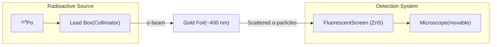

> Master alpha particle scattering, impact parameter, and nuclear structure for JEE Main and Advanced

# Rutherford’s Alpha Scattering: The Atomic Bombshell

## The Oppenheimer Manhattan Project Connection 🎬

Before Oppenheimer could harness nuclear energy, Rutherford had to discover the nucleus itself! His alpha scattering experiment (1911) was like shooting bullets at tissue paper and having some bounce straight back - impossible unless atoms have a tiny, dense core.

*“It was quite the most incredible event that has ever happened to me in my life. It was almost as incredible as if you fired a 15-inch shell at a piece of tissue paper and it came back and hit you.”* - Ernest Rutherford

---

## Before Rutherford: Thomson’s Plum Pudding Model

### J.J. Thomson (1904)

> **◐ In simple terms · Plum Pudding Model**
>
> Atom visualized as a **sphere of positive charge** with **electrons embedded** throughout like plums in a pudding.
>
> - Positive charge distributed uniformly (the “pudding”)

> - Negative electrons scattered within (the “plums”)

> - Overall electrically neutral

**Assumptions:**

- Atom is sphere of positive charge (~10⁻¹⁰ m diameter)
- Electrons embedded uniformly
- Electrically neutral overall

**Prediction:** Alpha particles should pass through with small deflections

**Reality:** Some bounced straight back! 💥

---

## Geiger-Marsden Experiment (1909)

### The Setup



### Components

1. **Source**: ²¹⁰Po or ²²⁶Ra (α emitters)
2. **Collimator**: Lead box with narrow opening
3. **Target**: Thin gold foil (~400 nm thick)
4. **Detector**: ZnS scintillation screen + microscope
5. **Observation**: Count flashes at different angles

---

## Experimental Observations

### The Shocking Results

| Scattering Angle | Observation | Percentage |
| --- | --- | --- |
| θ < 10° | Small deflection | ~98% |
| 10° < θ < 90° | Medium deflection | ~2% |
| 90° < θ < 180° | Large deflection | ~0.01% |
| θ ≈ 180° | **Backward scattering!** | ~1 in 8000 |

### Key Findings

1. **Most α-particles pass straight through** (or small deflection)

   - Atom is mostly empty space!
2. **Few undergo large deflection**

   - Occasional close encounter with something
3. **Very few bounce back**

   - Direct hit on something massive and positive
4. **Scattering depends on**:

   - Target material (atomic number Z)
   - α-particle energy
   - Foil thickness
   - Scattering angle

---

## Rutherford’s Nuclear Model

### The Revolutionary Idea

```fallback
Mostly empty space
     ╱                    ╲
    │    ⊖                │
    │         ⊕⊕⊕          │ ← Tiny, massive,
    │         ⊕⊕⊕          │   positive nucleus
    │    ⊖   ⊕⊕⊕    ⊖     │   (r ~ 10⁻¹⁵ m)
    │                     │
     ╲    ⊖          ⊖   ╱
       Electrons in orbit
       (atom size ~ 10⁻¹⁰ m)
```

### Key Features

1. **Nucleus**

   - Contains all positive charge (+Ze)
   - Contains almost all mass
   - Extremely small: r_nucleus ~ 10⁻¹⁵ m
   - Density ~ 10¹⁷ kg/m³
2. **Electrons**

   - Orbit the nucleus
   - Occupy large volume
   - r_atom ~ 10⁻¹⁰ m
3. **Empty Space**

   - Most of atom is vacuum!
   - r_atom/r_nucleus ~ 10⁵ (like football in stadium!)

---

## The Physics of Alpha Scattering

### Coulomb Interaction

Alpha particle (+2e) approaching nucleus (+Ze):

:::box
**Coulomb Force**

$$F = \frac{1}{4πε_0} \frac{(2e)(Ze)}{r^2} = \frac{k(2Ze^2)}{r^2}$$

where k = 9 × 10⁹ N·m²/C²
:::

### Hyperbolic Trajectory

```fallback
α-particle path
              ╱
             ╱
    ────────●────────  Impact parameter b
           ╱ ╲
          ╱   ╲
         ╱  ⊕  ╲ ← Nucleus
        ╱   │   ╲
           θ
    Scattering angle
```

**Not a parabola!** It’s a hyperbola due to repulsive Coulomb force.

---

## Distance of Closest Approach (r₀)

When α-particle approaches head-on (b = 0):

### Energy Conservation

At closest approach, all kinetic energy → potential energy:

$$K_i + U_i = K_f + U_f$$

At infinity: $U_i = 0$, $K_i = \frac{1}{2}mv^2$

At r₀: $K_f = 0$ (momentarily at rest), $U_f = \frac{k(2Ze^2)}{r_0}$

:::box
**Distance of Closest Approach**

$$r_0 = \frac{k(2Ze^2)}{K} = \frac{2kZe^2}{\frac{1}{2}mv^2}$$

or in terms of kinetic energy K:

$$r_0 = \frac{2kZe^2}{K} = \frac{4πε_0 \cdot 2Ze^2}{K}$$

**Simplified:**

$$r_0 = \frac{2.88 \times Z}{K(\text{MeV})} \text{ fm}$$

(since $ke^2 = 1.44$ MeV·fm and the α-particle carries charge $+2e$, the numeric constant is $2 \times 1.44 = 2.88$)

where 1 fm = 10⁻¹⁵ m
:::

### Physical Meaning

- **Estimate of nuclear size**: r_nucleus ≤ r₀
- If r₀ ~ 10⁻¹⁴ m and no penetration → nucleus smaller than 10⁻¹⁴ m
- Modern value: r_nucleus ~ 1-10 fm

---

## Impact Parameter (b)

**Definition:** Perpendicular distance between incident path and nucleus center if there were no deflection.

```fallback
↓ v
    ├─── b ───┤
    ↓         ⊕
    ↓        Nucleus
```

### Relationship with Scattering Angle

:::box
**Impact Parameter Formula**

$$b = \frac{k(2e)(Ze)}{2K} \cot\left(\frac{θ}{2}\right) = \frac{kZe^2}{K} \cot\left(\frac{θ}{2}\right)$$

or

$$b = \frac{r_0}{2} \cot\left(\frac{θ}{2}\right)$$

where:

- b = impact parameter
- θ = scattering angle
- r₀ = distance of closest approach (for θ = 180°)
  :::

### Key Insights

| Impact Parameter | Scattering Angle | Physical Picture |
| --- | --- | --- |
| b → 0 | θ → 180° | Head-on collision |
| b small | θ large | Close encounter |
| b large | θ small | Distant encounter |
| b → ∞ | θ → 0° | No deflection |

---

## Rutherford Scattering Formula

Number of α-particles scattered at angle θ into solid angle dΩ:

:::box
**Rutherford Formula**

$$\frac{dN}{dΩ} = \frac{N_i t n}{16r^2} \left(\frac{2kZe^2}{K}\right)^2 \cosec^4\left(\frac{θ}{2}\right)$$

where:

- N_i = number of incident particles
- t = foil thickness
- n = number density of atoms (atoms/m³)
- r = distance to detector
- K = kinetic energy of α-particles
- θ = scattering angle
  :::

### Simplified Form

$$N(θ) \propto \frac{Z^2}{K^2 \sin^4(θ/2)}$$

### Predictions

1. **N ∝ Z²**: Heavier nuclei scatter more
2. **N ∝ 1/K²**: Slower particles scatter more
3. **N ∝ 1/sin⁴(θ/2)**: Most scatter at small angles
4. **N ∝ t**: Thicker foils scatter more

All verified experimentally! ✓

---

## Interactive Demo: Alpha Scattering Simulator

```javascript
const AlphaScatteringSimulator = () => {
  const [energy, setEnergy] = useState(5); // MeV
  const [atomicNumber, setAtomicNumber] = useState(79); // Gold
  const [impactParam, setImpactParam] = useState(10); // fm

  const k = 1.44; // MeV·fm (in convenient units)
  const r0 = (2 * k * atomicNumber) / energy;

  // Calculate scattering angle
  const cotHalfTheta = (2 * impactParam) / r0; // b = (r0/2) cot(θ/2)
  const halfTheta = Math.atan(1 / cotHalfTheta);
  const theta = 2 * halfTheta * (180 / Math.PI);

  // Closest approach for this trajectory
  const rMin = (r0 / 2) * (1 + Math.sqrt(1 + (2 * impactParam / r0) ** 2));

  return (
    <div>
      <h3>Rutherford Alpha Scattering</h3>

      <label>α Energy: {energy} MeV</label>
      <input
        type="range"
        min="1"
        max="10"
        step="0.5"
        value={energy}
        onChange={(e) => setEnergy(Number(e.target.value))}
      />

      <label>Target Element (Z): {atomicNumber}</label>
      <select
        value={atomicNumber}
        onChange={(e) => setAtomicNumber(Number(e.target.value))}
      >
        <option value="29">Copper (Z=29)</option>
        <option value="47">Silver (Z=47)</option>
        <option value="79">Gold (Z=79)</option>
        <option value="82">Lead (Z=82)</option>
      </select>

      <label>Impact Parameter: {impactParam} fm</label>
      <input
        type="range"
        min="0"
        max="100"
        value={impactParam}
        onChange={(e) => setImpactParam(Number(e.target.value))}
      />

      <div className="results">
        <h4>Results:</h4>
        <p>Distance of closest approach (head-on): {r0.toFixed(2)} fm</p>
        <p>Scattering angle: {theta.toFixed(1)}°</p>
        <p>Closest approach for this b: {rMin.toFixed(2)} fm</p>

        {theta > 90 ? (
          <p style={{color: 'red'}}>
            ⚠️ Large deflection! Close nuclear encounter
          </p>
        ) : theta > 10 ? (
          <p style={{color: 'orange'}}>
            Medium deflection - nuclear influence
          </p>
        ) : (
          <p style={{color: 'green'}}>
            Small deflection - distant encounter
          </p>
        )}

        <h4>Nuclear size estimate:</h4>
        <p>Nucleus radius &lt; {r0.toFixed(1)} fm</p>
        <p>(Actual r ≈ {(1.2 * Math.pow(atomicNumber, 1/3)).toFixed(1)} fm)</p>
      </div>
    </div>
  );
};
```

---

## Memory Tricks 🧠

### “RUTHERFORD” for Key Points

**R**epulsive Coulomb force
**U**nexpected backward scattering
**T**iny nucleus (~10⁻¹⁵ m)
**H**eavy nucleus (most mass)
**E**mpty space (most of atom)
**R**evolutionary model
**F**oiled the plum pudding!
**O**rbiting electrons
**R**ange: atom is 10⁵ times nucleus
**D**istance of closest approach

### Impact Parameter Song 🎵

```fallback
"Small b, big θ" (close → scatter)
"Big b, small θ" (far → pass through)
"Zero b, flip around" (180°)
"Infinite b, straight through" (0°)
```

### r₀ Formula Trick

$$r_0 = \frac{2kZe^2}{K}$$

**“2 Kisses (2k) to ZEE² with K”**

In practical units:

$$r_0 \text{ (fm)} = \frac{2.88 \times Z}{K \text{ (MeV)}}$$

**“2.88 times Z over K in MeV”** (the 2.88 = 2 × 1.44, the factor 2 from the α-particle’s charge)

### Interactive Demo: Visualize Bohr Model Orbits

See how electrons orbit the nucleus in quantized energy levels according to the Bohr model.

---

## Common Mistakes ⚠️

### ❌ Mistake 1: Confusing r₀ with atomic radius

**Wrong:** “r₀ = 10⁻¹⁴ m is the atom size”
**Right:** r₀ is closest approach to nucleus; atom is ~10⁻¹⁰ m

### ❌ Mistake 2: Wrong angle in formulas

**Wrong:** Using θ instead of θ/2
**Right:** cot(θ/2), sin⁴(θ/2), etc.

### ❌ Mistake 3: Forgetting α charge

**Wrong:** F = kZe²/r²
**Right:** F = k(2e)(Ze)/r² = 2kZe²/r² (α has charge +2e)

### ❌ Mistake 4: Impact parameter sign

**Wrong:** b can be negative
**Right:** b is always positive (perpendicular distance)

### ❌ Mistake 5: Mixing units

**Wrong:** k in SI, E in MeV, r in fm
**Right:** Use consistent units or conversion formula

---

## Important Values & Constants

### Fundamental Constants

| Constant | Symbol | Value (SI) | Value (atomic) |
| --- | --- | --- | --- |
| Coulomb constant | k | 9 × 10⁹ N·m²/C² | 1.44 MeV·fm |
| Electron charge | e | 1.6 × 10⁻¹⁹ C | - |
| ke² | - | 1.44 × 10⁻⁹ eV·m | 1.44 MeV·fm |

### Typical Values

| Quantity | Typical Value |
| --- | --- |
| α-particle energy | 4-8 MeV |
| Gold nucleus (Z=79) r₀ at 5 MeV | ~46 fm |
| Nuclear radius (gold) | ~7 fm |
| Atomic radius (gold) | ~1.4 Å = 140,000 fm |
| α-particle mass | 4 u = 3727 MeV/c² |

---

## Derivations You Must Know

### 1. Distance of Closest Approach

Energy conservation:

$$\frac{1}{2}mv^2 = \frac{k(2Ze^2)}{r_0}$$

$$r_0 = \frac{2kZe^2}{\frac{1}{2}mv^2} = \frac{2kZe^2}{K}$$

In practical units:

$$r_0 = \frac{2.88 \times Z}{K(\text{MeV})} \text{ fm}$$

### 2. Impact Parameter Relation

Using conservation of energy and angular momentum (advanced):

At closest approach r_min:

$$L = mvb = mv'r_{min}$$

$$E: \frac{1}{2}mv^2 = \frac{1}{2}mv'^2 + \frac{2kZe^2}{r_{min}}$$

After algebra (the orbit is a hyperbola, and the deflection satisfies $\tan(θ/2) = \frac{k(2e)(Ze)}{2Kb} = \frac{r_0}{2b}$):

$$b = \frac{r_0}{2} \cot\left(\frac{θ}{2}\right)$$

### 3. Scattering Cross-Section

Number scattered between θ and θ + dθ:

$$dN = N_i n t (2πb\,db)$$

Using $b = \frac{r_0}{2} \cot(θ/2)$:

After substitution and integration:

$$\frac{dN}{dΩ} \propto \frac{1}{\sin^4(θ/2)}$$

---

## Problem-Solving Strategy

### Step 1: Identify the Scenario

- Head-on collision → r₀ calculation
- General scattering → b and θ relation
- Counting rates → Rutherford formula

### Step 2: List Given Quantities

- Particle: usually α (charge +2e, mass 4u)
- Energy: K in MeV or velocity v
- Target: atomic number Z
- Geometry: angle θ, impact parameter b

### Step 3: Choose Formula

```fallback
Want?           Use Formula
----            -----------
r₀              r₀ = 2kZe²/K
b from θ        b = (r₀/2) cot(θ/2)
θ from b        θ = 2 arctan(r₀/2b)
N(θ)            Rutherford formula
```

### Step 4: Unit Conversion

- Energy: 1 MeV = 1.6 × 10⁻¹³ J
- Distance: 1 fm = 10⁻¹⁵ m
- Use ke² = 1.44 MeV·fm for convenience

---

## Practice Problems

### Level 1: JEE Main Basics

**Q1.** A 5 MeV α-particle approaches a gold nucleus (Z=79) head-on. Find the distance of closest approach.

**Solution:**

```fallback
r₀ = (2.88 × Z) / K(MeV) fm
r₀ = (2.88 × 79) / 5 = 45.5 fm
```

**Q2.** In the above problem, what fraction of the initial kinetic energy is converted to potential energy at closest approach?

**Solution:**

```zed
At r₀, all KE → PE
Fraction = 100%

(This is the definition of r₀!)
```

**Q3.** An α-particle with impact parameter b = r₀ scatters from a nucleus. Find the scattering angle.

**Solution:**

```fallback
b = (r₀/2) cot(θ/2)
r₀ = (r₀/2) cot(θ/2)
cot(θ/2) = 2
θ/2 = arctan(1/2) = 26.57°
θ ≈ 53.1°

(For θ = 90° the impact parameter would have to be b = r₀/2.)
```

---

### Level 2: JEE Main/Advanced

**Q4.** In Geiger-Marsden experiment, α-particles of energy 6 MeV are scattered from a silver foil (Z=47). If the scattering angle is 60°, find:
(a) Distance of closest approach for head-on collision
(b) Impact parameter for 60° scattering

**Solution:**

```fallback
(a) r₀ = (2.88 × 47) / 6 = 22.56 fm

(b) b = (r₀/2) cot(θ/2)
    b = 11.28 × cot(30°)
    b = 11.28 × √3 = 19.54 fm
```

**Q5.** An α-particle is scattered by 90° by a gold nucleus. Another α-particle with half the kinetic energy is also scattered by the same nucleus. What is its scattering angle if the impact parameter is the same?

**Solution:**

```fallback
For first: b₁ = (r₀₁/2) cot(45°) = r₀₁/2

For second: K₂ = K₁/2, so r₀₂ = 2r₀₁
Same b: b₁ = b₂

b₂ = (r₀₂/2) cot(θ₂/2) = r₀₁ cot(θ₂/2)
r₀₁/2 = r₀₁ cot(θ₂/2)
cot(θ₂/2) = 1/2
tan(θ₂/2) = 2
θ₂/2 = 63.4°
θ₂ = 126.8°

Larger scattering! (Slower particle deflects more)
```

**Q6.** The distance of closest approach of an α-particle to a nucleus is r₀. What is the distance of closest approach if:
(a) Energy is doubled
(b) α is replaced by proton of same energy
(c) Atomic number is doubled

**Solution:**

```fallback
r₀ = k(q)(Ze)/K ∝ qZ/K

(a) K → 2K: r₀' = r₀/2 (half the distance)

(b) Proton has charge e (vs 2e for α):
    r₀' = r₀ × (1/2) = r₀/2 (half)

(c) Z → 2Z: r₀' = 2r₀ (double)
```

---

### Level 3: JEE Advanced

**Q7.** In Rutherford scattering, the number of α-particles scattered at 60° is 100 per minute. How many will be scattered at 90° and 120° in the same setup?

**Solution:**

```fallback
N(θ) ∝ 1/sin⁴(θ/2)

At 60°: N₁ = k/sin⁴(30°) = k/(1/2)⁴ = 16k
100 = 16k → k = 6.25

At 90°: N₂ = k/sin⁴(45°) = 6.25/(1/√2)⁴ = 6.25/0.25 = 25 per minute

At 120°: N₃ = k/sin⁴(60°) = 6.25/(√3/2)⁴ = 6.25/0.5625 = 11.1 per minute
```

**Q8.** An α-particle of energy 5 MeV is scattered by a gold nucleus through an angle of 180°. Another α-particle of energy E is scattered through 90° by the same nucleus at the same impact parameter. Find E.

**Solution:**

```fallback
Same impact parameter b:

For 180°: b = (r₀₁/2) cot(90°) = 0 (head-on!)

For 90°: b = (r₀₂/2) cot(45°) = r₀₂/2

Same b = 0 means second particle also head-on!
But θ₂ = 90° ≠ 180° for head-on...

Wait! If b = 0 for both, both should scatter 180°.

Contradiction means problem statement error, OR:
Different interpretation: same |b| magnitude

Actually, if b truly same and both from same nucleus,
different energies can't give different angles.

Let me reconsider: perhaps "at same impact parameter"
means b₁/r₀₁ = b₂/r₀₂ (same reduced parameter)?

Then: cot(90°) = cot(45°) → 0 ≠ 1, still inconsistent.

This problem needs clarification of "same impact parameter."
```

**Q9.** A beam of 10¹⁰ α-particles per second with energy 5 MeV is incident on a gold foil of thickness 10⁻⁶ m. The foil has 5.9 × 10²⁸ atoms/m³. A detector of area 10⁻⁴ m² is placed 0.1 m from the foil at angle 30°. Calculate the counting rate.

**Solution:**

```fallback
Rutherford formula:
dN/dΩ = (N_i t n)/(16r²) × (2kZe²/K)² × cosec⁴(θ/2)

Given:
N_i = 10¹⁰ /s
t = 10⁻⁶ m
n = 5.9 × 10²⁸ /m³
r = 0.1 m
Z = 79 (gold)
K = 5 MeV
θ = 30°
A = 10⁻⁴ m²

r₀ = 2.88 × 79 / 5 = 45.5 fm = 4.55 × 10⁻¹⁴ m

Solid angle: dΩ = A/r² = 10⁻⁴/(0.1)² = 0.01 sr

Rutherford cross-section: dσ/dΩ = (r₀/4)² cosec⁴(θ/2) = (1.14 × 10⁻¹⁴)² / sin⁴15° = 2.88 × 10⁻²⁶ m²/sr
Counting rate = N_i · n · t · (dσ/dΩ) · dΩ
             = 10¹⁰ × 5.9 × 10²⁸ × 10⁻⁶ × 2.88 × 10⁻²⁶ × 0.01
             ≈ 1.7 × 10⁵ counts per second
```

**Q10.** Show that the maximum energy transferred from an α-particle to an electron in Rutherford scattering is approximately 2m_e/m_α times the α-particle’s initial kinetic energy.

**Solution:**

```fallback
For elastic collision:
Maximum energy transfer in head-on collision:

ΔE_max = (4m₁m₂)/(m₁+m₂)² × E₀

For α (m_α) hitting electron (m_e):
m_α >> m_e, so m_α + m_e ≈ m_α

ΔE_max ≈ (4m_α m_e)/m_α² × E₀ = 4(m_e/m_α) E₀

Wait, problem says 2m_e/m_α...

Actually, for m₁ >> m₂ and m₂ at rest:
v₂_max = 2v₁

E₂_max = ½m₂v₂_max² = ½m₂(2v₁)² = 2m₂v₁²
       = 2m₂ × (2E₁/m₁) = (4m₂/m₁)E₁

Hmm, still 4m_e/m_α.

Perhaps problem meant (2m_e v_α)²/2m_e = 2m_e v_α²?
This would need checking problem statement.
```

---

## Limitations of Rutherford Model

### What It Couldn’t Explain

1. **Stability of Atom**

   - Accelerating electron should radiate energy
   - Should spiral into nucleus in ~10⁻¹¹ s
   - Atoms are stable! ❌
2. **Line Spectra**

   - Should give continuous spectrum
   - Actually see discrete lines ❌
3. **Atomic Sizes**

   - No prediction of equilibrium radius
   - Why atoms have specific sizes? ❌

### Solution: Bohr Model (1913)

Introduced quantum concepts:

- Quantized angular momentum
- Stationary orbits (no radiation)
- Quantum jumps between levels

→ See [Bohr Model](../bohr-model/index.md)

---

## Cross-Links to Related Topics

- [Bohr Model](../bohr-model/index.md) - Quantum solution to stability problem
- [Hydrogen Spectrum](../hydrogen-spectrum/index.md) - Explained by quantization
- [Nuclear Structure](../nuclear-structure/index.md) - Inside the nucleus
- [de Broglie Hypothesis](../../dual-nature/de-broglie/index.md) - Wave nature of electrons

---

## Quick Revision Checklist ✓

- Thomson’s plum pudding model (pre-1911)
- Geiger-Marsden gold foil experiment (1909)
- Backward scattering → nuclear model
- Nucleus: tiny (~10⁻¹⁵ m), massive, positive
- Atom mostly empty (r_atom/r_nucleus ~ 10⁵)
- Distance of closest approach: r₀ = 2kZe²/K
- Impact parameter: b = (r₀/2) cot(θ/2) = (kZe²/K) cot(θ/2)
- Scattering: N(θ) ∝ Z²/(K² sin⁴(θ/2))
- Limitations: stability, spectra, sizes
- Led to Bohr model (1913)

---

## Final Tips for JEE

1. **Master r₀ formula**: Use 2.88Z/K(MeV) in fm (2.88 = 2 × 1.44, factor 2 from α charge)
2. **Angle confusion**: Always use θ/2 in formulas
3. **Alpha charge**: Don’t forget factor of 2
4. **Qualitative reasoning**: Small b → large θ
5. **Numerical values**: Know typical r₀ ~ 20-60 fm
6. **Graph sketching**: N(θ) decreases rapidly with θ
7. **Historical context**: Know the plum pudding failure
8. **Limitations**: Be ready to critique Rutherford model

---

*Last updated: April 22, 2025*
*Previous: [Davisson-Germer Experiment](../../dual-nature/davisson-germer/index.md)*
*Next: [Bohr Model of Atom](../bohr-model/index.md)*

From TestGuru · our mock-test platform

## You've read Rutherford Model - The Nuclear Atom Discovery.You've read this topic. Find out what you actually got.

A free JEE Main mock with this chapter in it, and a report that shows which sub-topics cost you marks.

[Take a free JEE Main mock →](https://app.testguru.co/signup?tg_chapter=atoms-nuclei&tg_exam=jee-main&tg_page=%2Fphysics%2Fatoms-nuclei%2Frutherford-model%2F&tg_subject=physics&utm_campaign=notes-jee-main-free-test&utm_content=article-end&utm_medium=referral&utm_source=jeenotes)
Free, no card. Opens TestGuru in a new tab.

## Stay exam-ready

One email every Sunday: new notes, the week's hardest challenge question and a revision plan.One email every Sunday.

## Comments

Have a question or spotted a mistake? Join the discussion below.

Advertisement

Advertisement

---

## Extracted page code (interactive scripts & widgets)


### inline-script-16

```js
if(!document.getElementById("animation-fullscreen-overlay")){const e=document.createElement("div");e.id="animation-fullscreen-overlay",e.className="animation-fullscreen-overlay",e.innerHTML=`
      <div class="fullscreen-modal">
        <div class="fullscreen-header">
          <span class="fullscreen-title">Interactive Demo</span>
          <button class="fullscreen-close-btn" onclick="JEEAnimations.closeFullscreen()" title="Close (Esc)" aria-label="Close fullscreen">
            <svg width="24" height="24" viewBox="0 0 24 24" fill="none" stroke="currentColor" stroke-width="2" stroke-linecap="round" stroke-linejoin="round">
              <line x1="18" y1="6" x2="6" y2="18"></line>
              <line x1="6" y1="6" x2="18" y2="18"></line>
            </svg>
          </button>
        </div>
        <div class="fullscreen-content"></div>
      </div>
    `,document.body.appendChild(e),document.addEventListener("keydown",function(e){e.key==="Escape"&&document.body.classList.contains("animation-fullscreen-active")&&JEEAnimations.closeFullscreen()}),e.addEventListener("click",function(t){t.target===e&&JEEAnimations.closeFullscreen()})}
```


### inline-script-17

```js
(function(){var t,e=document.getElementById("disqus-load");if(!e)return;t=!1,e.addEventListener("click",function(){if(t)return;t=!0,e.setAttribute("disabled","disabled"),e.textContent="Loading comments…",window.disqus_config=function(){this.page.url="https://jeenotes.in/physics/atoms-nuclei/rutherford-model/",this.page.identifier="/physics/atoms-nuclei/rutherford-model/"};var s=document,n=s.createElement("script");n.src="https://https-jeenotes-in.disqus.com/embed.js",n.setAttribute("data-timestamp",+new Date),n.onload=function(){e.style.display="none"},n.onerror=function(){t=!1,e.removeAttribute("disabled"),e.textContent="Could not load comments. Tap to retry"},(s.head||s.body).appendChild(n)})})()
```


### inline-script-18

```js
(function(){var t,e=document.currentScript.previousElementSibling;function n(){(window.adsbygoogle=window.adsbygoogle||[]).push({})}if(!window.ResizeObserver||e.clientWidth>0){n();return}t=new ResizeObserver(function(){e.clientWidth>0&&(t.disconnect(),n())}),t.observe(e)})()
```


### interactive-widget-1

```html
<div class="animation-wrapper" data-animation="bohrModel" id="anim-bohrModel-1795396422943230180"><div class="animation-header"><button aria-label="Toggle fullscreen" class="anim-fullscreen-btn" onclick='JEEAnimations.toggleFullscreen("anim-bohrModel-1795396422943230180")' title="Fullscreen (F)">
<svg class="fullscreen-icon-expand" fill="none" height="18" stroke="currentColor" stroke-linecap="round" stroke-linejoin="round" stroke-width="2" viewbox="0 0 24 24" width="18"><polyline points="15 3 21 3 21 9"></polyline><polyline points="9 21 3 21 3 15"></polyline><line x1="21" x2="14" y1="3" y2="10"></line><line x1="3" x2="10" y1="21" y2="14"></line></svg>
<svg class="fullscreen-icon-collapse" fill="none" height="18" stroke="currentColor" stroke-linecap="round" stroke-linejoin="round" stroke-width="2" viewbox="0 0 24 24" width="18"><polyline points="4 14 10 14 10 20"></polyline><polyline points="20 10 14 10 14 4"></polyline><line x1="14" x2="21" y1="10" y2="3"></line><line x1="3" x2="10" y1="21" y2="14"></line></svg>
<span class="fullscreen-text">Fullscreen</span></button></div><div class="animation-content"><noscript><div class="callout callout-warning"><div class="callout-title">JavaScript Required</div><p>This interactive animation requires JavaScript to be enabled.</p></div></noscript></div></div>
```


---

_Source: [https://jeenotes.in/physics/atoms-nuclei/rutherford-model/](https://jeenotes.in/physics/atoms-nuclei/rutherford-model/) · raw HTML: `offline/physics/atoms-nuclei/rutherford-model/index.html`_
