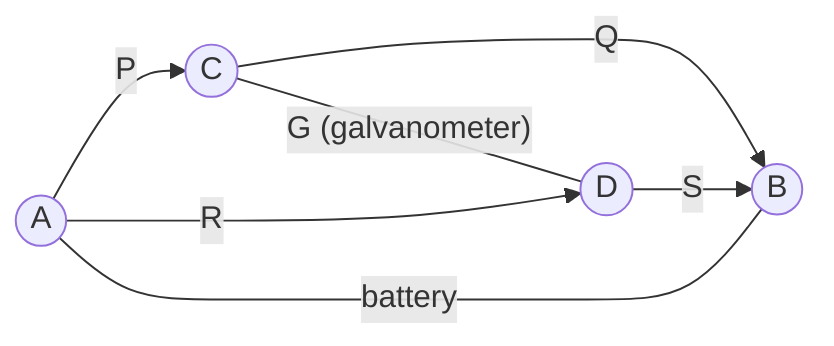

> All key Current Electricity formulas for JEE Physics: current, Ohm's law, resistance, power, Kirchhoff's laws, Wheatstone & meter bridge. Quick revision for JEE Main & Advanced.

Every must-know formula and result from the Current Electricity chapter, grouped by sub-topic for last-minute revision. Use the tables to scan fast and the boxed formulas for the headline relations.

## Electric Current and Drift Velocity

$$\boxed{I = \frac{dQ}{dt} = \frac{Q}{t}}$$

$$\boxed{v_d = \frac{eE\tau}{m}} \qquad \boxed{I = nAev_d} \qquad v_d = \frac{I}{nAe}$$

| Quantity | Formula | Notes |
| --- | --- | --- |
| Electric current | $I = \dfrac{Q}{t}$ | Unit: ampere (A) = C/s |
| Drift velocity | $v_d = \dfrac{eE\tau}{m}$ | $\tau$ = relaxation time |
| Drift velocity (from $I$) | $v_d = \dfrac{I}{nAe}$ | Most useful JEE form |
| Current from drift | $I = nAev_d$ | Links micro to macro |
| Current density | $J = \dfrac{I}{A} = nev_d$ | Unit: A/m² |
| Current density (vector) | $\vec{J} = ne\vec{v_d}$ | Direction opposite to electron drift |
| Mobility | $\mu = \dfrac{v_d}{E} = \dfrac{e\tau}{m}$ | Unit: m²/(V·s) |
| Conductivity–mobility | $\sigma = ne\mu$ |  |
| Current via mobility | $I = neA\mu E = neA\mu\dfrac{V}{L}$ |  |
| Drift velocity (same V) | $v_d = \dfrac{V}{\rho L ne}$ | $v_d \propto 1/L$ for same V |

**Microscopic Ohm’s law:**

$$\boxed{\vec{J} = \sigma \vec{E}} \qquad \sigma = \frac{ne^2\tau}{m}$$

> **★ Key point · High-Yield Reminders**
>
> **Stretched wire (same current):** $v_d \propto 1/A$, so if length doubles ($A$ halves), $v_d$ doubles.
>
> Drift velocity is tiny ($\sim 10^{-4}$ m/s) but the signal speed $\approx c = 3\times10^8$ m/s — that is why the bulb lights instantly.
>
> Copper number density: $n \approx 8.5 \times 10^{28}$ electrons/m³ (about one free electron per atom).

## Ohm’s Law and V–I Characteristics

$$\boxed{V = IR}$$

| Form | Expression | Use when |
| --- | --- | --- |
| Current | $I = \dfrac{V}{R}$ | $V$, $R$ known |
| Resistance | $R = \dfrac{V}{I}$ | from V–I measurement |
| Microscopic | $J = \sigma E$ | vector / material form |

**Units:** Voltage = volt (J/C), Current = ampere (C/s), Resistance = ohm (V/A).

| Material type | V–I graph | Obeys Ohm’s law? |
| --- | --- | --- |
| Metallic conductor (const. T) | Straight line through origin | Yes |
| Filament bulb | Curves (R rises with T) | No |
| Diode / LED | Threshold then steep rise | No |
| Electrolyte | Non-linear at low V | No (initially) |

> **★ Key point · Graph & Slope Traps**
>
> **V–I graph** (V on y-axis): slope $= R$. **I–V graph** (I on y-axis): slope $= 1/R$ = conductance.
>
> For a curved (non-ohmic) graph, $R = V/I$ at that **point**; dynamic resistance $= dV/dI$.
>
> Ohm’s law is **not** universal — it holds only for ohmic conductors at constant temperature.

## Resistance, Resistivity and Temperature

$$\boxed{R = \rho\frac{L}{A}} \qquad \boxed{R_T = R_0(1 + \alpha\Delta T)}$$

| Quantity | Formula | Notes |
| --- | --- | --- |
| Resistance | $R = \rho\dfrac{L}{A}$ | $R \propto L$, $R \propto 1/A$ |
| Resistivity | $\rho = R\dfrac{A}{L}$ | Material property (Ω·m) |
| Conductivity | $\sigma = \dfrac{1}{\rho}$ | Unit: S/m |
| Conductance | $G = \dfrac{1}{R} = \dfrac{I}{V} = \dfrac{\sigma A}{L}$ | Unit: siemens (S) |
| Temperature (metal) | $R_T = R_0[1+\alpha(T-T_0)]$ | $\alpha > 0$ for metals |
| Temperature (semicond.) | $R_T = R_0 e^{-\beta\Delta T} \approx R_0(1-\alpha\Delta T)$ | $\alpha < 0$ |
| Compare two wires | $\dfrac{R_1}{R_2} = \dfrac{\rho_1}{\rho_2}\cdot\dfrac{L_1}{L_2}\cdot\dfrac{A_2}{A_1}$ | ratio method |
| Hollow cylinder | $R = \dfrac{\rho L}{\pi(r_2^2 - r_1^2)}$ | $r_2$ outer, $r_1$ inner |

**Increasing resistivity order:** Silver < Copper < Gold < Aluminium (in $\rho$); copper $\rho \approx 1.7\times10^{-8}$ Ω·m.

| Material | $\alpha$ (per °C) | Behaviour |
| --- | --- | --- |
| Metals (Cu, Ag, Al, W) | $\sim +4\times10^{-3}$ | R increases with T |
| Nichrome, Manganin | $\sim 10^{-4}$ or less | nearly constant |
| Semiconductors, electrolytes | Negative | R decreases with T |

> **★ Key point · Wire Stretching & Cutting (JEE Favourites)**
>
> **Stretched to $n\times$ length** (volume constant): $\boxed{R' = n^2 R}$.
>
> **Radius halved:** length $\times 4$, area $\div 4$ ⟹ $R' = 16R$.
>
> **Cut into $n$ equal parts, all in parallel:** $\boxed{R_{eq} = \dfrac{R}{n^2}}$.

## Combination of Resistors

$$\boxed{R_{eq} = R_1 + R_2 + R_3 + \dots} \quad \text{(series)}$$

$$\boxed{\frac{1}{R_{eq}} = \frac{1}{R_1} + \frac{1}{R_2} + \frac{1}{R_3} + \dots} \quad \text{(parallel)}$$

| Configuration | Result | Notes |
| --- | --- | --- |
| Two in parallel | $R_{eq} = \dfrac{R_1 R_2}{R_1+R_2}$ | “product over sum” |
| $n$ equal in series | $R_{eq} = nR$ | same current in all |
| $n$ equal in parallel | $R_{eq} = \dfrac{R}{n}$ | same voltage across all |
| Voltage divider (series) | $V_1 = \dfrac{R_1}{R_1+R_2}V$ | voltage $\propto R$ |
| Current divider (parallel) | $I_1 = \dfrac{R_2}{R_1+R_2}I$ | current $\propto 1/R$ |
| Conductance in parallel | $G_{eq} = G_1 + G_2 + G_3$ | add directly |

## EMF and Internal Resistance

$$\boxed{V = \varepsilon - Ir} \qquad I = \frac{\varepsilon}{R+r}$$

| Configuration | EMF | Internal resistance |
| --- | --- | --- |
| Cells in series | $\varepsilon_{eq} = \varepsilon_1 + \varepsilon_2$ | $r_{eq} = r_1 + r_2$ |
| Cells in parallel | $\varepsilon_{eq} = \dfrac{\varepsilon_1/r_1 + \varepsilon_2/r_2}{1/r_1 + 1/r_2}$ | $\dfrac{1}{r_{eq}} = \dfrac{1}{r_1}+\dfrac{1}{r_2}$ |
| $n$ identical cells parallel | $\varepsilon_{eq} = \varepsilon$ | $r_{eq} = \dfrac{r}{n}$ |

> **★ Key point · Terminal Voltage**
>
> On discharge $V = \varepsilon - Ir$ (terminal V < EMF). Open circuit: $V = \varepsilon$. Short circuit: $I = \varepsilon/r$ (maximum current).

## Electrical Power and Heating

$$\boxed{P = VI = I^2R = \frac{V^2}{R}}$$

$$\boxed{H = I^2Rt = Pt}$$

| Quantity | Formula | Use when |
| --- | --- | --- |
| Power (basic) | $P = VI$ | $V$, $I$ given |
| Power (current form) | $P = I^2R$ | series — same $I$ |
| Power (voltage form) | $P = \dfrac{V^2}{R}$ | parallel — same $V$ |
| Heat (Joule’s law) | $H = I^2Rt = VIt = \dfrac{V^2t}{R}$ | energy in joules |
| Heat in calories | $H = \dfrac{I^2Rt}{4.2}$ | 1 cal = 4.2 J |
| Energy | $E = Pt = VIt = I^2Rt = \dfrac{V^2t}{R}$ |  |
| Bulb resistance from rating | $R = \dfrac{V^2}{P}$ | $V$, $P$ = rated values |
| Commercial unit | $1\text{ kWh} = 3.6\times10^6$ J | “1 unit” of electricity |

**Maximum power transfer:** load $R$ = source internal resistance $r$.

$$\boxed{R = r} \qquad P_{max} = \frac{\varepsilon^2}{4r} \qquad \eta = 50\%$$

> **★ Key point · Bulb Brightness — Series vs Parallel**
>
> **Series** (same $I$, use $P = I^2R$): **higher R glows brighter** (a 60 W bulb beats a 100 W bulb).
>
> **Parallel** (same $V$, use $P = V^2/R$): **lower R / higher rating glows brighter** (100 W beats 60 W).
>
> A “100 W, 220 V” rating holds only at rated voltage; at any other $V$ use $P = V^2/R$ with $R = V_{rated}^2/P_{rated}$ constant.
>
> Heater coils — time $\propto R$ for fixed heat: series adds times ($t_1+t_2$), parallel adds reciprocals ($1/t = 1/t_1 + 1/t_2$).

## Kirchhoff’s Laws

$$\boxed{\sum I_{in} = \sum I_{out}} \quad \text{(KCL — charge conservation)}$$

$$\boxed{\sum V = 0} \quad \text{(KVL — energy conservation)}$$

KVL alternative form: $\sum \varepsilon = \sum IR$.

| Element / traversal | Potential change | Notes |
| --- | --- | --- |
| Resistor, with current | $-IR$ (drop) | current flows high → low V |
| Resistor, against current | $+IR$ (rise) |  |
| Battery, $-$ to $+$ | $+\varepsilon$ (rise) | “uphill” |
| Battery, $+$ to $-$ | $-\varepsilon$ (drop) | “downhill” |
| Number of KCL equations | $(n-1)$ for $n$ junctions | nth is redundant |
| Number of KVL equations | one per independent loop | use mesh loops |

> **★ Key point · Sign Convention — the #1 JEE Error**
>
> Traversing a resistor **with** the current is a potential **drop** ($-IR$); **against** it is a rise ($+IR$).
>
> If a solved current comes out **negative**, the actual direction is opposite to the one you assumed.
>
> Check: $\sum P_{\text{sources}} = \sum P_{\text{loads}}$ (power balance).

## Wheatstone Bridge and Meter Bridge

$$\boxed{\frac{P}{Q} = \frac{R}{S}} \quad\Longleftrightarrow\quad \boxed{P\times S = Q\times R}$$

At balance, **no current flows through the galvanometer** and $V_C = V_D$.

| Quantity | Formula | Notes |
| --- | --- | --- |
| Balance condition | $\dfrac{P}{Q} = \dfrac{R}{S}$, i.e. $PS = QR$ | products of opposite arms equal |
| Unknown resistance | $R = \dfrac{P\times S}{Q}$ | three arms known |
| Balanced bridge $R_{eq}$ | $R_{eq} = \dfrac{(P+Q)(R+S)}{P+Q+R+S}$ | only when balanced |
| Meter bridge ($l$ from R side) | $R = P\times\dfrac{100-l}{l}$ | $l$ in cm on 100 cm wire |
| Meter bridge ($l$ from P side) | $R = P\times\dfrac{l}{100-l}$ | check which side $l$ is |
| Interchange gaps | $l_2 = 100 - l_1$ | complementary balance point |
| End corrections | $R = P\times\dfrac{100-l+\alpha}{l+\beta}$ | $\alpha,\beta$ end resistances |
| Shunt effect | $R' = \dfrac{R\,R_{shunt}}{R+R_{shunt}}$ | effective R decreases |



> **★ Key point · Meter Bridge Quick Wins**
>
> If $P = R$, balance is at the centre, $l = 50$ cm. Best sensitivity is near $l = 50$ cm; poor near the ends.
>
> Meter bridge wire is uniform, so resistance $\propto$ length — that is why the length ratio replaces the resistance ratio.
>
> When balanced, current still flows through the P–Q and R–S branches; only the galvanometer branch carries none.

## Galvanometer Conversion

$$\boxed{S = \frac{I_g G}{I - I_g}} \quad \text{(ammeter: shunt in parallel)}$$

$$\boxed{R = \frac{V}{I_g} - G} \quad \text{(voltmeter: high R in series)}$$

| Conversion | Added resistance | Position | Effect on circuit |
| --- | --- | --- | --- |
| To ammeter | low shunt $S = \dfrac{I_g G}{I - I_g}$ | parallel | low net resistance; connect in series |
| To voltmeter | high $R = \dfrac{V}{I_g} - G$ | series | high net resistance; connect in parallel |

Here $G$ = galvanometer resistance, $I_g$ = full-scale deflection current.

## Potentiometer

**Principle:** potential drop $\propto$ length, so $\dfrac{V_1}{V_2} = \dfrac{l_1}{l_2}$.

| Application | Formula | Notes |
| --- | --- | --- |
| Comparing EMFs | $\dfrac{\varepsilon_1}{\varepsilon_2} = \dfrac{l_1}{l_2}$ | balancing lengths |
| Internal resistance | $r = R\left(\dfrac{l_1 - l_2}{l_2}\right)$ | $l_1$ open, $l_2$ with $R$ across cell |

> **★ Key point · Why a Potentiometer Beats a Voltmeter**
>
> At balance it draws **no current** from the cell, so it measures true EMF — more accurate than a voltmeter, which always draws some current.

## Constants and Standard Values

| Constant | Value |
| --- | --- |
| Electron charge $e$ | $1.6 \times 10^{-19}$ C |
| Electron mass $m$ | $9.1 \times 10^{-31}$ kg |
| Number density (copper) | $\approx 8.5 \times 10^{28}$ m⁻³ |
| Resistivity of copper | $\approx 1.7 \times 10^{-8}$ Ω·m |
| 1 kWh | $3.6 \times 10^{6}$ J |
| 1 calorie | $4.2$ J |

From TestGuru · our mock-test platform

## You've read Current Electricity Formula Sheet.You've read this topic. Find out what you actually got.

A free JEE Main mock with this chapter in it, and a report that shows which sub-topics cost you marks.

[Take a free JEE Main mock →](https://app.testguru.co/signup?tg_chapter=current-electricity&tg_exam=jee-main&tg_page=%2Fphysics%2Fcurrent-electricity%2Fformula-sheet%2F&tg_subject=physics&utm_campaign=notes-jee-main-free-test&utm_content=article-end&utm_medium=referral&utm_source=jeenotes)
Free, no card. Opens TestGuru in a new tab.

## Stay exam-ready

One email every Sunday: new notes, the week's hardest challenge question and a revision plan.One email every Sunday.

## Comments

Have a question or spotted a mistake? Join the discussion below.

Advertisement

Advertisement

---

## Extracted page code (interactive scripts & widgets)


### inline-script-14

```js
(function(){var t,e=document.getElementById("disqus-load");if(!e)return;t=!1,e.addEventListener("click",function(){if(t)return;t=!0,e.setAttribute("disabled","disabled"),e.textContent="Loading comments…",window.disqus_config=function(){this.page.url="https://jeenotes.in/physics/current-electricity/formula-sheet/",this.page.identifier="/physics/current-electricity/formula-sheet/"};var s=document,n=s.createElement("script");n.src="https://https-jeenotes-in.disqus.com/embed.js",n.setAttribute("data-timestamp",+new Date),n.onload=function(){e.style.display="none"},n.onerror=function(){t=!1,e.removeAttribute("disabled"),e.textContent="Could not load comments. Tap to retry"},(s.head||s.body).appendChild(n)})})()
```


### inline-script-15

```js
(function(){var t,e=document.currentScript.previousElementSibling;function n(){(window.adsbygoogle=window.adsbygoogle||[]).push({})}if(!window.ResizeObserver||e.clientWidth>0){n();return}t=new ResizeObserver(function(){e.clientWidth>0&&(t.disconnect(),n())}),t.observe(e)})()
```


---

_Source: [https://jeenotes.in/physics/current-electricity/formula-sheet/](https://jeenotes.in/physics/current-electricity/formula-sheet/) · raw HTML: `offline/physics/current-electricity/formula-sheet/index.html`_
