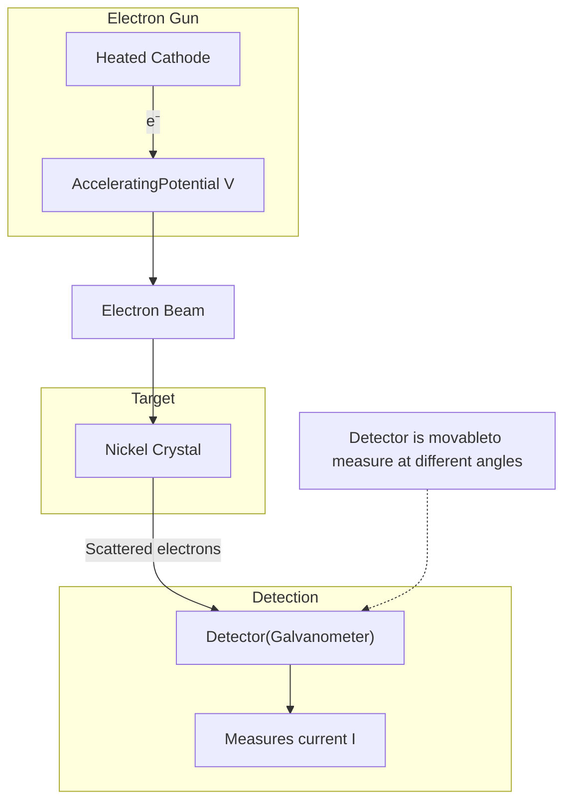

> Master the experimental verification of de Broglie hypothesis through electron diffraction for JEE Main and Advanced

# Davisson-Germer Experiment: The Proof That Broke Physics

## The Quantum Realm Becomes Real 🎬

Like discovering that Ant-Man’s quantum realm actually exists, Davisson and Germer accidentally proved that electrons behave like waves. An accidental vacuum break led to one of the most important discoveries in quantum physics - and a Nobel Prize!

*“The most exciting phrase in science is not ‘Eureka!’ but ‘That’s funny&mldr;’”* - Isaac Asimov

---

## Historical Context

### 1924: de Broglie’s Bold Hypothesis

- Predicted matter waves: λ = h/p
- Pure theory, no experimental evidence
- Most physicists were skeptical 🤨

### 1927: The Accident That Changed Everything

- Davisson & Germer studying electron scattering
- Vacuum break → nickel sample oxidized
- Heated sample to remove oxide
- **Accidentally created nickel crystal!**
- Observed unexpected electron scattering pattern
- Realized it matched wave diffraction! 🎯

### 1927: Same Year

- G.P. Thomson (J.J. Thomson’s son!) independently confirmed
- J.J. discovered electron as particle (1897)
- G.P. proved electron is wave (1927)
- Father and son both won Nobel Prizes! 👨‍👦

---

## The Experimental Setup

### Components



### Key Features

1. **Electron Source**: Heated filament (thermionic emission)
2. **Accelerating Voltage**: 40-68 V range
3. **Target**: Nickel single crystal
4. **Detector**: Movable electron collector
5. **Measurement**: Scattered electron intensity vs angle

---

## The Experiment in Detail

### Step 1: Electron Beam Generation

Electrons accelerated through potential V:

$$K = eV$$

de Broglie wavelength:

$$λ = \frac{h}{\sqrt{2meV}} = \frac{12.27}{\sqrt{V}} \text{ Å}$$

For V = 54 V:

$$λ = \frac{12.27}{\sqrt{54}} = 1.67 \text{ Å}$$

### Step 2: Crystal Scattering

Nickel crystal structure:

- FCC (Face-Centered Cubic) lattice
- Atomic plane spacing: d = 0.91 Å (for 111 planes)

### Step 3: Detection

Detector moved in arc around crystal:

- Measures scattered electron intensity
- Angle θ varied from 0° to 90°
- Look for intensity maxima (constructive interference)

---

## Bragg’s Law for Electron Diffraction

For constructive interference from crystal planes:

:::box
**Bragg’s Law**

$$2d \sin θ = nλ$$

where:

- d = spacing between crystal planes
- θ = glancing angle (angle with plane)
- n = order of diffraction (1, 2, 3, &mldr;)
- λ = wavelength
  :::

### Interactive Demo: Visualize Electron Diffraction

See how electron waves diffract from crystal planes just like light waves.

### Important: Glancing vs Scattering Angle

```fallback
Incident beam →    ↗ Scattered beam
             \  θ /
              \ | /  ← Scattering angle φ
          ─────●─────  Crystal plane
                θ

Glancing angle: θ
Scattering angle: φ = 180° - 2θ
```

---

## Experimental Results

### The Breakthrough Observation

At **V = 54 V**, strong peak at **φ = 50°**

Glancing angle: θ = (180° - 50°)/2 = 65°

### Verification of de Broglie

**Calculated λ** (from de Broglie):

$$λ = \frac{12.27}{\sqrt{54}} = 1.67 \text{ Å}$$

**Expected λ** (from Bragg’s law):

$$λ = 2d \sin θ = 2 × 0.91 × \sin 65° = 1.65 \text{ Å}$$

**Match within experimental error!** 🎯

### The Graph That Proved Everything

```fallback
Intensity
    ↑
    │      ╱╲
    │     ╱  ╲
    │    ╱    ╲   ← Sharp peak at φ = 50°
    │   ╱      ╲
    │  ╱        ╲
    │ ╱          ╲___
    │╱________________╲___
    └─────────────────────→ Scattering angle φ
         50°
```

This is **exactly** what you’d expect from **wave diffraction**, not particle scattering!

---

## G.P. Thomson’s Independent Confirmation (1927)

### Different Approach

- Used **thin polycrystalline metal foils** (gold, aluminum)
- Higher energy electrons (10-40 kV)
- Shorter wavelengths: λ ~ 0.1 Å

### Results

Observed **concentric rings** on photographic plate:

- Just like X-ray diffraction patterns!
- Debye-Scherrer rings from random crystal orientations

```fallback
Thin metal foil
        │
   e⁻ →│→ ╱ ╲
        │  ╱   ╲
        │ │  ○  │ ← Concentric rings
        │  ╲   ╱    on screen
        │   ╲ ╱
```

**Another proof of electron waves!**

---

## Why This Experiment is Revolutionary

### Classical Prediction

Particles scattering → smooth distribution

```fallback
Intensity
    │ ─────────
    │
    └──────────→ Angle
```

### Actual Result

Wave interference → sharp peaks

```fallback
Intensity
    │  ╱╲    ╱╲
    │ ╱  ╲  ╱  ╲
    └──────────→ Angle
```

### Implications

1. **Electrons are waves** ✓
2. **de Broglie was right** ✓
3. **Wave-particle duality is real** ✓
4. **Quantum mechanics is correct** ✓
5. **Classical physics is incomplete** ✓

---

## Interactive Demo: Crystal Diffraction Simulator

```javascript
const DavissonGermerSimulator = () => {
  const [voltage, setVoltage] = useState(54);
  const [crystalSpacing, setCrystalSpacing] = useState(0.91); // Å

  const h = 6.626e-34; // J·s
  const e = 1.6e-19; // C
  const m = 9.11e-31; // kg

  // Calculate de Broglie wavelength
  const lambda = (12.27 / Math.sqrt(voltage)).toFixed(2); // Å

  // First order diffraction (n=1)
  const sinTheta = lambda / (2 * crystalSpacing);
  const theta = sinTheta <= 1 ? Math.asin(sinTheta) * (180/Math.PI) : null;
  const phi = theta ? 180 - 2*theta : null;

  return (
    <div>
      <h3>Davisson-Germer Simulator</h3>

      <label>Accelerating Voltage: {voltage} V</label>
      <input
        type="range"
        min="20"
        max="100"
        value={voltage}
        onChange={(e) => setVoltage(Number(e.target.value))}
      />

      <label>Crystal Plane Spacing: {crystalSpacing} Å</label>
      <input
        type="range"
        min="0.5"
        max="2.0"
        step="0.01"
        value={crystalSpacing}
        onChange={(e) => setCrystalSpacing(Number(e.target.value))}
      />

      <div className="results">
        <h4>Results:</h4>
        <p>de Broglie wavelength: {lambda} Å</p>

        {theta !== null ? (
          <>
            <p>Glancing angle (θ): {theta.toFixed(1)}°</p>
            <p>Scattering angle (φ): {phi.toFixed(1)}°</p>
            <p style={{color: 'green'}}>
              ✓ Diffraction peak observable!
            </p>

            {voltage === 54 && Math.abs(phi - 50) < 2 ? (
              <p style={{color: 'gold', fontWeight: 'bold'}}>
                🏆 Historical Davisson-Germer result!
              </p>
            ) : null}
          </>
        ) : (
          <p style={{color: 'red'}}>
            ✗ No diffraction (λ too large)
          </p>
        )}

        <h4>For diffraction to occur:</h4>
        <p>λ must be ≤ 2d = {(2*crystalSpacing).toFixed(2)} Å</p>
        <p>Required voltage ≥ {((12.27/(2*crystalSpacing))**2).toFixed(0)} V</p>
      </div>
    </div>
  );
};
```

---

## Memory Tricks 🧠

### “DAVISSON” for the Experiment

**D**iffraction of electrons
**A**ccident led to discovery
**V**oltage accelerates electrons
**I**nterference pattern observed
**S**cattering angle measured
**S**ingle crystal nickel
**O**rder n = 1 most prominent
**N**obel Prize 1937

### The “54-50-65” Magic Numbers

For the famous result:

- **54** V → accelerating voltage
- **50**° → scattering angle
- **65**° → glancing angle
- λ = **1.67** Å

**Mnemonic:** “**54** volunteers **50** cents, glance **65** times”

### Bragg’s Law Triangle

```fallback
2d
   ╱ │ ╲
  ╱  │  ╲
 ╱ θ │ θ ╲
────────────
    nλ

2d sinθ = nλ
```

---

## Common Mistakes ⚠️

### ❌ Mistake 1: Confusing angles

**Wrong:** Using scattering angle φ directly in Bragg’s law
**Right:** Use glancing angle θ = (180° - φ)/2

### ❌ Mistake 2: Wrong de Broglie formula

**Wrong:** λ = 12.27 × √V
**Right:** λ = 12.27 / √V (inverse relationship!)

### ❌ Mistake 3: Forgetting first-order

**Wrong:** Using arbitrary n in calculations
**Right:** Usually n = 1 (first-order) unless stated

### ❌ Mistake 4: Unit confusion

**Wrong:** d in nm, λ in Å
**Right:** Keep same units (both Å or both nm)

### ❌ Mistake 5: Expecting diffraction always

**Wrong:** “Any voltage will show diffraction”
**Right:** Need λ ≤ 2d for first-order diffraction

---

## Comparison: Davisson-Germer vs G.P. Thomson

| Feature | Davisson-Germer | G.P. Thomson |
| --- | --- | --- |
| **Year** | 1927 | 1927 |
| **Sample** | Single crystal Ni | Polycrystalline foil |
| **Voltage** | 40-68 V | 10-40 kV |
| **Wavelength** | ~1-2 Å | ~0.1 Å |
| **Pattern** | Discrete peaks | Concentric rings |
| **Geometry** | Reflection | Transmission |
| **Analysis** | Bragg diffraction | Debye-Scherrer |
| **Setup** | Low energy, surface | High energy, bulk |

Both proved the same thing: **Electrons are waves!**

---

## Detailed Calculations

### Example 1: The Classic 54V Result

**Given:** V = 54 V, Ni crystal, φ = 50°

**Find:** Verify de Broglie hypothesis

**Solution:**

```fallback
Step 1: Calculate λ from de Broglie
λ_calc = 12.27/√54 = 1.67 Å

Step 2: Find glancing angle
θ = (180° - φ)/2 = (180° - 50°)/2 = 65°

Step 3: Calculate λ from Bragg's law
For Ni (111) planes: d = 0.91 Å
λ_exp = 2d sinθ = 2 × 0.91 × sin65°
λ_exp = 1.82 × 0.906 = 1.65 Å

Step 4: Compare
|λ_calc - λ_exp|/λ_calc = |1.67 - 1.65|/1.67 = 1.2%

Excellent agreement! ✓
```

### Example 2: Finding Unknown Crystal Spacing

**Given:** V = 100 V, first peak at φ = 60°, n = 1

**Find:** Crystal plane spacing d

**Solution:**

```fallback
Step 1: de Broglie wavelength
λ = 12.27/√100 = 1.227 Å

Step 2: Glancing angle
θ = (180° - 60°)/2 = 60°

Step 3: Bragg's law
2d sinθ = nλ
d = nλ/(2 sinθ) = 1 × 1.227/(2 × sin60°)
d = 1.227/(2 × 0.866) = 0.708 Å
```

---

## Problem-Solving Strategy

### Step-by-Step Approach

1. **Identify given quantities**

   - Voltage V (or energy K)
   - Crystal spacing d
   - Scattering/glancing angle
   - Order n (usually 1)
2. **Calculate de Broglie wavelength**

   - λ = 12.27/√V Å (for electrons)
3. **Handle angle correctly**

   - If given φ (scattering): θ = (180° - φ)/2
   - If given θ (glancing): use directly
4. **Apply Bragg’s law**

   - 2d sinθ = nλ
   - Solve for unknown
5. **Check reasonableness**

   - Is λ comparable to d?
   - Is sinθ ≤ 1?

---

## Practice Problems

### Level 1: JEE Main Basics

**Q1.** Electrons accelerated through 150 V are diffracted from a crystal with d = 1.0 Å. What is the glancing angle for first-order diffraction?

**Solution:**

```fallback
λ = 12.27/√150 = 1.0 Å

2d sinθ = nλ
2 × 1.0 × sinθ = 1 × 1.0
sinθ = 0.5
θ = 30°
```

**Q2.** In Davisson-Germer experiment, if voltage is increased, what happens to:
(a) de Broglie wavelength
(b) Glancing angle for same d

**Solution:**

```fallback
(a) λ = 12.27/√V
    V increases → λ decreases

(b) 2d sinθ = nλ
    λ decreases → sinθ decreases → θ decreases
```

**Q3.** The first diffraction maximum in Davisson-Germer experiment occurs at θ = 30°. At what angle will the second maximum occur? (d = 1.5 Å)

**Solution:**

```fallback
First order: 2d sinθ₁ = 1λ
λ = 2 × 1.5 × sin30° = 1.5 Å

Second order: 2d sinθ₂ = 2λ
sinθ₂ = 2λ/(2d) = 2 × 1.5/(2 × 1.5) = 1

θ₂ = 90° (grazing incidence)
```

---

### Level 2: JEE Main/Advanced

**Q4.** In Davisson-Germer experiment, electrons are accelerated from rest through 60 V. The first diffraction peak occurs at scattering angle 60°. Calculate:
(a) de Broglie wavelength
(b) Crystal plane spacing

**Solution:**

```fallback
(a) λ = 12.27/√60 = 1.58 Å

(b) Glancing angle: θ = (180° - 60°)/2 = 60°
    2d sinθ = nλ
    d = nλ/(2 sinθ) = 1 × 1.58/(2 × sin60°)
    d = 1.58/1.732 = 0.91 Å

    (This is indeed Ni crystal!)
```

**Q5.** For electron diffraction from a crystal, the first-order peak occurs at glancing angle 30° when voltage is 54 V. If voltage is increased to 216 V, at what angle will the first-order peak occur?

**Solution:**

```fallback
At V₁ = 54 V: λ₁ = 12.27/√54 = 1.67 Å
At V₂ = 216 V: λ₂ = 12.27/√216 = 0.835 Å

λ₂ = λ₁/2

From 2d sinθ₁ = λ₁:
d = λ₁/(2 sinθ₁) = 1.67/(2 × 0.5) = 1.67 Å

For new voltage: 2d sinθ₂ = λ₂
sinθ₂ = λ₂/(2d) = 0.835/(2 × 1.67) = 0.25
θ₂ = 14.5°

Angle decreases! (Higher V → smaller λ → smaller θ)
```

**Q6.** A beam of electrons and a beam of protons are accelerated through the same potential and diffracted from the same crystal. Find the ratio of glancing angles for first-order diffraction.

**Solution:**

```fallback
For same V: λ ∝ 1/√m

λₑ/λₚ = √(mₚ/mₑ) = √1836 = 43

From 2d sinθ = λ:
sinθₑ/sinθₚ = λₑ/λₚ = 43

For small angles: sinθ ≈ θ
θₑ/θₚ ≈ 43

Electrons diffract at much larger angles!
```

---

### Level 3: JEE Advanced

**Q7.** In a Davisson-Germer type experiment with neutrons, the first-order diffraction from NaCl crystal (d = 2.82 Å) occurs at glancing angle 15°. Calculate:
(a) Wavelength of neutrons
(b) Their kinetic energy in eV
(c) Temperature of neutron beam assuming thermal equilibrium

**Solution:**

```fallback
(a) 2d sinθ = nλ
    λ = 2d sinθ/n = 2 × 2.82 × sin15° / 1
    λ = 5.64 × 0.259 = 1.46 Å

(b) λ = h/√(2mK)
    K = h²/(2mλ²)
    K = (6.626 × 10⁻³⁴)² / (2 × 1.67 × 10⁻²⁷ × (1.46 × 10⁻¹⁰)²)
    K = 6.28 × 10⁻²¹ J = 0.039 eV

(c) For thermal neutrons: K = (3/2)kT
    T = 2K/(3k) = 2 × 6.28 × 10⁻²¹ / (3 × 1.38 × 10⁻²³)
    T = 303 K ≈ 30°C

    Room temperature neutrons!
```

**Q8.** An electron beam accelerated through V volts gives a first-order diffraction peak at angle θ. To get the same peak at angle 2θ from the same crystal:
(a) What should be the new voltage?
(b) What should be the new crystal orientation?

**Solution:**

```fallback
(a) Same peak means same d and n.
    2d sinθ₁ = λ₁ and 2d sin(2θ) = λ₂

    λ₂/λ₁ = sin(2θ)/sinθ = 2sinθ cosθ/sinθ = 2cosθ

    λ ∝ 1/√V, so V ∝ 1/λ²
    V₂/V₁ = (λ₁/λ₂)² = 1/(4cos²θ)

    V₂ = V₁/(4cos²θ)

    Example: θ = 30°
    V₂ = V/(4 × 0.75) = V/3

    Need LESS voltage for larger angle!

(b) Alternative: Keep same V (same λ)
    Change crystal orientation to access planes with:
    d' = d/(2cosθ)
```

**Q9.** A monoenergetic electron beam shows diffraction maxima at θ₁ = 30° and θ₂ = 60° from the same set of crystal planes. Show that these correspond to first and second order diffraction and find the ratio V₂/V₁ if voltage is changed between measurements.

**Solution:**

```fallback
If same voltage (same λ):
2d sinθ₁ = n₁λ
2d sinθ₂ = n₂λ

n₂/n₁ = sinθ₂/sinθ₁ = sin60°/sin30° = (√3/2)/(1/2) = √3

This doesn't give integer ratio!

So different voltages must be used:
For θ₁ = 30°, first order: 2d sin30° = λ₁ → d = λ₁
For θ₂ = 60°, second order: 2d sin60° = 2λ₂ → d = λ₂/√3

d = d: λ₁ = λ₂/√3
λ₂ = √3 λ₁

V₂/V₁ = (λ₁/λ₂)² = 1/3

V₂ = V₁/3
```

**Q10.** In a Davisson-Germer setup, the detector is at angle φ from the incident beam direction. If the accelerating voltage is V₀ when a peak is observed, show that the voltage required for a peak at angle 2φ is V₀/[4cos²((180°-φ)/2)].

**Solution:**

```fallback
For angle φ:
θ₁ = (180° - φ)/2
2d sinθ₁ = λ₁
λ₁ = 12.27/√V₀

For angle 2φ:
θ₂ = (180° - 2φ)/2 = 90° - φ
2d sinθ₂ = λ₂

sinθ₂ = sin(90° - φ) = cosφ = cos(180° - 2θ₁) = -cos(2θ₁)
      = -(1 - 2sin²θ₁) = 2sin²θ₁ - 1

Actually, simpler approach:
θ₂ = 90° - φ = 90° - (180° - 2θ₁) = 2θ₁ - 90°

Using sin(2θ₁ - 90°) = -cos(2θ₁) = 2sin²θ₁ - 1

This is getting complex. Better:
θ₁ = (180° - φ)/2
θ₂ = (180° - 2φ)/2 = 90° - φ = 90° - 180° + 2θ₁ = 2θ₁ - 90°

[Full derivation requires careful angle manipulation]
```

---

## Experimental Modifications & Extensions

### Modern Variations

1. **Electron Microscopy**

   - Uses same principle
   - λ ~ 0.01 Å for 100 keV electrons
   - Resolution better than optical microscopes
2. **Neutron Diffraction**

   - Probes nuclear positions
   - Magnetic structure determination
   - Complementary to X-ray diffraction
3. **Atom Interferometry**

   - Entire atoms showing wave behavior
   - Used in precision measurements
   - Tests fundamental quantum mechanics

---

## Cross-Links to Related Topics

- [de Broglie Hypothesis](../de-broglie/index.md) - Theoretical foundation
- [Photoelectric Effect](../photoelectric-effect/index.md) - Wave-particle duality of light
- [Bohr Model](../../atoms-nuclei/bohr-model/index.md) - Standing wave interpretation
- [X-ray Diffraction](../../oscillations-waves/index.md) - Similar Bragg law application

---

## Quick Revision Checklist ✓

- Davisson-Germer proved electron waves (1927)
- Used nickel crystal, V = 54 V, φ = 50°
- Bragg’s law: 2d sinθ = nλ
- Glancing angle: θ = (180° - φ)/2
- de Broglie: λ = 12.27/√V Å
- G.P. Thomson: independent confirmation
- Father (J.J.) found particle, son (G.P.) found wave!
- Nobel Prize 1937 (Davisson, G.P. Thomson)
- Modern applications: electron microscopy
- Diffraction pattern proves wave nature

---

## Conceptual Questions

**Q1.** Why was nickel used in the experiment?
**A:** Good single crystals, well-defined atomic planes, suitable spacing (~1 Å)

**Q2.** Could this experiment work with protons?
**A:** Yes! But need higher voltage for same λ (proton is 1836× heavier)

**Q3.** Why discrete peaks and not continuous?
**A:** Constructive interference only at specific angles (Bragg condition)

**Q4.** What if we use polycrystalline sample?
**A:** Get rings (Debye-Scherrer pattern) like G.P. Thomson’s experiment

**Q5.** Can we see interference of single electron?
**A:** Yes! Modern experiments show even single electrons interfere with themselves

---

## Final Tips for JEE

1. **Master angle conversion**: φ ↔ θ relationships
2. **Remember 54-50-65**: Classic result numbers
3. **Bragg’s law**: Always use glancing angle θ, not scattering φ
4. **Quick check**: For diffraction, need λ ≤ 2d
5. **Common mistake**: Don’t confuse with X-ray diffraction (same Bragg law though!)
6. **Unit consistency**: Keep d and λ in same units (Å is standard)
7. **Know the story**: Accidental discovery, Nobel Prize
8. **Father-son Nobel**: J.J. (electron) and G.P. (electron wave)

---

*Last updated: April 20, 2025*
*Previous: [de Broglie Hypothesis](../de-broglie/index.md)*
*Next: [Rutherford Model of Atom](../../atoms-nuclei/rutherford-model/index.md)*

From TestGuru · our mock-test platform

## You've read Davisson-Germer Experiment - Proving Matter Waves.You've read this topic. Find out what you actually got.

A free JEE Main mock with this chapter in it, and a report that shows which sub-topics cost you marks.

[Take a free JEE Main mock →](https://app.testguru.co/signup?tg_chapter=dual-nature&tg_exam=jee-main&tg_page=%2Fphysics%2Fdual-nature%2Fdavisson-germer%2F&tg_subject=physics&utm_campaign=notes-jee-main-free-test&utm_content=article-end&utm_medium=referral&utm_source=jeenotes)
Free, no card. Opens TestGuru in a new tab.

## Stay exam-ready

One email every Sunday: new notes, the week's hardest challenge question and a revision plan.One email every Sunday.

## Comments

Have a question or spotted a mistake? Join the discussion below.

Advertisement

Advertisement

---

## Extracted page code (interactive scripts & widgets)


### inline-script-16

```js
if(!document.getElementById("animation-fullscreen-overlay")){const e=document.createElement("div");e.id="animation-fullscreen-overlay",e.className="animation-fullscreen-overlay",e.innerHTML=`
      <div class="fullscreen-modal">
        <div class="fullscreen-header">
          <span class="fullscreen-title">Interactive Demo</span>
          <button class="fullscreen-close-btn" onclick="JEEAnimations.closeFullscreen()" title="Close (Esc)" aria-label="Close fullscreen">
            <svg width="24" height="24" viewBox="0 0 24 24" fill="none" stroke="currentColor" stroke-width="2" stroke-linecap="round" stroke-linejoin="round">
              <line x1="18" y1="6" x2="6" y2="18"></line>
              <line x1="6" y1="6" x2="18" y2="18"></line>
            </svg>
          </button>
        </div>
        <div class="fullscreen-content"></div>
      </div>
    `,document.body.appendChild(e),document.addEventListener("keydown",function(e){e.key==="Escape"&&document.body.classList.contains("animation-fullscreen-active")&&JEEAnimations.closeFullscreen()}),e.addEventListener("click",function(t){t.target===e&&JEEAnimations.closeFullscreen()})}
```


### inline-script-17

```js
(function(){var t,e=document.getElementById("disqus-load");if(!e)return;t=!1,e.addEventListener("click",function(){if(t)return;t=!0,e.setAttribute("disabled","disabled"),e.textContent="Loading comments…",window.disqus_config=function(){this.page.url="https://jeenotes.in/physics/dual-nature/davisson-germer/",this.page.identifier="/physics/dual-nature/davisson-germer/"};var s=document,n=s.createElement("script");n.src="https://https-jeenotes-in.disqus.com/embed.js",n.setAttribute("data-timestamp",+new Date),n.onload=function(){e.style.display="none"},n.onerror=function(){t=!1,e.removeAttribute("disabled"),e.textContent="Could not load comments. Tap to retry"},(s.head||s.body).appendChild(n)})})()
```


### inline-script-18

```js
(function(){var t,e=document.currentScript.previousElementSibling;function n(){(window.adsbygoogle=window.adsbygoogle||[]).push({})}if(!window.ResizeObserver||e.clientWidth>0){n();return}t=new ResizeObserver(function(){e.clientWidth>0&&(t.disconnect(),n())}),t.observe(e)})()
```


### interactive-widget-1

```html
<div class="animation-wrapper" data-animation="waveFunction" id="anim-waveFunction-1795396423169887712"><div class="animation-header"><button aria-label="Toggle fullscreen" class="anim-fullscreen-btn" onclick='JEEAnimations.toggleFullscreen("anim-waveFunction-1795396423169887712")' title="Fullscreen (F)">
<svg class="fullscreen-icon-expand" fill="none" height="18" stroke="currentColor" stroke-linecap="round" stroke-linejoin="round" stroke-width="2" viewbox="0 0 24 24" width="18"><polyline points="15 3 21 3 21 9"></polyline><polyline points="9 21 3 21 3 15"></polyline><line x1="21" x2="14" y1="3" y2="10"></line><line x1="3" x2="10" y1="21" y2="14"></line></svg>
<svg class="fullscreen-icon-collapse" fill="none" height="18" stroke="currentColor" stroke-linecap="round" stroke-linejoin="round" stroke-width="2" viewbox="0 0 24 24" width="18"><polyline points="4 14 10 14 10 20"></polyline><polyline points="20 10 14 10 14 4"></polyline><line x1="14" x2="21" y1="10" y2="3"></line><line x1="3" x2="10" y1="21" y2="14"></line></svg>
<span class="fullscreen-text">Fullscreen</span></button></div><div class="animation-content"><noscript><div class="callout callout-warning"><div class="callout-title">JavaScript Required</div><p>This interactive animation requires JavaScript to be enabled.</p></div></noscript></div></div>
```


---

_Source: [https://jeenotes.in/physics/dual-nature/davisson-germer/](https://jeenotes.in/physics/dual-nature/davisson-germer/) · raw HTML: `offline/physics/dual-nature/davisson-germer/index.html`_
