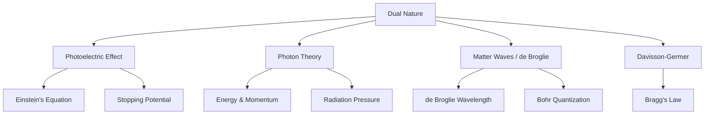

> All key Dual Nature formulas: photoelectric effect, photon energy/momentum, de Broglie wavelength, Davisson-Germer Bragg law. JEE Main & Advanced quick revision.

Last-minute revision sheet for the entire Dual Nature chapter: photoelectric effect, photon theory, de Broglie matter waves, and the Davisson-Germer experiment. Every formula, constant, and shortcut below is pulled straight from the chapter pages.

## Chapter Map



## Photoelectric Effect

Einstein’s photoelectric equation is the headline result of this chapter.

$$\boxed{K_{max} = h\nu - \phi}$$

$$\frac{1}{2}mv_{max}^2 = h\nu - \phi$$

In terms of wavelength:

$$K_{max} = \frac{hc}{\lambda} - \phi$$

### Work Function and Threshold

$$\boxed{\phi = h\nu_0 = \frac{hc}{\lambda_0}}$$

$$\lambda_0 = \frac{hc}{\phi}$$

At threshold, $K_{max} = 0$, so $h\nu_0 = \phi$.

### Stopping Potential

$$\boxed{eV_0 = K_{max} = h\nu - \phi}$$

$$V_0 = \frac{h}{e}\nu - \frac{\phi}{e} = \frac{h}{e}(\nu - \nu_0)$$

This is a straight line $y = mx + c$ with **slope $= h/e$** and **y-intercept $= -\phi/e$**.

| Quantity | Formula | Notes |
| --- | --- | --- |
| Photon energy | $E = h\nu = \dfrac{hc}{\lambda}$ | Energy of one incident photon |
| Max KE of photoelectron | $K_{max} = h\nu - \phi$ | Depends only on frequency |
| Work function | $\phi = h\nu_0 = \dfrac{hc}{\lambda_0}$ | Minimum energy to free an electron |
| Stopping potential | $eV_0 = K_{max}$ | Independent of intensity |
| $V_0$ vs $\nu$ slope | $\dfrac{h}{e}$ | Universal constant $= 4.14 \times 10^{-15}$ V·s |
| Threshold wavelength | $\lambda_0 = \dfrac{hc}{\phi}$ | Longest $\lambda$ that ejects electrons |

### Comparison Relations

Ratio of stopping potentials for two frequencies:

$$\frac{V_{01}}{V_{02}} = \frac{h\nu_1 - \phi}{h\nu_2 - \phi}$$

Change in stopping potential:

$$\Delta V_0 = \frac{h}{e}\Delta\nu = \frac{hc}{e}\left(\frac{1}{\lambda_1} - \frac{1}{\lambda_2}\right)$$

> **★ Key point · High-Yield: Frequency vs Intensity**
>
> **Frequency** controls $K_{max}$ and stopping potential. **Intensity** controls the number of photoelectrons (photocurrent). Doubling intensity doubles photocurrent but leaves $K_{max}$ and $V_0$ unchanged. Emission is instantaneous ($\sim 10^{-9}$ s), with no time lag.

### Key Experimental Observations

1. Below threshold frequency $\nu_0$: no emission, regardless of intensity.
2. Saturation current is proportional to intensity, independent of frequency.
3. Stopping potential $V_0 \propto \nu$ (linear), independent of intensity.
4. Emission is instantaneous (no time lag).

## Photon Theory

| Property | Formula | Notes |
| --- | --- | --- |
| Energy | $E = h\nu = \dfrac{hc}{\lambda}$ | Discrete energy packet |
| Momentum | $p = \dfrac{h\nu}{c} = \dfrac{h}{\lambda}$ | Photon carries momentum |
| Rest mass | $0$ | Photons always travel at $c$ |
| Relativistic mass | $m = \dfrac{h\nu}{c^2} = \dfrac{h}{\lambda c}$ | Effective mass equivalent |

### Radiation Pressure

$$\boxed{P = \frac{I}{c} \text{ (complete absorption)}, \qquad P = \frac{2I}{c} \text{ (complete reflection)}}$$

where $I$ is the intensity of incident radiation.

## de Broglie Hypothesis

Every moving particle has an associated matter wave.

$$\boxed{\lambda = \frac{h}{p} = \frac{h}{mv}}$$

### All Forms of the de Broglie Wavelength

| Known quantity | Formula | Notes |
| --- | --- | --- |
| Velocity $v$ | $\lambda = \dfrac{h}{mv}$ | Free particle |
| Kinetic energy $K$ | $\lambda = \dfrac{h}{\sqrt{2mK}}$ | Using $p = \sqrt{2mK}$ |
| Accelerating potential $V$, charge $q$ | $\lambda = \dfrac{h}{\sqrt{2mqV}}$ | $K = qV$ |
| Electron through $V$ volts | $\lambda = \dfrac{12.27}{\sqrt{V}}$ Å | Memorize this shortcut |
| Electron with KE $K$ (eV) | $\lambda = \dfrac{12.27}{\sqrt{K}}$ Å | $V$ replaced by $K$ in eV |
| Thermal neutron at $T$ | $\lambda = \dfrac{h}{\sqrt{3mkT}}$ | Uses $K = \tfrac{3}{2}kT$ |

Relating momentum and kinetic energy:

$$K = \frac{1}{2}mv^2 = \frac{p^2}{2m} \quad\Rightarrow\quad p = \sqrt{2mK}$$

Electron-specific shortcut:

$$\boxed{\lambda = \frac{h}{\sqrt{2meV}} = \frac{12.27}{\sqrt{V}} \text{ Å}}$$

### Relativistic Form

For high speeds ($v \sim c$):

$$\lambda = \frac{h}{\sqrt{2m_0 K\left(1 + \dfrac{K}{2m_0 c^2}\right)}}$$

### Phase and Group Velocity

| Velocity | Formula | Meaning |
| --- | --- | --- |
| Phase velocity | $v_p = \nu\lambda = \dfrac{\omega}{k} = \dfrac{E}{p} = \dfrac{c^2}{v}$ | $v_p > c$, carries no information |
| Group velocity | $v_g = \dfrac{d\omega}{dk} = v$ | Actual particle velocity |
| Product | $v_p \cdot v_g = c^2$ | Key relation |

> **★ Key point · Inverse Proportionalities**
>
> $\lambda \propto \dfrac{1}{v}$, $\quad \lambda \propto \dfrac{1}{\sqrt{K}}$, $\quad \lambda \propto \dfrac{1}{\sqrt{V}}$.

> At the **same kinetic energy**: $\lambda \propto \dfrac{1}{\sqrt{m}}$ (lighter particle has larger $\lambda$).

> At the **same accelerating potential**: $\lambda \propto \dfrac{1}{\sqrt{mq}}$ (used to compare different particles).

> Heavier or faster particles have smaller wavelengths and behave more particle-like.

### Bohr Quantization from de Broglie

A stable orbit fits a whole number of wavelengths (standing wave):

$$2\pi r = n\lambda$$

Substituting $\lambda = h/mv$:

$$\boxed{mvr = \frac{nh}{2\pi} = n\hbar}$$

This is exactly Bohr’s angular momentum quantization condition.

### Photon vs Electron

| Property | Photon | Electron |
| --- | --- | --- |
| Rest mass | $0$ | $9.1 \times 10^{-31}$ kg |
| Charge | $0$ | $-1.6 \times 10^{-19}$ C |
| Speed | $c$ always | $v < c$ |
| Wavelength | $\dfrac{hc}{E}$ | $\dfrac{h}{mv}$ |

For a photon, de Broglie wavelength equals the electromagnetic wavelength: $E = pc \Rightarrow p = h/\lambda_{EM}$, so $\lambda_{dB} = \lambda_{EM}$.

## Davisson-Germer Experiment

Confirmed the wave nature of electrons via diffraction from a nickel single crystal (1927).

### Bragg’s Law

$$\boxed{2d\sin\theta = n\lambda}$$

where $d$ = crystal plane spacing, $\theta$ = **glancing angle**, $n$ = order (usually 1), $\lambda$ = wavelength.

The chapter overview also states the diffraction condition as $d\sin\theta = n\lambda$; in the detailed Davisson-Germer analysis the working relation is the Bragg form $2d\sin\theta = n\lambda$.

### Angle Conversion

$$\theta = \frac{180^\circ - \varphi}{2}$$

where $\varphi$ is the scattering angle and $\theta$ is the glancing angle (the angle used in Bragg’s law).

### The Classic 54 V Result

| Quantity | Value | Notes |
| --- | --- | --- |
| Accelerating voltage $V$ | 54 V |  |
| Scattering angle $\varphi$ | 50° | Observed peak |
| Glancing angle $\theta$ | 65° | $\theta = (180^\circ - 50^\circ)/2$ |
| Crystal spacing $d$ (Ni, 111) | 0.91 Å | FCC nickel |
| $\lambda$ from de Broglie | $\dfrac{12.27}{\sqrt{54}} = 1.67$ Å |  |
| $\lambda$ from Bragg’s law | $2d\sin\theta \approx 1.65$ Å | Agreement within ~1% |

> **★ Key point · High-Yield: Davisson-Germer Pitfalls**
>
> Always use the **glancing angle $\theta$** in Bragg’s law, never the scattering angle $\varphi$. Remember $\lambda = 12.27/\sqrt{V}$ (inverse, not $\times\sqrt{V}$). For first-order diffraction to occur you need $\lambda \le 2d$. The magic numbers to recall: **54 V, 50°, 65°, 1.67 Å**.

## Heisenberg’s Uncertainty Principle

$$\boxed{\Delta x \cdot \Delta p \geq \frac{h}{4\pi}}$$

$$\Delta E \cdot \Delta t \geq \frac{h}{4\pi}$$

Implications: position and momentum cannot be known simultaneously with arbitrary precision; this explains why electrons do not collapse into the nucleus.

## Constants and Quick Values

| Constant | Symbol | Value |
| --- | --- | --- |
| Planck’s constant | $h$ | $6.626 \times 10^{-34}$ J·s |
| Planck’s constant | $h$ | $4.14 \times 10^{-15}$ eV·s |
| $h/e$ (slope of $V_0$ vs $\nu$) | — | $4.14 \times 10^{-15}$ V·s |
| Golden constant | $hc$ | $1240$ eV·nm |
| Electron charge | $e$ | $1.6 \times 10^{-19}$ C |
| Electron mass | $m_e$ | $9.11 \times 10^{-31}$ kg |
| Proton mass | $m_p$ | $1.67 \times 10^{-27}$ kg |
| Speed of light | $c$ | $3 \times 10^8$ m/s |
| Proton-to-electron mass ratio | $m_p/m_e$ | $\approx 1836$ |

> **★ Key point · Use hc = 1240 eV·nm**
>
> For photoelectric problems, $E(\text{eV}) = \dfrac{1240}{\lambda(\text{nm})}$ saves time. For electron matter-wave problems, jump straight to $\lambda(\text{Å}) = \dfrac{12.27}{\sqrt{V}}$ with $V$ in volts.

### Work Functions of Common Metals

| Metal | $\phi$ (eV) | $\nu_0$ ($10^{14}$ Hz) | $\lambda_0$ (nm) |
| --- | --- | --- | --- |
| Cesium (Cs) | 2.1 | 5.1 | 590 |
| Sodium (Na) | 2.3 | 5.6 | 540 |
| Potassium (K) | 2.3 | 5.6 | 540 |
| Calcium (Ca) | 2.9 | 7.0 | 430 |
| Zinc (Zn) | 4.3 | 10.4 | 290 |
| Silver (Ag) | 4.7 | 11.4 | 260 |
| Platinum (Pt) | 5.6 | 13.5 | 220 |

Work function ladder (easy to hard to eject): Cs < Na < K < Al < Cu < Zn < Ag < Pt.

## Common Mistakes to Avoid

| Wrong | Right |
| --- | --- |
| $K_{max} = h\lambda - \phi$ | $K_{max} = \dfrac{hc}{\lambda} - \phi$ (inverse in $\lambda$) |
| Intensity determines emission | Frequency must exceed $\nu_0$; intensity sets electron count |
| All photoelectrons have $K_{max}$ | Electrons have $0 \le K \le K_{max}$ |
| $\lambda = h/\sqrt{mK}$ | $\lambda = h/\sqrt{2mK}$ (don’t drop the 2) |
| $\lambda = 12.27\sqrt{V}$ | $\lambda = 12.27/\sqrt{V}$ Å |
| Use scattering angle $\varphi$ in Bragg’s law | Use glancing angle $\theta = (180^\circ - \varphi)/2$ |
| Particle travels at $v_p = c^2/v$ | Particle travels at $v_g = v$ |

## Cross-Links

- [Photoelectric Effect](../photoelectric-effect/index.md) — Einstein’s equation in depth
- [de Broglie Hypothesis](../de-broglie/index.md) — matter waves and duality
- [Davisson-Germer Experiment](../davisson-germer/index.md) — experimental proof
- [Bohr Model](../../atoms-nuclei/bohr-model/index.md) — angular momentum quantization
- [Hydrogen Spectrum](../../atoms-nuclei/hydrogen-spectrum/index.md) — photon emission and absorption

From TestGuru · our mock-test platform

## You've read Dual Nature of Matter and Radiation Formula Sheet.You've read this topic. Find out what you actually got.

A free JEE Main mock with this chapter in it, and a report that shows which sub-topics cost you marks.

[Take a free JEE Main mock →](https://app.testguru.co/signup?tg_chapter=dual-nature&tg_exam=jee-main&tg_page=%2Fphysics%2Fdual-nature%2Fformula-sheet%2F&tg_subject=physics&utm_campaign=notes-jee-main-free-test&utm_content=article-end&utm_medium=referral&utm_source=jeenotes)
Free, no card. Opens TestGuru in a new tab.

## Stay exam-ready

One email every Sunday: new notes, the week's hardest challenge question and a revision plan.One email every Sunday.

## Comments

Have a question or spotted a mistake? Join the discussion below.

Advertisement

Advertisement

---

## Extracted page code (interactive scripts & widgets)


### inline-script-14

```js
(function(){var t,e=document.getElementById("disqus-load");if(!e)return;t=!1,e.addEventListener("click",function(){if(t)return;t=!0,e.setAttribute("disabled","disabled"),e.textContent="Loading comments…",window.disqus_config=function(){this.page.url="https://jeenotes.in/physics/dual-nature/formula-sheet/",this.page.identifier="/physics/dual-nature/formula-sheet/"};var s=document,n=s.createElement("script");n.src="https://https-jeenotes-in.disqus.com/embed.js",n.setAttribute("data-timestamp",+new Date),n.onload=function(){e.style.display="none"},n.onerror=function(){t=!1,e.removeAttribute("disabled"),e.textContent="Could not load comments. Tap to retry"},(s.head||s.body).appendChild(n)})})()
```


### inline-script-15

```js
(function(){var t,e=document.currentScript.previousElementSibling;function n(){(window.adsbygoogle=window.adsbygoogle||[]).push({})}if(!window.ResizeObserver||e.clientWidth>0){n();return}t=new ResizeObserver(function(){e.clientWidth>0&&(t.disconnect(),n())}),t.observe(e)})()
```


---

_Source: [https://jeenotes.in/physics/dual-nature/formula-sheet/](https://jeenotes.in/physics/dual-nature/formula-sheet/) · raw HTML: `offline/physics/dual-nature/formula-sheet/index.html`_
