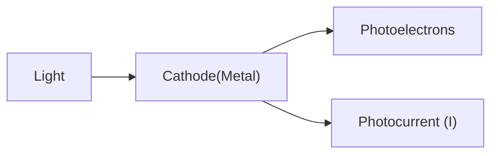

> Master Einstein's photoelectric equation, work function, and stopping potential for JEE Main and Advanced

# Photoelectric Effect: When Light Kicks Out Electrons

## The Oppenheimer Connection 🎬

Remember that scene in Oppenheimer where young Einstein revolutionizes physics? The photoelectric effect was his Nobel Prize work - not relativity! This simple experiment where light ejects electrons from metal surfaces destroyed classical physics and birthed quantum mechanics.

*“Quantum mechanics is very impressive, but I am convinced God does not play dice.”* - Einstein (who ironically started it all)

---

## What is the Photoelectric Effect?

When light of sufficiently high frequency strikes a metal surface, **electrons are ejected** from the surface. These emitted electrons are called **photoelectrons**.

### Classical Wave Theory’s Epic Fail

According to classical physics:

- Light intensity ↑ → Kinetic energy of electrons ↑
- Any frequency should work if intense enough
- There should be a time lag for electrons to absorb energy

**Reality crushed all three predictions!** 🎯

---

## Experimental Observations (Lenard, 1902)

### The Setup



### Key Observations

1. **Threshold Frequency (ν₀)**

   - Below ν₀: No emission, regardless of intensity
   - Above ν₀: Instant emission
2. **Saturation Current**

   - Proportional to light intensity
   - Independent of frequency
3. **Stopping Potential (V₀)**

   - Depends on frequency, NOT intensity
   - V₀ ∝ ν (linear relationship)
4. **Instantaneous Emission**

   - No time lag (~10⁻⁹ s)

---

## Einstein’s Quantum Explanation (1905)

### The Revolutionary Idea

Light consists of discrete packets of energy called **photons**:

$$E_{photon} = hν = \frac{hc}{λ}$$

where:

- h = 6.626 × 10⁻³⁴ J·s (Planck’s constant)
- ν = frequency
- c = 3 × 10⁸ m/s
- λ = wavelength

### Properties of the Photon

**Momentum:**

$$p = \frac{hν}{c} = \frac{h}{λ}$$

**Rest mass:** Zero (photons always travel at c)

**Equivalent (relativistic) mass:**

$$m = \frac{hν}{c^2} = \frac{h}{λ c}$$

---

## Einstein’s Photoelectric Equation

:::box
**Master Formula**

$$K_{max} = hν - φ$$

or equivalently:

$$\frac{1}{2}mv_{max}^2 = hν - φ$$

where:

- K_max = Maximum kinetic energy of photoelectrons
- φ = Work function (minimum energy to remove electron)
- hν = Energy of incident photon
  :::

### In Terms of Wavelength

$$K_{max} = \frac{hc}{λ} - φ$$

### Work Function

$$φ = hν_0 = \frac{hc}{λ_0}$$

where ν₀ is the threshold frequency.

---

## Stopping Potential

The **stopping potential (V₀)** is the minimum negative potential applied to anode that stops the most energetic photoelectrons.

:::box
**Key Relations**

$$eV_0 = K_{max}$$

$$eV_0 = hν - φ$$

$$V_0 = \frac{h}{e}ν - \frac{φ}{e}$$

This is a straight line equation: y = mx + c

- Slope = h/e (universal constant)
- y-intercept = -φ/e
  :::

### Interactive Demo: Visualize Photoelectric Effect

See how light frequency and intensity affect electron emission in real-time.

### The Million-Dollar Graph

```fallback
V₀ (V)
  ↑
  |     /
  |    /  Slope = h/e = 4.14 × 10⁻¹⁵ V·s
  |   /
  |  /
  | /
──┼───────→ ν (Hz)
  |/ν₀

Intercept on ν-axis = ν₀ = φ/h
Intercept on V₀-axis = -φ/e
```

---

## Interactive Demo: Photoelectric Simulator

```javascript
// Adjust frequency and intensity
const PhotoelectricDemo = () => {
  const [frequency, setFrequency] = useState(5e14); // Hz
  const [intensity, setIntensity] = useState(50); // arbitrary units

  // Sodium work function
  const workFunction = 2.3; // eV
  const h = 4.14e-15; // eV·s

  const photonEnergy = h * frequency;
  const kMax = photonEnergy - workFunction;
  const emissionOccurs = photonEnergy > workFunction;

  return (
    <div>
      <h3>Photoelectric Effect Simulator</h3>
      <p>Work Function (Sodium): {workFunction} eV</p>

      <label>Frequency: {frequency.toExponential(2)} Hz</label>
      <input
        type="range"
        min="1e14"
        max="1e15"
        value={frequency}
        onChange={(e) => setFrequency(Number(e.target.value))}
      />

      <label>Intensity: {intensity}%</label>
      <input
        type="range"
        min="0"
        max="100"
        value={intensity}
        onChange={(e) => setIntensity(Number(e.target.value))}
      />

      <div style={{backgroundColor: emissionOccurs ? 'green' : 'red'}}>
        {emissionOccurs ? (
          <>
            <p>✓ Photoelectron Emission!</p>
            <p>Photon Energy: {photonEnergy.toFixed(2)} eV</p>
            <p>K_max: {kMax.toFixed(2)} eV</p>
            <p>Number of electrons ∝ {intensity}</p>
          </>
        ) : (
          <>
            <p>✗ No Emission</p>
            <p>Photon Energy: {photonEnergy.toFixed(2)} eV</p>
            <p>Need: {workFunction} eV minimum</p>
          </>
        )}
      </div>
    </div>
  );
};
```

---

## Memory Tricks 🧠

### “STOP” for Stopping Potential

- **S**topping potential depends on ν
- **T**hreshold frequency exists
- **O**ne photon → one electron
- **P**hotocurrent depends on intensity

### Work Function Ladder

```fallback
Low φ  → Easy to liberate electrons → Alkali metals
High φ → Hard to liberate electrons → Transition metals

Cs < Na < K < Al < Cu < Zn < Ag < Pt
↓                                    ↑
Easy                              Hard
```

### Einstein’s Energy Budget

```fallback
Photon brings hν
    ↓
Pay φ (entrance fee)
    ↓
Leftover = K_max (kinetic energy)
```

---

## Common Mistakes ⚠️

### ❌ Mistake 1: Intensity determines emission

**Wrong:** “Shine brighter light to eject electrons from any metal”
**Right:** Frequency must exceed threshold; intensity only affects number of electrons

### ❌ Mistake 2: All electrons have K_max

**Wrong:** “All photoelectrons have the same kinetic energy”
**Right:** Electrons have 0 ≤ K ≤ K_max depending on depth in metal

### ❌ Mistake 3: Negative stopping potential

**Wrong:** “V₀ = -2 V means apply +2V to stop electrons”
**Right:** Apply -2V to cathode (or +2V to anode relative to cathode)

### ❌ Mistake 4: Wavelength confusion

**Wrong:** K_max = hλ - φ
**Right:** K_max = hc/λ - φ (inverse relationship!)

### ❌ Mistake 5: Time lag exists

**Wrong:** “Electrons need time to accumulate energy”
**Right:** Emission is instantaneous (~10⁻⁹ s)

---

## Derivations You Must Know

### 1. Relation between ν₀ and λ₀

At threshold: K_max = 0

$$hν_0 = φ$$

$$\frac{hc}{λ_0} = φ$$

$$λ_0 = \frac{hc}{φ}$$

### 2. Ratio of Stopping Potentials

For two frequencies ν₁ and ν₂:

$$\frac{V_{01}}{V_{02}} = \frac{hν_1 - φ}{hν_2 - φ}$$

Special case: If ν₂ = ν₀ (threshold), then V₀₂ = 0

$$V_{01} = \frac{h}{e}(ν_1 - ν_0)$$

### 3. Change in Stopping Potential

$$ΔV_0 = \frac{h}{e}Δν = \frac{hc}{e}\left(\frac{1}{λ_1} - \frac{1}{λ_2}\right)$$

---

## Important Constants & Values

| Constant | Symbol | Value |
| --- | --- | --- |
| Planck’s constant | h | 6.626 × 10⁻³⁴ J·s |
| Planck’s constant | h | 4.14 × 10⁻¹⁵ eV·s |
| h/e (slope) | - | 4.14 × 10⁻¹⁵ V·s |
| hc | - | 1240 eV·nm |
| Electron charge | e | 1.6 × 10⁻¹⁹ C |

### Work Functions of Common Metals

| Metal | φ (eV) | ν₀ (10¹⁴ Hz) | λ₀ (nm) |
| --- | --- | --- | --- |
| Cesium (Cs) | 2.1 | 5.1 | 590 |
| Sodium (Na) | 2.3 | 5.6 | 540 |
| Potassium (K) | 2.3 | 5.6 | 540 |
| Calcium (Ca) | 2.9 | 7.0 | 430 |
| Zinc (Zn) | 4.3 | 10.4 | 290 |
| Silver (Ag) | 4.7 | 11.4 | 260 |
| Platinum (Pt) | 5.6 | 13.5 | 220 |

---

## Problem-Solving Strategy

### Step 1: Identify what’s given

- Frequency/wavelength
- Intensity
- Metal (work function)
- Stopping potential

### Step 2: Choose the right equation

- For K_max: Use hν - φ
- For V₀: Use eV₀ = K_max
- For threshold: Use hν₀ = φ

### Step 3: Unit consistency

- Convert nm → m (×10⁻⁹)
- Convert eV ↔ J (×1.6×10⁻¹⁹)
- Use hc = 1240 eV·nm for quick calculations

---

## Practice Problems

### Level 1: JEE Main Basics

**Q1.** Light of wavelength 400 nm falls on a metal surface with work function 2.0 eV. Calculate the maximum kinetic energy of photoelectrons.

**Solution:**

```fallback
Given: λ = 400 nm, φ = 2.0 eV
Using K_max = hc/λ - φ

K_max = 1240 eV·nm / 400 nm - 2.0 eV
K_max = 3.1 - 2.0 = 1.1 eV
```

**Q2.** The stopping potential for photoelectrons from a metal surface is 3.2 V when light of wavelength 300 nm is used. Find the work function.

**Solution:**

```fallback
Given: V₀ = 3.2 V, λ = 300 nm
eV₀ = hc/λ - φ

φ = hc/λ - eV₀
φ = 1240/300 - 3.2
φ = 4.13 - 3.2 = 0.93 eV
```

**Q3.** If the intensity of light is doubled, what happens to:
(a) Stopping potential
(b) Photocurrent
(c) Maximum kinetic energy

**Answer:**

```fallback
(a) No change (depends only on frequency)
(b) Doubles (more photons → more electrons)
(c) No change (depends only on frequency)
```

---

### Level 2: JEE Main/Advanced

**Q4.** A metal has a threshold wavelength of 500 nm. When light of wavelength 400 nm falls on it, find:
(a) Work function
(b) Maximum kinetic energy
(c) Stopping potential

**Solution:**

```fallback
(a) φ = hc/λ₀ = 1240/500 = 2.48 eV

(b) K_max = hc/λ - φ = 1240/400 - 2.48
    K_max = 3.1 - 2.48 = 0.62 eV

(c) V₀ = K_max/e = 0.62 V
```

**Q5.** The stopping potential for sodium (φ = 2.3 eV) is 1.5 V. If the same light falls on potassium (φ = 2.3 eV), what is the stopping potential?

**Solution:**

```fallback
For sodium: eV₀₁ = hν - φ₁
1.5 = hν - 2.3
hν = 3.8 eV

For potassium: eV₀₂ = hν - φ₂
eV₀₂ = 3.8 - 2.3 = 1.5 V

Answer: Same! (both have same work function)
```

**Q6.** A graph of stopping potential vs frequency has a slope of 4.12 × 10⁻¹⁵ V·s. What is the value of Planck’s constant?

**Solution:**

```fallback
Slope = h/e
h = slope × e
h = 4.12 × 10⁻¹⁵ × 1.6 × 10⁻¹⁹
h = 6.59 × 10⁻³⁴ J·s

(Close to actual value 6.626 × 10⁻³⁴ J·s)
```

---

### Level 3: JEE Advanced

**Q7.** A monochromatic light source of power 5 mW emits 8 × 10¹⁵ photons per second. This light ejects photoelectrons from a metal surface with stopping potential 2.0 V. The efficiency of photoelectron emission is 0.1%. Calculate:
(a) Wavelength of light
(b) Work function of metal
(c) Photocurrent if all emitted electrons reach the anode

**Solution:**

```fallback
(a) Power = Number of photons × Energy per photon
    5 × 10⁻³ = 8 × 10¹⁵ × hc/λ
    5 × 10⁻³ = 8 × 10¹⁵ × (6.626 × 10⁻³⁴ × 3 × 10⁸)/λ
    λ = 3.18 × 10⁻⁷ m = 318 nm

(b) eV₀ = hc/λ - φ
    2.0 = 1240/318 - φ
    φ = 3.9 - 2.0 = 1.9 eV

(c) Electrons emitted = 0.1% × 8 × 10¹⁵
                      = 8 × 10¹² electrons/s
    I = ne = 8 × 10¹² × 1.6 × 10⁻¹⁹
    I = 1.28 × 10⁻⁶ A = 1.28 μA
```

**Q8.** Two metallic surfaces A and B have work functions 3 eV and 4 eV respectively. Light of wavelength 300 nm falls on both. Find the ratio of maximum velocities of photoelectrons from A and B.

**Solution:**

```fallback
For A: K_A = hc/λ - φ_A = 1240/300 - 3 = 1.13 eV
For B: K_B = hc/λ - φ_B = 1240/300 - 4 = 0.13 eV

½mv_A² = K_A and ½mv_B² = K_B

v_A/v_B = √(K_A/K_B) = √(1.13/0.13) = √8.7 = 2.95
```

**Q9.** A photon of energy 5 eV ejects a photoelectron from a metal surface. The electron makes a head-on collision with a hydrogen atom in ground state. Find the minimum work function of metal for which the hydrogen atom will be excited to the first excited state. (Ionization energy of H = 13.6 eV)

**Solution:**

```fallback
For H: E₁ = -13.6 eV, E₂ = -13.6/4 = -3.4 eV
ΔE = E₂ - E₁ = -3.4 - (-13.6) = 10.2 eV

For excitation, electron needs KE ≥ 10.2 eV

K_max = hν - φ
10.2 = 5 - φ_min
φ_min = -5.2 eV

This is negative! Impossible.

Actually, photon energy must be increased:
φ_max = hν - K_min
φ_max = 5 - 10.2 = -5.2 eV

Correct interpretation: Need hν ≥ 10.2 + φ
For given hν = 5 eV, impossible regardless of φ.

For φ_min: Set K_max = 10.2 eV
φ_min = 5 - 10.2 = -5.2 eV (unphysical)

Answer: Impossible with 5 eV photon. Need at least 10.2 eV photon.
```

---

## Cross-Links to Related Topics

- [de Broglie Hypothesis](../de-broglie/index.md) - Matter waves and wave-particle duality
- [Davisson-Germer Experiment](../davisson-germer/index.md) - Experimental proof of matter waves
- [Bohr Model](../../atoms-nuclei/bohr-model/index.md) - Quantization of energy (another quantum success)
- [Hydrogen Spectrum](../../atoms-nuclei/hydrogen-spectrum/index.md) - Photon emission and absorption

---

## Quick Revision Checklist ✓

- Einstein’s photoelectric equation: K_max = hν - φ
- Stopping potential: eV₀ = K_max
- Work function: φ = hν₀ = hc/λ₀
- Graph of V₀ vs ν (slope = h/e)
- Four experimental observations
- One photon ejects one electron (intensity → number)
- No time lag, instantaneous emission
- Frequency determines K_max, not intensity
- hc = 1240 eV·nm (golden constant)
- Work functions of common metals

---

## Final Tips for JEE

1. **Always check units**: nm vs m, eV vs J
2. **Use hc = 1240 eV·nm**: Saves calculation time
3. **Draw the V₀-ν graph**: Visual memory helps
4. **Remember**: Frequency = energy, Intensity = number
5. **Practice threshold problems**: Very common in JEE
6. **Know work functions**: At least 3-4 metals

---

*Last updated: April 15, 2025*
*Next: [de Broglie Hypothesis - Wave Nature of Matter](../de-broglie/index.md)*

From TestGuru · our mock-test platform

## You've read Photoelectric Effect - Einstein's Revolutionary Equation.You've read this topic. Find out what you actually got.

A free JEE Main mock with this chapter in it, and a report that shows which sub-topics cost you marks.

[Take a free JEE Main mock →](https://app.testguru.co/signup?tg_chapter=dual-nature&tg_exam=jee-main&tg_page=%2Fphysics%2Fdual-nature%2Fphotoelectric-effect%2F&tg_subject=physics&utm_campaign=notes-jee-main-free-test&utm_content=article-end&utm_medium=referral&utm_source=jeenotes)
Free, no card. Opens TestGuru in a new tab.

## Stay exam-ready

One email every Sunday: new notes, the week's hardest challenge question and a revision plan.One email every Sunday.

## Comments

Have a question or spotted a mistake? Join the discussion below.

Advertisement

Advertisement

---

## Extracted page code (interactive scripts & widgets)


### inline-script-16

```js
if(!document.getElementById("animation-fullscreen-overlay")){const e=document.createElement("div");e.id="animation-fullscreen-overlay",e.className="animation-fullscreen-overlay",e.innerHTML=`
      <div class="fullscreen-modal">
        <div class="fullscreen-header">
          <span class="fullscreen-title">Interactive Demo</span>
          <button class="fullscreen-close-btn" onclick="JEEAnimations.closeFullscreen()" title="Close (Esc)" aria-label="Close fullscreen">
            <svg width="24" height="24" viewBox="0 0 24 24" fill="none" stroke="currentColor" stroke-width="2" stroke-linecap="round" stroke-linejoin="round">
              <line x1="18" y1="6" x2="6" y2="18"></line>
              <line x1="6" y1="6" x2="18" y2="18"></line>
            </svg>
          </button>
        </div>
        <div class="fullscreen-content"></div>
      </div>
    `,document.body.appendChild(e),document.addEventListener("keydown",function(e){e.key==="Escape"&&document.body.classList.contains("animation-fullscreen-active")&&JEEAnimations.closeFullscreen()}),e.addEventListener("click",function(t){t.target===e&&JEEAnimations.closeFullscreen()})}
```


### inline-script-17

```js
(function(){var t,e=document.getElementById("disqus-load");if(!e)return;t=!1,e.addEventListener("click",function(){if(t)return;t=!0,e.setAttribute("disabled","disabled"),e.textContent="Loading comments…",window.disqus_config=function(){this.page.url="https://jeenotes.in/physics/dual-nature/photoelectric-effect/",this.page.identifier="/physics/dual-nature/photoelectric-effect/"};var s=document,n=s.createElement("script");n.src="https://https-jeenotes-in.disqus.com/embed.js",n.setAttribute("data-timestamp",+new Date),n.onload=function(){e.style.display="none"},n.onerror=function(){t=!1,e.removeAttribute("disabled"),e.textContent="Could not load comments. Tap to retry"},(s.head||s.body).appendChild(n)})})()
```


### inline-script-18

```js
(function(){var t,e=document.currentScript.previousElementSibling;function n(){(window.adsbygoogle=window.adsbygoogle||[]).push({})}if(!window.ResizeObserver||e.clientWidth>0){n();return}t=new ResizeObserver(function(){e.clientWidth>0&&(t.disconnect(),n())}),t.observe(e)})()
```


### interactive-widget-1

```html
<div class="animation-wrapper" data-animation="photoelectricEffect" id="anim-photoelectricEffect-1795396423192393189"><div class="animation-header"><button aria-label="Toggle fullscreen" class="anim-fullscreen-btn" onclick='JEEAnimations.toggleFullscreen("anim-photoelectricEffect-1795396423192393189")' title="Fullscreen (F)">
<svg class="fullscreen-icon-expand" fill="none" height="18" stroke="currentColor" stroke-linecap="round" stroke-linejoin="round" stroke-width="2" viewbox="0 0 24 24" width="18"><polyline points="15 3 21 3 21 9"></polyline><polyline points="9 21 3 21 3 15"></polyline><line x1="21" x2="14" y1="3" y2="10"></line><line x1="3" x2="10" y1="21" y2="14"></line></svg>
<svg class="fullscreen-icon-collapse" fill="none" height="18" stroke="currentColor" stroke-linecap="round" stroke-linejoin="round" stroke-width="2" viewbox="0 0 24 24" width="18"><polyline points="4 14 10 14 10 20"></polyline><polyline points="20 10 14 10 14 4"></polyline><line x1="14" x2="21" y1="10" y2="3"></line><line x1="3" x2="10" y1="21" y2="14"></line></svg>
<span class="fullscreen-text">Fullscreen</span></button></div><div class="animation-content"><noscript><div class="callout callout-warning"><div class="callout-title">JavaScript Required</div><p>This interactive animation requires JavaScript to be enabled.</p></div></noscript></div></div>
```


---

_Source: [https://jeenotes.in/physics/dual-nature/photoelectric-effect/](https://jeenotes.in/physics/dual-nature/photoelectric-effect/) · raw HTML: `offline/physics/dual-nature/photoelectric-effect/index.html`_
