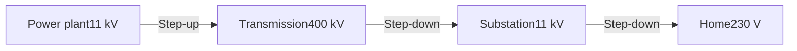

> All key Electromagnetic Induction and AC formulas - Faraday's law, motional EMF, inductance, LCR resonance, transformers. JEE Main & Advanced quick revision.

Every formula you need for Electromagnetic Induction and AC circuits, grouped by sub-topic for last-minute revision.
Headline results are boxed.

## Faraday’s Law & Magnetic Flux

The induced EMF equals the negative rate of change of flux linkage.

$$\boxed{\mathcal{E} = -N\frac{d\Phi_B}{dt}}$$

Magnetic flux through a surface:

$$\Phi_B = \int \vec{B}\cdot d\vec{A} = BA\cos\theta$$

| Quantity | Formula | Notes |
| --- | --- | --- |
| Magnetic flux | $\Phi_B = BA\cos\theta$ | $\theta$ = angle between $\vec{B}$ and area vector $\vec{A}$ |
| Induced EMF | $\mathcal{E} = -N\dfrac{d\Phi_B}{dt}$ | $N$ = number of turns |
| Flux linkage | $N\Phi_B$ | total flux linked with $N$ turns |
| Rotating coil flux | $\Phi_B = NBA\cos(\omega t)$ | coil spinning at angular velocity $\omega$ |
| Rotating coil EMF | $\mathcal{E} = NBA\omega\sin(\omega t)$ | AC generator principle |
| Max EMF (AC generator) | $\mathcal{E}_{max} = NBA\omega$ | peak value |

> **★ Key point · Three ways to change flux**
>
> Flux $\Phi_B = BA\cos\theta$ changes by varying (1) field $B$, (2) area $A$, or (3) angle $\theta$. Static fields induce **no** EMF - only a *changing* flux does. Units: flux in Weber (Wb) = T·m² = V·s.

## Lenz’s Law

> The induced current always opposes the change in flux that produced it - this is the source of the negative sign in Faraday’s law.

| Statement | Meaning |
| --- | --- |
| Flux increasing ($\frac{d\Phi_B}{dt} > 0$) | $\mathcal{E} < 0$; induced field **opposes** external field |
| Flux decreasing ($\frac{d\Phi_B}{dt} < 0$) | $\mathcal{E} > 0$; induced field **supports** external field |
| Magnet approaching coil | near face becomes same pole → repulsion |
| Magnet receding from coil | near face becomes opposite pole → attraction |

> **★ Key point · Lenz = Energy Conservation**
>
> The opposing force means you must do mechanical work to change the flux, and that work becomes the electrical energy: Mechanical work input = Electrical energy output. A magnet dropped through a coil falls **slower than g** because of this braking.

## Motional EMF

For a straight conductor of length $\ell$ moving with velocity $v$ perpendicular to field $B$:

$$\boxed{\mathcal{E} = B\ell v}$$

| Quantity | Formula | Notes |
| --- | --- | --- |
| Straight rod (perpendicular) | $\mathcal{E} = B\ell v$ | “BLV” - $B$, $v$, $\ell$ mutually perpendicular |
| General angle | $\mathcal{E} = B\ell v\sin\theta$ | $\theta$ = angle between $\vec{v}$ and $\vec{B}$ |
| Vector form | $\mathcal{E} = \displaystyle\int (\vec{v}\times\vec{B})\cdot d\vec{\ell}$ | for non-uniform cases |
| Rotating rod (about one end) | $\mathcal{E} = \frac{1}{2}B\omega L^2$ | integrate, since $v = \omega r$ varies |
| Rotating disc (centre to rim) | $\mathcal{E} = \frac{1}{2}B\omega R^2$ | disc generator |
| Force on current-carrying rod | $F = BI\ell = \dfrac{B^2\ell^2 v}{R}$ | retarding force (Lenz) |
| Induced current (rod on rails) | $I = \dfrac{B\ell v}{R}$ | closed loop, resistance $R$ |
| Power dissipated | $P = \dfrac{(B\ell v)^2}{R} = F_{app}\,v$ | equals applied mechanical power |

**Rod released from rest** (velocity decay) and **terminal velocity** on an incline:

$$v(t) = v_0\,e^{-\frac{B^2\ell^2}{mR}t}, \qquad \tau = \frac{mR}{B^2\ell^2}, \qquad v_t = \frac{mgR\sin\theta}{B^2\ell^2}$$

## Self Inductance

$$\boxed{N\Phi_B = LI \qquad \mathcal{E} = -L\frac{dI}{dt}}$$

| Quantity | Formula | Notes |
| --- | --- | --- |
| Definition | $L = \dfrac{N\Phi_B}{I}$ | unit: Henry (H) = Wb/A = V·s/A |
| Back-EMF | $\mathcal{E} = -L\dfrac{dI}{dt}$ | proportional to *rate of change* of $I$ |
| Solenoid | $L = \dfrac{\mu_0 N^2 A}{\ell}$ | $L\propto N^2$; air core $\mu_0 = 4\pi\times10^{-7}$ H/m |
| Solenoid (material core) | $L = \dfrac{\mu_r\mu_0 N^2 A}{\ell}$ | $\mu_r$ = relative permeability |
| Toroid | $L = \dfrac{\mu_0 N^2 A}{2\pi r}$ | $r$ = mean radius |
| Energy stored | $U = \frac{1}{2}LI^2$ | energy in magnetic field |
| Energy density | $u = \dfrac{B^2}{2\mu_0}$ | per unit volume |

**LR circuit** (time constant $\tau = L/R$):

$$\text{Growth: } I(t) = I_0\left(1 - e^{-t/\tau}\right), \quad I_0 = \frac{\mathcal{E}_0}{R} \qquad\qquad \text{Decay: } I(t) = I_0\,e^{-t/\tau}$$

> **★ Key point · Time constant milestones**
>
> At $t = \tau$: growth reaches $0.63\,I_0$ (63%), decay falls to $0.37\,I_0$ (37%). Current through an inductor **cannot change instantly** (would need infinite EMF). In DC steady state an inductor is a short circuit; for AC it blocks high frequencies.

## Mutual Inductance

$$\boxed{\mathcal{E}_2 = -M\frac{dI_1}{dt} \qquad M = k\sqrt{L_1 L_2}}$$

| Quantity | Formula | Notes |
| --- | --- | --- |
| Definition | $M = \dfrac{N_2\Phi_{21}}{I_1} = \dfrac{N_1\Phi_{12}}{I_2}$ | reciprocity: $M_{12} = M_{21} = M$ |
| Induced EMF | $\mathcal{E}_2 = -M\dfrac{dI_1}{dt}$ | unit: Henry (H) |
| Coupling coefficient | $M = k\sqrt{L_1 L_2}$ | $0 \le k \le 1$; $k=1$ is perfect coupling |
| Solenoid pair | $M = \dfrac{\mu_0 N_1 N_2 A}{\ell}$ | $M\propto N_1 N_2$ |
| Energy of coupled coils | $U = \frac{1}{2}L_1 I_1^2 + \frac{1}{2}L_2 I_2^2 \pm M I_1 I_2$ | $+$ aiding, $-$ opposing |

**Series combinations:**

$$L_{eq} = L_1 + L_2 + 2M \ \text{(aiding)} \qquad L_{eq} = L_1 + L_2 - 2M \ \text{(opposing)} \qquad M = \frac{L_{aiding} - L_{opposing}}{4}$$

**Parallel combinations** (general, and identical coils $L_1=L_2=L$):

$$\frac{1}{L_{eq}} = \frac{1}{L_1 \pm M} + \frac{1}{L_2 \pm M} \qquad\Rightarrow\qquad L_{eq} = \frac{L \pm M}{2}$$

## AC Circuits: R, L, C

AC voltage and current, with RMS (effective) values:

$$V = V_0\sin(\omega t), \qquad V_{rms} = \frac{V_0}{\sqrt{2}}, \qquad I_{rms} = \frac{I_0}{\sqrt{2}}, \qquad \omega = 2\pi f = \frac{2\pi}{T}$$

| Element | Phase relation | Reactance / opposition | $I_0$ |
| --- | --- | --- | --- |
| Pure R | $V$ and $I$ in phase | $R$ (constant) | $I_0 = \dfrac{V_0}{R}$ |
| Pure L | $V$ leads $I$ by 90° | $X_L = \omega L = 2\pi f L$ ($\propto f$) | $I_0 = \dfrac{V_0}{X_L}$ |
| Pure C | $I$ leads $V$ by 90° | $X_C = \dfrac{1}{\omega C} = \dfrac{1}{2\pi f C}$ ($\propto \frac{1}{f}$) | $I_0 = \dfrac{V_0}{X_C}$ |

> **★ Key point · ELI the ICE man**
>
> In an inductor (**L**): voltage **E** leads current **I** → **ELI**. In a capacitor (**C**): current **I** leads voltage **E** → **ICE**. Average power over a cycle for a pure inductor or capacitor is **zero** - they only store and return energy. Indian mains: $V_{rms} = 230$ V → $V_0 = 230\sqrt{2} \approx 325$ V at 50 Hz.

## Series LCR Circuit & Resonance

$$\boxed{Z = \sqrt{R^2 + (X_L - X_C)^2} \qquad \tan\phi = \frac{X_L - X_C}{R}}$$

| Quantity | Formula | Notes |
| --- | --- | --- |
| Impedance | $Z = \sqrt{R^2 + \left(\omega L - \frac{1}{\omega C}\right)^2}$ | AC equivalent of resistance |
| Current | $I = \dfrac{V}{Z}$ | same current through all elements |
| Phase angle | $\tan\phi = \dfrac{X_L - X_C}{R}$ | $X_L>X_C$ inductive; $X_L |
| Average power | $P = V_{rms}I_{rms}\cos\phi = I_{rms}^2 R$ | only $R$ dissipates power |
| Power factor | $\cos\phi = \dfrac{R}{Z}$ | unity at resonance |

**Resonance** ($X_L = X_C$):

$$\omega_r = \frac{1}{\sqrt{LC}}, \qquad f_r = \frac{1}{2\pi\sqrt{LC}}$$

At resonance: $Z = R$ (minimum), $I = \dfrac{V}{R}$ (maximum), $\phi = 0$, $\cos\phi = 1$, power maximum $P = \dfrac{V_{rms}^2}{R}$.

**Quality factor and bandwidth:**

$$Q = \frac{\omega_r L}{R} = \frac{1}{\omega_r C R} = \frac{1}{R}\sqrt{\frac{L}{C}}, \qquad \Delta\omega = \frac{\omega_r}{Q}, \qquad V_L = V_C = QV \ \text{(at resonance)}$$

| Property | Series LCR | Parallel LCR |
| --- | --- | --- |
| Resonance condition | $X_L = X_C$ | $X_L = X_C$ |
| Resonant frequency | $f_r = \frac{1}{2\pi\sqrt{LC}}$ | $f_r = \frac{1}{2\pi\sqrt{LC}}$ |
| At resonance | $Z$ minimum, $I$ maximum | $Z$ maximum, $I$ minimum |
| Use | acceptor (passes $f_r$) | rejector (blocks $f_r$) |

> **★ Key point · Power-formula trap**
>
> Always use $P = I_{rms}^2 R$, never $I_{rms}^2 Z$ - only the resistor consumes power. At resonance $V_L$ and $V_C$ are equal in magnitude but 180° out of phase, so they cancel and can each be $Q$ times the source voltage (voltage magnification).

## Transformers

$$\boxed{\frac{V_2}{V_1} = \frac{N_2}{N_1} = \frac{I_1}{I_2} = K}$$

| Quantity | Formula | Notes |
| --- | --- | --- |
| Voltage ratio | $\dfrac{V_2}{V_1} = \dfrac{N_2}{N_1} = K$ | $K>1$ step-up, $K<1$ step-down |
| Current ratio | $\dfrac{I_2}{I_1} = \dfrac{N_1}{N_2} = \dfrac{1}{K}$ | voltage up → current down |
| Power conservation (ideal) | $V_1 I_1 = V_2 I_2$ | ideal transformer |
| Impedance transformation | $\dfrac{Z_1}{Z_2} = \dfrac{N_1^2}{N_2^2} = \dfrac{1}{K^2}$ | transforms as square of turns ratio |
| Efficiency | $\eta = \dfrac{P_{out}}{P_{in}} = \dfrac{V_2 I_2}{V_1 I_1}$ | typically 95-99% for power transformers |
| Copper loss | $P_{Cu} = I_1^2 R_1 + I_2^2 R_2$ | load-dependent ($\propto I^2$) |
| Iron loss | $P_{Fe} = P_{hysteresis} + P_{eddy}$ | hysteresis $\propto f$; eddy $\propto f^2 B^2$ |
| Max-efficiency condition | $P_{Cu} = P_{Fe}$ | variable losses = constant losses |
| Transmission loss | $P_{loss} = I^2 R$ | step up $V$ to cut $I$ and slash loss |

> **⚠ Trap · Transformers need AC**
>
> A transformer works **only with AC**. DC gives constant flux, so $\frac{d\Phi_B}{dt} = 0$ and no EMF is induced in the secondary. Laminated soft-iron cores reduce eddy-current losses.

## Power-system voltage chain



High transmission voltage means low current, so $P_{loss} = I^2 R$ drops drastically - the reason power is sent at 132-400 kV.

## Master Formula Recap

| Topic | Headline formula |
| --- | --- |
| Faraday’s law | $\mathcal{E} = -N\frac{d\Phi_B}{dt}$ |
| Magnetic flux | $\Phi_B = BA\cos\theta$ |
| Motional EMF (rod) | $\mathcal{E} = B\ell v$ |
| Rotating rod | $\mathcal{E} = \frac{1}{2}B\omega L^2$ |
| Self inductance (solenoid) | $L = \frac{\mu_0 N^2 A}{\ell}$ |
| Inductor energy | $U = \frac{1}{2}LI^2$ |
| LR time constant | $\tau = \frac{L}{R}$ |
| Mutual inductance | $M = k\sqrt{L_1 L_2}$ |
| RMS value | $V_{rms} = \frac{V_0}{\sqrt{2}}$ |
| Reactances | $X_L = \omega L,\ X_C = \frac{1}{\omega C}$ |
| LCR impedance | $Z = \sqrt{R^2 + (X_L - X_C)^2}$ |
| Resonant frequency | $f_r = \frac{1}{2\pi\sqrt{LC}}$ |
| Quality factor | $Q = \frac{1}{R}\sqrt{\frac{L}{C}}$ |
| AC power | $P = V_{rms}I_{rms}\cos\phi$ |
| Transformer ratio | $\frac{V_2}{V_1} = \frac{N_2}{N_1} = \frac{I_1}{I_2}$ |

---

*Revise the full chapter:* [Faraday’s Law](../faradays-law/index.md) · [Lenz’s Law](../lenzs-law/index.md) · [Motional EMF](../motional-emf/index.md) · [Self Inductance](../self-inductance/index.md) · [Mutual Inductance](../mutual-inductance/index.md) · [AC Circuits](../ac-circuits/index.md) · [LCR Circuits](../lcr-circuits/index.md) · [Transformers](../transformers/index.md)

From TestGuru · our mock-test platform

## You've read Electromagnetic Induction & AC Formula Sheet.You've read this topic. Find out what you actually got.

A free JEE Main mock with this chapter in it, and a report that shows which sub-topics cost you marks.

[Take a free JEE Main mock →](https://app.testguru.co/signup?tg_chapter=electromagnetic-induction&tg_exam=jee-main&tg_page=%2Fphysics%2Felectromagnetic-induction%2Fformula-sheet%2F&tg_subject=physics&utm_campaign=notes-jee-main-free-test&utm_content=article-end&utm_medium=referral&utm_source=jeenotes)
Free, no card. Opens TestGuru in a new tab.

## Stay exam-ready

One email every Sunday: new notes, the week's hardest challenge question and a revision plan.One email every Sunday.

## Comments

Have a question or spotted a mistake? Join the discussion below.

Advertisement

Advertisement

---

## Extracted page code (interactive scripts & widgets)


### inline-script-14

```js
(function(){var t,e=document.getElementById("disqus-load");if(!e)return;t=!1,e.addEventListener("click",function(){if(t)return;t=!0,e.setAttribute("disabled","disabled"),e.textContent="Loading comments…",window.disqus_config=function(){this.page.url="https://jeenotes.in/physics/electromagnetic-induction/formula-sheet/",this.page.identifier="/physics/electromagnetic-induction/formula-sheet/"};var s=document,n=s.createElement("script");n.src="https://https-jeenotes-in.disqus.com/embed.js",n.setAttribute("data-timestamp",+new Date),n.onload=function(){e.style.display="none"},n.onerror=function(){t=!1,e.removeAttribute("disabled"),e.textContent="Could not load comments. Tap to retry"},(s.head||s.body).appendChild(n)})})()
```


### inline-script-15

```js
(function(){var t,e=document.currentScript.previousElementSibling;function n(){(window.adsbygoogle=window.adsbygoogle||[]).push({})}if(!window.ResizeObserver||e.clientWidth>0){n();return}t=new ResizeObserver(function(){e.clientWidth>0&&(t.disconnect(),n())}),t.observe(e)})()
```


---

_Source: [https://jeenotes.in/physics/electromagnetic-induction/formula-sheet/](https://jeenotes.in/physics/electromagnetic-induction/formula-sheet/) · raw HTML: `offline/physics/electromagnetic-induction/formula-sheet/index.html`_
