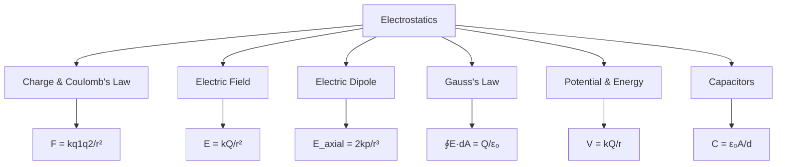

> All key Electrostatics formulas for JEE — Coulomb's law, fields, dipole, Gauss's law, potential, energy and capacitors. JEE Main & Advanced quick revision.

Every must-know formula, constant and standard result from the Electrostatics chapter in one scannable place. Use this for last-minute revision before JEE Main and Advanced.

## Constants and Definitions

| Quantity | Value / Formula | Notes |
| --- | --- | --- |
| Elementary charge | $e = 1.6 \times 10^{-19}$ C | Charge of one electron |
| Coulomb’s constant | $k = 9 \times 10^9$ N·m²/C² | $k = \dfrac{1}{4\pi\varepsilon_0}$ |
| Permittivity of free space | $\varepsilon_0 = 8.85 \times 10^{-12}$ C²/N·m² | Vacuum permittivity |
| Electron volt | $1\text{ eV} = 1.6 \times 10^{-19}$ J | Energy unit |
| Debye | $1\text{ D} = 3.33 \times 10^{-30}$ C·m | Dipole moment unit |

## Electric Charge

**Three fundamental properties:** conservation, quantization, additivity.

| Property | Relation | Notes |
| --- | --- | --- |
| Conservation | $Q_{total} = Q_1 + Q_2 + \ldots = \text{constant}$ | Isolated system |
| Quantization | $Q = ne$ | $n$ is an integer |
| Additivity | $Q_{total} = q_1 + q_2 + \ldots + q_n$ | Algebraic sum (with signs) |

$$\boxed{Q = ne, \quad e = 1.6 \times 10^{-19}\text{ C}}$$

| Charging method | Result |
| --- | --- |
| Friction | Both bodies charged, **opposite** signs |
| Conduction | Both bodies get the **same** sign |
| Induction | Object gets the **opposite** sign (no contact) |

## Coulomb’s Law

$$\boxed{F = k\frac{|q_1 q_2|}{r^2} = \frac{1}{4\pi\varepsilon_0}\frac{|q_1 q_2|}{r^2}}$$

Vector form (force on $q_2$ due to $q_1$):

$$\boxed{\vec{F}_{21} = k\frac{q_1 q_2}{r^2}\hat{r}_{21}}$$

| Item | Relation | Notes |
| --- | --- | --- |
| Constant relation | $k = \dfrac{1}{4\pi\varepsilon_0}$ | — |
| Sign rule | $q_1 q_2 > 0 \Rightarrow$ repulsion; $q_1 q_2 < 0 \Rightarrow$ attraction | Along line joining charges |
| Superposition | $\vec{F}_{net} = \vec{F}_1 + \vec{F}_2 + \ldots + \vec{F}_n$ | Vector sum |

> **★ Key point · Force on a divided charge is maximal at equal split**
>
> Splitting charge $Q$ into $q$ and $(Q-q)$ at separation $r$, the mutual force $F = k\dfrac{q(Q-q)}{r^2}$ is maximum when $q = \dfrac{Q}{2}$.

## Electric Field

$$\boxed{\vec{E} = \frac{\vec{F}}{q_0}, \qquad \vec{F} = q\vec{E}}$$

Field of a point charge:

$$\boxed{E = k\frac{|Q|}{r^2} = \frac{1}{4\pi\varepsilon_0}\frac{|Q|}{r^2}}$$

Superposition: $\vec{E}_{net} = \vec{E}_1 + \vec{E}_2 + \ldots + \vec{E}_n$ (vector sum).

Continuous distributions use $\vec{E} = \displaystyle\int k\frac{dq}{r^2}\hat{r}$, with $\lambda = \dfrac{dq}{dl}$, $\sigma = \dfrac{dq}{dA}$, $\rho = \dfrac{dq}{dV}$.

### Standard Field Results

| Configuration | Field | Notes |
| --- | --- | --- |
| Point charge | $E = k\dfrac{Q}{r^2}$ | $E \propto 1/r^2$ |
| Infinite line charge | $E = \dfrac{\lambda}{2\pi\varepsilon_0 r} = \dfrac{2k\lambda}{r}$ | $E \propto 1/r$ |
| Infinite plane sheet | $E = \dfrac{\sigma}{2\varepsilon_0}$ | Uniform (independent of distance) |
| Two parallel sheets ($\pm\sigma$) | $E = \dfrac{\sigma}{\varepsilon_0}$ between, $E = 0$ outside | Capacitor basis |
| Spherical shell, $r > R$ | $E = k\dfrac{Q}{r^2}$ | Acts as point charge |
| Spherical shell, $r < R$ | $E = 0$ | — |
| Solid sphere, $r > R$ | $E = k\dfrac{Q}{r^2}$ | — |
| Solid sphere, $r < R$ | $E = k\dfrac{Qr}{R^3}$ | $E \propto r$ (linear) |
| Cylindrical shell, $r > R$ | $E = \dfrac{\lambda}{2\pi\varepsilon_0 r}$ | Like infinite line |
| Cylindrical shell, $r < R$ | $E = 0$ | — |
| Ring (on axis, distance $x$) | $E = \dfrac{kQx}{(R^2 + x^2)^{3/2}}$ | $E = 0$ at centre |

$$\boxed{E_{\text{solid sphere, inside}} = k\frac{Qr}{R^3} = \frac{Q}{4\pi\varepsilon_0 R^3}\, r}$$

> **★ Key point · Dimensionality pattern for field decay**
>
> 0D point: $E \propto 1/r^2$, 1D line: $E \propto 1/r$, 2D plane: $E = $ constant. The dimension of the source sets how fast the field falls off.

### Field Lines (key facts)

Start on $+$, end on $-$ (or infinity), never cross, tangent gives field direction, density gives field strength, perpendicular to conductor surfaces and to equipotentials. In electrostatic equilibrium, the field **inside a conductor is zero**.

## Electric Dipole

$$\boxed{\vec{p} = q \cdot 2a \cdot \hat{p}} \qquad (\text{direction: } - \text{ to } +)$$

| Quantity | Formula | Notes |
| --- | --- | --- |
| Axial field ($r \gg a$) | $E_{axial} = \dfrac{2kp}{r^3} = \dfrac{2p}{4\pi\varepsilon_0 r^3}$ | Along $\vec{p}$ |
| Equatorial field ($r \gg a$) | $E_{eq} = \dfrac{kp}{r^3} = \dfrac{p}{4\pi\varepsilon_0 r^3}$ | Opposite to $\vec{p}$ |
| General point | $E = \dfrac{kp}{r^3}\sqrt{1 + 3\cos^2\theta}$ | $\tan\alpha = \dfrac{\tan\theta}{2}$ ($\alpha$ from $\hat{r}$) |
| Potential | $V = \dfrac{kp\cos\theta}{r^2}$ | $V = 0$ on equator |
| Torque | $\tau = pE\sin\theta$, $\vec{\tau} = \vec{p} \times \vec{E}$ | Uniform field |
| Potential energy | $U = -pE\cos\theta = -\vec{p}\cdot\vec{E}$ | Min at $\theta = 0$ |
| Net force (uniform field) | $F_{net} = 0$ | Only torque acts |

$$\boxed{E_{axial} = \frac{2kp}{r^3}, \qquad E_{eq} = \frac{kp}{r^3}, \qquad E_{axial} : E_{eq} = 2 : 1}$$

$$\boxed{\vec{\tau} = \vec{p} \times \vec{E}, \qquad U = -\vec{p}\cdot\vec{E}}$$

| Orientation | $\theta$ | Energy $U$ | Stability |
| --- | --- | --- | --- |
| Parallel to $\vec{E}$ | $0°$ | $-pE$ | Stable (minimum) |
| Perpendicular | $90°$ | $0$ | Reference |
| Antiparallel | $180°$ | $+pE$ | Unstable (maximum) |

Work to rotate from $\theta_1$ to $\theta_2$: $W = pE(\cos\theta_1 - \cos\theta_2)$; full flip ($0° \to 180°$) needs $W = 2pE$.

> **★ Key point · Dipole falls off one power of r faster**
>
> Dipole field $\propto 1/r^3$ vs point-charge $1/r^2$; dipole potential $\propto 1/r^2$ vs point-charge $1/r$. Watch the trap: equatorial **potential** is zero, but equatorial **field** is not.

## Gauss’s Law and Electric Flux

Flux (uniform field, flat surface): $\phi = \vec{E}\cdot\vec{A} = EA\cos\theta$. General: $\phi = \displaystyle\int \vec{E}\cdot d\vec{A}$.

$$\boxed{\oint \vec{E}\cdot d\vec{A} = \frac{Q_{enclosed}}{\varepsilon_0}}$$

Alternative form: $\oint \vec{E}\cdot d\vec{A} = 4\pi k\,Q_{enclosed}$ (since $\frac{1}{\varepsilon_0} = 4\pi k$). Only the **enclosed** charge contributes to net flux.

### Field Results via Gauss’s Law

| Configuration | Region | Field |
| --- | --- | --- |
| Spherical shell (charge $Q$, radius $R$) | $r < R$ | $E = 0$ |
|  | $r \geq R$ | $E = k\dfrac{Q}{r^2}$ |
| Solid sphere (charge $Q$, radius $R$) | $r < R$ | $E = k\dfrac{Qr}{R^3}$ |
|  | $r \geq R$ | $E = k\dfrac{Q}{r^2}$ |
| Infinite line ($\lambda$) | all $r$ | $E = \dfrac{\lambda}{2\pi\varepsilon_0 r}$ |
| Infinite plane ($\sigma$) | all $r$ | $E = \dfrac{\sigma}{2\varepsilon_0}$ |
| Two parallel planes ($\pm\sigma$) | between | $E = \dfrac{\sigma}{\varepsilon_0}$ |
|  | outside | $E = 0$ |

For the solid sphere, $\rho = \dfrac{Q}{\frac{4}{3}\pi R^3} = \dfrac{3Q}{4\pi R^3}$ and $Q_{enc}(r) = Q\dfrac{r^3}{R^3}$.

> **★ Key point · Shell vs solid pattern**
>
> Shell (spherical or cylindrical): zero field inside, $1/r^2$ (or $1/r$) outside. Solid: field rises linearly inside ($E \propto r$), same external behaviour. Field is maximum at the surface ($r = R$).

## Electric Potential and Potential Energy

$$\boxed{V = \frac{W_{\infty \to P}}{q_0}, \qquad V = k\frac{Q}{r} = \frac{1}{4\pi\varepsilon_0}\frac{Q}{r}}$$

| Relation | Formula | Notes |
| --- | --- | --- |
| Potential difference | $V_A - V_B = \dfrac{W_{B \to A}}{q}$ | Voltage |
| Field–potential | $\vec{E} = -\nabla V$, $E = -\dfrac{dV}{dx}$ | Field from gradient |
| Line integral | $V_B - V_A = -\displaystyle\int_A^B \vec{E}\cdot d\vec{l}$ | — |
| Superposition | $V = \displaystyle\sum_i k\dfrac{q_i}{r_i}$ | Scalar sum |

### Potential of Standard Distributions

| Configuration | Potential | Notes |
| --- | --- | --- |
| Point charge | $V = k\dfrac{Q}{r}$ | $V \propto 1/r$ |
| Dipole | $V = \dfrac{kp\cos\theta}{r^2}$ | $V = 0$ on equator |
| Ring (on axis, distance $x$) | $V = \dfrac{kQ}{\sqrt{R^2 + x^2}}$ | $V = \dfrac{kQ}{R}$ at centre |
| Disk (on axis, distance $x$) | $V = \dfrac{\sigma}{2\varepsilon_0}\left(\sqrt{R^2 + x^2} - x\right)$ | — |
| Spherical shell, $r \geq R$ | $V = k\dfrac{Q}{r}$ | — |
| Spherical shell, $r < R$ | $V = k\dfrac{Q}{R}$ | Constant (not zero) |
| Solid sphere, $r \geq R$ | $V = k\dfrac{Q}{r}$ | — |
| Solid sphere, $r < R$ | $V = \dfrac{kQ}{2R^3}(3R^2 - r^2)$ | $V_{centre} = \dfrac{3kQ}{2R}$ |

### Potential Energy

$$\boxed{U = qV, \qquad U = k\frac{q_1 q_2}{r}, \qquad U = k\sum_{i| Relation | Formula | Notes |
| --- | --- | --- |
| Single charge | $U = qV$ | $V$ from other charges |
| Two charges | $U = k\dfrac{q_1 q_2}{r}$ | $U = 0$ at infinite separation |
| System ($n$ charges) | $U = k\displaystyle\sum_{i Sum over distinct pairs | |
| Work by field | $W_{field} = q(V_A - V_B)$ | $\Delta KE = q(V_A - V_B)$ |
| Work by external agent | $W_{ext} = q(V_B - V_A) = -W_{field}$ | — |
| Energy conservation | $\tfrac{1}{2}mv_A^2 + qV_A = \tfrac{1}{2}mv_B^2 + qV_B$ | — |

Electron accelerated through $V$: $KE = eV$ joules (or numerically $KE = V$ in eV).

### Equipotential Surfaces

Constant $V$ over the surface; $\vec{E} \perp$ surface; no work done moving a charge along it; closer surfaces mean stronger field. A conductor in equilibrium is an equipotential volume.

> **★ Key point · Potential trails field by one power of r**
>
> Point charge: $E \propto 1/r^2$, $V \propto 1/r$. Dipole: $E \propto 1/r^3$, $V \propto 1/r^2$. Because $E = -dV/dr$, potential always carries one less power of $r$ than the field. Inside a shell $E = 0$ but $V = kQ/R$ (constant, not zero).

## Capacitors and Capacitance

$$\boxed{C = \frac{Q}{V}} \qquad \text{Unit: farad (F)} = \text{C/V}$$

Subunits: $1\,\mu\text{F} = 10^{-6}$ F, $1\,\text{nF} = 10^{-9}$ F, $1\,\text{pF} = 10^{-12}$ F.

### Capacitor Configurations

| Type | Capacitance | Notes |
| --- | --- | --- |
| Parallel plate | $C = \dfrac{\varepsilon_0 A}{d}$ | $C \propto A$, $C \propto 1/d$ |
| With dielectric | $C = \dfrac{K\varepsilon_0 A}{d} = KC_0$ | $K$ = dielectric constant |
| Spherical (radii $a < b$) | $C = 4\pi\varepsilon_0 \dfrac{ab}{b-a}$ | $\to 4\pi\varepsilon_0 a$ for $b \gg a$ |
| Cylindrical (radii $a < b$, length $L$) | $C = \dfrac{2\pi\varepsilon_0 L}{\ln(b/a)}$ | Coaxial |

$$\boxed{C = \frac{\varepsilon_0 A}{d}, \qquad C_{\text{with dielectric}} = \frac{K\varepsilon_0 A}{d}}$$

Field between plates: $E = \dfrac{\sigma}{\varepsilon_0}$, with $V = Ed = \dfrac{Qd}{A\varepsilon_0}$.

### Combinations

$$\boxed{\frac{1}{C_{series}} = \sum_i \frac{1}{C_i}, \qquad C_{parallel} = \sum_i C_i}$$

| Property | Series | Parallel |
| --- | --- | --- |
| Charge | Same $Q$ on all | Adds: $Q = \sum Q_i$ |
| Voltage | Adds: $V = \sum V_i$ | Same $V$ on all |
| Equivalent $C$ | $\dfrac{1}{C_{eq}} = \sum \dfrac{1}{C_i}$ | $C_{eq} = \sum C_i$ |
| Two capacitors | $C_{eq} = \dfrac{C_1 C_2}{C_1 + C_2}$ | $C_{eq} = C_1 + C_2$ |
| Compared to individuals | $< $ smallest | $>$ largest |

> **★ Key point · Capacitors are the opposite of resistors**
>
> Series capacitors combine like resistors in parallel (reciprocals add); parallel capacitors combine like resistors in series (add directly).

### Energy

$$\boxed{U = \frac{1}{2}CV^2 = \frac{1}{2}QV = \frac{Q^2}{2C}}$$

Energy density (energy per unit volume of field):

$$\boxed{u = \frac{1}{2}\varepsilon_0 E^2} \qquad \left(u = \frac{1}{2}K\varepsilon_0 E^2 \text{ with dielectric}\right)$$

### Dielectric: Battery Connected vs Disconnected

| Situation | Held constant | Effect of inserting $K$ |
| --- | --- | --- |
| Battery **connected** | $V$ constant | $C \to KC_0$; $Q$ and $U$ increase by $K$ |
| Battery **disconnected** | $Q$ constant | $C \to KC_0$; $V$ and $U$ decrease by $K$ |

> **★ Key point · Insertion direction matters**
>
> Always check whether $Q$ or $V$ is held constant before deciding whether the stored energy goes up or down when a dielectric is inserted.

### RC Circuits

| Quantity | Charging | Discharging |
| --- | --- | --- |
| Charge | $Q(t) = CV_0(1 - e^{-t/RC})$ | $Q(t) = Q_0 e^{-t/RC}$ |
| Voltage | $V_C(t) = V_0(1 - e^{-t/RC})$ | $V_C(t) = V_0 e^{-t/RC}$ |
| Current | $I(t) = \dfrac{V_0}{R}e^{-t/RC}$ | $I(t) = -\dfrac{V_0}{R}e^{-t/RC}$ |

Time constant $\tau = RC$: at $t = \tau$ the capacitor reaches 63% of maximum; at $t = 5\tau$ it is over 99% (effectively full).

## Subject Map



## Related Topics

- [Electric Charges and Coulomb’s Law](../electric-charges/index.md)
- [Electric Field](../electric-field/index.md)
- [Electric Dipole](../electric-dipole/index.md)
- [Gauss’s Law](../gauss-law/index.md)
- [Electric Potential and Potential Energy](../electric-potential/index.md)
- [Capacitors and Capacitance](../capacitors/index.md)

From TestGuru · our mock-test platform

## You've read Electrostatics Formula Sheet.You've read this topic. Find out what you actually got.

A free JEE Main mock with this chapter in it, and a report that shows which sub-topics cost you marks.

[Take a free JEE Main mock →](https://app.testguru.co/signup?tg_chapter=electrostatics&tg_exam=jee-main&tg_page=%2Fphysics%2Felectrostatics%2Fformula-sheet%2F&tg_subject=physics&utm_campaign=notes-jee-main-free-test&utm_content=article-end&utm_medium=referral&utm_source=jeenotes)
Free, no card. Opens TestGuru in a new tab.

## Stay exam-ready

One email every Sunday: new notes, the week's hardest challenge question and a revision plan.One email every Sunday.

## Comments

Have a question or spotted a mistake? Join the discussion below.

Advertisement

Advertisement

---

## Extracted page code (interactive scripts & widgets)


### inline-script-14

```js
(function(){var t,e=document.getElementById("disqus-load");if(!e)return;t=!1,e.addEventListener("click",function(){if(t)return;t=!0,e.setAttribute("disabled","disabled"),e.textContent="Loading comments…",window.disqus_config=function(){this.page.url="https://jeenotes.in/physics/electrostatics/formula-sheet/",this.page.identifier="/physics/electrostatics/formula-sheet/"};var s=document,n=s.createElement("script");n.src="https://https-jeenotes-in.disqus.com/embed.js",n.setAttribute("data-timestamp",+new Date),n.onload=function(){e.style.display="none"},n.onerror=function(){t=!1,e.removeAttribute("disabled"),e.textContent="Could not load comments. Tap to retry"},(s.head||s.body).appendChild(n)})})()
```


### inline-script-15

```js
(function(){var t,e=document.currentScript.previousElementSibling;function n(){(window.adsbygoogle=window.adsbygoogle||[]).push({})}if(!window.ResizeObserver||e.clientWidth>0){n();return}t=new ResizeObserver(function(){e.clientWidth>0&&(t.disconnect(),n())}),t.observe(e)})()
```


---

_Source: [https://jeenotes.in/physics/electrostatics/formula-sheet/](https://jeenotes.in/physics/electrostatics/formula-sheet/) · raw HTML: `offline/physics/electrostatics/formula-sheet/index.html`_
