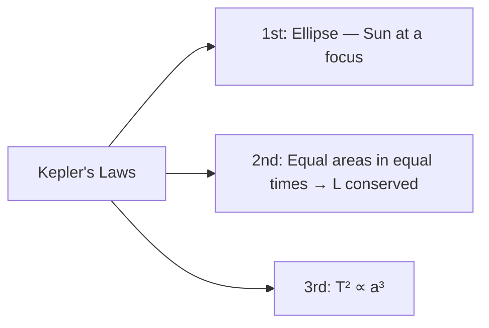

> All key Gravitation formulas for JEE Physics: Newton's law, g variation, field, potential, escape & orbital velocity, satellites, Kepler's laws. Quick revision for JEE Main & Advanced.

Every formula, key relation, and must-know result from the Gravitation chapter, grouped by sub-topic for last-minute revision. Use it to scan before the exam, not to learn for the first time.

> **★ Key point · Five things JEE asks again and again**
>
> $g = \frac{GM}{R^2}$ and its variation with height/depth/latitude
>
> Escape velocity $v_e = \sqrt{2gR} = \sqrt{2}\,v_o$
>
> Satellite energy ratio $KE : |PE| : |E| = 1 : 2 : 1$
>
> Kepler’s third law $T^2 \propto a^3$
>
> Potential/PE are scalars and always negative (reference at infinity)

## Universal Law of Gravitation

$$\boxed{F = G\frac{m_1 m_2}{r^2}}$$

Vector form (attractive, along line of centres):

$$\vec{F}_{12} = -G\frac{m_1 m_2}{r^2}\hat{r}_{12}, \qquad \vec{F}_{12} = -\vec{F}_{21}$$

Superposition for several masses:

$$\vec{F}_{net} = \vec{F}_1 + \vec{F}_2 + \vec{F}_3 + \dots$$

| Quantity | Formula / Value | Notes |
| --- | --- | --- |
| Force between two masses | $F = G\dfrac{m_1 m_2}{r^2}$ | $r$ = centre-to-centre distance |
| Dimensions of $G$ | $[G] = M^{-1}L^3T^{-2}$ | i.e. $\text{m}^3\,\text{kg}^{-1}\,\text{s}^{-2}$ |
| Acceleration of a mass | $a = \dfrac{F}{m} = G\dfrac{M}{r^2}$ | independent of $m$ |
| Distance doubled | $F \to F/4$ | inverse-square law |
| Both masses doubled | $F \to 4F$ | — |

> **★ Key point · High-yield reminder**
>
> $G = 6.67 \times 10^{-11}$ N·m²/kg² is **universal** (same everywhere). $g$ is local and varies. Never mix them. Always use $r = R + h$, not $h$, for distance from Earth’s centre.

## Acceleration Due to Gravity (g) and Its Variation

Surface value (from $mg = GMm/R^2$):

$$\boxed{g = \frac{GM}{R^2}} \qquad (GM = gR^2)$$

| Situation | Formula | Notes |
| --- | --- | --- |
| At height $h$ (general) | $g_h = g\left(\dfrac{R}{R+h}\right)^2$ | inverse-square |
| At height $h$ ($h \ll R$) | $g_h \approx g\left(1 - \dfrac{2h}{R}\right)$ | note factor of **2**; valid $h < 0.1R$ |
| At depth $d$ | $g_d = g\left(1 - \dfrac{d}{R}\right)$ | linear; assumes uniform density |
| At Earth’s centre | $g = 0$ | all forces cancel |
| Due to rotation, latitude $\lambda$ | $g' = g - \omega^2 R\cos^2\lambda$ | $\omega = 2\pi/T$ |
| At poles ($\lambda = 90^\circ$) | $g' = g$ | maximum |
| At equator ($\lambda = 0^\circ$) | $g' = g - \omega^2 R$ | minimum |

Headline forms:

$$\boxed{g_h = g\left(\frac{R}{R+h}\right)^2 \approx g\left(1 - \frac{2h}{R}\right)} \qquad \boxed{g_d = g\left(1 - \frac{d}{R}\right)}$$

Combined height + latitude (small $h$):

$$g' \approx g\left(1 - \frac{2h}{R}\right) - \omega^2 R\cos^2\lambda$$

> **★ Key point · Same distance, height vs depth**
>
> For equal $h = d$, height reduces $g$ **more** than depth: $g_h < g_d$ (decrease is $2h/R$ vs $d/R$). Weight reduction always equals $g$ reduction since $W = mg$ with $m$ constant.

## Gravitational Field, Potential, and Potential Energy

$$\boxed{\vec{E} = \frac{\vec{F}}{m} = -\frac{GM}{r^2}\hat{r}} \qquad \boxed{V = -\frac{GM}{r}} \qquad \boxed{U = -\frac{GMm}{r}}$$

| Quantity | Formula | Units | Scalar / Vector |
| --- | --- | --- | --- |
| Force | $F = \dfrac{GMm}{r^2}$ | N | Vector (attractive) |
| Field intensity | $E = \dfrac{GM}{r^2}$ | N/kg = m/s² | Vector (toward $M$) |
| Potential | $V = -\dfrac{GM}{r}$ | J/kg | Scalar (negative) |
| Potential energy | $U = -\dfrac{GMm}{r}$ | J | Scalar (negative) |

Key relations:

$$E = \frac{F}{m}, \qquad V = \frac{U}{m}, \qquad E = -\frac{dV}{dr}, \qquad F = -\frac{dU}{dr}$$

Superposition (potential is scalar — add algebraically):

$$V_{total} = -G\left(\frac{M_1}{r_1} + \frac{M_2}{r_2} + \frac{M_3}{r_3}\right)$$

### Values for Earth

| Quantity | At surface ($r = R$) | At height $h$ ($r = R+h$) |
| --- | --- | --- |
| Potential | $V = -\dfrac{GM}{R} = -gR$ | $V_h = -\dfrac{GM}{R+h}$ |
| Potential energy | $U = -\dfrac{GMm}{R} = -mgR$ | $U_h = -\dfrac{GMm}{R+h}$ |

Change in PE moving from surface to height $h$:

$$\boxed{\Delta U = \frac{GMmh}{R(R+h)}} \xrightarrow{h \ll R} \Delta U \approx mgh$$

Work done against gravity (move $m$ from $r_1$ to $r_2$):

$$\boxed{W = m(V_2 - V_1) = GMm\left(\frac{1}{r_1} - \frac{1}{r_2}\right)}$$

Surface to infinity (binding energy of mass on surface):

$$W = \frac{GMm}{R}$$

Self-energy of a uniform solid sphere:

$$\boxed{U = -\frac{3GM^2}{5R}}$$

> **★ Key point · Power-of-r and sign pattern**
>
> $F, E \propto r^{-2}$; $V, U \propto r^{-1}$. Both $V$ and $U$ are **negative** (reference at infinity). Differentiating $-1/r$ gives $+1/r^2$, which is how $E = -dV/dr$ and $F = -dU/dr$ work out.

## Escape Velocity

$$\boxed{v_e = \sqrt{\frac{2GM}{R}} = \sqrt{2gR}}$$

Derived from total mechanical energy $= 0$ at the surface (just reaches infinity with $v = 0$).

| Quantity | Formula | Value for Earth |
| --- | --- | --- |
| Escape velocity | $v_e = \sqrt{2gR}$ | $\approx 11.2$ km/s |
| From height $h$ | $v_e(h) = \sqrt{\dfrac{2GM}{R+h}} = v_e\sqrt{\dfrac{R}{R+h}}$ | decreases with height |
| Relation to orbital | $v_e = \sqrt{2}\,v_o \approx 1.414\,v_o$ | — |
| Binding energy (surface) | $E = \dfrac{GMm}{R} = mgR = \tfrac{1}{2}mv_e^2$ | $= mgR$ |
| Proportionality | $v_e \propto \sqrt{\dfrac{M}{R}} \propto \sqrt{gR}$ | mass of object independent |

Energy classification of trajectories:

- $E < 0$ → bound orbit
- $E = 0$ → parabolic escape (minimum escape, $v_\infty = 0$)
- $E > 0$ → hyperbolic escape ($v_\infty > 0$)

Speed at infinity when projected at $v = k\,v_e$ from the surface:

$$\boxed{v_\infty = v_e\sqrt{k^2 - 1}} \qquad (\text{generally } v_\infty = \sqrt{v^2 - v_e^2})$$

Atmospheric retention condition (gas RMS speed $v_{rms} = \sqrt{3kT/m}$):

$$v_{rms} < \frac{v_e}{6}$$

> **★ Key point · Escape velocity essentials**
>
> Independent of the object’s **mass** and **direction** of projection — depends only on the planet’s $M$ and $R$. The **energy** needed ($\tfrac{1}{2}mv_e^2$) does depend on mass.

| Body | $v_e$ (km/s) |
| --- | --- |
| Earth | 11.2 |
| Moon | 2.4 |
| Mars | 5.0 |
| Jupiter | 60 |
| Sun | 618 |

## Satellite Motion

Gravitational force provides centripetal force: $\dfrac{GMm}{r^2} = \dfrac{mv^2}{r}$.

$$\boxed{v_o = \sqrt{\frac{GM}{r}} = \sqrt{gR}\cdot\sqrt{\frac{R}{r}}} \qquad \boxed{T = 2\pi\sqrt{\frac{r^3}{GM}} = 2\pi\sqrt{\frac{r^3}{gR^2}}}$$

| Parameter | Formula | Variation with $r$ | Value (LEO, $h \approx 0$) |
| --- | --- | --- | --- |
| Orbital velocity | $v_o = \sqrt{\dfrac{GM}{r}}$ | $v \propto r^{-1/2}$ | $\approx 7.9$ km/s |
| Time period | $T = 2\pi\sqrt{\dfrac{r^3}{GM}}$ | $T \propto r^{3/2}$ | $\approx 84$ min |
| Kinetic energy | $KE = \dfrac{GMm}{2r}$ | $\propto r^{-1}$ | $\tfrac{1}{2}mgR$ |
| Potential energy | $PE = -\dfrac{GMm}{r}$ | $\propto r^{-1}$ | $-mgR$ |
| Total energy | $E = -\dfrac{GMm}{2r}$ | $\propto r^{-1}$ | $-\tfrac{1}{2}mgR$ |

Energy relations (circular orbit):

$$\boxed{E = -\frac{GMm}{2r} = \frac{PE}{2} = -KE} \qquad |PE| = 2\,KE, \quad |E| = KE$$

$$\boxed{KE : |PE| : |E| = 1 : 2 : 1}$$

Period at surface ($r = R$): $T_0 = 2\pi\sqrt{\dfrac{R}{g}} \approx 84$ minutes (minimum possible period; same as a body dropped through a tunnel along Earth’s diameter).

Energy to launch from surface to circular orbit at height $h$:

$$\boxed{\Delta E = GMm\left(\frac{1}{R} - \frac{1}{2(R+h)}\right) = mgR\left(1 - \frac{R}{2(R+h)}\right)}$$

For low orbit ($h \ll R$): $\Delta E \approx \dfrac{mgR}{2}$ (half the escape energy).

> **★ Key point · Counterintuitive but examined**
>
> Higher orbit → **slower** speed, longer period, but **larger total energy** (less negative). Weightlessness in orbit is free fall, not zero gravity — at ISS height ($\approx 400$ km), $g$ is still about 90% of the surface value.

### Types of Satellites

| Type | Height | Period | Notes |
| --- | --- | --- | --- |
| Low Earth Orbit (LEO) | 200–2000 km | ~90–120 min | ISS, Hubble; atmospheric drag |
| Medium Earth Orbit (MEO) | 2,000–35,786 km | 2–12 h | GPS at ~20,200 km, 12 h |
| Geostationary (GEO) | $\approx 35{,}786$ km | exactly 24 h | equatorial, west→east, appears fixed |
| Polar | ~500–800 km | ~100 min | covers whole Earth, mapping/weather |

> **★ Key point · Geostationary conditions**
>
> Must satisfy all three: period = 24 h, **equatorial** plane (inclination 0°), and west-to-east motion. Geosynchronous needs only the 24 h period — all geostationary are geosynchronous, not vice-versa.

## Kepler’s Laws of Planetary Motion



**First Law (Orbits):** planets move in ellipses with the Sun at one focus.

$$r = \frac{a(1-e^2)}{1 + e\cos\theta}, \qquad e = \sqrt{1 - \frac{b^2}{a^2}}, \qquad r_1 + r_2 = 2a$$

| Point | Distance from Sun |
| --- | --- |
| Perihelion (closest) | $a(1-e)$ |
| Aphelion (farthest) | $a(1+e)$ |

Eccentricity cases: circle $e = 0$; ellipse $0 < e < 1$; parabola $e = 1$; hyperbola $e > 1$ (Earth’s orbit $e = 0.017$).

**Second Law (Areas):** equal areas swept in equal times.

$$\boxed{\frac{dA}{dt} = \frac{1}{2}r^2\omega = \frac{L}{2m} = \text{constant}}$$

This is conservation of angular momentum (gravity is central → zero torque), giving:

$$\boxed{r_p v_p = r_a v_a} \quad\Rightarrow\quad v_p > v_a \ (\text{faster at perihelion})$$

**Third Law (Periods):**

$$\boxed{T^2 \propto a^3} \qquad \boxed{\frac{T^2}{a^3} = \frac{4\pi^2}{GM} = \text{constant}}$$

For circular orbits $a = r$, so $T^2 = \dfrac{4\pi^2}{GM}r^3$. Mass of central body from an orbiting object:

$$\boxed{M = \frac{4\pi^2 a^3}{GT^2}}$$

| Quantity | Proportionality |
| --- | --- |
| Period | $T \propto r^{3/2}$ |
| Orbital speed | $v \propto r^{-1/2}$ |
| Angular velocity | $\omega \propto r^{-3/2}$ |

> **★ Key point · Kepler quick recall**
>
> “Two squared, three cubed”: $T^2 \propto a^3$. Doubling $r$ → $T \to 2^{3/2}T \approx 2.83T$. Doubling $T$ → $r \to 2^{2/3}r \approx 1.59r$. The constant depends only on the **central mass** — different for Sun, Earth, Mars.

## Standard Constants and Reference Values

| Quantity | Value |
| --- | --- |
| Universal gravitational constant $G$ | $6.67 \times 10^{-11}$ N·m²/kg² |
| $g$ at Earth’s surface | $9.8$ m/s² (use 10 for quick work) |
| Earth’s mass $M_E$ | $\approx 6 \times 10^{24}$ kg |
| Earth’s radius $R_E$ | $\approx 6.4 \times 10^6$ m |
| $\omega^2 R$ (rotation term) | $\approx 0.034$ m/s² |
| Escape velocity (Earth) | $11.2$ km/s |
| Orbital velocity (surface) | $7.9$ km/s |
| Surface-orbit / tunnel period | $\approx 84$ minutes |
| Geostationary height | $\approx 35{,}786$ km |

## One-Line Connectors

- $GM = gR^2$ — the bridge between $G$-form and $g$-form of every formula.
- $v_e = \sqrt{2}\,v_o$ — escape vs orbital velocity at the same point.
- $E = -KE = PE/2$ — satellite energy shortcut ($1:2:1$).
- $r_p v_p = r_a v_a$ — angular-momentum bridge for elliptical orbits.
- $T^2 = \dfrac{4\pi^2}{GM}a^3$ — Kepler’s third law, same form for planets and satellites.

## Related Topics

- [Newton’s Law of Universal Gravitation](../universal-gravitation/index.md)
- [Acceleration due to Gravity and Its Variation](../acceleration-gravity/index.md)
- [Gravitational Field and Potential](../gravitational-field-potential/index.md)
- [Kepler’s Laws of Planetary Motion](../keplers-laws/index.md)
- [Escape Velocity](../escape-velocity/index.md)
- [Satellite Motion](../satellites/index.md)

From TestGuru · our mock-test platform

## You've read Gravitation Formula Sheet.You've read this topic. Find out what you actually got.

A free JEE Main mock with this chapter in it, and a report that shows which sub-topics cost you marks.

[Take a free JEE Main mock →](https://app.testguru.co/signup?tg_chapter=gravitation&tg_exam=jee-main&tg_page=%2Fphysics%2Fgravitation%2Fformula-sheet%2F&tg_subject=physics&utm_campaign=notes-jee-main-free-test&utm_content=article-end&utm_medium=referral&utm_source=jeenotes)
Free, no card. Opens TestGuru in a new tab.

## Stay exam-ready

One email every Sunday: new notes, the week's hardest challenge question and a revision plan.One email every Sunday.

## Comments

Have a question or spotted a mistake? Join the discussion below.

Advertisement

Advertisement

---

## Extracted page code (interactive scripts & widgets)


### inline-script-14

```js
(function(){var t,e=document.getElementById("disqus-load");if(!e)return;t=!1,e.addEventListener("click",function(){if(t)return;t=!0,e.setAttribute("disabled","disabled"),e.textContent="Loading comments…",window.disqus_config=function(){this.page.url="https://jeenotes.in/physics/gravitation/formula-sheet/",this.page.identifier="/physics/gravitation/formula-sheet/"};var s=document,n=s.createElement("script");n.src="https://https-jeenotes-in.disqus.com/embed.js",n.setAttribute("data-timestamp",+new Date),n.onload=function(){e.style.display="none"},n.onerror=function(){t=!1,e.removeAttribute("disabled"),e.textContent="Could not load comments. Tap to retry"},(s.head||s.body).appendChild(n)})})()
```


### inline-script-15

```js
(function(){var t,e=document.currentScript.previousElementSibling;function n(){(window.adsbygoogle=window.adsbygoogle||[]).push({})}if(!window.ResizeObserver||e.clientWidth>0){n();return}t=new ResizeObserver(function(){e.clientWidth>0&&(t.disconnect(),n())}),t.observe(e)})()
```


---

_Source: [https://jeenotes.in/physics/gravitation/formula-sheet/](https://jeenotes.in/physics/gravitation/formula-sheet/) · raw HTML: `offline/physics/gravitation/formula-sheet/index.html`_
