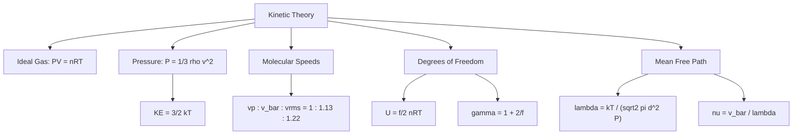

> Every key Kinetic Theory formula for JEE Main & Advanced quick revision: ideal gas laws, pressure, molecular speeds, degrees of freedom, mean free path.

A scannable, exam-day revision of every formula, constant, and must-know result from the Kinetic Theory of Gases chapter. Grouped by sub-topic for last-minute recall.

## Constants and Standard Values

| Quantity | Value | Notes |
| --- | --- | --- |
| Gas constant $R$ | $8.314$ J/(mol·K) | SI units; use for energy, speeds |
| Gas constant $R$ | $0.0821$ L·atm/(mol·K) | for $PV$ gas-law problems only |
| Boltzmann constant $k$ | $1.38 \times 10^{-23}$ J/K | $R = N_A k$ |
| Avogadro’s number $N_A$ | $6.022 \times 10^{23}$ /mol | molecules per mole |
| Molar volume at STP | $22.4$ L/mol | STP: $0^\circ$C, 1 atm |
| Number density at STP | $\approx 2.7 \times 10^{25}$ /m³ | molecules per m³ |
| Molecular diameter $d$ | $\approx 2$–$5$ Å $= 10^{-10}$ m | hard-sphere size |

> **★ Key point · Two values of R, never mix them**
>
> Use $R = 8.314$ J/(mol·K) for kinetic energy, internal energy, $C_V$, $C_P$, and molecular speeds. Use $R = 0.0821$ L·atm/(mol·K) only for $PV = nRT$ problems in atm and litres.
>
> Temperature is **always** in Kelvin: $K = {}^\circ\text{C} + 273$.

## Ideal Gas Equation and Gas Laws

### Equation of State

$$\boxed{PV = nRT = NkT}$$

where $n$ = moles, $N$ = number of molecules, $T$ in Kelvin.

| Form | Formula | Notes |
| --- | --- | --- |
| Molecule form | $PV = NkT$ | $N$ = number of molecules |
| Density form | $P = \dfrac{\rho RT}{M}$ | $\rho$ = density, $M$ = molar mass |
| Density (rearranged) | $\rho = \dfrac{PM}{RT}$ | direct density calculation |

### Individual Gas Laws

| Law | Condition | Relation |
| --- | --- | --- |
| Boyle’s | $T$ constant | $P \propto \dfrac{1}{V}$, i.e. $P_1V_1 = P_2V_2$ |
| Charles’s | $P$ constant | $V \propto T$, i.e. $\dfrac{V_1}{T_1} = \dfrac{V_2}{T_2}$ |
| Gay-Lussac’s | $V$ constant | $P \propto T$, i.e. $\dfrac{P_1}{T_1} = \dfrac{P_2}{T_2}$ |
| Avogadro’s | $T, P$ constant | $V \propto n$, i.e. $\dfrac{V_1}{n_1} = \dfrac{V_2}{n_2}$ |

### Combined Gas Law

$$\boxed{\frac{P_1 V_1}{T_1} = \frac{P_2 V_2}{T_2}}$$

### Gas Mixtures and Work

| Quantity | Formula | Notes |
| --- | --- | --- |
| Dalton’s law | $P_{total} = P_1 + P_2 + P_3 + \dots$ | sum of partial pressures |
| Partial pressure | $P_i = \dfrac{n_i RT}{V}$ | for component $i$ |
| Isothermal work | $W = nRT \ln\!\left(\dfrac{V_2}{V_1}\right) = nRT \ln\!\left(\dfrac{P_1}{P_2}\right)$ | $T$ constant |

### Pressure Unit Conversions

| Unit | Equivalent |
| --- | --- |
| 1 atm | $101{,}325$ Pa $\approx 10^5$ Pa |
| 1 atm | $760$ mmHg |
| 1 bar | $10^5$ Pa $\approx 0.987$ atm |
| 1 mmHg | $133.3$ Pa |
| 1 m³ | $1000$ L |

## Pressure and Temperature from Kinetic Theory

### Pressure

$$\boxed{P = \frac{1}{3}\rho\,\overline{v^2} = \frac{1}{3}\frac{Nm\,\overline{v^2}}{V}}$$

Equivalent form: $PV = \dfrac{1}{3} Nm\,\overline{v^2}$, where $\overline{v^2}$ = mean square speed.

### Kinetic Interpretation of Temperature

$$\boxed{\frac{1}{2}m\,\overline{v^2} = \frac{3}{2}kT}$$

| Quantity | Formula |
| --- | --- |
| Average KE per molecule | $\overline{KE} = \dfrac{3}{2}kT$ |
| Average KE per mole | $\overline{KE}_{mole} = \dfrac{3}{2}RT$ |
| Total KE of $N$ molecules | $KE_{total} = \dfrac{3}{2}NkT = \dfrac{3}{2}nRT$ |
| Pressure vs KE density | $P = \dfrac{2}{3} \times (\text{KE per unit volume})$ |

> **★ Key point · High-yield relation**
>
> $\overline{KE} = \frac{3}{2}kT$ is the single most-tested result of the chapter. At room temperature ($300$ K), average KE per molecule $\approx 6 \times 10^{-21}$ J. The $\frac{1}{3}$ factor in pressure comes from equal energy sharing across the three dimensions $x, y, z$.

> **★ Key point · m vs M trap**
>
> With $k$, use $m$ = mass of **one** molecule (kg). With $R$, use $M$ = **molar** mass (kg/mol). They are linked by $m = \dfrac{M}{N_A}$.

## Molecular Speeds

### Maxwell-Boltzmann Distribution

$$f(v) = 4\pi n \left(\frac{m}{2\pi kT}\right)^{3/2} v^2 \, e^{-\frac{mv^2}{2kT}}$$

Asymmetric curve; peak shifts right and broadens as $T$ rises; area = total number of molecules.

### The Three Speeds

$$\boxed{v_p = \sqrt{\frac{2kT}{m}} = \sqrt{\frac{2RT}{M}}}$$

$$\boxed{\overline{v} = \sqrt{\frac{8kT}{\pi m}} = \sqrt{\frac{8RT}{\pi M}}}$$

$$\boxed{v_{rms} = \sqrt{\overline{v^2}} = \sqrt{\frac{3kT}{m}} = \sqrt{\frac{3RT}{M}}}$$

| Speed | With $k$ | With $R$ | Numerical factor |
| --- | --- | --- | --- |
| Most probable $v_p$ | $\sqrt{\dfrac{2kT}{m}}$ | $\sqrt{\dfrac{2RT}{M}}$ | $\sqrt{2} \approx 1.414$ |
| Average $\overline{v}$ | $\sqrt{\dfrac{8kT}{\pi m}}$ | $\sqrt{\dfrac{8RT}{\pi M}}$ | $\sqrt{8/\pi} \approx 1.596$ |
| RMS $v_{rms}$ | $\sqrt{\dfrac{3kT}{m}}$ | $\sqrt{\dfrac{3RT}{M}}$ | $\sqrt{3} \approx 1.732$ |

### Speed Relationships

$$\boxed{v_p : \overline{v} : v_{rms} = \sqrt{2} : \sqrt{\tfrac{8}{\pi}} : \sqrt{3} = 1 : 1.128 : 1.224}$$

| Relation | Result |
| --- | --- |
| Ordering | $v_p < \overline{v} < v_{rms}$ |
| $\overline{v} / v_{rms}$ | $\sqrt{\dfrac{8}{3\pi}} \approx 0.922$ (independent of $T$, $M$) |
| Temperature dependence | $v \propto \sqrt{T}$, so $\dfrac{v_2}{v_1} = \sqrt{\dfrac{T_2}{T_1}}$ |
| Molar-mass dependence | $v \propto \dfrac{1}{\sqrt{M}}$, so $\dfrac{v_1}{v_2} = \sqrt{\dfrac{M_2}{M_1}}$ |
| Energy link | $\overline{KE} = \dfrac{1}{2}m v_{rms}^2 = \dfrac{3}{2}kT$ |

> **★ Key point · Memory hooks for speeds**
>
> “2-8-3”: $v_p$ has the 2, $\overline{v}$ has the $8/\pi$, $v_{rms}$ has the 3. “PAR” order: **P**robable < **A**verage < **R**MS. Quick ratio to memorise: **1 : 1.13 : 1.22**.

> **★ Key point · Speed pitfalls**
>
> Use $M$ in **kg/mol** (O₂ is $32 \times 10^{-3}$ kg/mol, not 32). Always keep the square root. Use $v_{rms}$ — never $v_p$ or $\overline{v}$ — for kinetic energy. Sanity check: common gases give $\sim 500$ m/s at room temperature.

## Degrees of Freedom and Equipartition

### Counting Degrees of Freedom

$$f = \text{Translational} + \text{Rotational} + 2 \times (\text{Vibrational modes})$$

| Gas Type | Example | $f$ | Breakdown (trans + rot + vib) |
| --- | --- | --- | --- |
| Monoatomic | He, Ne, Ar | 3 | 3 + 0 + 0 |
| Diatomic (room T) | H₂, O₂, N₂ | 5 | 3 + 2 + 0 |
| Diatomic (high T) | above ~1000 K | 7 | 3 + 2 + 2 |
| Linear triatomic | CO₂ | 7 | 3 + 2 + 2 |
| Non-linear triatomic | H₂O | 6 | 3 + 3 + 0 |

General polyatomic ($N$ atoms): linear vibrational modes $= 3N - 5$; non-linear vibrational modes $= 3N - 6$.

### Law of Equipartition

Each degree of freedom carries average energy $\dfrac{1}{2}kT$ per molecule (or $\dfrac{1}{2}RT$ per mole).

$$\boxed{\overline{E} = \frac{f}{2}kT \quad\text{(per molecule)}, \qquad U = \frac{f}{2}nRT \quad\text{(}n\text{ moles)}}$$

| Gas Type | $f$ | $U$ per mole |
| --- | --- | --- |
| Monoatomic | 3 | $\frac{3}{2}RT$ |
| Diatomic (room T) | 5 | $\frac{5}{2}RT$ |
| Diatomic (high T) | 7 | $\frac{7}{2}RT$ |
| Linear triatomic | 7 | $\frac{7}{2}RT$ |
| Non-linear triatomic | 6 | $3RT$ |

### Specific Heats and Adiabatic Index

$$C_V = \frac{f}{2}R \qquad C_P = \frac{f+2}{2}R \qquad C_P - C_V = R \text{ (Mayer's relation)}$$

$$\boxed{\gamma = \frac{C_P}{C_V} = \frac{f+2}{f} = 1 + \frac{2}{f}}$$

Useful rearrangement: $C_V = \dfrac{R}{\gamma - 1}$.

| Gas Type | $f$ | $C_V$ | $C_P$ | $\gamma$ |
| --- | --- | --- | --- | --- |
| Monoatomic | 3 | $\frac{3}{2}R$ | $\frac{5}{2}R$ | $5/3 \approx 1.67$ |
| Diatomic (room T) | 5 | $\frac{5}{2}R$ | $\frac{7}{2}R$ | $7/5 = 1.40$ |
| Diatomic (high T) | 7 | $\frac{7}{2}R$ | $\frac{9}{2}R$ | $9/7 \approx 1.29$ |
| Non-linear triatomic | 6 | $3R$ | $4R$ | $4/3 \approx 1.33$ |

### Gas Mixtures (equivalent values)

$$C_{V,\text{mix}} = \frac{n_1 C_{V1} + n_2 C_{V2}}{n_1 + n_2}, \qquad f_{eq} = \frac{n_1 f_1 + n_2 f_2}{n_1 + n_2}, \qquad \gamma_{mix} = 1 + \frac{2}{f_{eq}}$$

### Adiabatic and Related Relations

| Quantity | Formula |
| --- | --- |
| Adiabatic process | $PV^\gamma = \text{constant}$ |
| Adiabatic ($T$-$V$) | $TV^{\gamma-1} = \text{constant}$ |
| Adiabatic ($P$-$T$) | $P^{1-\gamma}T^\gamma = \text{constant}$ |
| Adiabatic work | $W = \dfrac{nR(T_1 - T_2)}{\gamma - 1} = \dfrac{P_1V_1 - P_2V_2}{\gamma - 1}$ |
| Speed of sound in gas | $v = \sqrt{\dfrac{\gamma RT}{M}}$ |

> **★ Key point · Degrees-of-freedom shortcuts**
>
> “3-5-7” for diatomic (low / room / high T). $\gamma$ values to memorise: $1.67$ monoatomic, $1.40$ diatomic (like air), $1.33$ triatomic. $\gamma > 1$ always, since $C_P > C_V$. Air is diatomic, so $f = 5$, $\gamma = 1.4$.

## Mean Free Path and Collisions

### Mean Free Path

$$\boxed{\lambda = \frac{1}{\sqrt{2}\,\pi n d^2} = \frac{kT}{\sqrt{2}\,\pi d^2 P}}$$

Simplified (stationary-target) model: $\lambda = \dfrac{1}{\pi n d^2}$. The $\sqrt{2}$ in the accurate form accounts for relative motion ($v_{rel} = \sqrt{2}\,\overline{v}$).

| Dependence | Relation |
| --- | --- |
| Number density | $\lambda \propto \dfrac{1}{n}$ |
| Pressure (const $T$) | $\lambda \propto \dfrac{1}{P}$ |
| Temperature (const $P$) | $\lambda \propto T$ |
| Combined | $\lambda \propto \dfrac{T}{P}$ |
| Molecular size | $\lambda \propto \dfrac{1}{d^2}$ |
| Volume (const $N$) | $\lambda \propto V$ |

### Collision Frequency and Timing

| Quantity | Formula |
| --- | --- |
| Collision frequency | $\nu = \dfrac{\overline{v}}{\lambda} = \sqrt{2}\,\pi n d^2 \overline{v}$ |
| In terms of $P$ | $\nu = \dfrac{\sqrt{2}\,\pi d^2 P \overline{v}}{kT}$ |
| Using $\overline{v} = \sqrt{\tfrac{8kT}{\pi m}}$ | $\nu = 4\pi d^2 n \sqrt{\dfrac{kT}{\pi m}}$ |
| Mean time between collisions | $\tau = \dfrac{1}{\nu} = \dfrac{\lambda}{\overline{v}}$ |
| Collision rate per unit volume | $Z = \dfrac{1}{2}n\nu = \dfrac{\pi n^2 d^2 \overline{v}}{\sqrt{2}}$ |

### Number Density

$$n = \frac{N}{V} = \frac{P}{kT} = \frac{N_A P}{RT}$$

### Transport Properties

| Property | Proportionality |
| --- | --- |
| Viscosity $\eta$ | $\eta \propto \dfrac{m\overline{v}}{\pi d^2} \propto \sqrt{mT}$ |
| Thermal conductivity $\kappa$ | $\kappa \propto \dfrac{C_V \overline{v}}{3\pi d^2} \propto \sqrt{T}$ |
| Diffusion coefficient $D$ | $D \propto \dfrac{\overline{v}\lambda}{3} \propto \dfrac{T^{3/2}}{P}$ |
| Knudsen number | $Kn = \dfrac{\lambda}{L}$ ($Kn \ll 1$ continuum, $Kn \gg 1$ free-molecular) |

> **★ Key point · Mean free path benchmarks**
>
> At STP: $\lambda \approx 100$ nm ($\sim 10^{-7}$ m) and $\nu \approx 10^9$–$10^{10}$ collisions/s. The factor-of-2 quick rule: $\lambda_{new} = \lambda_{old} \times \dfrac{T_{new}}{T_{old}} \times \dfrac{P_{old}}{P_{new}}$. Convert $d$ from Å to metres ($1$ Å $= 10^{-10}$ m) before plugging in.

## Real Gas Behaviour (Deviations)

| Quantity | Formula | Notes |
| --- | --- | --- |
| Van der Waals equation | $\left(P + \dfrac{an^2}{V^2}\right)(V - nb) = nRT$ | corrects for forces ($a$) and volume ($b$) |
| Compressibility factor | $Z = \dfrac{PV}{nRT}$ | $Z = 1$ ideal; $Z > 1$ repulsive; $Z < 1$ attractive |

Kinetic theory assumptions break down at **high pressure** (molecular volume matters) and **low temperature** (intermolecular forces matter).

## Chapter Map



## One-Glance Exam Cheats

> **◐ In simple terms · Memorise these for instant marks**
>
> - $PV = nRT = NkT$ — equation of state.

> - $\overline{KE} = \frac{3}{2}kT$ per molecule; $\frac{3}{2}nRT$ total.

> - $v_p : \overline{v} : v_{rms} = 1 : 1.128 : 1.224$; all $\propto \sqrt{T/M}$.

> - $C_V = \frac{f}{2}R$, $C_P = \frac{f+2}{2}R$, $C_P - C_V = R$, $\gamma = 1 + \frac{2}{f}$.

> - $f$: monoatomic 3, diatomic 5, polyatomic 6 (non-linear); $\gamma$: 1.67, 1.40, 1.33.

> - $\lambda = \dfrac{kT}{\sqrt{2}\pi d^2 P}$; $\nu = \dfrac{\overline{v}}{\lambda}$; at STP $\lambda \approx 100$ nm.

## Related Topics

- [Ideal Gas Equation and Gas Laws](../ideal-gas-equation/index.md)
- [Kinetic Theory: Basic Postulates and Assumptions](../kinetic-theory-assumptions/index.md)
- [Molecular Speeds: RMS, Average, and Most Probable](../molecular-speeds/index.md)
- [Degrees of Freedom and Law of Equipartition of Energy](../degrees-freedom/index.md)
- [Mean Free Path and Molecular Collisions](../mean-free-path/index.md)

From TestGuru · our mock-test platform

## You've read Kinetic Theory of Gases Formula Sheet.You've read this topic. Find out what you actually got.

A free JEE Main mock with this chapter in it, and a report that shows which sub-topics cost you marks.

[Take a free JEE Main mock →](https://app.testguru.co/signup?tg_chapter=kinetic-theory&tg_exam=jee-main&tg_page=%2Fphysics%2Fkinetic-theory%2Fformula-sheet%2F&tg_subject=physics&utm_campaign=notes-jee-main-free-test&utm_content=article-end&utm_medium=referral&utm_source=jeenotes)
Free, no card. Opens TestGuru in a new tab.

## Stay exam-ready

One email every Sunday: new notes, the week's hardest challenge question and a revision plan.One email every Sunday.

## Comments

Have a question or spotted a mistake? Join the discussion below.

Advertisement

Advertisement

---

## Extracted page code (interactive scripts & widgets)


### inline-script-14

```js
(function(){var t,e=document.getElementById("disqus-load");if(!e)return;t=!1,e.addEventListener("click",function(){if(t)return;t=!0,e.setAttribute("disabled","disabled"),e.textContent="Loading comments…",window.disqus_config=function(){this.page.url="https://jeenotes.in/physics/kinetic-theory/formula-sheet/",this.page.identifier="/physics/kinetic-theory/formula-sheet/"};var s=document,n=s.createElement("script");n.src="https://https-jeenotes-in.disqus.com/embed.js",n.setAttribute("data-timestamp",+new Date),n.onload=function(){e.style.display="none"},n.onerror=function(){t=!1,e.removeAttribute("disabled"),e.textContent="Could not load comments. Tap to retry"},(s.head||s.body).appendChild(n)})})()
```


### inline-script-15

```js
(function(){var t,e=document.currentScript.previousElementSibling;function n(){(window.adsbygoogle=window.adsbygoogle||[]).push({})}if(!window.ResizeObserver||e.clientWidth>0){n();return}t=new ResizeObserver(function(){e.clientWidth>0&&(t.disconnect(),n())}),t.observe(e)})()
```


---

_Source: [https://jeenotes.in/physics/kinetic-theory/formula-sheet/](https://jeenotes.in/physics/kinetic-theory/formula-sheet/) · raw HTML: `offline/physics/kinetic-theory/formula-sheet/index.html`_
