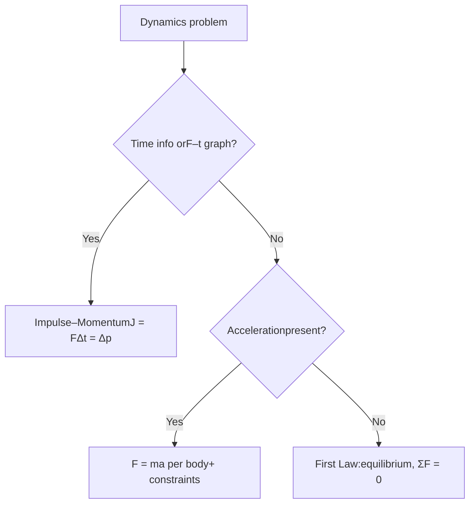

> All key Laws of Motion formulas for JEE Main & Advanced quick revision: Newton's laws, friction, impulse-momentum, collisions, and circular dynamics.

Every must-know formula, relation, and result from the Laws of Motion chapter, organised for last-minute revision. Use it as a rapid checklist before the exam.

## Newton’s Three Laws

### First Law (Law of Inertia)

A body at rest stays at rest, and a body in uniform motion continues in a straight line, unless acted upon by an external force.

| Quantity | Relation | Notes |
| --- | --- | --- |
| Inertia | $\text{Inertia} \propto \text{Mass}$ | Mass is the measure of inertia |
| Equilibrium | Net force $= 0 \Rightarrow$ constant velocity | First law holds in inertial frames only |

> **★ Key point · Frames of reference**
>
> **Inertial frame:** zero acceleration; first law holds without pseudo forces.

> **Non-inertial frame:** accelerating; introduce a pseudo force $= ma$ opposite to the frame’s acceleration.

### Second Law (Force and Momentum)

$$\boxed{\vec{F} = \frac{d\vec{p}}{dt}}$$

For **constant mass** this reduces to:

$$\boxed{\vec{F} = m\vec{a}}$$

| Quantity | Formula | Notes |
| --- | --- | --- |
| Linear momentum | $\vec{p} = m\vec{v}$ | Vector; units kg·m/s or N·s |
| 2D components | $F_x = ma_x,\;\; F_y = ma_y$ | x and y motions are independent |

> **★ Key point · dp/dt vs ma**
>
> $\vec{F} = d\vec{p}/dt$ is the **general** form (works for variable mass like rockets). $\vec{F} = m\vec{a}$ is the **special case** for constant mass only.

### Third Law (Action–Reaction)

$$\boxed{\vec{F}_{AB} = -\vec{F}_{BA}}$$

Action and reaction are equal in magnitude, opposite in direction, of the **same type**, act **simultaneously**, and on **different bodies** (so they never cancel).

- **Recoil (gun–bullet):** $m_b v_b = m_g v_g \;\Rightarrow\; v_g = \dfrac{m_b}{m_g}\,v_b$
- Internal (action–reaction) forces cannot change a system’s total momentum.

## Connected Bodies, Pulleys and Inclines

| System | Result | Conditions |
| --- | --- | --- |
| Atwood machine | $a = \dfrac{(m_2 - m_1)g}{m_1 + m_2}$ | Two masses over a frictionless pulley |
| Atwood tension | $T = \dfrac{2 m_1 m_2 g}{m_1 + m_2}$ | Massless string; $T = mg$ if $m_1 = m_2$ |
| Block on smooth incline | $a = g\sin\theta$ | Independent of mass |
| Block on rough incline (sliding down) | $a = g(\sin\theta - \mu_k\cos\theta)$ | Kinetic friction acts up the plane |
| Block on incline (FBD) | $N = mg\cos\theta$ | Along plane: $mg\sin\theta - f = ma$ |
| Wedge + block (both smooth) | $a_M = \dfrac{mg\sin\theta\cos\theta}{M + m\sin^2\theta}$ | Acceleration of the wedge |

> **★ Key point · Sin or cos on an incline?**
>
> “**SIN goes DOWN the plane**” — along-plane component is $mg\sin\theta$, into-plane (normal) component is $mg\cos\theta$.



## Impulse and Momentum

$$\boxed{\vec{J} = \int_{t_1}^{t_2}\vec{F}\,dt = \Delta\vec{p}}$$

| Quantity | Formula | Notes |
| --- | --- | --- |
| Impulse (constant force) | $\vec{J} = \vec{F}\,\Delta t$ | Units N·s = kg·m/s |
| Impulse–momentum theorem | $F\,\Delta t = m\,\Delta v$ | Large $F$/short $t$ or small $F$/long $t$ |
| Impulse from graph | $J = $ area under $F$–$t$ curve | Works for variable force |
| Average force | $\vec{F}_{\text{avg}} = \dfrac{\vec{J}}{\Delta t} = \dfrac{\Delta\vec{p}}{\Delta t}$ | Equivalent constant force |

> **★ Key point · Why catching/airbags work**
>
> For a fixed momentum change, increasing the contact time $\Delta t$ reduces the peak force $F = \Delta p/\Delta t$ — the principle behind airbags, crumple zones, and pulling hands back while catching.

## Conservation of Momentum

$$\boxed{\vec{F}_{\text{ext}} = 0 \;\Rightarrow\; \vec{p}_{\text{total}} = \text{constant}}$$

A direct consequence of Newton’s third law (internal forces cancel).

| Quantity | Formula | Notes |
| --- | --- | --- |
| CM velocity | $\vec{v}_{\text{CM}} = \dfrac{m_1\vec{v}_1 + m_2\vec{v}_2}{m_1 + m_2}$ | Constant if $\vec{F}_{\text{ext}} = 0$ |
| Total momentum | $\vec{p}_{\text{total}} = (m_1 + m_2)\vec{v}_{\text{CM}}$ | — |
| Explosion (from rest) | $\sum m_i\vec{v}_i = 0$ | Fragments’ momenta sum to zero |
| 2D conservation | $p_x,\,p_y,\,p_z$ each conserved separately | Momentum is a vector |

> **⚠ Trap · When NOT to use it**
>
> Momentum is conserved only if **no net external force** acts. With friction or an applied external force, momentum of the system is **not** conserved.

## Collisions

$$\boxed{e = \frac{\text{velocity of separation}}{\text{velocity of approach}} = \frac{v_2 - v_1}{u_1 - u_2}}$$

| Type | Restitution $e$ | Conserved | Outcome |
| --- | --- | --- | --- |
| Elastic | $e = 1$ | Momentum + KE | Bounce off |
| Inelastic | $0 < e < 1$ | Momentum only | Bounce, reduced speed |
| Perfectly inelastic | $e = 0$ | Momentum only | Stick together; max KE loss |

### Head-on elastic collision (1D)

$$\boxed{v_1 = \frac{(m_1 - m_2)u_1 + 2m_2 u_2}{m_1 + m_2}}$$

$$\boxed{v_2 = \frac{(m_2 - m_1)u_2 + 2m_1 u_1}{m_1 + m_2}}$$

| Special case | Result |
| --- | --- |
| Equal masses ($m_1 = m_2$) | Velocities exchange: $v_1 = u_2,\; v_2 = u_1$ |
| Equal masses, target at rest | $v_1 = 0,\; v_2 = u_1$ |
| Light hits heavy ($m_1 \ll m_2$), target at rest | $v_1 \approx -u_1,\; v_2 \approx 0$ |
| Heavy hits light ($m_1 \gg m_2$), target at rest | $v_1 \approx u_1,\; v_2 \approx 2u_1$ |

### Perfectly inelastic collision

$$\boxed{v = \frac{m_1 u_1 + m_2 u_2}{m_1 + m_2}}$$

$$\boxed{\Delta KE = \frac{1}{2}\,\frac{m_1 m_2}{m_1 + m_2}\,(u_1 - u_2)^2}$$

(uses the reduced mass; this KE loss is the maximum possible).

### General collision with restitution

Solve simultaneously:

$$m_1 u_1 + m_2 u_2 = m_1 v_1 + m_2 v_2 \qquad v_2 - v_1 = e(u_1 - u_2)$$

### Bouncing off the ground

| Quantity | Formula | Notes |
| --- | --- | --- |
| Rebound speed (elastic) | $v = -u$ | $e = 1$ |
| Rebound speed (general) | $v = -eu$ | Wall/ground infinitely massive |
| Height after $n$ bounces | $h_n = e^{2n}\,h$ | Dropped from height $h$ |
| Total path before rest | $H = h\,\dfrac{1 + e^2}{1 - e^2}$ | Sum of the bounce series |

## Friction

$$\boxed{f_s \le \mu_s N} \qquad \boxed{f_{s,\text{max}} = \mu_s N} \qquad \boxed{f_k = \mu_k N}$$

| Quantity | Relation | Notes |
| --- | --- | --- |
| Coefficient of friction | $\mu = f/N$ | Dimensionless; depends on surfaces |
| Static vs kinetic | $\mu_s > \mu_k$ | Harder to start than to keep going |
| Static friction | Self-adjusting, $0 \le f_s \le \mu_s N$ | Not always equal to $\mu_s N$ |
| Kinetic friction | Constant $= \mu_k N$ | Independent of area and (approx.) speed |
| Angle of friction | $\tan\lambda = \mu_s,\;\; \lambda = \tan^{-1}\mu_s$ | Resultant of $N$ and $f_{\max}$ |
| Angle of repose | $\theta_R = \tan^{-1}\mu_s$ | Equal to angle of friction |
| Rest condition on incline | $\tan\theta \le \mu_s$ | Block stays put |

### Friction-driven results

| Quantity | Formula | Notes |
| --- | --- | --- |
| Min. horizontal force to move | $F_{\min} = \mu_s mg$ | Pure horizontal pull |
| Force $F$ at angle $\theta$ (to start) | $F = \dfrac{\mu_s mg}{\cos\theta + \mu_s\sin\theta}$ | $N = mg - F\sin\theta$ |
| Overall minimum applied force | $F_{\min} = \dfrac{\mu_s mg}{\sqrt{1 + \mu_s^2}}$ | At $\theta = \lambda = \tan^{-1}\mu_s$ |
| Max. acceleration without slipping | $a_{\max} = \mu_s g$ | Driving/braking on flat road |
| Stopping distance | $s = \dfrac{v^2}{2\mu_k g}$ | Braking on horizontal surface |
| Belt–pulley tension ratio | $\dfrac{T_1}{T_2} = e^{\mu\theta}$ | $\theta$ = wrap angle (radians) |

> **★ Key point · Repose = friction angle**
>
> “**Repose and friction are twins**”: $\theta_R = \lambda = \tan^{-1}\mu_s$. On an incline, if $\theta < \tan^{-1}\mu_s$ the block will not slide.

> **⚠ Trap · Friction direction**
>
> Friction opposes **relative motion / tendency of motion**, not “down the plane.” On an incline it acts up if the block moves down, and down if the block moves up.

## Circular Motion Dynamics

$$\boxed{F_c = \frac{mv^2}{r} = m\omega^2 r = mv\omega} \qquad \boxed{a_c = \frac{v^2}{r} = \omega^2 r}$$

Centripetal force is the **net** inward force (from tension, friction, gravity, or normal) — not a new force.

### Roads and pendulum

| Scenario | Formula | Notes |
| --- | --- | --- |
| Level road, max speed | $v_{\max} = \sqrt{\mu_s r g}$ | Friction supplies $F_c$; mass-independent |
| Banked road (no friction), optimum | $v_{\text{opt}} = \sqrt{rg\tan\theta}$ | $\tan\theta = v^2/(rg)$ |
| Banking angle | $\theta = \tan^{-1}\!\big(v^2/(rg)\big)$ | For design speed $v$ |
| Banked + friction, max speed | $v_{\max} = \sqrt{rg\,\dfrac{\mu + \tan\theta}{1 - \mu\tan\theta}}$ | Friction acts down-slope |
| Banked + friction, min speed | $v_{\min} = \sqrt{rg\,\dfrac{\tan\theta - \mu}{1 + \mu\tan\theta}}$ | Friction acts up-slope |
| Conical pendulum | $\cos\theta = \dfrac{g}{L\omega^2}$ | $r = L\sin\theta$ |
| Conical pendulum speed | $v^2 = Lg\sin\theta\tan\theta$ | — |
| Conical pendulum period | $T = 2\pi\sqrt{\dfrac{L\cos\theta}{g}}$ | — |

### Vertical circular motion

| Position | Tension / Normal | Notes |
| --- | --- | --- |
| Bottom (lowest) | $T_L = mg + \dfrac{mv_L^2}{r}$ | Maximum tension |
| Top (highest) | $T_H = \dfrac{mv_H^2}{r} - mg$ | Minimum tension |
| Side | $T = \dfrac{mv^2}{r}$ | Intermediate |
| Min. speed at top | $v_{H,\min} = \sqrt{gr}$ | Set $T_H = 0$ |
| Min. speed at bottom | $v_{L,\min} = \sqrt{5gr}$ | From energy conservation |
| Well of death (vertical wall) | $v_{\min} = \sqrt{\dfrac{rg}{\mu}}$ | $N = mv^2/r$, $\mu N = mg$ |

Energy link between top and bottom of a vertical circle: $v_L^2 = v_H^2 + 4gr$.

> **★ Key point · Vertical circle: remember 1 and 5**
>
> Minimum speed at the **top** $= \sqrt{gr}$ (coefficient 1); at the **bottom** $= \sqrt{5gr}$ (coefficient 5). At the optimum banking speed, **no friction is needed**.

## Variable Mass (Rocket)

| Quantity | Formula | Notes |
| --- | --- | --- |
| Thrust | $F_{\text{thrust}} = v_{\text{rel}}\dfrac{dm}{dt}$ | Use $F = dp/dt$, not $ma$ |
| Tsiolkovsky equation | $v - u = v_{\text{rel}}\ln\!\dfrac{m_i}{m_f}$ | Free space |
| Velocity at time $t$ (rate $\alpha$) | $v = u\ln\!\dfrac{m_0}{m_0 - \alpha t}$ | Gravity-free; from rest |

[Practise these formulas: NLM PYQ](../previous-year-questions/index.md)

## Notes

- This is a true formula sheet: every formula and fact above is drawn directly from the existing chapter pages (`_index.md`, `newtons-first-law`, `newtons-second-law`, `newtons-third-law`, `friction`, `impulse-momentum`, `circular-dynamics`). Nothing has been added from outside those pages.
- Worked-problem-specific intermediate results (e.g., the chain-on-table timing, man-on-boat displacement) were treated as problem solutions rather than general results and were intentionally not listed as standalone formulas, since they are not headline relations to memorise.
- Standard values used throughout the chapter’s problems: $g = 10\ \text{m/s}^2$.

## Keep studying this chapter

- [Laws of Motion chapter notes](../index.md)
- [Laws of Motion previous year questions](../previous-year-questions/index.md)

From TestGuru · our mock-test platform

## You've read Laws of Motion Formula Sheet.You've read this topic. Find out what you actually got.

A free JEE Main mock with this chapter in it, and a report that shows which sub-topics cost you marks.

[Take a free JEE Main mock →](https://app.testguru.co/signup?tg_chapter=laws-of-motion&tg_exam=jee-main&tg_page=%2Fphysics%2Flaws-of-motion%2Fformula-sheet%2F&tg_subject=physics&utm_campaign=notes-jee-main-free-test&utm_content=article-end&utm_medium=referral&utm_source=jeenotes)
Free, no card. Opens TestGuru in a new tab.

## Stay exam-ready

One email every Sunday: new notes, the week's hardest challenge question and a revision plan.One email every Sunday.

## Comments

Have a question or spotted a mistake? Join the discussion below.

Advertisement

Advertisement

---

## Extracted page code (interactive scripts & widgets)


### inline-script-14

```js
(function(){var t,e=document.getElementById("disqus-load");if(!e)return;t=!1,e.addEventListener("click",function(){if(t)return;t=!0,e.setAttribute("disabled","disabled"),e.textContent="Loading comments…",window.disqus_config=function(){this.page.url="https://jeenotes.in/physics/laws-of-motion/formula-sheet/",this.page.identifier="/physics/laws-of-motion/formula-sheet/"};var s=document,n=s.createElement("script");n.src="https://https-jeenotes-in.disqus.com/embed.js",n.setAttribute("data-timestamp",+new Date),n.onload=function(){e.style.display="none"},n.onerror=function(){t=!1,e.removeAttribute("disabled"),e.textContent="Could not load comments. Tap to retry"},(s.head||s.body).appendChild(n)})})()
```


### inline-script-15

```js
(function(){var t,e=document.currentScript.previousElementSibling;function n(){(window.adsbygoogle=window.adsbygoogle||[]).push({})}if(!window.ResizeObserver||e.clientWidth>0){n();return}t=new ResizeObserver(function(){e.clientWidth>0&&(t.disconnect(),n())}),t.observe(e)})()
```


---

_Source: [https://jeenotes.in/physics/laws-of-motion/formula-sheet/](https://jeenotes.in/physics/laws-of-motion/formula-sheet/) · raw HTML: `offline/physics/laws-of-motion/formula-sheet/index.html`_
