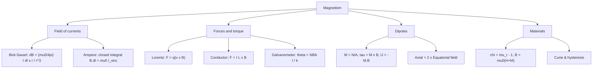

> All key magnetism formulas for JEE - Biot-Savart, Ampere's law, Lorentz force, torque, dipoles, galvanometers, and magnetic materials. Quick revision for JEE Main & Advanced.

Every must-know formula from this chapter in one scannable place. Use it for last-minute revision: each result below is drawn directly from the chapter topics on Biot-Savart law, Ampere’s law, Lorentz force, force on conductors, galvanometers, magnetic dipoles, and magnetic materials.

> **★ Key point · Master constant**
>
> Memorize $\mu_0 = 4\pi \times 10^{-7}$ T·m/A and the shortcut $\dfrac{\mu_0}{4\pi} = 10^{-7}$ T·m/A. The second form saves real time in almost every numerical.

## Biot-Savart Law and Magnetic Field of Currents

Field due to a current element:

$$\boxed{d\vec{B} = \frac{\mu_0}{4\pi}\cdot\frac{I\,d\vec{l}\times\vec{r}}{r^3}} \qquad dB = \frac{\mu_0}{4\pi}\cdot\frac{I\,dl\sin\theta}{r^2}$$

| Configuration | Magnetic field | Key point |
| --- | --- | --- |
| Infinite straight wire | $B = \dfrac{\mu_0 I}{2\pi r}$ | Most common building block |
| Finite wire (angles $\alpha,\beta$) | $B = \dfrac{\mu_0 I}{4\pi r}(\sin\alpha + \sin\beta)$ | Measured from the ends |
| Semi-infinite wire | $B = \dfrac{\mu_0 I}{4\pi r}$ | Half of the infinite wire |
| Circular loop (center) | $B = \dfrac{\mu_0 N I}{2R}$ | $\perp$ to plane of loop |
| Circular loop (on axis) | $B = \dfrac{\mu_0 N I R^2}{2(R^2+x^2)^{3/2}}$ | The $3/2$ power |
| Loop, far on axis ($x \gg R$) | $B \approx \dfrac{\mu_0 I R^2}{2x^3} = \dfrac{\mu_0 M}{2\pi x^3}$ | $M = I\pi R^2$ |
| Arc subtending $\theta$ at center | $B = \dfrac{\mu_0 I \theta}{4\pi R}$ | $\theta$ in radians |
| Square loop, side $a$ (center) | $B = \dfrac{2\sqrt{2}\,\mu_0 I}{\pi a}$ | Sum of 4 sides |

Arc special cases (from $B = \dfrac{\mu_0 I\theta}{4\pi R}$):

$$\text{Semicircle: } B = \frac{\mu_0 I}{4R} \qquad \text{Quarter: } B = \frac{\mu_0 I}{8R} \qquad \text{Full circle: } B = \frac{\mu_0 I}{2R}$$

> **★ Key point · Direction shortcut**
>
> Right-hand thumb rule: point the thumb along the current, the curled fingers give the circular field direction. The field around a straight wire forms loops, it never points radially.

## Ampere’s Circuital Law

$$\boxed{\oint \vec{B}\cdot d\vec{l} = \mu_0 I_{\text{enc}}}$$

Maxwell-corrected form (with displacement current):

$$\oint \vec{B}\cdot d\vec{l} = \mu_0\left(I_{\text{enc}} + \epsilon_0\frac{d\Phi_E}{dt}\right)$$

| Configuration | Region | Magnetic field |
| --- | --- | --- |
| Infinite wire | Outside | $B = \dfrac{\mu_0 I}{2\pi r}$ |
| Solid cylinder (radius $R$) | Inside, $r $B = \dfrac{\mu_0 I r}{2\pi R^2}$ | |
| Solid cylinder | Outside, $r>R$ | $B = \dfrac{\mu_0 I}{2\pi r}$ |
| Solenoid | Inside | $B = \mu_0 n I$ |
| Solenoid | Outside (ideal) | $B = 0$ |
| Toroid | Inside | $B = \dfrac{\mu_0 N I}{2\pi r}$ |
| Toroid | Outside | $B = 0$ |
| Infinite current sheet | Either side | $B = \dfrac{\mu_0 K}{2}$ |

Hollow cylinder (inner $a$, outer $b$), current within the conductor ($a
$$B = \frac{\mu_0 I (r^2 - a^2)}{2\pi r (b^2 - a^2)} \qquad (rb:\ B=\tfrac{\mu_0 I}{2\pi r})$$

> **★ Key point · When to use which law**
>
> Use Ampere’s law only when there is cylindrical, planar, or translational symmetry (infinite wire, solenoid, toroid, cylinder, current sheet). For finite or bent wires, loops, and arcs, fall back to Biot-Savart.

## Lorentz Force and Motion of Charged Particles

$$\boxed{\vec{F} = q(\vec{v}\times\vec{B})} \qquad F = qvB\sin\theta$$

Complete Lorentz force (electric + magnetic):

$$\boxed{\vec{F} = q(\vec{E} + \vec{v}\times\vec{B})}$$

> **⚠ Trap · Magnetic force does NO work**
>
> The magnetic force is always perpendicular to $\vec{v}$, so $W = \vec{F}\cdot\vec{v} = 0$. The magnetic field changes a particle’s direction, never its speed or kinetic energy.

| Quantity | Formula | Note |
| --- | --- | --- |
| Radius (circular, $v\perp B$) | $r = \dfrac{mv}{qB}$ | Larger mass and speed widen the circle |
| Time period | $T = \dfrac{2\pi m}{qB}$ | Independent of $v$ and $r$ |
| Cyclotron frequency | $f = \dfrac{qB}{2\pi m}$ | Independent of $v$ |
| Angular frequency | $\omega = \dfrac{qB}{m}$ | Simplest form |
| Radius (helical) | $r = \dfrac{mv\sin\theta}{qB}$ | Uses $v_\perp$ only |
| Pitch (helical) | $p = \dfrac{2\pi m v\cos\theta}{qB}$ | Uses $v_\parallel$ |

Motion summary by angle between $\vec{v}$ and $\vec{B}$: $\theta = 0^\circ$ gives a straight line ($F=0$); $\theta = 90^\circ$ gives a circle; any other angle gives a helix.

### Applications (Crossed and Cyclotron Fields)

| Device | Key formula | Note |
| --- | --- | --- |
| Velocity selector | $v = \dfrac{E}{B}$ | Only this speed passes undeflected |
| Cyclotron AC frequency | $f = \dfrac{qB}{2\pi m}$ | Independent of radius |
| Cyclotron max KE | $KE_{\max} = \dfrac{q^2 B^2 R^2}{2m}$ | At dee radius $R$ |
| Mass spectrometer | $m = \dfrac{qB^2 r}{E}$ | After velocity selection $v=E/B$ |
| Magnetic focusing | $d = \dfrac{\pi m v}{qB}$ | Distance between focuses |
| $E \parallel B$ | accelerating helix | Helix with increasing pitch |
| $E \perp B$ (from rest) | drift $v_{\text{drift}} = \dfrac{E}{B}$ | Cycloidal motion |

Particles accelerated through the same potential $V$ then bent in field $B$:

$$r = \frac{1}{B}\sqrt{\frac{2mV}{q}} \quad\Rightarrow\quad \frac{r_1}{r_2} = \sqrt{\frac{m_1}{m_2}} \ \ (\text{same } q,V,B)$$

## Force and Torque on Current-Carrying Conductors

$$\boxed{d\vec{F} = I\,d\vec{l}\times\vec{B}} \qquad \boxed{\vec{F} = I\vec{L}\times\vec{B}} \qquad F = BIL\sin\theta$$

| Quantity | Formula | Note |
| --- | --- | --- |
| Force on straight wire | $F = BIL\sin\theta$ | Max ($BIL$) when $I\perp B$ |
| Force between parallel wires | $\dfrac{F}{L} = \dfrac{\mu_0 I_1 I_2}{2\pi d}$ | Same direction $\to$ attract |
| Torque on coil | $\tau = NIAB\sin\theta$ | Max when plane $\parallel B$ |
| Magnetic moment | $M = NIA$ | $\vec{\tau} = \vec{M}\times\vec{B}$ |
| Potential energy | $U = -\vec{M}\cdot\vec{B} = -MB\cos\theta$ | Min at $\theta = 0^\circ$ |
| Work to rotate | $W = MB(\cos\theta_1 - \cos\theta_2)$ | $\theta_1\to\theta_2$ |

> **↗ Connection · Effective length theorem**
>
> For any shape of wire in a uniform field, the force equals that on a straight wire joining the endpoints: $\vec{F} = I\vec{L}_{\text{eff}}\times\vec{B}$. So a semicircle uses $L_{\text{eff}} = 2R$ (diameter), and a closed loop has $L_{\text{eff}} = 0$, hence zero net force (but possibly nonzero torque).

> **⚠ Trap · Common sign and direction traps**
>
> Same-direction currents **attract**, opposite-direction currents **repel**. Torque is **zero** at equilibrium ($\theta=0$), maximum at $\theta=90^\circ$. The potential energy keeps its **negative** sign: $U = -MB\cos\theta$.

**Definition of the ampere:** two infinite parallel wires 1 m apart each carrying 1 A experience a force of $2\times 10^{-7}$ N/m.

## Moving Coil Galvanometer

| Quantity | Formula | Note |
| --- | --- | --- |
| Deflection | $\theta = \dfrac{NBA}{k}\,I$ | Linear; $\propto I$ (radial field) |
| Current sensitivity | $S_I = \dfrac{\theta}{I} = \dfrac{NBA}{k}$ | Higher is more sensitive |
| Voltage sensitivity | $S_V = \dfrac{\theta}{V} = \dfrac{NBA}{kG}$ | Depends on $G$ too |
| Figure of merit | $k_g = \dfrac{1}{S_I}$ | Lower is better |

**Conversion to ammeter** (shunt $S$ in parallel, $n = I/I_g$):

$$\boxed{S = \frac{I_g G}{I - I_g} = \frac{G}{n-1}} \qquad R_A = \frac{GS}{G+S} = \frac{G}{n}$$

**Conversion to voltmeter** (resistance $R$ in series, $m = V/(I_g G)$):

$$\boxed{R = \frac{V}{I_g} - G = (m-1)G} \qquad R_V = G + R = mG = \frac{V}{I_g}$$

| Property | Ammeter | Voltmeter |
| --- | --- | --- |
| Add | Shunt in parallel (low R) | Resistance in series (high R) |
| Ideal resistance | $R_A \to 0$ | $R_V \to \infty$ |
| Quality | — | $\dfrac{R_V}{V} = \dfrac{1}{I_g}$ ($\Omega$/V) |

> **★ Key point · Half-deflection method**
>
> To find the galvanometer resistance, halve the deflection by adding a shunt; at half-deflection $G = S$, because equal currents flow through equal parallel resistances.

## Magnetic Dipole and Bar Magnet

$$\boxed{\vec{M} = NI\vec{A}} \qquad M = m\times 2l \ (\text{bar magnet})$$

| Quantity | Formula | Note |
| --- | --- | --- |
| Torque | $\tau = MB\sin\theta$ | Max at $\theta = 90^\circ$ |
| Potential energy | $U = -MB\cos\theta$ | Min (stable) at $\theta = 0^\circ$ |
| Work to rotate | $W = MB(\cos\theta_1 - \cos\theta_2)$ | $\theta_1\to\theta_2$ |
| Energy gap (stable$\to$unstable) | $\Delta U = 2MB$ | $0^\circ \to 180^\circ$ |
| Oscillation period | $T = 2\pi\sqrt{\dfrac{I}{MB}}$ | Like a torsion pendulum |
| Angular frequency | $\omega = \sqrt{\dfrac{MB}{I}}$ | $I$ = moment of inertia |
| Axial field ($r\gg$ length) | $B = \dfrac{\mu_0}{4\pi}\dfrac{2M}{r^3}$ | Along axis |
| Equatorial field | $B = \dfrac{\mu_0}{4\pi}\dfrac{M}{r^3}$ | Opposite to $\vec{M}$ |
| Field ratio | $\dfrac{B_{\text{axial}}}{B_{\text{equatorial}}} = 2$ | At same distance |

General point at angle $\theta$ to the axis:

$$B_r = \frac{\mu_0}{4\pi}\frac{2M\cos\theta}{r^3}, \quad B_\theta = \frac{\mu_0}{4\pi}\frac{M\sin\theta}{r^3}, \quad B = \frac{\mu_0}{4\pi}\frac{M}{r^3}\sqrt{1+3\cos^2\theta}, \quad \tan\alpha = \frac{\tan\theta}{2}$$

Force between two coaxial dipoles falls as $r^{-4}$: $F = \dfrac{6\mu_0 M_1 M_2}{4\pi r^4}$ (coaxial), $F = \dfrac{3\mu_0 M_1 M_2}{4\pi r^4}$ (side by side).

**Bohr magneton:** $\mu_B = \dfrac{e\hbar}{2m_e} = 9.27\times 10^{-24}$ A·m².

> **⚠ Trap · Dipole pitfalls**
>
> Axial field is **twice** the equatorial field (not the other way around). The energy sign is **negative**: $U = -MB\cos\theta$. Cutting a magnet always yields two magnets - no isolated monopoles - and cutting in half either way gives moment $M/2$.

### Earth’s Magnetic Field

| Quantity | Relation | Note |
| --- | --- | --- |
| Angle of dip | $\tan\theta = \dfrac{B_V}{B_H}$ | $0^\circ$ at equator, $90^\circ$ at poles |
| Horizontal component | $B_H = B\cos\theta$ |  |
| Vertical component | $B_V = B\sin\theta$ |  |

Earth’s moment $M_E \approx 8\times 10^{22}$ A·m²; field near equator $B_E \approx 3\times 10^{-5}$ T (30 μT).

## Magnetic Materials

| Quantity | Formula | Note |
| --- | --- | --- |
| Magnetic intensity | $\vec{H} = \dfrac{\vec{B}}{\mu_0} - \vec{M}$ | Unit A/m |
| Solenoid intensity | $H = nI$ | Depends only on current |
| Magnetization | $M = \chi H$ | Moment per unit volume |
| Susceptibility | $\chi = \mu_r - 1$ | Dimensionless |
| Relative permeability | $\mu_r = 1 + \chi$ | $\mu_r = \mu/\mu_0$ |
| B-H relation | $B = \mu_0\mu_r H$ | In a medium |
| B-M relation | $B = \mu_0(H + M) = \mu_0(1+\chi)H$ | Alternative form |
| Curie law (para) | $\chi = \dfrac{C}{T}$ | $\chi \propto 1/T$ |
| Curie-Weiss (ferro) | $\chi = \dfrac{C}{T - T_C}$ | Valid above $T_C$ |
| Hysteresis loss | $E = \oint H\,dB$ | Loop area = energy/cycle/volume |

### Classification of Materials

| Property | Diamagnetic | Paramagnetic | Ferromagnetic |
| --- | --- | --- | --- |
| Susceptibility $\chi$ | Negative ($\sim -10^{-5}$) | Small positive ($10^{-5}$ to $10^{-3}$) | Large positive ($10^2$ to $10^5$) |
| Permeability $\mu_r$ | $<1$ | $>1$ (slightly) | $\gg 1$ (1000 to 100000) |
| Behavior in field | Weakly repelled | Weakly attracted | Strongly attracted |
| Temperature effect | Independent | $\chi \propto 1/T$ | $\chi \propto 1/(T-T_C)$ |
| Examples | Bi, Cu, Ag, Au, H₂O | Al, Na, O₂, Pt | Fe, Co, Ni |

**Curie temperatures:** Iron 1043 K, Cobalt 1394 K, Nickel 631 K. Above $T_C$ a ferromagnet becomes paramagnetic.

### Hysteresis Terms

- **Retentivity (remanence):** the residual $B$ when $H = 0$ (field is removed).
- **Coercivity:** the reverse magnetizing intensity $H$ needed to bring the magnetization back to zero.
- **Saturation:** all domains aligned, $M = M_s$; further increase in $H$ no longer increases $M$.

| Property | Soft magnetic | Hard magnetic |
| --- | --- | --- |
| Hysteresis loop | Narrow (small area) | Wide (large area) |
| Retentivity / Coercivity | Low | High |
| Energy loss | Low | High |
| Use | Transformer cores, electromagnets | Permanent magnets, data storage |
| Examples | Soft iron, permalloy | Steel, alnico, NdFeB |

> **⚠ Trap · Material misconceptions**
>
> Diamagnetic $\chi$ is **negative**. The permeability relation is $\mu_r = 1 + \chi$ (plus sign). Paramagnetic $\chi$ **decreases** with temperature. Domains exist **always** in a ferromagnet; the external field merely aligns them.

## Chapter Map



## Last-Minute Reminders

> **★ Key point · High-yield recall list**
>
> - $\dfrac{\mu_0}{4\pi} = 10^{-7}$ T·m/A and $\mu_0 = 4\pi\times10^{-7}$ T·m/A.

> - Cyclotron period $T = \dfrac{2\pi m}{qB}$ and frequency are independent of speed and radius.

> - Magnetic force does no work; speed and KE stay constant.

> - Same-direction currents attract; opposite repel.

> - Torque on a loop is zero at equilibrium, maximum when the plane is parallel to $B$.

> - Axial dipole field is twice the equatorial field at the same distance.

> - Ammeter: low-resistance shunt in parallel; voltmeter: high-resistance in series.

> - $\mu_r = 1 + \chi$; diamagnetic $\chi < 0$, paramagnetic small positive, ferromagnetic $\chi \gg 0$.

## Further Reading

- [Biot-Savart Law](../biot-savart-law/index.md)
- [Ampere’s Circuital Law](../amperes-law/index.md)
- [Lorentz Force](../force-moving-charge/index.md)
- [Force on Current-Carrying Conductors](../force-current-conductor/index.md)
- [Moving Coil Galvanometer](../galvanometer/index.md)
- [Magnetic Dipole](../magnetic-dipole/index.md)
- [Magnetic Materials](../magnetic-materials/index.md)

From TestGuru · our mock-test platform

## You've read Magnetic Effects of Current and Magnetism Formula Sheet.You've read this topic. Find out what you actually got.

A free JEE Main mock with this chapter in it, and a report that shows which sub-topics cost you marks.

[Take a free JEE Main mock →](https://app.testguru.co/signup?tg_chapter=magnetism&tg_exam=jee-main&tg_page=%2Fphysics%2Fmagnetism%2Fformula-sheet%2F&tg_subject=physics&utm_campaign=notes-jee-main-free-test&utm_content=article-end&utm_medium=referral&utm_source=jeenotes)
Free, no card. Opens TestGuru in a new tab.

## Stay exam-ready

One email every Sunday: new notes, the week's hardest challenge question and a revision plan.One email every Sunday.

## Comments

Have a question or spotted a mistake? Join the discussion below.

Advertisement

Advertisement

---

## Extracted page code (interactive scripts & widgets)


### inline-script-14

```js
(function(){var t,e=document.getElementById("disqus-load");if(!e)return;t=!1,e.addEventListener("click",function(){if(t)return;t=!0,e.setAttribute("disabled","disabled"),e.textContent="Loading comments…",window.disqus_config=function(){this.page.url="https://jeenotes.in/physics/magnetism/formula-sheet/",this.page.identifier="/physics/magnetism/formula-sheet/"};var s=document,n=s.createElement("script");n.src="https://https-jeenotes-in.disqus.com/embed.js",n.setAttribute("data-timestamp",+new Date),n.onload=function(){e.style.display="none"},n.onerror=function(){t=!1,e.removeAttribute("disabled"),e.textContent="Could not load comments. Tap to retry"},(s.head||s.body).appendChild(n)})})()
```


### inline-script-15

```js
(function(){var t,e=document.currentScript.previousElementSibling;function n(){(window.adsbygoogle=window.adsbygoogle||[]).push({})}if(!window.ResizeObserver||e.clientWidth>0){n();return}t=new ResizeObserver(function(){e.clientWidth>0&&(t.disconnect(),n())}),t.observe(e)})()
```


---

_Source: [https://jeenotes.in/physics/magnetism/formula-sheet/](https://jeenotes.in/physics/magnetism/formula-sheet/) · raw HTML: `offline/physics/magnetism/formula-sheet/index.html`_
