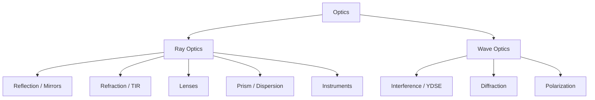

> Ray and wave optics formulas on one page: mirror and lens formulas, prism, TIR, microscope, telescope, Young's double slit, diffraction and polarization. JEE Main & Advanced.

Last-minute, scan-friendly recap of every formula and must-know result from the Optics chapter - ray optics, wave optics, and instruments. Use the
reminders to dodge the traps JEE loves.

## Chapter Map



## Sign Convention (New Cartesian)

> **★ Key point · Master this first - 80% of errors are sign errors**
>
> - Measure all distances from the pole / optical center.

> - Distances **towards the object (left)** are negative; **away (right)** are positive.

> - Heights **above** the principal axis are positive, **below** are negative.

> - Mirrors: $f$ is negative for concave, positive for convex.

> - Lenses: $f$ is positive for convex, negative for concave.

## Reflection & Mirrors

Laws of reflection: incident ray, reflected ray, and normal are coplanar, and

$$\boxed{i = r}$$

| Quantity | Formula | Notes |
| --- | --- | --- |
| Mirror formula | $\dfrac{1}{v} + \dfrac{1}{u} = \dfrac{1}{f}$ | Note the **plus** sign |
| Focal length | $f = \dfrac{R}{2}$ | Concave: $f<0$; Convex: $f>0$ |
| Magnification | $m = -\dfrac{v}{u} = \dfrac{h_i}{h_o}$ | $m<0$ inverted, $m>0$ erect |
| Plane mirror | $v = -u,\; m = +1$ | Virtual, erect, same size |
| Mirror rotation | beam deviates by $2\theta$ | for mirror rotated by $\theta$ |
| Images in two mirrors | $n = \dfrac{360^\circ}{\theta} - 1$ | take floor if not integer |

**Concave mirror image positions (real object):**

| Object position | Image |
| --- | --- |
| Beyond C | Real, inverted, diminished |
| At C | Real, inverted, same size |
| Between F and C | Real, inverted, magnified |
| At F | At infinity |
| Between P and F | Virtual, erect, magnified |
| Convex (any) | Virtual, erect, diminished |

> **★ Key point · Mirror vs lens**
>
> Mirror formula has a **+** between $\tfrac{1}{v}$ and $\tfrac{1}{u}$; lens formula has a **-**. Mirror magnification carries a minus sign ($m = -v/u$); lens magnification does not ($m = v/u$).

## Refraction & TIR

$$\boxed{n = \frac{c}{v}} \qquad \boxed{n_1 \sin i = n_2 \sin r}$$

Equivalent ratios (frequency stays constant in refraction):

$$\frac{n_2}{n_1} = \frac{\sin i}{\sin r} = \frac{v_1}{v_2} = \frac{\lambda_1}{\lambda_2}$$

| Quantity | Formula | Notes |
| --- | --- | --- |
| Relative index | $_1n_2 = \dfrac{n_2}{n_1} = \dfrac{v_1}{v_2}$ | medium 2 w.r.t. medium 1 |
| Apparent depth | $d_{app} = \dfrac{d_{real}}{n}$ | viewing denser from rarer |
| Normal shift (slab) | $s = t\left(1 - \dfrac{1}{n}\right)$ | $t$ = thickness |
| Critical angle | $\sin i_c = \dfrac{n_2}{n_1}$ | smaller $n$ on top |
| Lateral shift (slab) | $d = t\,\dfrac{\sin(i-r)}{\cos r}$ | emergent ray parallel to incident |
| Lateral shift (small angle) | $d \approx t\, i\left(1 - \dfrac{1}{n}\right)$ |  |
| Spherical surface | $\dfrac{n_2}{v} - \dfrac{n_1}{u} = \dfrac{n_2 - n_1}{R}$ | single refracting surface |
| Cauchy’s relation | $n = A + \dfrac{B}{\lambda^2}$ | $n$ falls as $\lambda$ rises |

Standard indices to memorize: Vacuum $1$, Water $1.33$, Glass $1.5$, Diamond $2.42$. Critical angles (with air): water $\approx 48.6^\circ$, glass $\approx 41.8^\circ$, diamond $\approx 24.4^\circ$.

> **★ Key point · TIR needs both conditions**
>
> Total internal reflection occurs only when light goes **denser to rarer** AND the angle of incidence exceeds the critical angle ($i > i_c$).

## Lenses

$$\boxed{\frac{1}{v} - \frac{1}{u} = \frac{1}{f}} \qquad \boxed{\frac{1}{f} = (n-1)\left(\frac{1}{R_1} - \frac{1}{R_2}\right)}$$

| Quantity | Formula | Notes |
| --- | --- | --- |
| Magnification | $m = \dfrac{v}{u} = \dfrac{h_i}{h_o}$ | **no** minus sign for lenses |
| Power | $P = \dfrac{1}{f}$ | $f$ in metres, $P$ in dioptres |
| Lenses in contact | $\dfrac{1}{F} = \dfrac{1}{f_1} + \dfrac{1}{f_2}$, $\;P = P_1 + P_2$ | $m = m_1 m_2$ |
| Lenses separated by $d$ | $\dfrac{1}{F} = \dfrac{1}{f_1} + \dfrac{1}{f_2} - \dfrac{d}{f_1 f_2}$ | reduces to contact at $d=0$ |
| Lens in a medium | $\dfrac{1}{f} = \left(\dfrac{n_L}{n_M} - 1\right)\left(\dfrac{1}{R_1} - \dfrac{1}{R_2}\right)$ | use relative index |
| Lens in water (glass) | $\dfrac{f_{water}}{f_{air}} = \dfrac{n_w(n_L - 1)}{n_L - n_w}$ | $f$ increases in water |
| Concave lens image | $v = \dfrac{fu}{u-f}$ | always virtual, erect, diminished |
| Newton’s formula | $xy = f^2$ | $x,y$ measured from focal points |
| Silvered lens | $\dfrac{1}{f_{eq}} = \dfrac{2}{f_{lens}} + \dfrac{1}{f_{mirror}}$ | light passes lens twice |

**Convex lens image positions (real object):**

| Object position | Image |
| --- | --- |
| Beyond 2F | Real, inverted, diminished |
| At 2F | Real, inverted, same size |
| Between F and 2F | Real, inverted, magnified |
| At F | At infinity |
| Within F | Virtual, erect, magnified |

> **★ Key point · Power unit trap**
>
> Always convert $f$ to **metres** before computing $P = 1/f$. $f = 25$ cm gives $P = +4$ D, not $0.04$ D.

## Prism & Dispersion

$$\boxed{\delta = i + e - A} \qquad \boxed{A = r_1 + r_2}$$

At minimum deviation $i = e$, $r_1 = r_2 = A/2$, and:

$$\boxed{n = \frac{\sin\left(\dfrac{A + \delta_m}{2}\right)}{\sin\left(\dfrac{A}{2}\right)}} \qquad \delta_m = 2i - A$$

| Quantity | Formula | Notes |
| --- | --- | --- |
| Thin prism ($A<10^\circ$) | $\delta = (n-1)A$ | independent of $i$ |
| Angular dispersion | $\theta = \delta_V - \delta_R = (n_V - n_R)A$ | thin prism |
| Dispersive power | $\omega = \dfrac{\theta}{\delta_Y} = \dfrac{n_V - n_R}{n_Y - 1}$ | dimensionless, material-only |
| Deviation w/o dispersion | $\omega_1 A_1 + \omega_2 A_2 = 0$ | achromatic; $\delta = (n_Y-1)(A_1+A_2)$ |
| Dispersion w/o deviation | $(n_{Y1}-1)A_1 + (n_{Y2}-1)A_2 = 0$ | direct-vision; $\theta = \theta_1 + \theta_2$ |

Color order VIBGYOR: violet has the highest $n$ and deviates **most**; red the least, so $n_V > n_R$ and $\delta_V > \delta_R$. Typical $\omega$: crown glass $\approx 0.03$, flint glass $\approx 0.05$.

> **⚠ Trap · Common prism slips**
>
> - Deviation is $\delta = i + e - A$ (both $i$ and $e$ add).

> - $\delta_m = 2i - A$ holds **only** at minimum deviation.

> - Dispersive power denominator is $(n_Y - 1)$, not $n_Y$.

## Wave Optics Fundamentals

$$\boxed{y = A\sin(\omega t - kx + \phi)} \qquad c = f\lambda = \frac{\omega}{k}$$

Phase-path link and interference conditions:

$$\boxed{\phi = \frac{2\pi}{\lambda}\,\Delta x}$$

| Quantity | Formula | Notes |
| --- | --- | --- |
| Constructive | $\Delta x = n\lambda$, $\;\phi = 2n\pi$ | $n = 0,1,2,\dots$ |
| Destructive | $\Delta x = \left(n+\tfrac{1}{2}\right)\lambda$, $\;\phi = (2n+1)\pi$ |  |
| Resultant amplitude | $A = \sqrt{A_1^2 + A_2^2 + 2A_1 A_2\cos\phi}$ | superposition |
| Intensity | $I = I_1 + I_2 + 2\sqrt{I_1 I_2}\cos\phi$ | $I \propto A^2$ |
| Equal sources | $I = 4I_0\cos^2\tfrac{\phi}{2}$ | $I_{max}=4I_0,\; I_{min}=0$ |
| Max / min intensity | $I_{max,min} = \left(\sqrt{I_1} \pm \sqrt{I_2}\right)^2$ |  |
| $n$ sources in phase | $I = n^2 I_0$ |  |
| Wavelength in medium | $\lambda_m = \dfrac{\lambda}{n}$ | frequency unchanged |

Coherent sources need the **same frequency** and a **constant phase difference**; obtained by division of wavefront (Young’s slits, Fresnel biprism) or division of amplitude (thin films, Newton’s rings).

> **★ Key point · Energy is conserved**
>
> For equal sources $I_{max} = 4I_0$ (not $2I_0$). The average screen intensity stays $2I_0$, so energy is just redistributed.

## Interference (YDSE & Thin Films)

$$\boxed{\beta = \frac{\lambda D}{d}} \qquad \Delta x = \frac{yd}{D}$$

| Quantity | Formula | Notes |
| --- | --- | --- |
| Bright fringe | $y_n = \dfrac{n\lambda D}{d}$ | $n = 0,1,2,\dots$; centre brightest |
| Dark fringe | $y_n = \dfrac{(2n+1)\lambda D}{2d}$ | $n = 0,1,2,\dots$ |
| Angular fringe width | $\theta = \dfrac{\beta}{D} = \dfrac{\lambda}{d}$ | independent of $D$ |
| Intensity | $I = 4I_0\cos^2\!\left(\dfrac{\pi yd}{\lambda D}\right)$ |  |
| Visibility | $V = \dfrac{I_{max}-I_{min}}{I_{max}+I_{min}} = \dfrac{2\sqrt{I_1 I_2}}{I_1+I_2}$ | $V=1$ when $I_1=I_2$ |
| Film over one slit | $\Delta x_{extra} = (n-1)t$; shift $= \dfrac{(n-1)tD}{d}$ | shifts **toward** that slit |
| YDSE in medium | $\beta_m = \dfrac{\beta}{n}$ | fringes narrow |

**Thin films & Newton’s rings:**

| Quantity | Formula | Notes |
| --- | --- | --- |
| Film path difference | $\Delta x = 2nt\cos r$ | normal incidence: $2nt$ |
| Effective (one $\pi$ flip) | $\Delta x_{eff} = 2nt \pm \dfrac{\lambda}{2}$ | phase $\pi$ on denser reflection |
| Film bright (air-film-air) | $2nt = \left(m+\tfrac{1}{2}\right)\lambda$ | opposite to YDSE |
| Film dark | $2nt = m\lambda$ |  |
| Anti-reflection thickness | $t = \dfrac{\lambda}{4n}$ | $n_{coat} = \sqrt{n_{glass}}$ |
| Newton air-film thickness | $t = \dfrac{r^2}{2R}$ |  |
| Dark ring radius | $r_n = \sqrt{n\lambda R}$ | centre is dark |
| Bright ring radius | $r_n = \sqrt{\left(n-\tfrac{1}{2}\right)\lambda R}$ |  |

> **⚠ Trap · Interference gotchas**
>
> - White light: central fringe is **white**, surrounding fringes colored (violet inner, red outer).

> - Thin films: don’t forget the $\pi$ phase change (add $\lambda/2$) on the denser-medium reflection.

> - Fringe width $\beta$ is constant across the screen.

## Diffraction

Single slit (width $a$), minima at:

$$\boxed{a\sin\theta = n\lambda} \qquad \text{Central max width} = \frac{2\lambda D}{a}$$

| Quantity | Formula | Notes |
| --- | --- | --- |
| Minima position | $y_n = \dfrac{n\lambda D}{a}$ | $n = 1,2,3,\dots$ |
| Secondary maxima (approx) | $a\sin\theta = \left(n+\tfrac{1}{2}\right)\lambda$ |  |
| Intensity | $I = I_0\left(\dfrac{\sin\beta}{\beta}\right)^2$, $\;\beta = \dfrac{\pi a\sin\theta}{\lambda}$ | central is brightest |
| Grating maxima | $d\sin\theta = n\lambda$ | $d = 1/N$ (N lines per unit length) |
| Maximum order | $n_{max} = \left\lfloor \dfrac{d}{\lambda} \right\rfloor$ | since $\sin\theta \le 1$ |
| Absent orders | $\dfrac{a}{d} = \dfrac{p}{q}$ gives $n = q,2q,\dots$ absent |  |
| Rayleigh criterion | $\theta_{min} = \dfrac{1.22\lambda}{D}$ | circular aperture |
| Telescope resolving power | $R = \dfrac{D}{1.22\lambda}$ | larger $D$ = better |
| Microscope resolving power | $R = \dfrac{2\mu\sin\theta}{1.22\lambda}$ | $\mu$ = medium index |
| Grating resolving power | $R = nN$ | $= \lambda/\Delta\lambda$ |

> **⚠ Trap · Single slit vs grating**
>
> $a\sin\theta = n\lambda$ gives **minima** for a single slit but **maxima** for a grating ($d\sin\theta = n\lambda$). The $1.22$ factor appears only for **circular** apertures - for a rectangular slit use $\lambda/a$.

## Polarization

$$\boxed{I = I_0\cos^2\theta} \qquad \boxed{\tan i_p = n}$$

| Quantity | Formula | Notes |
| --- | --- | --- |
| Through one polaroid | $I = \dfrac{I_0}{2}$ | unpolarized input |
| Malus’ law | $I = I_0\cos^2\theta$ | $\theta$ between transmission axes |
| Two polaroids (unpolarized in) | $I = \dfrac{I_0}{2}\cos^2\theta$ | crossed ($90^\circ$): $I=0$ |
| Three polaroids | $I = \dfrac{I_0}{8}\sin^2 2\theta$ | max $I_0/8$ at $\theta=45^\circ$ |
| Brewster’s angle | $\tan i_p = n$, $\;i_p + r = 90^\circ$ | reflected ray fully polarized |
| Rayleigh scattering | $I \propto \dfrac{1}{\lambda^4}$ | blue sky, red sunset |

Only **transverse** waves can be polarized; this is why light polarizes but sound does not. Reflected light is completely polarized at Brewster’s angle, where the reflected and refracted rays are perpendicular.

> **★ Key point · Brewster uses tan**
>
> Brewster’s angle uses $\tan i_p = n$ (tangent), not $\sin$. For unpolarized light through two polaroids remember the leading factor of $1/2$.

## Optical Instruments

| Instrument | Magnifying power | Length / extra |
| --- | --- | --- |
| Simple microscope (image at $\infty$) | $M = \dfrac{D}{f}$ | $D = 25$ cm |
| Simple microscope (image at $D$) | $M = 1 + \dfrac{D}{f}$ | max magnification |
| Compound microscope (normal) | $M = \dfrac{v_o}{u_o}\cdot\dfrac{D}{f_e}$ | $L = v_o + f_e$ |
| Compound microscope (image at $D$) | $M = \dfrac{v_o}{u_o}\left(1+\dfrac{D}{f_e}\right)$ | $M \approx \dfrac{LD}{f_o f_e}$ |
| Astronomical telescope (normal) | $M = -\dfrac{f_o}{f_e}$ | $L = f_o + f_e$ |
| Astronomical telescope (image at $D$) | $M = -\dfrac{f_o}{f_e}\left(1+\dfrac{f_e}{D}\right)$ | $L = f_o + u_e$ |
| Galilean telescope | $M = \dfrac{f_o}{\lvert f_e\rvert}$ | $L = f_o - \lvert f_e\rvert$, erect |
| Telescope resolving power | $R = \dfrac{D}{1.22\lambda}$ | $\theta_{min} = \dfrac{1.22\lambda}{D}$ |

**Eye defects and corrections:**

| Defect | Lens | Power |
| --- | --- | --- |
| Myopia (near-sighted) | Concave | $P = -\dfrac{100}{d}$ ($d$ = far point, cm) |
| Hypermetropia (far-sighted) | Convex | $P = \dfrac{100}{25} - \dfrac{100}{d}$ ($d$ = near point, cm) |
| Presbyopia | Bifocal | loss of accommodation |
| Astigmatism | Cylindrical | unequal corneal curvature |

Normal eye: near point $D = 25$ cm, far point at infinity, power of accommodation $\Delta P = P_{near} - P_{far} \approx 4$ D.

> **★ Key point · Normal adjustment = image at infinity**
>
> “Normal adjustment” means the final image is at **infinity** (relaxed eye), not at 25 cm. Telescope objective has a **long** $f_o$, eyepiece a **short** $f_e$; both microscope lenses are short.

## Related Topics

- [Reflection of Light](../reflection/index.md)
- [Refraction of Light](../refraction/index.md)
- [Thin Lenses](../thin-lenses/index.md)
- [Prism](../prism/index.md)
- [Wave Optics](../wave-optics/index.md)
- [Interference](../interference/index.md)
- [Diffraction](../diffraction/index.md)
- [Polarization](../polarization/index.md)
- [Optical Instruments](../optical-instruments/index.md)

## Keep studying this chapter

- [Optics chapter notes](../index.md)
- [Optics previous year questions](../previous-year-questions/index.md)

From TestGuru · our mock-test platform

## You've read Optics Formula Sheet.You've read this topic. Find out what you actually got.

A free JEE Main mock with this chapter in it, and a report that shows which sub-topics cost you marks.

[Take a free JEE Main mock →](https://app.testguru.co/signup?tg_chapter=optics&tg_exam=jee-main&tg_page=%2Fphysics%2Foptics%2Fformula-sheet%2F&tg_subject=physics&utm_campaign=notes-jee-main-free-test&utm_content=article-end&utm_medium=referral&utm_source=jeenotes)
Free, no card. Opens TestGuru in a new tab.

## Stay exam-ready

One email every Sunday: new notes, the week's hardest challenge question and a revision plan.One email every Sunday.

## Comments

Have a question or spotted a mistake? Join the discussion below.

Advertisement

Advertisement

---

## Extracted page code (interactive scripts & widgets)


### inline-script-14

```js
(function(){var t,e=document.getElementById("disqus-load");if(!e)return;t=!1,e.addEventListener("click",function(){if(t)return;t=!0,e.setAttribute("disabled","disabled"),e.textContent="Loading comments…",window.disqus_config=function(){this.page.url="https://jeenotes.in/physics/optics/formula-sheet/",this.page.identifier="/physics/optics/formula-sheet/"};var s=document,n=s.createElement("script");n.src="https://https-jeenotes-in.disqus.com/embed.js",n.setAttribute("data-timestamp",+new Date),n.onload=function(){e.style.display="none"},n.onerror=function(){t=!1,e.removeAttribute("disabled"),e.textContent="Could not load comments. Tap to retry"},(s.head||s.body).appendChild(n)})})()
```


### inline-script-15

```js
(function(){var t,e=document.currentScript.previousElementSibling;function n(){(window.adsbygoogle=window.adsbygoogle||[]).push({})}if(!window.ResizeObserver||e.clientWidth>0){n();return}t=new ResizeObserver(function(){e.clientWidth>0&&(t.disconnect(),n())}),t.observe(e)})()
```


---

_Source: [https://jeenotes.in/physics/optics/formula-sheet/](https://jeenotes.in/physics/optics/formula-sheet/) · raw HTML: `offline/physics/optics/formula-sheet/index.html`_
