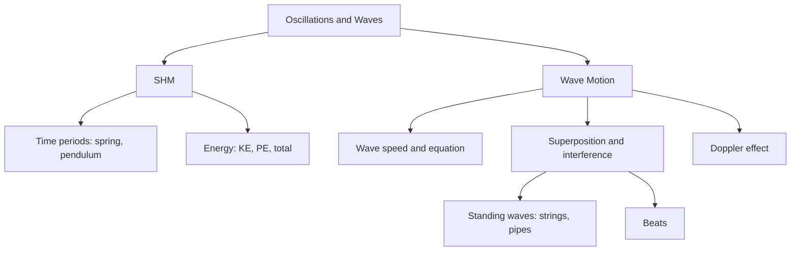

> All key Oscillations & Waves Physics formulas - SHM, energy, wave motion, superposition, standing waves, beats & Doppler effect for JEE Main & Advanced quick revision.

Every must-know formula for Oscillations and Waves on one scannable page — built straight from this chapter’s topics. Use it for last-minute revision before JEE Main and Advanced.

## Simple Harmonic Motion (SHM)

### Defining Equations

$$\boxed{F = -kx} \qquad \boxed{a = -\omega^2 x}$$

| Quantity | Formula | Notes |
| --- | --- | --- |
| Displacement | $x = A\sin(\omega t + \phi)$ | Or $x = A\cos(\omega t + \phi')$ |
| Velocity (time) | $v = A\omega\cos(\omega t + \phi)$ | Derivative of $x$ |
| Velocity (position) | $v = \omega\sqrt{A^2 - x^2}$ | Use when time is unknown |
| Acceleration (time) | $a = -A\omega^2\sin(\omega t + \phi)$ | Derivative of $v$ |
| Acceleration (position) | $a = -\omega^2 x$ | Defining relation |

### Maximum Values

$$\boxed{v_{max} = A\omega \text{ (at } x=0)} \qquad \boxed{a_{max} = A\omega^2 \text{ (at } x=\pm A)}$$

### Time Period, Frequency, Angular Frequency

$$\boxed{\omega = 2\pi f = \frac{2\pi}{T}} \qquad f = \frac{1}{T} = \frac{\omega}{2\pi}$$

> **★ Key point · Highest-Yield SHM Facts**
>
> $v_{max}$ occurs at **equilibrium** ($x=0$); $a_{max}$ occurs at **extremes** ($x=\pm A$) — opposite locations.
>
> Time period is **independent of amplitude** for all SHM systems.
>
> Watch the trap: $T = \dfrac{1}{f} = \dfrac{2\pi}{\omega}$, **not** $\dfrac{2\pi}{f}$.

### Phase

| Phase Difference | Relationship |
| --- | --- |
| $0$ or $2\pi$ | In phase |
| $\pi$ | Out of phase |
| $\dfrac{\pi}{2}$ | Quadrature (90 degrees out) |

## SHM Systems: Time Periods

| System | Time Period | Key Feature |
| --- | --- | --- |
| Spring-mass | $T = 2\pi\sqrt{\dfrac{m}{k}}$ | Independent of $g$ |
| Simple pendulum (small angle) | $T = 2\pi\sqrt{\dfrac{l}{g}}$ | Independent of $m$ and amplitude |
| Physical pendulum | $T = 2\pi\sqrt{\dfrac{I}{mgd}}$ | $d$ = pivot to centre of mass |
| Torsional pendulum | $T = 2\pi\sqrt{\dfrac{I}{C}}$ | $C$ = torsional constant |

$$\boxed{T_{spring} = 2\pi\sqrt{\frac{m}{k}}} \qquad \boxed{T_{pendulum} = 2\pi\sqrt{\frac{l}{g}}}$$

**Spring frequency:** $f = \dfrac{1}{2\pi}\sqrt{\dfrac{k}{m}}$    **Pendulum frequency:** $f = \dfrac{1}{2\pi}\sqrt{\dfrac{g}{l}}$

### Combinations of Springs

$$\text{Series: } \frac{1}{k_{eq}} = \frac{1}{k_1} + \frac{1}{k_2} \implies k_{eq} = \frac{k_1 k_2}{k_1 + k_2}$$

$$\text{Parallel: } k_{eq} = k_1 + k_2$$

### Pendulum Special Cases

| Situation | Result |
| --- | --- |
| Pendulum in accelerating car (accel $a$) | $T = 2\pi\sqrt{\dfrac{l}{\sqrt{g^2 + a^2}}}$,   $g_{eff} = \sqrt{g^2 + a^2}$ |
| Pendulum on the Moon ($g_{moon} = g/6$) | $T_{moon} = \sqrt{6}\,T_{earth}$ |

## Energy in SHM

$$\boxed{KE = \frac{1}{2}m\omega^2(A^2 - x^2) = \frac{1}{2}k(A^2 - x^2)}$$

$$\boxed{PE = \frac{1}{2}m\omega^2 x^2 = \frac{1}{2}kx^2}$$

$$\boxed{E_{total} = \frac{1}{2}m\omega^2 A^2 = \frac{1}{2}kA^2}$$

| Position | Displacement | KE | PE |
| --- | --- | --- | --- |
| Equilibrium | $0$ | $E$ (100%) | $0$ |
| Midpoint | $A/2$ | $3E/4$ | $E/4$ |
| Equal-energy point | $A/\sqrt{2}$ | $E/2$ | $E/2$ |
| Extreme | $\pm A$ | $0$ | $E$ (100%) |

**Equal-energy point** ($KE = PE$):   $\boxed{x = \dfrac{A}{\sqrt{2}} \approx 0.707A}$

**Averages over one cycle:** $\langle KE \rangle = \langle PE \rangle = \dfrac{E}{2}$

**Energy vs time** (with $x = A\sin\omega t$): both KE and PE oscillate at frequency $2f$, 180 degrees out of phase (antiphase).

$$KE = \frac{E}{2}[1 + \cos 2\omega t], \qquad PE = \frac{E}{2}[1 - \cos 2\omega t]$$

**Power in SHM:** $P = -\dfrac{1}{2}kA^2\omega\sin(2\omega t)$,   average power $\langle P \rangle = 0$.

**Pendulum total energy:** $E = mgl(1 - \cos\theta_{max}) \approx \dfrac{1}{2}mgl\theta_{max}^2$;   speed at lowest point $v = \sqrt{2gl(1 - \cos\theta_0)}$.

> **★ Key point · Energy Traps to Avoid**
>
> $E \propto A^2$ — double the amplitude gives **quadruple** the energy.
>
> $KE = PE$ at $x = A/\sqrt{2}$, **not** at $A/2$ (don’t drop the $\sqrt{2}$).
>
> Vertical spring: measure energy from the new equilibrium (shifted by $x_0 = mg/k$); then only $\tfrac{1}{2}kA^2$ matters.

## Wave Motion

### Wave Parameters

$$\boxed{v = f\lambda = \frac{\lambda}{T} = \frac{\omega}{k}}$$

$$k = \frac{2\pi}{\lambda}, \qquad \omega = 2\pi f = \frac{2\pi}{T}, \qquad T = \frac{1}{f}$$

### Travelling Wave Equation

$$\boxed{y(x,t) = A\sin(kx - \omega t + \phi)}$$

| Direction / Type | Equation |
| --- | --- |
| Wave along $+x$ | $y = A\sin(kx - \omega t)$ |
| Wave along $-x$ | $y = A\sin(kx + \omega t)$ |
| Sound (displacement) | $s = s_0\sin(kx - \omega t)$ |
| Sound (pressure) | $\Delta P = P_0\cos(kx - \omega t)$ (90 degrees out of phase with displacement) |

**General differential wave equation:** $\dfrac{\partial^2 y}{\partial t^2} = v^2\dfrac{\partial^2 y}{\partial x^2}$

### Wave Speed in Different Media

| Medium | Speed | Symbols |
| --- | --- | --- |
| String (transverse) | $v = \sqrt{\dfrac{T}{\mu}}$ | $T$ = tension, $\mu = m/l$ |
| Sound in gas | $v = \sqrt{\dfrac{\gamma RT}{M}} = \sqrt{\dfrac{\gamma P}{\rho}}$ | $\gamma\approx1.4$ (air), $T$ in K |
| Sound in solid (rod) | $v = \sqrt{\dfrac{E}{\rho}}$ | $E$ = Young’s modulus |
| Sound in liquid | $v = \sqrt{\dfrac{B}{\rho}}$ | $B$ = bulk modulus |

**Sound in air (empirical):** $v \approx 331 + 0.6t$ m/s ($t$ in degrees C); $\approx 343$ m/s at 20 degrees C.

### Particle vs Wave Velocity

$$v_{particle} = \frac{\partial y}{\partial t} = -A\omega\cos(kx - \omega t), \qquad v_{particle,\,max} = A\omega$$

$$v_{wave} = \frac{\omega}{k} = f\lambda \quad (\text{constant for a given medium})$$

### Energy, Power, Intensity

$$\boxed{u = \frac{1}{2}\rho\omega^2 A^2} \qquad \boxed{P_{avg} = \frac{1}{2}\rho v\omega^2 A^2}$$

$$I = \frac{P}{A_{area}}, \qquad I_{spherical} = \frac{P}{4\pi r^2} \propto \frac{1}{r^2}$$

Power $\propto A^2$, $\propto \omega^2$, $\propto v$.

### Phase and Path Difference

$$\boxed{\Delta\phi = \frac{2\pi}{\lambda}\Delta x} \qquad \Delta x = \frac{\lambda}{2\pi}\Delta\phi$$

### Reflection / Transmission at a Boundary

| End / Boundary | Result |
| --- | --- |
| Fixed end | Reflects with phase change of $\pi$ (inverted) |
| Free end | Reflects with no phase change |
| Medium 1 to 2 | $A_r = \dfrac{v_2 - v_1}{v_2 + v_1}A_i$,   $A_t = \dfrac{2v_2}{v_2 + v_1}A_i$ |

Frequency stays constant across a boundary; wavelength changes: $\dfrac{\lambda_2}{\lambda_1} = \dfrac{v_2}{v_1}$.

> **★ Key point · Wave Speed Reminders**
>
> Wave speed on a string depends **only** on $T$ and $\mu$ — not on frequency.
>
> Energy $\propto A^2$, never $\propto A$.
>
> Across media: frequency fixed, wavelength changes.

## Superposition, Interference and Standing Waves

### Principle of Superposition

$$\boxed{y_{resultant} = y_1 + y_2 + y_3 + \cdots}$$

### Interference (same frequency)

$$\boxed{A = \sqrt{A_1^2 + A_2^2 + 2A_1 A_2\cos\phi}} \qquad \tan\alpha = \frac{A_2\sin\phi}{A_1 + A_2\cos\phi}$$

| Type | Phase Difference | Path Difference | Amplitude |
| --- | --- | --- | --- |
| Constructive | $0, 2\pi, 4\pi, \dots$ | $n\lambda$ | $A_1 + A_2$ |
| Destructive | $\pi, 3\pi, 5\pi, \dots$ | $(2n+1)\dfrac{\lambda}{2}$ | $\lvert A_1 - A_2\rvert$ |

For $A_1 = A_2 = A_0$: amplitude is $2A_0$ at $\phi=0$, $A_0\sqrt{2}$ at $\phi=\pi/2$, and $0$ at $\phi=\pi$.

### Standing (Stationary) Waves

Formed by two identical waves travelling in opposite directions:

$$\boxed{y = 2A\sin(kx)\cos(\omega t)}$$

| Feature | Formula |
| --- | --- |
| Position-dependent amplitude | $A(x) = 2A\sin(kx)$ |
| Node positions ($\sin kx = 0$) | $x = n\dfrac{\lambda}{2}$ |
| Antinode positions ($\sin kx = \pm1$) | $x = (2n+1)\dfrac{\lambda}{4}$ |
| Node-to-node spacing | $\dfrac{\lambda}{2}$ |
| Antinode-to-antinode spacing | $\dfrac{\lambda}{2}$ |
| Node-to-nearest-antinode | $\dfrac{\lambda}{4}$ |

Standing waves transfer **no net energy**.

### Normal Modes: Strings and Pipes

| System | Boundary | Harmonics | Fundamental | $f_n$ |
| --- | --- | --- | --- | --- |
| String (both fixed) | Node-Node | All | $\dfrac{v}{2L}$ | $f_n = n\dfrac{v}{2L}$ |
| String (one free) | Node-Antinode | Odd only | $\dfrac{v}{4L}$ | $f_n = (2n-1)\dfrac{v}{4L}$ |
| Closed pipe (one end) | Node-Antinode | Odd only | $\dfrac{v}{4L}$ | $f_n = (2n-1)\dfrac{v}{4L}$ |
| Open pipe (both ends) | Antinode-Antinode | All | $\dfrac{v}{2L}$ | $f_n = n\dfrac{v}{2L}$ |

For a string fixed at both ends, $v = \sqrt{\dfrac{T}{\mu}}$ and $f_n = \dfrac{n}{2L}\sqrt{\dfrac{T}{\mu}} = nf_1$.

Allowed wavelengths: both-same ends $\lambda_n = \dfrac{2L}{n}$; one-different end $\lambda_n = \dfrac{4L}{2n-1}$.

### Beats

$$\boxed{f_{beats} = |f_1 - f_2|}$$

Resultant: $y = [2A\cos(2\pi f_{beat}t)]\sin(2\pi f_{avg}t)$, with $f_{avg} = \dfrac{f_1+f_2}{2}$ and $f_{beat} = \dfrac{|f_1-f_2|}{2}$. Audible when $|f_1 - f_2| < \sim 10$ Hz. Frequency $\propto \sqrt{T}$ on a string, so a fractional tension change $\delta$ shifts frequency by $\approx \tfrac{\delta}{2}$.

> **★ Key point · Harmonics and Beats Memory Hooks**
>
> “Closed is Odd, Open is All” — closed pipe gives odd harmonics ($f_1, 3f_1, 5f_1, \dots$); open pipe gives all.
>
> Same-to-same (N-N or A-A) = $\lambda/2$; change-type (N-A) = $\lambda/4$.
>
> Beats = **difference** of frequencies, never the sum.
>
> Open-pipe fundamental is **twice** the closed-pipe fundamental of equal length.

## Doppler Effect

### Sound — General Formula

$$\boxed{f' = f\frac{v + v_o}{v - v_s}}$$

**Sign convention (TAPS):** Toward Adds for oPserver (numerator $+v_o$), Toward Subtracts for Source (denominator $-v_s$).

| Scenario | Formula |
| --- | --- |
| Stationary observer, moving source | $f' = f\dfrac{v}{v - v_s}$ |
| Moving observer, stationary source | $f' = f\dfrac{v + v_o}{v}$ |
| Both stationary / zero relative velocity | $f' = f$ |
| Reflection off moving surface | $f' = f\dfrac{v + v_r}{v - v_r}$ |
| Not along line of sight | $f' = f\dfrac{v + v_o\cos\alpha}{v - v_s\cos\beta}$ |

For a reflector with $v_r \ll v$: $\dfrac{\Delta f}{f} = \dfrac{2v_r}{v}$.

### Light / EM Waves

| Regime | Formula |
| --- | --- |
| Non-relativistic ($v \ll c$) | $f' = f\left(1 + \dfrac{v}{c}\right)$,   $\dfrac{\Delta f}{f} = \dfrac{v}{c}$ |
| Relativistic | $f' = f\sqrt{\dfrac{c + v}{c - v}} = f\sqrt{\dfrac{1+\beta}{1-\beta}}$,   $\beta = v/c$ |
| Radar reflection ($v \ll c$) | $\Delta f = 2f\dfrac{v}{c}$ |

**Redshift parameter:** $\boxed{z = \dfrac{\lambda' - \lambda}{\lambda} = \dfrac{\Delta\lambda}{\lambda}}$; for $v \ll c$, $z \approx \dfrac{v}{c}$.

- Approaching: $f' > f$, $\lambda' < \lambda$ (**blueshift**)
- Receding: $f' < f$, $\lambda' > \lambda$ (**redshift**)

### Shock Waves / Sonic Boom (source faster than wave, $v_s > v$)

$$\boxed{M = \frac{v_s}{v}} \qquad \boxed{\sin\theta = \frac{v}{v_s} = \frac{1}{M}}$$

$M<1$ subsonic, $M=1$ sonic, $M>1$ supersonic.

> **★ Key point · Doppler Traps to Avoid**
>
> Moving source and moving observer (same speed) give **different** shifts — source motion has the larger effect.
>
> Never use the sound formula for light — for light only relative velocity matters.
>
> For any reflection problem, remember the factor of 2.

## Chapter Map



## Related Topics

- [Simple Harmonic Motion](../simple-harmonic-motion/index.md)
- [Energy in SHM](../shm-energy/index.md)
- [Wave Motion](../wave-motion/index.md)
- [Superposition of Waves](../superposition-waves/index.md)
- [Doppler Effect](../doppler-effect/index.md)

From TestGuru · our mock-test platform

## You've read Oscillations and Waves Formula Sheet.You've read this topic. Find out what you actually got.

A free JEE Main mock with this chapter in it, and a report that shows which sub-topics cost you marks.

[Take a free JEE Main mock →](https://app.testguru.co/signup?tg_chapter=oscillations-waves&tg_exam=jee-main&tg_page=%2Fphysics%2Foscillations-waves%2Fformula-sheet%2F&tg_subject=physics&utm_campaign=notes-jee-main-free-test&utm_content=article-end&utm_medium=referral&utm_source=jeenotes)
Free, no card. Opens TestGuru in a new tab.

## Stay exam-ready

One email every Sunday: new notes, the week's hardest challenge question and a revision plan.One email every Sunday.

## Comments

Have a question or spotted a mistake? Join the discussion below.

Advertisement

Advertisement

---

## Extracted page code (interactive scripts & widgets)


### inline-script-14

```js
(function(){var t,e=document.getElementById("disqus-load");if(!e)return;t=!1,e.addEventListener("click",function(){if(t)return;t=!0,e.setAttribute("disabled","disabled"),e.textContent="Loading comments…",window.disqus_config=function(){this.page.url="https://jeenotes.in/physics/oscillations-waves/formula-sheet/",this.page.identifier="/physics/oscillations-waves/formula-sheet/"};var s=document,n=s.createElement("script");n.src="https://https-jeenotes-in.disqus.com/embed.js",n.setAttribute("data-timestamp",+new Date),n.onload=function(){e.style.display="none"},n.onerror=function(){t=!1,e.removeAttribute("disabled"),e.textContent="Could not load comments. Tap to retry"},(s.head||s.body).appendChild(n)})})()
```


### inline-script-15

```js
(function(){var t,e=document.currentScript.previousElementSibling;function n(){(window.adsbygoogle=window.adsbygoogle||[]).push({})}if(!window.ResizeObserver||e.clientWidth>0){n();return}t=new ResizeObserver(function(){e.clientWidth>0&&(t.disconnect(),n())}),t.observe(e)})()
```


---

_Source: [https://jeenotes.in/physics/oscillations-waves/formula-sheet/](https://jeenotes.in/physics/oscillations-waves/formula-sheet/) · raw HTML: `offline/physics/oscillations-waves/formula-sheet/index.html`_
