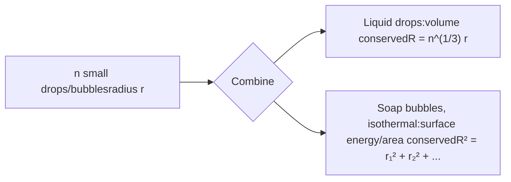

> All key Physics formulas for Properties of Solids & Liquids — elasticity, fluid pressure, Bernoulli, viscosity, surface tension. JEE Main & Advanced quick revision.

Every must-know formula, constant, and result for elasticity and fluid mechanics — compiled for last-minute JEE revision. Each section maps to a full topic page; follow the links if a result needs derivation.

## Elasticity: Stress and Strain

**Stress** — internal restoring force per unit area; same dimensions as pressure, $[ML^{-1}T^{-2}]$, unit Pa.

$$\boxed{\text{Stress} = \frac{F}{A}}$$

**Strain** — relative deformation; dimensionless (a pure ratio).

$$\boxed{\text{Strain} = \frac{\text{Change in dimension}}{\text{Original dimension}}}$$

| Type | Stress | Strain |
| --- | --- | --- |
| Tensile / Compressive | $F/A$ (longitudinal) | $\dfrac{\Delta L}{L}$ |
| Shearing (tangential) | $F_{\text{tangential}}/A$ | $\theta = \dfrac{\Delta x}{L}$ |
| Hydraulic (bulk) | $-\Delta P$ | $\dfrac{\Delta V}{V}$ |

**Hooke’s Law** (within elastic limit):

$$\boxed{\text{Stress} = E \times \text{Strain}}$$

For a spring: $\boxed{F = kx}$

> **★ Key point · High-yield reminders**
>
> Strain is **dimensionless** — never give it units.
>
> Hooke’s law holds **only** within the elastic limit, for small deformations, at constant temperature, in isotropic materials.
>
> Hydraulic stress carries a **negative sign** ($-\Delta P$): increasing pressure compresses the body.

### Elastic Potential Energy

$$\boxed{U = \tfrac{1}{2}kx^2}$$

For a stretched wire / rod:

$$\boxed{U = \tfrac{1}{2}\,\text{Stress}\times\text{Strain}\times\text{Volume} = \tfrac{1}{2}F\,\Delta L}$$

Energy density (per unit volume):

$$\boxed{u = \frac{U}{V} = \tfrac{1}{2}\,\text{Stress}\times\text{Strain}}$$

Full page: [Stress and Strain](../stress-strain/index.md)

## Elastic Moduli

$$\boxed{\text{Elastic Modulus} = \frac{\text{Stress}}{\text{Strain}}}$$

Common unit: Pa; dimensions $[ML^{-1}T^{-2}]$.

| Modulus | Formula | Applies to |
| --- | --- | --- |
| Young’s $Y$ | $\dfrac{F/A}{\Delta L/L} = \dfrac{FL}{A\,\Delta L}$ | Solids |
| Bulk $K$ | $\dfrac{-\Delta P}{\Delta V/V} = -V\dfrac{\Delta P}{\Delta V}$ | Solids, liquids, gases |
| Shear (rigidity) $\eta$ | $\dfrac{F/A}{\theta} = \dfrac{F/A}{\Delta x/L}$ | Solids only |
| Poisson’s ratio $\sigma$ | $-\dfrac{\Delta d/d}{\Delta L/L}$ | Solids (dimensionless) |
| Compressibility $\kappa$ | $\dfrac{1}{K}$ | All materials |

For a wire, $\Delta L = \dfrac{FL}{AY}$, so it behaves like a spring with $k = \dfrac{YA}{L}$.

**Bulk modulus of an ideal gas:**

$$\boxed{K_{\text{isothermal}} = P} \qquad \boxed{K_{\text{adiabatic}} = \gamma P}$$

where $\gamma = C_p/C_v$ (air: $\gamma \approx 1.4$).

**Poisson’s ratio range:** $0 < \sigma < 0.5$ (cork $\approx 0$, rubber $\approx 0.5$, most metals $\approx 0.2$–$0.4$).

### Relations Between Elastic Constants (isotropic materials)

$$\boxed{Y = 2\eta(1+\sigma)} \qquad \boxed{Y = 3K(1-2\sigma)}$$

$$\boxed{K = \frac{Y}{3(1-2\sigma)}} \qquad \boxed{\eta = \frac{Y}{2(1+\sigma)}}$$

$$\boxed{K = \frac{\eta(2+2\sigma)}{3(1-2\sigma)}} \qquad \boxed{Y = \frac{9K\eta}{3K+\eta}}$$

> **★ Key point · High-yield reminders**
>
> Liquids and gases have **no shear modulus** ($\eta = 0$) — that is why they flow.
>
> A vertical wire stretched by its **own weight** extends $\Delta L = \dfrac{\rho g L^2}{2Y}$ — half the value for the same weight hung at the end.
>
> Order of stiffness (Young’s modulus): Steel > Iron > Copper > Aluminium > Glass $\approx$ Wood > Rubber.

**Reference values (Young’s modulus):** Steel $2\times10^{11}$ Pa, Iron $1.9\times10^{11}$, Copper $1.2\times10^{11}$, Aluminium $0.7\times10^{11}$, Rubber $\approx 5\times10^6$ Pa.

Full page: [Elastic Moduli](../elastic-moduli/index.md)

## Fluid Pressure and Pascal’s Law

$$\boxed{P = \frac{F}{A}}$$

Pressure in a fluid at rest is a **scalar** — same in all directions at a point.

**Hydrostatic pressure at depth $h$:**

$$\boxed{P = P_0 + \rho g h}$$

**Gauge pressure:**

$$\boxed{P_{\text{gauge}} = P - P_0 = \rho g h}$$

**Pascal’s Law — hydraulic lift:**

$$\boxed{\frac{F_1}{A_1} = \frac{F_2}{A_2}} \qquad \frac{F_2}{F_1} = \frac{A_2}{A_1}$$

Work conserved: $F_1 d_1 = F_2 d_2$.

**Barometer / manometer:** $P_0 = \rho_{Hg}\, g\, h$; open-tube manometer gives $P_{\text{gas}} - P_0 = \rho g h$.

### Archimedes’ Principle and Buoyancy

$$\boxed{F_B = \rho_{\text{fluid}}\, V_{\text{displaced}}\, g}$$

**Floating condition** ($\rho_{\text{body}} < \rho_{\text{fluid}}$):

$$\boxed{\frac{V_{\text{submerged}}}{V_{\text{total}}} = \frac{\rho_{\text{body}}}{\rho_{\text{fluid}}}}$$

**Apparent weight (sinking body):**

$$\boxed{W_{\text{apparent}} = W_{\text{actual}} - F_B = Vg(\rho_{\text{body}} - \rho_{\text{fluid}})}$$

> **★ Key point · High-yield reminders**
>
> Hydrostatic pressure depends **only on depth $h$**, not on container shape or amount of liquid (hydrostatic paradox).
>
> Buoyant force equals the weight of **fluid displaced**, not the weight of the body. They are equal only for a floating body.
>
> Remember: **76 cm Hg = 760 mm Hg = 1 atm $= 1.013\times10^5$ Pa** $\approx 10^5$ Pa; $\rho_{Hg} = 13600$ kg/m³.

Full page: [Fluid Pressure and Pascal’s Law](../fluid-pressure/index.md)

## Fluid Dynamics: Continuity and Bernoulli

**Equation of continuity** (incompressible, streamline flow):

$$\boxed{A_1 v_1 = A_2 v_2 = \text{constant}}$$

**Bernoulli’s theorem** (ideal fluid — non-viscous, incompressible, steady, streamline flow):

$$\boxed{P + \tfrac{1}{2}\rho v^2 + \rho g h = \text{constant}}$$

Equivalently, dividing by $\rho g$ (head form):

$$\boxed{\frac{P}{\rho g} + \frac{v^2}{2g} + h = \text{constant}}$$

### Key Applications

| Application | Formula | Condition |
| --- | --- | --- |
| Torricelli’s efflux | $v = \sqrt{2gh}$ | Hole at depth $h$, large tank |
| Venturi meter | $v_1 = A_2\sqrt{\dfrac{2(P_1-P_2)}{\rho(A_1^2 - A_2^2)}}$ | Horizontal pipe |
| Flow rate | $Q = A_1 v_1 = Av$ | — |
| Aerofoil lift | $F_{\text{lift}} = \tfrac{1}{2}\rho(v_{\text{top}}^2 - v_{\text{bottom}}^2)A$ | Wing area $A$ |

$$\boxed{v = \sqrt{2gh}} \qquad \text{(Torricelli — same as free fall from height } h)$$

> **★ Key point · High-yield reminders**
>
> Bernoulli connects two points **on the same streamline** only.
>
> In a constriction: area $\downarrow$ → velocity $\uparrow$ (continuity) → pressure $\downarrow$ (Bernoulli).
>
> In Torricelli’s theorem both the surface and the jet exit are at atmospheric pressure $P_0$ — the $P_0$ terms cancel.

Full page: [Bernoulli’s Theorem](../bernoullis/index.md)

## Viscosity, Stokes’ Law and Flow Through Pipes

**Newton’s law of viscosity:**

$$\boxed{F = -\eta A \frac{dv}{dy}}$$

$\eta$ = coefficient of viscosity. Unit: Pa·s (CGS: poise; $1$ poise $= 0.1$ Pa·s, $1$ cP $= 10^{-3}$ Pa·s). Dimensions $[ML^{-1}T^{-1}]$. Water at 20 °C: $\eta \approx 10^{-3}$ Pa·s.

**Reynolds number** (dimensionless):

$$\boxed{Re = \frac{\rho v D}{\eta}}$$

Laminar: $Re < 1000$; turbulent: $Re > 2000$; transition: $1000 < Re < 2000$.

**Stokes’ law** (small sphere, low velocity, $Re < 1$):

$$\boxed{F = 6\pi \eta r v}$$

**Terminal velocity:**

$$\boxed{v_t = \frac{2r^2 g(\rho_{\text{sphere}} - \rho_{\text{fluid}})}{9\eta}}$$

When $\rho_{\text{sphere}} \gg \rho_{\text{fluid}}$: $v_t = \dfrac{2r^2 \rho g}{9\eta}$.

Time to reach $\sim$90 % of $v_t$: $t_{90\%} \approx \dfrac{m}{3\pi\eta r}$.

**Poiseuille’s law** (laminar flow through a cylindrical pipe):

$$\boxed{Q = \frac{\pi r^4 (P_1 - P_2)}{8\eta L}}$$

> **★ Key point · High-yield reminders**
>
> $v_t \propto r^2$: a drop 10× smaller falls 100× slower. Also $v_t \propto (\rho_{\text{sphere}}-\rho_{\text{fluid}})$, $\propto 1/\eta$, $\propto g$.
>
> Poiseuille flow $Q \propto r^4$: halving the radius cuts flow to $1/16$.
>
> Temperature: liquid viscosity **decreases** with $T$; gas viscosity **increases** with $T$.
>
> If $n$ identical drops of radius $r$ coalesce, the big drop radius is $R = n^{1/3}r$; e.g. 8 drops → $R = 2r$ → $v_t$ becomes $4\times$.

Full page: [Viscosity and Stokes’ Law](../viscosity/index.md)

## Surface Tension and Capillarity

Two equivalent definitions, same value and units ($\text{N/m} = \text{J/m}^2$), dimensions $[MT^{-2}]$:

$$\boxed{\gamma = \frac{F}{L}} \qquad \boxed{\gamma = \frac{W}{A}}$$

**Work to create new surface (surface energy):**

$$\boxed{W = \gamma\,\Delta A} \qquad U = \gamma A$$

### Excess Pressure

| Geometry | Excess pressure | Surfaces |
| --- | --- | --- |
| Liquid drop | $\dfrac{2\gamma}{r}$ | 1 |
| Air bubble in liquid | $\dfrac{2\gamma}{r}$ | 1 |
| Soap bubble | $\dfrac{4\gamma}{r}$ | 2 (inner + outer) |

$$\boxed{\Delta P_{\text{drop}} = \frac{2\gamma}{r}} \qquad \boxed{\Delta P_{\text{soap bubble}} = \frac{4\gamma}{r}}$$

### Capillary Rise

$$\boxed{h = \frac{2\gamma\cos\theta}{\rho g r}}$$

For perfect wetting ($\theta = 0°$, $\cos\theta = 1$): $h = \dfrac{2\gamma}{\rho g r}$.

Obtuse $\theta$ (e.g. mercury in glass) gives $\cos\theta < 0$ → **capillary depression**.

**Angle of contact:** measured through the liquid. $\theta < 90°$ → wets, concave meniscus, adhesion > cohesion (water on glass). $\theta > 90°$ → doesn’t wet, convex meniscus, cohesion > adhesion (mercury on glass, $\theta \approx 135°$–$140°$).

> **★ Key point · High-yield reminders**
>
> Soap bubble has **two** surfaces → factor of 4, not 2. Energy to blow it = $\gamma \times 8\pi r^2$.
>
> Capillary rise: $h \propto 1/r$, $h \propto \gamma$, $h \propto 1/\rho$. Valid only for **narrow** tubes.
>
> Excess pressure $\propto 1/r$ — tiny drops/bubbles have huge internal pressure; when two bubbles join, air flows from smaller (higher $P$) to larger.
>
> Reference: $\gamma_{\text{water}} \approx 0.073$ N/m, $\gamma_{\text{mercury}} \approx 0.465$ N/m (highest), soap $\approx 0.025$ N/m. Surface tension decreases with temperature (zero at critical temperature).

Full page: [Surface Tension and Capillarity](../surface-tension/index.md)

## Coalescing Drops and Bubbles (Quick Results)



- **Liquid drops coalescing** — volume is conserved: $R^3 = \sum r_i^3$ (e.g. $n=8 \Rightarrow R = 2r$).
- **Soap bubbles coalescing (isothermal)** — surface energy is conserved: $R^2 = r_1^2 + r_2^2$.

---

## One-Glance Master Table

| Quantity | Formula | Notes |
| --- | --- | --- |
| Stress | $\sigma = F/A$ | Pa, $[ML^{-1}T^{-2}]$ |
| Strain | $\varepsilon = \Delta L/L$ | dimensionless |
| Hooke’s law | $\sigma = E\varepsilon$; $F = kx$ | within elastic limit |
| Elastic PE | $U = \tfrac12 kx^2 = \tfrac12 F\Delta L$ | — |
| Young’s modulus | $Y = FL/(A\Delta L)$ | solids |
| Bulk modulus | $K = -V\Delta P/\Delta V$ | all states; gas: $K_{\text{iso}}=P$, $K_{\text{adi}}=\gamma P$ |
| Shear modulus | $\eta = (F/A)/\theta$ | solids only |
| Poisson’s ratio | $\sigma = -(\Delta d/d)/(\Delta L/L)$ | $0$–$0.5$ |
| Modulus relation | $Y = 9K\eta/(3K+\eta)$ | isotropic |
| Hydrostatic pressure | $P = P_0 + \rho gh$ | depends only on $h$ |
| Hydraulic lift | $F_1/A_1 = F_2/A_2$ | $F_1 d_1 = F_2 d_2$ |
| Buoyant force | $F_B = \rho_{\text{fluid}} V_{\text{disp}}\, g$ | upward |
| Floating fraction | $V_{\text{sub}}/V = \rho_{\text{body}}/\rho_{\text{fluid}}$ | $\rho_{\text{body}}<\rho_{\text{fluid}}$ |
| Continuity | $Av = $ const | incompressible |
| Bernoulli | $P + \tfrac12\rho v^2 + \rho gh = $ const | ideal, same streamline |
| Torricelli | $v = \sqrt{2gh}$ | efflux |
| Venturi | $v_1 = A_2\sqrt{2\Delta P/[\rho(A_1^2-A_2^2)]}$ | horizontal |
| Newton’s viscosity | $F = -\eta A\, dv/dy$ | $\eta$ in Pa·s |
| Reynolds number | $Re = \rho v D/\eta$ | $<1000$ laminar, $>2000$ turbulent |
| Stokes’ law | $F = 6\pi\eta r v$ | small sphere, $Re<1$ |
| Terminal velocity | $v_t = 2r^2 g(\rho_s-\rho_f)/(9\eta)$ | $\propto r^2$ |
| Poiseuille | $Q = \pi r^4 \Delta P/(8\eta L)$ | $Q\propto r^4$ |
| Surface tension | $\gamma = F/L = W/A$ | N/m $=$ J/m² |
| Excess pressure (drop) | $\Delta P = 2\gamma/r$ | one surface |
| Excess pressure (bubble) | $\Delta P = 4\gamma/r$ | two surfaces |
| Capillary rise | $h = 2\gamma\cos\theta/(\rho gr)$ | narrow tubes |

---

## Related Pages

- [Stress and Strain](../stress-strain/index.md)
- [Elastic Moduli](../elastic-moduli/index.md)
- [Fluid Pressure and Pascal’s Law](../fluid-pressure/index.md)
- [Bernoulli’s Theorem](../bernoullis/index.md)
- [Viscosity and Stokes’ Law](../viscosity/index.md)
- [Surface Tension and Capillarity](../surface-tension/index.md)

From TestGuru · our mock-test platform

## You've read Properties of Solids and Liquids Formula Sheet.You've read this topic. Find out what you actually got.

A free JEE Main mock with this chapter in it, and a report that shows which sub-topics cost you marks.

[Take a free JEE Main mock →](https://app.testguru.co/signup?tg_chapter=properties-solids-liquids&tg_exam=jee-main&tg_page=%2Fphysics%2Fproperties-solids-liquids%2Fformula-sheet%2F&tg_subject=physics&utm_campaign=notes-jee-main-free-test&utm_content=article-end&utm_medium=referral&utm_source=jeenotes)
Free, no card. Opens TestGuru in a new tab.

## Stay exam-ready

One email every Sunday: new notes, the week's hardest challenge question and a revision plan.One email every Sunday.

## Comments

Have a question or spotted a mistake? Join the discussion below.

Advertisement

Advertisement

---

## Extracted page code (interactive scripts & widgets)


### inline-script-14

```js
(function(){var t,e=document.getElementById("disqus-load");if(!e)return;t=!1,e.addEventListener("click",function(){if(t)return;t=!0,e.setAttribute("disabled","disabled"),e.textContent="Loading comments…",window.disqus_config=function(){this.page.url="https://jeenotes.in/physics/properties-solids-liquids/formula-sheet/",this.page.identifier="/physics/properties-solids-liquids/formula-sheet/"};var s=document,n=s.createElement("script");n.src="https://https-jeenotes-in.disqus.com/embed.js",n.setAttribute("data-timestamp",+new Date),n.onload=function(){e.style.display="none"},n.onerror=function(){t=!1,e.removeAttribute("disabled"),e.textContent="Could not load comments. Tap to retry"},(s.head||s.body).appendChild(n)})})()
```


### inline-script-15

```js
(function(){var t,e=document.currentScript.previousElementSibling;function n(){(window.adsbygoogle=window.adsbygoogle||[]).push({})}if(!window.ResizeObserver||e.clientWidth>0){n();return}t=new ResizeObserver(function(){e.clientWidth>0&&(t.disconnect(),n())}),t.observe(e)})()
```


---

_Source: [https://jeenotes.in/physics/properties-solids-liquids/formula-sheet/](https://jeenotes.in/physics/properties-solids-liquids/formula-sheet/) · raw HTML: `offline/physics/properties-solids-liquids/formula-sheet/index.html`_
