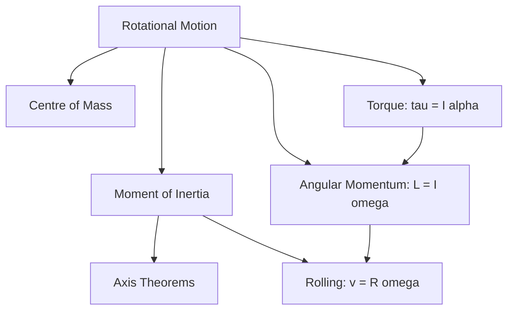

> Rotational motion formulas on one page: centre of mass, moment of inertia, parallel and perpendicular axis theorems, torque, angular momentum, rolling. JEE Main & Advanced.

One-page rapid revision of every formula, standard result, and high-yield trick from the Rotational Motion chapter. Scan before the exam; click through to the full topics when you need the derivation.

## Linear vs Rotational Analogues

| Linear | Rotational | Relation |
| --- | --- | --- |
| Displacement $s$ | Angular displacement $\theta$ | $s = r\theta$ |
| Velocity $v$ | Angular velocity $\omega$ | $v = r\omega$ |
| Acceleration $a$ | Angular acceleration $\alpha$ | $a_t = r\alpha$ |
| Mass $m$ | Moment of inertia $I$ | — |
| Force $F$ | Torque $\tau$ | $\vec{\tau} = \vec{r}\times\vec{F}$ |
| Momentum $p = mv$ | Angular momentum $L = I\omega$ | $\vec{L} = \vec{r}\times\vec{p}$ |
| $F = ma$ | $\tau = I\alpha$ | — |
| $KE = \tfrac{1}{2}mv^2$ | $KE = \tfrac{1}{2}I\omega^2$ | — |

> **★ Key point · The master trick**
>
> Every rotational formula is the linear one with the swap $m \to I$, $v \to \omega$, $a \to \alpha$, $F \to \tau$, $p \to L$. Memorise linear mechanics and you already know rotation.

## Rotational Kinematics (constant $\alpha$)

$$\omega = \omega_0 + \alpha t$$

$$\theta = \omega_0 t + \tfrac{1}{2}\alpha t^2$$

$$\omega^2 = \omega_0^2 + 2\alpha\theta$$

## Centre of Mass

$$\boxed{\vec{r}_{cm} = \frac{\sum m_i\vec{r}_i}{\sum m_i} = \frac{1}{M}\int \vec{r}\,dm}$$

Component form: $\displaystyle x_{cm} = \frac{\sum m_i x_i}{M},\quad y_{cm} = \frac{\sum m_i y_i}{M},\quad z_{cm} = \frac{\sum m_i z_i}{M}$

| Quantity | Formula | Notes |
| --- | --- | --- |
| Two particles (origin at $m_1$) | $x_{cm} = \dfrac{m_2 d}{m_1 + m_2}$ | COM closer to heavier mass; divides line in ratio $m_2 : m_1$ |
| Velocity of COM | $\vec{v}_{cm} = \dfrac{\sum m_i\vec{v}_i}{M} = \dfrac{\vec{p}_{total}}{M}$ | Total momentum / total mass |
| Acceleration of COM | $\vec{a}_{cm} = \dfrac{\sum m_i\vec{a}_i}{M} = \dfrac{\vec{F}_{ext}}{M}$ | Only external force matters |
| Newton’s 2nd law (system) | $\vec{F}_{ext} = M\vec{a}_{cm}$ | Internal forces cancel |

### Standard COM Locations

| Body | COM location |
| --- | --- |
| Uniform rod (length $L$) | At centre, $L/2$ from either end |
| Semicircular ring (radius $R$) | $\dfrac{2R}{\pi}$ from centre |
| Semicircular disc (radius $R$) | $\dfrac{4R}{3\pi}$ from centre |
| Hollow hemisphere (radius $R$) | $\dfrac{R}{2}$ from base |
| Solid hemisphere (radius $R$) | $\dfrac{3R}{8}$ from base |
| Hollow cone (height $h$) | $\dfrac{h}{3}$ from base |
| Solid cone (height $h$) | $\dfrac{h}{4}$ from base |

> **★ Key point · Symmetry shortcut**
>
> If a body is symmetric about an axis, the COM lies on it. Two or more axes of symmetry → COM at their intersection. In an explosion with no external force, the COM keeps following the original parabolic path.

## Moment of Inertia

$$\boxed{I = \sum m_i r_i^2 = \int r^2\,dm}$$

Radius of gyration: $\displaystyle I = Mk^2 \;\Rightarrow\; \boxed{k = \sqrt{\tfrac{I}{M}}}$

### Standard Moments of Inertia

| Body | Axis | $I$ | $k$ |
| --- | --- | --- | --- |
| Point mass | Distance $r$ | $mr^2$ | $r$ |
| Rod (length $L$) | Through centre, ⊥ | $\dfrac{ML^2}{12}$ | $\dfrac{L}{2\sqrt{3}}$ |
| Rod (length $L$) | Through end, ⊥ | $\dfrac{ML^2}{3}$ | $\dfrac{L}{\sqrt{3}}$ |
| Ring (radius $R$) | Through centre, ⊥ plane | $MR^2$ | $R$ |
| Ring (radius $R$) | About diameter | $\dfrac{MR^2}{2}$ | — |
| Disc (radius $R$) | Through centre, ⊥ plane | $\dfrac{MR^2}{2}$ | $\dfrac{R}{\sqrt{2}}$ |
| Disc (radius $R$) | About diameter | $\dfrac{MR^2}{4}$ | — |
| Solid cylinder (radius $R$) | Along axis | $\dfrac{MR^2}{2}$ | $\dfrac{R}{\sqrt{2}}$ |
| Solid cylinder | Through centre, ⊥ length | $M\left(\dfrac{R^2}{4} + \dfrac{L^2}{12}\right)$ | — |
| Hollow cylinder ($R_1, R_2$) | Along axis | $\dfrac{M(R_1^2 + R_2^2)}{2}$ | — |
| Solid sphere (radius $R$) | Any diameter | $\dfrac{2MR^2}{5}$ | $\sqrt{\tfrac{2}{5}}R$ |
| Hollow sphere (radius $R$) | Any diameter | $\dfrac{2MR^2}{3}$ | $\sqrt{\tfrac{2}{3}}R$ |
| Rectangular plate ($a\times b$) | Along side $a$, through centre | $\dfrac{Mb^2}{12}$ | — |
| Rectangular plate ($a\times b$) | ⊥ to plate, through centre | $\dfrac{M(a^2 + b^2)}{12}$ | — |

> **★ Key point · DRISH mnemonic + hollow rule**
>
> **D**isc $=\tfrac{1}{2}$, **R**od-centre $=\tfrac{1}{12}$, **I** (rod-end) $=\tfrac{1}{3}$, **S**olid sphere $=\tfrac{2}{5}$, **H**ollow sphere $=\tfrac{2}{3}$. For equal mass and radius, **hollow always has larger $I$** than solid. Rod about end $= 4\times$ rod about centre.

## Axis Theorems

$$\boxed{I = I_{cm} + Md^2} \qquad \text{(Parallel axis — any rigid body)}$$

$$\boxed{I_z = I_x + I_y} \qquad \text{(Perpendicular axis — planar bodies only)}$$

| Theorem | Condition | Key point |
| --- | --- | --- |
| Parallel axis | Axes must be **parallel**; $d$ = ⊥ distance from COM axis | $I \ge I_{cm}$ always; minimum at COM |
| Perpendicular axis | **Planar lamina only** (disc, ring, plate); 3 axes meet at a point | Symmetric lamina: $I_x = I_y \Rightarrow I_z = 2I_x$ |

Useful derived results (from the theorems):

| Body | Axis | $I$ |
| --- | --- | --- |
| Disc | Tangent ⊥ to plane | $\dfrac{3MR^2}{2}$ |
| Disc | Tangent in plane (edge) | $\dfrac{5MR^2}{4}$ |
| Ring | Tangent in plane | $\dfrac{3MR^2}{2}$ |
| Square plate (side $a$) | ⊥ through centre | $\dfrac{Ma^2}{6}$ |
| Square plate (side $a$) | ⊥ through one corner | $\dfrac{2Ma^2}{3}$ |

> **⚠ Trap · Theorem traps**
>
> Perpendicular axis theorem fails for 3D objects (sphere, solid cylinder, rod). In parallel axis, $d$ is the perpendicular distance between the parallel axes, not any length on the body. Parallel axes never intersect.

## Torque

$$\boxed{\vec{\tau} = \vec{r}\times\vec{F}} \qquad \tau = rF\sin\theta = r_\perp F = rF_\perp$$

| Quantity | Formula | Notes |
| --- | --- | --- |
| Newton’s 2nd law (rotation) | $\boxed{\tau_{net} = I\alpha}$ | Rotational analogue of $F = ma$ |
| Rotational equilibrium | $\sum\vec{\tau} = 0$ | Holds about **any** axis; pair with $\sum\vec{F} = 0$ |
| Torque due to gravity | $\tau_g = r_{cm}\,Mg\sin\theta$ | Weight acts at COM |
| Maximum torque | $\tau_{max} = rF$ | When $\theta = 90^\circ$ |

**Torque is zero when** $F = 0$, or $r = 0$ (force through axis), or $\vec{F}\parallel\vec{r}$ ($\sin\theta = 0$). Sign convention: CCW positive, CW negative.

> **★ Key point · Equilibrium shortcut**
>
> Take torques about the point where the unknown forces act — their torque vanishes and the equation simplifies instantly.

## Angular Momentum

$$\boxed{\vec{L} = \vec{r}\times\vec{p} = \vec{r}\times m\vec{v}} \qquad L = mvr\sin\theta$$

$$\boxed{L = I\omega} \qquad \boxed{\vec{\tau} = \frac{d\vec{L}}{dt}}$$

| Concept | Formula | Notes |
| --- | --- | --- |
| Particle (straight line / circular) | $L = mvr$ | $r$ = ⊥ distance from axis |
| Rigid body about fixed axis | $L = I\omega$ | Most common form |
| System of particles | $\vec{L}_{total} = \sum \vec{r}_i\times m_i\vec{v}_i$ | Vector sum |
| Conservation (if $\tau_{ext}=0$) | $\boxed{I_1\omega_1 = I_2\omega_2}$ | $L$ constant |
| Unit | kg·m²/s = J·s | — |

> **★ Key point · Spin faster, pull closer**
>
> With $L$ conserved, $\omega \propto 1/I$: pull mass inward → $I$ drops → $\omega$ rises (figure skater). Conservation of $L$ does **not** mean conservation of $KE$ — pulling arms in raises $KE$ (the skater does work).

Standard conservation setups:

| Setup | Equation |
| --- | --- |
| Bullet embeds in rotating disc | $I_{disc}\omega_i + mvr = (I_{disc} + mr^2)\omega_f$ |
| Two discs couple coaxially | $\omega_f = \dfrac{I_1\omega_1}{I_1 + I_2}$ (KE not conserved) |
| Planet / satellite (tangential) | $mv_1 r_1 = mv_2 r_2$ (Kepler’s 2nd law) |

## Rotational Kinetic Energy

$$\boxed{KE_{rot} = \tfrac{1}{2}I\omega^2}$$

## Rolling Motion

Pure rolling (no slipping) condition:

$$\boxed{v_{cm} = R\omega} \qquad a_{cm} = R\alpha$$

Velocity of points on a purely rolling body: top $= 2v_{cm}$ (fastest), centre $= v_{cm}$, contact $= 0$ (instantaneously at rest).

### Energy in Rolling

$$KE_{total} = \tfrac{1}{2}Mv_{cm}^2 + \tfrac{1}{2}I_{cm}\omega^2$$

$$\boxed{KE_{total} = \tfrac{1}{2}Mv_{cm}^2\left(1 + \frac{k^2}{R^2}\right) = \tfrac{1}{2}Mv_{cm}^2\left(1 + \frac{I_{cm}}{MR^2}\right)}$$

Energy split: $\dfrac{KE_{rot}}{KE_{trans}} = \dfrac{I_{cm}}{MR^2}$

### On an Incline (pure rolling)

| Quantity | Formula |
| --- | --- |
| Acceleration | $\boxed{a = \dfrac{g\sin\theta}{1 + I_{cm}/MR^2}}$ |
| Velocity at bottom | $\boxed{v = \sqrt{\dfrac{2gh}{1 + I_{cm}/MR^2}}}$ |
| Time down incline (length $L$) | $\boxed{t = \sqrt{\dfrac{2L(1 + I_{cm}/MR^2)}{g\sin\theta}}}$ |
| Friction force | $f = \dfrac{(I_{cm}/MR^2)\,Mg\sin\theta}{1 + I_{cm}/MR^2}$ |
| Min. friction for rolling | $\boxed{\mu_s \ge \dfrac{\tan\theta}{1 + MR^2/I_{cm}}}$ |

### Race Comparison ($g\sin\theta$ reference)

| Object | $I/MR^2$ | Acceleration | $v$ at bottom | $KE_{rot}/KE_{total}$ |
| --- | --- | --- | --- | --- |
| Sliding block (no friction) | 0 | $g\sin\theta$ | — | 0% |
| Solid sphere | 2/5 | $\dfrac{5g\sin\theta}{7}$ | $\sqrt{\tfrac{10gh}{7}}$ | 29% |
| Disc / solid cylinder | 1/2 | $\dfrac{2g\sin\theta}{3}$ | $\sqrt{\tfrac{4gh}{3}}$ | 33% |
| Hollow sphere | 2/3 | $\dfrac{3g\sin\theta}{5}$ | $\sqrt{\tfrac{6gh}{5}}$ | 40% |
| Ring / hollow cylinder | 1 | $\dfrac{g\sin\theta}{2}$ | $\sqrt{gh}$ | 50% |

> **★ Key point · Solid Speeds, Ring Retards**
>
> Acceleration is independent of mass and radius — only the shape factor $I/MR^2$ matters. Smaller ratio → larger acceleration → wins the race. Order fastest to slowest: solid sphere > disc > hollow sphere > ring.

> **⚠ Trap · Friction in pure rolling**
>
> Friction is **static** and does **zero work** in pure rolling (contact point has zero displacement), so energy conservation has no friction term: $Mgh = \tfrac{1}{2}Mv^2 + \tfrac{1}{2}I\omega^2$. Never forget the rotational KE term, and never use $v_{cm} = R\omega$ when the body is slipping.

### Slipping → Rolling (solid cylinder given $v_0$, no spin, friction $\mu$)

$$t = \frac{v_0}{3\mu g}, \qquad s = \frac{5v_0^2}{18\mu g}, \qquad v_{roll} = \frac{2v_0}{3}$$

## One-Glance Map



## Related Topics

- [Centre of Mass](../centre-of-mass/index.md)
- [Moment of Inertia](../moment-of-inertia/index.md)
- [Parallel & Perpendicular Axis Theorems](../parallel-perpendicular-theorems/index.md)
- [Torque](../torque/index.md)
- [Angular Momentum](../angular-momentum/index.md)
- [Rolling Motion](../rolling-motion/index.md)

## Keep studying this chapter

- [Rotational Motion chapter notes](../index.md)
- [Rotational Motion previous year questions](../previous-year-questions/index.md)

From TestGuru · our mock-test platform

## You've read Rotational Motion Formula Sheet.You've read this topic. Find out what you actually got.

A free JEE Main mock with this chapter in it, and a report that shows which sub-topics cost you marks.

[Take a free JEE Main mock →](https://app.testguru.co/signup?tg_chapter=rotational-motion&tg_exam=jee-main&tg_page=%2Fphysics%2Frotational-motion%2Fformula-sheet%2F&tg_subject=physics&utm_campaign=notes-jee-main-free-test&utm_content=article-end&utm_medium=referral&utm_source=jeenotes)
Free, no card. Opens TestGuru in a new tab.

## Stay exam-ready

One email every Sunday: new notes, the week's hardest challenge question and a revision plan.One email every Sunday.

## Comments

Have a question or spotted a mistake? Join the discussion below.

Advertisement

Advertisement

---

## Extracted page code (interactive scripts & widgets)


### inline-script-14

```js
(function(){var t,e=document.getElementById("disqus-load");if(!e)return;t=!1,e.addEventListener("click",function(){if(t)return;t=!0,e.setAttribute("disabled","disabled"),e.textContent="Loading comments…",window.disqus_config=function(){this.page.url="https://jeenotes.in/physics/rotational-motion/formula-sheet/",this.page.identifier="/physics/rotational-motion/formula-sheet/"};var s=document,n=s.createElement("script");n.src="https://https-jeenotes-in.disqus.com/embed.js",n.setAttribute("data-timestamp",+new Date),n.onload=function(){e.style.display="none"},n.onerror=function(){t=!1,e.removeAttribute("disabled"),e.textContent="Could not load comments. Tap to retry"},(s.head||s.body).appendChild(n)})})()
```


### inline-script-15

```js
(function(){var t,e=document.currentScript.previousElementSibling;function n(){(window.adsbygoogle=window.adsbygoogle||[]).push({})}if(!window.ResizeObserver||e.clientWidth>0){n();return}t=new ResizeObserver(function(){e.clientWidth>0&&(t.disconnect(),n())}),t.observe(e)})()
```


---

_Source: [https://jeenotes.in/physics/rotational-motion/formula-sheet/](https://jeenotes.in/physics/rotational-motion/formula-sheet/) · raw HTML: `offline/physics/rotational-motion/formula-sheet/index.html`_
