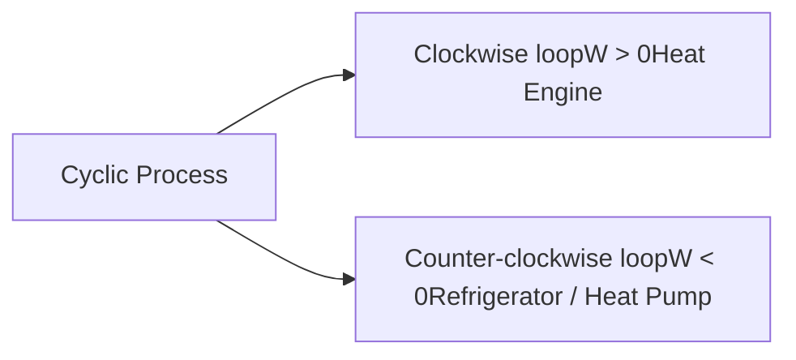

> Physics thermodynamics formulas on one page: first law, isothermal and adiabatic processes, work done, heat engines, Carnot efficiency and entropy. Class 11, JEE Main & Advanced.

Everything you need for last-minute Thermodynamics revision: every formula, constant, and must-know result from the chapter, grouped by sub-topic and ready to scan before the exam.

## Temperature and Scales

| Quantity | Formula | Notes |
| --- | --- | --- |
| Scale relation | $\dfrac{C}{100} = \dfrac{F-32}{180} = \dfrac{K-273}{100}$ | Master conversion equation |
| Celsius from Fahrenheit | $C = \dfrac{5}{9}(F-32)$ |  |
| Fahrenheit from Celsius | $F = \dfrac{9}{5}C + 32$ |  |
| Kelvin from Celsius | $K = C + 273$ | Use $273.15$ for ice-point precision |
| Temperature difference | $\Delta C = \Delta K$ | NOT equal to $\Delta F$ |
| Fahrenheit difference | $\Delta F = \dfrac{9}{5}\Delta C = \dfrac{9}{5}\Delta K$ |  |

> **★ Key point · High-Yield Reminder**
>
> Always convert temperature to **Kelvin** before plugging into any thermodynamic formula. Use $\Delta C = \Delta K$ for temperature *changes* (no $+273$), but $K = C + 273$ for absolute temperature. The C and F scales read equal only at $-40$.

**Zeroth Law:** If A is in thermal equilibrium with C, and B is in thermal equilibrium with C, then A and B are in thermal equilibrium. This defines temperature and makes thermometers possible.

## First Law of Thermodynamics

$$\boxed{\Delta Q = \Delta U + \Delta W \quad\Longleftrightarrow\quad \Delta U = Q - W}$$

| Quantity | Formula | Notes |
| --- | --- | --- |
| Work done by gas | $W = \displaystyle\int_{V_1}^{V_2} P\,dV$ | Area under P-V curve |
| Internal energy change | $\Delta U = nC_V\Delta T$ | True for **all** ideal-gas processes |
| Internal energy (ideal gas) | $U = \dfrac{f}{2}nRT = nC_VT$ | $f$ = degrees of freedom |
| Elementary work | $dW = P\,dV$ |  |
| Constant-pressure work | $W = P\Delta V$ |  |

**Sign convention:** $Q > 0$ heat absorbed; $W > 0$ work done by system (expansion); $\Delta U > 0$ temperature rises.

> **★ Key point · State vs Path**
>
> $\Delta U$ is a **state function** (path-independent) and equals $nC_V\Delta T$ for an ideal gas in every process. $Q$ and $W$ are **path-dependent**. For a cyclic process $\Delta U = 0$, so $Q = W$.

**Free expansion (into vacuum):** $Q = 0$, $W = 0$, so $\Delta U = 0$ and $\Delta T = 0$ for an ideal gas.

## Heat, Heat Capacity and Specific Heat

| Quantity | Formula | Notes |
| --- | --- | --- |
| Heat capacity | $C = \dfrac{\Delta Q}{\Delta T}$ | Unit J/K |
| Specific heat | $c = \dfrac{\Delta Q}{m\Delta T} = \dfrac{C}{m}$ | Unit J/(kg·K) |
| Molar heat capacity | $C_m = \dfrac{\Delta Q}{n\Delta T} = \dfrac{C}{n}$ | Unit J/(mol·K) |
| Heat (solid/liquid) | $Q = mc\Delta T$ | Use mass, not moles |
| Heat–work conversion | $1\ \text{cal} = 4.186\ \text{J}$ |  |

**Reference values:** specific heat of water $c = 4186\ \text{J/(kg}\cdot\text{K)}$ (highest among common substances).

## Molar Heat Capacities of Gases

$$\boxed{C_P - C_V = R \quad\text{(Mayer's relation)}}$$

| Quantity | Formula | Notes |
| --- | --- | --- |
| At constant volume | $C_V = \dfrac{f}{2}R = \dfrac{R}{\gamma - 1}$ | $Q = nC_V\Delta T$ |
| At constant pressure | $C_P = \left(\dfrac{f}{2}+1\right)R = \dfrac{\gamma R}{\gamma - 1}$ | $Q = nC_P\Delta T$ |
| Adiabatic exponent | $\gamma = \dfrac{C_P}{C_V} = 1 + \dfrac{2}{f}$ | Dimensionless, $\gamma > 1$ |

### Gas-Type Reference Table

| Gas Type | $f$ | $C_V$ | $C_P$ | $\gamma$ |
| --- | --- | --- | --- | --- |
| Monatomic (He, Ar) | 3 | $\tfrac{3}{2}R$ | $\tfrac{5}{2}R$ | $\tfrac{5}{3} \approx 1.67$ |
| Diatomic (H₂, N₂, O₂) | 5 | $\tfrac{5}{2}R$ | $\tfrac{7}{2}R$ | $\tfrac{7}{5} = 1.4$ |
| Polyatomic (CO₂, NH₃) | 6+ | $3R$ | $4R$ | $\approx 1.33$ |

| Special result | Formula | Notes |
| --- | --- | --- |
| Gas mixture $C_V$ | $C_{V,\text{mix}} = \dfrac{n_1C_{V1} + n_2C_{V2}}{n_1 + n_2}$ | Mole-weighted average |
| Dulong–Petit (solids) | $C_V \approx 3R \approx 25\ \text{J/(mol}\cdot\text{K)}$ | Room temperature |
| Polytropic heat capacity | $C_n = C_V\dfrac{\gamma - n}{1 - n}$ | For $PV^n = \text{const}$ |

> **★ Key point · 3-5-7 Mnemonic**
>
> Mono **3-5**, Di **5-7** (numerators of $C_V$, $C_P$ with $R/2$). Difference is always $2 \times \tfrac{R}{2} = R$, confirming Mayer’s relation. Polytropic special cases: $n=0 \Rightarrow C_n = C_P$; $n=1 \Rightarrow C_n = \infty$; $n=\gamma \Rightarrow C_n = 0$; $n\to\infty \Rightarrow C_n = C_V$.

## The Four Thermodynamic Processes

| Process | Constant | Relation | $W$ | $Q$ | $\Delta U$ | $C$ |
| --- | --- | --- | --- | --- | --- | --- |
| **Isothermal** | $T$ | $PV = \text{const}$ | $nRT\ln\dfrac{V_2}{V_1}$ | $W$ | $0$ | $\infty$ |
| **Adiabatic** | $Q = 0$ | $PV^\gamma = \text{const}$ | $\dfrac{nR(T_1 - T_2)}{\gamma - 1}$ | $0$ | $-W$ | $0$ |
| **Isobaric** | $P$ | $\dfrac{V}{T} = \text{const}$ | $P\Delta V = nR\Delta T$ | $nC_P\Delta T$ | $nC_V\Delta T$ | $C_P$ |
| **Isochoric** | $V$ | $\dfrac{P}{T} = \text{const}$ | $0$ | $nC_V\Delta T$ | $nC_V\Delta T$ | $C_V$ |

### Isothermal Process

$$P_1V_1 = P_2V_2 \qquad W = Q = nRT\ln\frac{V_2}{V_1} = nRT\ln\frac{P_1}{P_2}$$

Alternative work forms: $W = P_1V_1\ln\dfrac{V_2}{V_1} = P_2V_2\ln\dfrac{V_2}{V_1}$.

### Adiabatic Process

$$\boxed{PV^\gamma = \text{const}, \qquad TV^{\gamma-1} = \text{const}, \qquad TP^{(\gamma-1)/\gamma} = \text{const}}$$

| Quantity | Formula |
| --- | --- |
| Between states | $P_1V_1^\gamma = P_2V_2^\gamma$; $T_1V_1^{\gamma-1} = T_2V_2^{\gamma-1}$ |
| Temperature–pressure | $\dfrac{T_1}{T_2} = \left(\dfrac{P_1}{P_2}\right)^{(\gamma-1)/\gamma}$ |
| Work (temperatures) | $W = \dfrac{nR(T_1 - T_2)}{\gamma - 1}$ |
| Work (P, V) | $W = \dfrac{P_1V_1 - P_2V_2}{\gamma - 1}$ |
| Work (from $\Delta U$) | $W = -\Delta U = nC_V(T_1 - T_2)$ |

### Curve Slopes on a P-V Diagram

| Process | Slope $\dfrac{dP}{dV}$ |
| --- | --- |
| Isothermal | $-P/V$ |
| Adiabatic | $-\gamma P/V$ (steeper) |
| Isobaric | $0$ (horizontal) |
| Isochoric | $\infty$ (vertical) |

**Steepness order:** Isochoric $>$ Adiabatic $>$ Isothermal $>$ Isobaric. The adiabatic slope is $\gamma$ times the isothermal slope at any common point.

> **★ Key point · Work Comparison**
>
> For the same expansion from $V_1$ to $V_2$: $W_{\text{isobaric}} > W_{\text{isothermal}} > W_{\text{adiabatic}}$, because a higher curve encloses more area.
>
> Match the heat-capacity subscript to the constant: **V** constant uses $C_V$, **P** constant uses $C_P$.

## P-V Diagrams and Cyclic Processes

| Quantity | Formula | Notes |
| --- | --- | --- |
| Work by gas | $W = \displaystyle\int_{V_1}^{V_2} P\,dV$ | Area under curve |
| Cyclic net work | $W_{\text{net}} = \displaystyle\oint P\,dV$ = area enclosed | $\Delta U = 0$, so $Q_{\text{net}} = W_{\text{net}}$ |
| Rectangular cycle | $W = \Delta P \times \Delta V$ | Area of rectangle |
| Triangular cycle | $W = \tfrac{1}{2} \times \text{base} \times \text{height}$ |  |

**Cycle direction:** Clockwise loop $\Rightarrow W > 0$ (heat engine); counter-clockwise loop $\Rightarrow W < 0$ (refrigerator/heat pump).



## Second Law of Thermodynamics

- **Kelvin–Planck:** No engine working in a cycle can convert heat from a single reservoir entirely into work. Consequently $\eta = \dfrac{W}{Q_H} < 1$ always.
- **Clausius:** Heat cannot spontaneously flow from a colder to a hotter body without external work input.

**Carnot’s theorem:** No engine between two temperatures can exceed the Carnot (reversible) efficiency.

$$\eta_{\text{reversible}} = \eta_{\text{Carnot}} = 1 - \frac{T_C}{T_H} \qquad \eta_{\text{irreversible}} < \eta_{\text{Carnot}}$$

## Heat Engines, Carnot Cycle and Refrigerators

$$\boxed{\eta = \frac{W}{Q_H} = \frac{Q_H - Q_C}{Q_H} = 1 - \frac{Q_C}{Q_H}}$$

$$\boxed{\eta_{\text{Carnot}} = 1 - \frac{T_C}{T_H}}$$

| Device / Cycle | Formula | Notes |
| --- | --- | --- |
| First law (engine) | $Q_H = W + Q_C$ | Per cycle, $\Delta U = 0$ |
| Carnot heat exchange | $\dfrac{Q_C}{Q_H} = \dfrac{T_C}{T_H}$ | Depends only on temperatures |
| Otto cycle | $\eta_{\text{Otto}} = 1 - \dfrac{1}{r^{\gamma-1}}$ | $r$ = compression ratio |
| Diesel cycle | $\eta_{\text{Diesel}} = 1 - \dfrac{1}{r^{\gamma-1}}\cdot\dfrac{\rho^\gamma - 1}{\gamma(\rho - 1)}$ | $\rho$ = cutoff ratio |
| Stirling cycle | $\eta_{\text{Stirling}} = \eta_{\text{Carnot}}$ | Matches Carnot |
| Brayton cycle | $\eta_{\text{Brayton}} = 1 - \dfrac{1}{r_p^{(\gamma-1)/\gamma}}$ | $r_p$ = pressure ratio |
| Refrigerator COP | $\text{COP}_R = \dfrac{Q_C}{W} = \dfrac{Q_C}{Q_H - Q_C}$ | Carnot: $\dfrac{T_C}{T_H - T_C}$ |
| Heat pump COP | $\text{COP}_{HP} = \dfrac{Q_H}{W} = \dfrac{Q_H}{Q_H - Q_C}$ | Carnot: $\dfrac{T_H}{T_H - T_C}$ |
| COP relation | $\text{COP}_{HP} = \text{COP}_R + 1$ | Always |

**Carnot cycle:** isothermal expansion at $T_H$ → adiabatic expansion → isothermal compression at $T_C$ → adiabatic compression. Carnot heat absorbed $Q_H = nRT_H\ln\dfrac{V_B}{V_A}$, rejected $Q_C = nRT_C\ln\dfrac{V_C}{V_D}$.

| Series engines | Result |
| --- | --- |
| Two Carnot engines in series | Overall $\eta$ = single Carnot from $T_{\text{highest}}$ to $T_{\text{lowest}}$ |
| $n$ engines, equal efficiency | Temperatures in GP: $T_i = T_H\left(\dfrac{T_C}{T_H}\right)^{i/n}$ |
| Two-stage equal $\eta$ | Intermediate $T = \sqrt{T_H T_C}$ (geometric mean) |

> **★ Key point · Engine vs Refrigerator**
>
> For engines $\eta < 1$ always; for refrigerators and heat pumps the **COP can exceed 1** because they move existing heat rather than create work. Increase efficiency by widening the gap: $\eta = \dfrac{T_H - T_C}{T_H}$. Raising $T_H$ and $T_C$ by the same $\Delta T$ **decreases** efficiency (same numerator, larger denominator).

## Entropy

$$\boxed{dS = \frac{dQ_{\text{rev}}}{T}, \qquad \Delta S = \int \frac{dQ_{\text{rev}}}{T}}$$

**Second Law (entropy form):** for an isolated system $\Delta S_{\text{universe}} \geq 0$ — equality for reversible, strict inequality ($>0$) for irreversible processes. Units: J/K.

| Process | Entropy change $\Delta S$ |
| --- | --- |
| Isothermal | $\dfrac{Q}{T} = nR\ln\dfrac{V_2}{V_1} = nR\ln\dfrac{P_1}{P_2}$ |
| Isochoric | $nC_V\ln\dfrac{T_2}{T_1}$ |
| Isobaric | $nC_P\ln\dfrac{T_2}{T_1}$ |
| Reversible adiabatic | $0$ (isentropic) |
| Phase change | $\dfrac{Q}{T} = \dfrac{mL}{T}$ |
| General ideal gas | $nC_V\ln\dfrac{T_2}{T_1} + nR\ln\dfrac{V_2}{V_1}$ |
| General (alt. forms) | $nC_P\ln\dfrac{T_2}{T_1} - nR\ln\dfrac{P_2}{P_1} = nC_V\ln\dfrac{P_2}{P_1} + nC_P\ln\dfrac{V_2}{V_1}$ |

| Special case | Entropy result |
| --- | --- |
| Boltzmann (microscopic) | $S = k_B\ln\Omega$, $\ k_B = 1.38\times10^{-23}\ \text{J/K}$ |
| Free expansion | $\Delta S_{\text{gas}} = nR\ln\dfrac{V_2}{V_1} > 0$ (even though $Q=0$) |
| Heat across finite $\Delta T$ | $\Delta S = Q\left(\dfrac{1}{T_C} - \dfrac{1}{T_H}\right) > 0$ |
| Mixing of ideal gases | $\Delta S_{\text{mix}} = -nR(x_1\ln x_1 + x_2\ln x_2) > 0$ |
| Two equal bodies mixing | $\Delta S = C\ln\dfrac{(T_1+T_2)^2}{4T_1T_2} > 0$ for $T_1 \neq T_2$ |
| Clausius inequality | $\displaystyle\oint \dfrac{dQ}{T} \leq 0$ ($=0$ reversible, $<0$ irreversible) |

**Carnot cycle entropy:** $\Delta S_{\text{gas}} = 0$ and $\Delta S_{\text{universe}} = 0$ (reversible). On a T-S diagram the Carnot cycle is a rectangle with area $W = (T_H - T_C)(S_2 - S_1)$.

> **★ Key point · Entropy Traps**
>
> A **reversible** adiabatic has $\Delta S = 0$, but an **irreversible** adiabatic (free expansion) has $\Delta S > 0$. Local entropy can decrease (e.g. freezing water), but $\Delta S_{\text{universe}}$ never does — always check **system + surroundings**, and always use Kelvin.

## Useful Constants

| Constant | Value |
| --- | --- |
| Gas constant | $R = 8.314\ \text{J/(mol}\cdot\text{K)}$ |
| Boltzmann constant | $k_B = 1.38\times10^{-23}\ \text{J/K}$ |
| Mechanical equivalent of heat | $1\ \text{cal} = 4.186\ \text{J}$ |
| Ice point | $273.15\ \text{K} \approx 273\ \text{K}$ |
| Specific heat of water | $4186\ \text{J/(kg}\cdot\text{K)}$ |

## Related Topics

- [Zeroth Law of Thermodynamics](../zeroth-law/index.md)
- [First Law of Thermodynamics](../first-law/index.md)
- [Specific Heat and Molar Heat Capacity](../specific-heat/index.md)
- [Thermodynamic Processes](../thermodynamic-processes/index.md)
- [PV Diagrams and Cyclic Processes](../pv-diagrams/index.md)
- [Second Law of Thermodynamics](../second-law/index.md)
- [Heat Engines and Carnot Cycle](../heat-engines/index.md)
- [Entropy and Irreversibility](../entropy/index.md)

From TestGuru · our mock-test platform

## You've read Thermodynamics Formula Sheet.You've read this topic. Find out what you actually got.

A free JEE Main mock with this chapter in it, and a report that shows which sub-topics cost you marks.

[Take a free JEE Main mock →](https://app.testguru.co/signup?tg_chapter=thermodynamics&tg_exam=jee-main&tg_page=%2Fphysics%2Fthermodynamics%2Fformula-sheet%2F&tg_subject=physics&utm_campaign=notes-jee-main-free-test&utm_content=article-end&utm_medium=referral&utm_source=jeenotes)
Free, no card. Opens TestGuru in a new tab.

## Stay exam-ready

One email every Sunday: new notes, the week's hardest challenge question and a revision plan.One email every Sunday.

## Comments

Have a question or spotted a mistake? Join the discussion below.

Advertisement

Advertisement

---

## Extracted page code (interactive scripts & widgets)


### inline-script-14

```js
(function(){var t,e=document.getElementById("disqus-load");if(!e)return;t=!1,e.addEventListener("click",function(){if(t)return;t=!0,e.setAttribute("disabled","disabled"),e.textContent="Loading comments…",window.disqus_config=function(){this.page.url="https://jeenotes.in/physics/thermodynamics/formula-sheet/",this.page.identifier="/physics/thermodynamics/formula-sheet/"};var s=document,n=s.createElement("script");n.src="https://https-jeenotes-in.disqus.com/embed.js",n.setAttribute("data-timestamp",+new Date),n.onload=function(){e.style.display="none"},n.onerror=function(){t=!1,e.removeAttribute("disabled"),e.textContent="Could not load comments. Tap to retry"},(s.head||s.body).appendChild(n)})})()
```


### inline-script-15

```js
(function(){var t,e=document.currentScript.previousElementSibling;function n(){(window.adsbygoogle=window.adsbygoogle||[]).push({})}if(!window.ResizeObserver||e.clientWidth>0){n();return}t=new ResizeObserver(function(){e.clientWidth>0&&(t.disconnect(),n())}),t.observe(e)})()
```


---

_Source: [https://jeenotes.in/physics/thermodynamics/formula-sheet/](https://jeenotes.in/physics/thermodynamics/formula-sheet/) · raw HTML: `offline/physics/thermodynamics/formula-sheet/index.html`_
