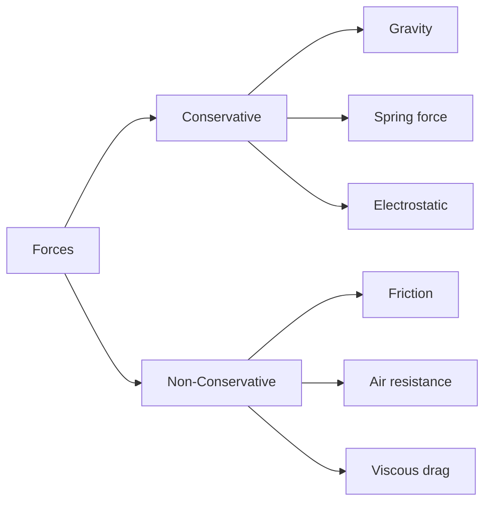

> Master the law of conservation of energy and distinguish between conservative and non-conservative forces.

## Prerequisites

Before studying this topic, review:

- [Kinetic Energy](../kinetic-energy/index.md)
- [Potential Energy](../potential-energy/index.md)
- [Work-Energy Theorem](../work-energy-theorem/index.md)

---

## Conservation of Mechanical Energy

> **★ Key point · Roller Coasters in Oppenheimer!**
>
> Energy conservation is like the physics of roller coasters in every theme park scene in movies. As the cart goes UP, kinetic energy converts to potential. Coming DOWN, potential converts back to kinetic. In *Oppenheimer* (2023), the scientists understood this principle at the atomic level — energy is never destroyed, only transformed. That’s the terrifying power of E = mc²!

### Statement

When only **conservative forces** do work, the total mechanical energy of a system remains constant:

$$\boxed{KE_i + PE_i = KE_f + PE_f}$$

or equivalently:

$$\boxed{E_{total} = KE + PE = \text{constant}}$$

### Interactive Demo: Visualize Energy Conservation

See how energy transforms between kinetic and potential forms.

---

## Conservative vs Non-Conservative Forces

### Conservative Forces

A force is **conservative** if:

1. Work done is **path-independent** (depends only on endpoints)
2. Work done in a **closed loop is zero**
3. Can be derived from a **potential energy function**

$$W_{A \to B} = -\Delta U = U_A - U_B$$

**Examples:**

- Gravitational force
- Spring force
- Electrostatic force

### Non-Conservative Forces

A force is **non-conservative** if work depends on the path taken.

**Examples:**

- Friction
- Air resistance
- Viscous forces
- Tension (when length changes)



> **⚠ Trap · Key Difference**
>
> **Conservative:** Work depends only on initial and final positions

> **Non-conservative:** Work depends on the entire path taken

---

## Modified Energy Conservation

When non-conservative forces are present:

$$\boxed{W_{nc} = \Delta E_{mech} = (KE_f + PE_f) - (KE_i + PE_i)}$$

or

$$KE_i + PE_i + W_{nc} = KE_f + PE_f$$

For friction specifically:

$$KE_i + PE_i - f \cdot s = KE_f + PE_f$$

where $f \cdot s$ is energy lost to heat.

---

## Application Strategy

### When to Use Energy Conservation

- Problems involving heights and speeds
- When acceleration is not needed
- [Projectile motion](../../kinematics/projectile-motion/index.md) problems (max height, landing speed)
- Roller coaster type problems

### When NOT to Use

x When you need time or acceleration (use [kinematic equations](../../kinematics/kinematic-equations/index.md))
x When [friction](../../laws-of-motion/friction/index.md) is present (use modified equation)
x When forces are impulsive (use [impulse-momentum](../../laws-of-motion/impulse-momentum/index.md))

### Problem-Solving Steps

1. **Identify system** and choose reference level for PE
2. **List forces** and classify as conservative or non-conservative
3. **Write energy equation** (choose appropriate form)
4. **Substitute** values and solve

---

## Common Scenarios

### 1. Free Fall

Object falling from height $h$:

$$mgh + 0 = 0 + \frac{1}{2}mv^2$$

$$\boxed{v = \sqrt{2gh}}$$

> **◐ In simple terms · Mission Impossible Dead Reckoning**
>
> When Tom Cruise drives off a cliff in *Mission: Impossible – Dead Reckoning* (2023), his speed when he falls depends ONLY on height, not on how he fell! That’s $v = \sqrt{2gh}$ — whether you fall straight down or slide down a slope, the final speed at the same height is identical (ignoring friction).

### 2. [Projectile](../../kinematics/projectile-motion/index.md) (Max Height)

Object launched vertically with speed $v$:

$$\frac{1}{2}mv^2 + 0 = 0 + mgh_{max}$$

$$\boxed{h_{max} = \frac{v^2}{2g}}$$

### 3. Spring Launch

Spring (compression $x$) launches mass $m$:

$$\frac{1}{2}kx^2 = \frac{1}{2}mv^2$$

$$\boxed{v = \sqrt{\frac{k}{m}}x}$$

### 4. Inclined Plane (Smooth)

Block sliding down from height $h$:

$$mgh = \frac{1}{2}mv^2$$

$$v = \sqrt{2gh}$$

(Same as free fall — path doesn’t matter!)

### 5. Inclined Plane (Rough)

With friction coefficient $\mu$, incline angle $\theta$, length $s$:

$$mgh - \mu mg\cos\theta \cdot s = \frac{1}{2}mv^2$$

---

## Worked Examples

### Example 1: Simple Pendulum

> **↗ Connection · Problem**
>
> A pendulum of length 2 m is released from horizontal position. Find the speed at the lowest point.

**Solution:**
Taking lowest point as reference:

- Initial: $KE_i = 0$, $PE_i = mgh = mg(2)$
- Final: $KE_f = \frac{1}{2}mv^2$, $PE_f = 0$

Conservation:

$$mg(2) = \frac{1}{2}mv^2$$

$$v = \sqrt{4g} = \sqrt{4 \times 10} = \boxed{2\sqrt{10} \approx 6.32 \text{ m/s}}$$

### Example 2: Block on Spring

> **↗ Connection · Problem**
>
> A 0.5 kg block compresses a spring (k = 800 N/m) by 10 cm. What height does it reach after release?

**Solution:**
Initial (compressed spring): $E_i = \frac{1}{2}kx^2 = \frac{1}{2}(800)(0.1)^2 = 4$ J

Final (maximum height): $E_f = mgh$

Conservation:

$$4 = (0.5)(10)h$$

$$h = \frac{4}{5} = \boxed{0.8 \text{ m}}$$

### Example 3: Rough Incline

> **↗ Connection · Problem**
>
> A 2 kg block slides 5 m down a 30° rough incline ($\mu_k = 0.2$) from rest. Find the final speed.

**Solution:**
Height dropped: $h = 5\sin30° = 2.5$ m

Work by friction:

$$W_f = -\mu_k mg\cos30° \cdot s = -0.2(2)(10)(0.866)(5) = -17.32 \text{ J}$$

Energy equation:

$$mgh + W_f = \frac{1}{2}mv^2$$

$$2(10)(2.5) - 17.32 = \frac{1}{2}(2)v^2$$

$$50 - 17.32 = v^2$$

$$v = \sqrt{32.68} = \boxed{5.72 \text{ m/s}}$$

---

## Energy Conservation in Connected Systems

For systems like pulleys (see [Newton’s Laws](../../laws-of-motion/index.md) for force analysis):

$$\Delta KE_{system} + \Delta PE_{system} + W_{friction} = 0$$

> **★ Key point · For Atwood's Machine**
>
> If masses $m_1$ and $m_2$ start from rest and $m_1$ falls height $h$:
>
> $$m_1gh - m_2gh = \frac{1}{2}(m_1 + m_2)v^2$$

---

## Practice Problems

1. A ball is thrown upward with 20 m/s. Find maximum height using energy conservation.
2. A 3 kg block compresses a spring (k = 600 N/m) by 20 cm, then is released. If the surface is smooth, find the block’s speed when spring is at natural length.
3. A 5 kg block slides down a curved frictionless track from height 4 m, then travels 8 m on a rough horizontal surface ($\mu_k = 0.25$) before stopping. Verify energy conservation.

---

From TestGuru · our mock-test platform

## You've read Conservation of Mechanical Energy.You've read this topic. Find out what you actually got.

A free JEE Main mock with this chapter in it, and a report that shows which sub-topics cost you marks.

[Take a free JEE Main mock →](https://app.testguru.co/signup?tg_chapter=work-energy-power&tg_exam=jee-main&tg_page=%2Fphysics%2Fwork-energy-power%2Fconservation-energy%2F&tg_subject=physics&utm_campaign=notes-jee-main-free-test&utm_content=article-end&utm_medium=referral&utm_source=jeenotes)
Free, no card. Opens TestGuru in a new tab.

## Stay exam-ready

One email every Sunday: new notes, the week's hardest challenge question and a revision plan.One email every Sunday.

## Comments

Have a question or spotted a mistake? Join the discussion below.

Advertisement

Advertisement

---

## Extracted page code (interactive scripts & widgets)


### inline-script-16

```js
if(!document.getElementById("animation-fullscreen-overlay")){const e=document.createElement("div");e.id="animation-fullscreen-overlay",e.className="animation-fullscreen-overlay",e.innerHTML=`
      <div class="fullscreen-modal">
        <div class="fullscreen-header">
          <span class="fullscreen-title">Interactive Demo</span>
          <button class="fullscreen-close-btn" onclick="JEEAnimations.closeFullscreen()" title="Close (Esc)" aria-label="Close fullscreen">
            <svg width="24" height="24" viewBox="0 0 24 24" fill="none" stroke="currentColor" stroke-width="2" stroke-linecap="round" stroke-linejoin="round">
              <line x1="18" y1="6" x2="6" y2="18"></line>
              <line x1="6" y1="6" x2="18" y2="18"></line>
            </svg>
          </button>
        </div>
        <div class="fullscreen-content"></div>
      </div>
    `,document.body.appendChild(e),document.addEventListener("keydown",function(e){e.key==="Escape"&&document.body.classList.contains("animation-fullscreen-active")&&JEEAnimations.closeFullscreen()}),e.addEventListener("click",function(t){t.target===e&&JEEAnimations.closeFullscreen()})}
```


### inline-script-17

```js
(function(){var t,e=document.getElementById("disqus-load");if(!e)return;t=!1,e.addEventListener("click",function(){if(t)return;t=!0,e.setAttribute("disabled","disabled"),e.textContent="Loading comments…",window.disqus_config=function(){this.page.url="https://jeenotes.in/physics/work-energy-power/conservation-energy/",this.page.identifier="/physics/work-energy-power/conservation-energy/"};var s=document,n=s.createElement("script");n.src="https://https-jeenotes-in.disqus.com/embed.js",n.setAttribute("data-timestamp",+new Date),n.onload=function(){e.style.display="none"},n.onerror=function(){t=!1,e.removeAttribute("disabled"),e.textContent="Could not load comments. Tap to retry"},(s.head||s.body).appendChild(n)})})()
```


### inline-script-18

```js
(function(){var t,e=document.currentScript.previousElementSibling;function n(){(window.adsbygoogle=window.adsbygoogle||[]).push({})}if(!window.ResizeObserver||e.clientWidth>0){n();return}t=new ResizeObserver(function(){e.clientWidth>0&&(t.disconnect(),n())}),t.observe(e)})()
```


### interactive-widget-1

```html
<div class="animation-wrapper" data-animation="energyConservation" id="anim-energyConservation-1795396424558386093"><div class="animation-header"><button aria-label="Toggle fullscreen" class="anim-fullscreen-btn" onclick='JEEAnimations.toggleFullscreen("anim-energyConservation-1795396424558386093")' title="Fullscreen (F)">
<svg class="fullscreen-icon-expand" fill="none" height="18" stroke="currentColor" stroke-linecap="round" stroke-linejoin="round" stroke-width="2" viewbox="0 0 24 24" width="18"><polyline points="15 3 21 3 21 9"></polyline><polyline points="9 21 3 21 3 15"></polyline><line x1="21" x2="14" y1="3" y2="10"></line><line x1="3" x2="10" y1="21" y2="14"></line></svg>
<svg class="fullscreen-icon-collapse" fill="none" height="18" stroke="currentColor" stroke-linecap="round" stroke-linejoin="round" stroke-width="2" viewbox="0 0 24 24" width="18"><polyline points="4 14 10 14 10 20"></polyline><polyline points="20 10 14 10 14 4"></polyline><line x1="14" x2="21" y1="10" y2="3"></line><line x1="3" x2="10" y1="21" y2="14"></line></svg>
<span class="fullscreen-text">Fullscreen</span></button></div><div class="animation-content"><noscript><div class="callout callout-warning"><div class="callout-title">JavaScript Required</div><p>This interactive animation requires JavaScript to be enabled.</p></div></noscript></div></div>
```


---

_Source: [https://jeenotes.in/physics/work-energy-power/conservation-energy/](https://jeenotes.in/physics/work-energy-power/conservation-energy/) · raw HTML: `offline/physics/work-energy-power/conservation-energy/index.html`_
